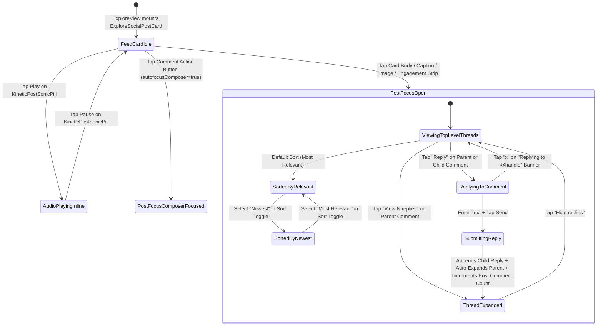
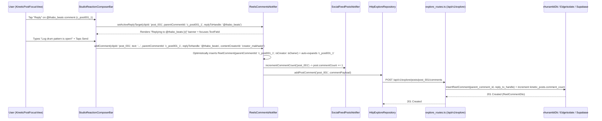

# Phase 69 — Kinetic Post Focus Domain, Threaded Replies & Feed Card Refinement Blueprint

> **Document ID:** `VHUNAMBI-SPEC-P69-BLUEPRINT-V1`  
> **Classification:** Phase 69 Architectural Blueprint (Stage 2 + Stage 3 Argon-Hardened Spec)  
> **Source Forensic Audit:** [`docs/audits/PHASE69_KINETIC_POST_FOCUS_AND_THREADING_AUDIT.md`](../../audits/PHASE69_KINETIC_POST_FOCUS_AND_THREADING_AUDIT.md)  
> **UX Benchmark:** Facebook Post & Full-Screen Post Focus Domain (`video_1.mp4 00:19–00:57`)  
> **Predecessor Foundation:** Phase 67 Notifications Deep-Link Router (`NotificationDeepLinkRouter`) & Phase 68 Unified Artwork Pipeline (`VhunambiTrackArtwork`)

---

## 1. Executive Overview & Visual North Star

Side-by-side physical device comparison (`video_1.mp4`) between Vhunambi's Explore Kinetic Posts (`00:00–00:18`, `00:58–01:19`) and Facebook's Post & Focus benchmark (`00:19–00:57`) exposed why Vhunambi's Kinetic Posts currently feel like static, dead-end feed cards rather than complete social/music destinations:

1. **Zero Post Focus Destination (`KP-01`):** Tapping a post's caption (`"I'm new to vhunambi..."`, `00:13–00:18`), card surface, or artwork (`00:34–00:37`) inside `ExploreSocialPostCard` performs zero action. Only the small chat icon (`social_post_comment_btn_${post.id}`) opens a cramped 75%-height modal (`ReelsCommentSheet`) that covers the post's artwork and audio pill while typing.
2. **Inert `Reply` Text & Unthreaded Flat Comments (`KP-02`):** Tapping `Reply` under `@ndugelo`'s comments (`01:14–01:19`) does nothing because `_CommentTile` renders a bare, non-interactive `Text('Reply')` with no tap handler, no `"Replying to @handle"` banner, no `parentCommentId` / `replyToHandle` model fields, no indented child replies (`View N replies`), no automatic `Author` badge on creator replies, and no `Most relevant` / `Newest` sort selector.
3. **Backend `404` Comment Black Hole & Sync Corruption (`KP-03`):** `ExploreSocialPostCard` routes comments through `POST /api/social/clips/:id/comments`, which checks `published_clips` instead of `kinetic_posts`—returning HTTP `404 NOT_FOUND` for every Kinetic Post. Furthermore, `explore_routes.ts` lacks post comment/like/create endpoints, SQLite and Postgres `kinetic_posts` lack `like_count`, `reel_comments` lacks `parent_comment_id` and `reply_to_handle`, and `applyMutationsBatch` in both `vhunambi_db.ts` and `edge_persistence_bridge.ts` misroutes `post.like` and `post.repost` mutations into `cosign_count`.
4. **Comment Count Desync & Wrong Notification Route (`KP-04`):** Submitting a comment in `ReelsCommentsNotifier.addComment` never increments `SocialMusicPost.commentCount` in `socialFeedPostsProvider`, never calls `syncCommentsForClip` when opening the comment view, emits notifications claiming `'Commented on Kinetic Reel'` with `/reel/$clipId`, and leaves seeded posts (`post_001`–`post_005`) with zero seeded comment records.
5. **Hardcoded Repost Identity (`You / @current_user`) (`KP-05`):** `RepostKineticPostSheet._submitRepost` hardcodes `creatorId: 'current_user'`, `creatorName: 'You'`, `creatorHandle: '@current_user'` instead of resolving `ownerProfileProvider` / `authSessionProvider`, and `KineticPostComposerBar` hardcodes `'CE'` in its avatar.
6. **Stacked Mid-Card Badge Clutter, Raw Emojis & Theme Drift (`KP-06`, `KP-07`, `KP-08`):** `ExploreSocialPostCard` stacks `Hybrid Co-Creation`, `Open Stems · 0 Remixes`, and `Co-Sign · 0/25` (with a literal fire emoji) between the header and artwork while omitting a clean **Engagement Summary Strip** above the action rail; `ReelsCommentSheet` and `ExploreView` render raw Unicode emojis (`STD-UIUX-001` violation) and stock Material `Icons.*`; and `ExploreSocialPostCard` uses static dark-only `AppColors.*` getters instead of `*Of(context)` dual-theme adapters.

Phase 69 resolves all 8 defects across a deterministic **Two-Pass Overhaul** with a zero-break compile boundary between Pass 1 and Pass 2:
- **Overhaul Pass 1 (`M69.1` – `M69.2` — Self-Contained Client Post Focus & Threading):** Unify repost/composer identity with `ownerProfileProvider`, declutter `ExploreSocialPostCard` (`Key('social_post_card_tap_${post.id}')`, inline provenance header chip, normalized `VhunambiTrackArtwork` media canvas, and clean **Engagement Summary Strip**), purge all `STD-UIUX-001` emojis and stock `Icons.*` across Explore/Social, upgrade `ReelComment` and `ReelsCommentsNotifier` (`parentCommentId`, `replyToHandle`, `CommentSortOrder`, `CommentThreadNode`, `View N replies`, seeded `post_001`–`post_005` threads, and `incrementCommentCount`), build `ThreadedCommentsSection` + `StudioReactionComposerBar`, and build the full-screen **`KineticPostFocusView`** (`< Post`) with `/post/:id` deep-link routing in `NotificationDeepLinkRouter`.
- **Overhaul Pass 2 (`M69.3` – `M69.4` — `ReelsCommentSheet` Unification, Backend API, Schema Migration & Full-Stack Sync):** Unify `ReelsCommentSheet` around `ThreadedCommentsSection` + `StudioReactionComposerBar`, wire `HttpExploreRepository` post/comment HTTP methods, add backend `/api/v1/explore/posts/*` REST endpoints, apply SQLite + Edge Isolate + Supabase PostgreSQL schema columns (`like_count`, `comment_count`, `parent_comment_id`, `reply_to_handle`), repair `applyMutationsBatch`, and execute the full backend and client test suites.

---

## 2. Forensic Post-Mortem Comparison Box

```
+------------------------------------------------------------------------------------------------------+
| PHASE 69 FORENSIC POST-MORTEM: FLAT FEED CARDS & DEAD TAPS vs. KINETIC POST FOCUS & THREADING       |
+------------------------------+------------------------------------+----------------------------------+
| Audit ID & Surface           | Pre-Phase 69 Defect (`video_1`)    | Phase 69 Target Architecture     |
+------------------------------+------------------------------------+----------------------------------+
| KP-01: Card, Caption & Media | Tapping caption, card body, or     | 1-tap anywhere on card body,     |
| Tap Navigation               | image is a dead tap; only tiny     | caption, or artwork pushes       |
| (`explore_social_post_card`) | chat icon opens 75% modal sheet.   | full-screen KineticPostFocusView.|
+------------------------------+------------------------------------+----------------------------------+
| KP-02: Comment `Reply` Tap   | `_CommentTile` renders bare        | Interactive 44x44dp Reply button |
| & Nested Threading           | `Text('Reply')` with zero onTap;   | sets "Replying to @handle" bar,  |
| (`reels_comment_sheet.dart`) | flat list, no child replies/sort.  | indents child replies + sort UI. |
+------------------------------+------------------------------------+----------------------------------+
| KP-03: Backend Comment &     | Posts call `/social/clips/:id/...` | Dedicated `/api/v1/explore/posts`|
| Post Mutation Persistence    | -> 404 NOT_FOUND; `post.like` &    | REST routes + SQLite/Edge/PG     |
| (`explore_routes.ts`, `db`)  | `repost` increment `cosign_count`. | `like_count` & `parent_comment`. |
+------------------------------+------------------------------------+----------------------------------+
| KP-04: Comment Counter Sync  | Adding comment never updates       | `addComment` increments post     |
| & Seeded Post Discussions    | `post.commentCount`; `post_001`    | `commentCount`, syncs from cloud,|
| (`reels_comments_provider`)  | shows 96 on card but 0 in sheet.   | & seeds threads for `post_001..5`|
+------------------------------+------------------------------------+----------------------------------+
| KP-05: Repost & Composer     | Repost hardcodes `You` /           | Resolves live `ownerProfile` +   |
| Creator Identity Resolution  | `@current_user`; composer bar      | `authSessionProvider` handle,    |
| (`repost_kinetic_post_sheet`)| hardcodes `'CE'` avatar text.      | display name, and avatar URL.    |
+------------------------------+------------------------------------+----------------------------------+
| KP-06: Feed Card Clutter &   | 3 stacked badge rows between       | Subtle header provenance pill +  |
| Missing Engagement Strip     | header & media; no summary strip   | clean Engagement Summary Strip   |
| (`explore_social_post_card`) | above the bottom action buttons.   | above balanced 5-action rail.    |
+------------------------------+------------------------------------+----------------------------------+
| KP-07 / KP-08: `STD-UIUX-001`| Raw emojis in quick bar, badges,   | 100% Phosphor studio reaction    |
| Emojis, Stock Icons & Theme  | & Co-Sign pill; stock `Icons.*`;   | chips, `AppIcons.*`, `*Of(ctx)`  |
| (`reels_comment_sheet`, etc.)| static dark `AppColors.*` getters. | dual-theme tokens & normalized   |
|                              |                                    | `VhunambiTrackArtwork` fallback. |
+------------------------------------------------------------------------------------------------------+
```

---

## 3. Multi-Layer Decoupled System Architecture

```
+======================================================================================================+
| LAYER 1: CLOUDFLARE WORKER API (`explore_routes.ts`), SQLITE (`vhunambi_db.ts`) & SUPABASE POSTGRES  |
|  * `GET /api/v1/explore/posts/:id`          * `GET /api/v1/explore/posts/:id/comments?sort=...`      |
|  * `POST /api/v1/explore/posts`             * `POST /api/v1/explore/posts/:id/comments`              |
|  * `POST /api/v1/explore/posts/:id/like`    * `POST /api/v1/explore/comments/:id/like`               |
|  * `POST /api/v1/explore/posts/:id/repost`  * `POST /api/v1/explore/posts/:id/cosign`                |
|  * Schema Parity: `kinetic_posts.(like_count, comment_count)` + `reel_comments.(parent_comment_id,   |
|    reply_to_handle)` across `VhunambiDatabase`, `EdgeIsolateDatabaseEngine`, & Supabase Migration.   |
+==================================================+===================================================+
                                                   |
                                                   v
+======================================================================================================+
| LAYER 2: CLIENT HTTP REPOSITORIES, HIVE L1/L2 CACHE & OUTBOX SYNC                                    |
|  * `HttpExploreRepository`: `fetchPostById`, `publishPost`, `togglePostLike`, `repostPost`,          |
|    `fetchPostComments`, `addPostComment`, `toggleCommentLike`                                        |
|  * `HttpSocialRepository`: preserves `parentCommentId` & `replyToHandle` on `/social/clips/:id/...`  |
|  * `SocialReelsCacheRepository` & `ExploreCacheRepository`: persists threaded comments & post likes  |
+==================================================+===================================================+
                                                   |
                                                   v
+======================================================================================================+
| LAYER 3: PURE DART DOMAIN & RIVERPOD STATE NOTIFIERS                                                 |
|  * `ReelComment` (`parentCommentId`, `replyToHandle`, `isReply`, `isCreator`)                        |
|  * `CommentSortOrder` (`mostRelevant`, `newest`) & `CommentThreadNode` (`parent`, `replies`)         |
|  * `ActiveReplyTarget` (`parentCommentId`, `replyToCommentId`, `replyToHandle`, `replyToDisplayName`)|
|  * `ReelsCommentsNotifier`: `threadsForClip(id, sort)`, `setSortOrder`, `setActiveReplyTarget`,      |
|    `toggleThreadExpanded`, `addComment` (syncs `socialFeedPostsProvider.incrementCommentCount`)      |
|  * `SocialFeedPostsNotifier`: `toggleLike`, `incrementCommentCount`, `repostPost`, `cosignPost`      |
+==================================================+===================================================+
                                                   |
                                                   v
+======================================================================================================+
| LAYER 4: PRESENTATION VIEWS & SHARED THREADED DISCUSSION COMPONENTS                                  |
|  * `ExploreSocialPostCard` (Refined 4-Zone Feed Card + Engagement Summary Strip + 1-Tap Focus Open)  |
|  * `KineticPostFocusView` (Full-Screen `< Post` Destination + Audio/Stem Telemetry + Sticky Composer)|
|  * `ThreadedCommentsSection` & `StudioReactionComposerBar` (Shared by Focus View & Reels Sheet)      |
|  * `NotificationDeepLinkRouter` (Routes `/post/:id` directly into `KineticPostFocusView`)            |
+======================================================================================================+
```

---

## 4. Spatial Topology & Domain Taxonomy

### 4.1 Two-Pass Overhaul Execution Partition

| Overhaul Pass | Milestones | Architectural Scope |
| :--- | :--- | :--- |
| **Pass 1** | `M69.1` – `M69.2` | Fix repost & composer identity (`ownerProfileProvider`); refine `ExploreSocialPostCard` layout (`Key('social_post_card_tap_${post.id}')`, inline header provenance chip, normalized `VhunambiTrackArtwork`, **Engagement Summary Strip**, `*Of(context)` tokens, `STD-UIUX-001` icon/emoji purge); upgrade `ReelComment` + `ReelsCommentsNotifier` (`parentCommentId`, `replyToHandle`, `CommentSortOrder`, `CommentThreadNode`, `View N replies`, seeded `post_001`–`post_005` threads, `incrementCommentCount`); build `ThreadedCommentsSection` + `StudioReactionComposerBar`; build full-screen **`KineticPostFocusView`** (`< Post`) with multi-image counter pill (`Key('kpost_focus_image_counter_${post.id}')`) and `/post/:id` routing in `NotificationDeepLinkRouter`. |
| **Pass 2** | `M69.3` – `M69.4` | Unify `ReelsCommentSheet` to consume `ThreadedCommentsSection` + `StudioReactionComposerBar`; add `HttpExploreRepository` post/comment HTTP methods; implement backend `/api/v1/explore/posts/*` routes (`GET/POST /posts`, `/like`, `/repost`, `GET/POST /comments`, `/comments/:id/like`), SQLite/Edge/Postgres schema migration (`20261118000001_phase69_kinetic_posts_and_threaded_comments.sql`), `applyMutationsBatch` fixes, and full backend & client verification suites. |

### 4.2 Studio Reaction Chips Taxonomy (`STD-UIUX-001` Replacement for Raw Emojis)

| Chip ID | Label | Inserted Text Token | Phosphor Icon Token | Accent Color Token |
| :--- | :--- | :--- | :--- | :--- |
| `fire` | `Fire` | `[Fire]` / `'Pure fire!'` | `AppIcons.flame` (`PhosphorIconsFill.flame`) | `AppColors.brandPrimary` |
| `crown` | `Crown` | `'Royalty!'` | `AppIcons.crown` (`PhosphorIconsFill.crown`) | `AppColors.coinGold` |
| `log_drum` | `Log Drum` | `'Heavy log drum!'` | `AppIcons.piano` (`PhosphorIconsFill.pianoKeys`) | `AppColors.badgeCyan` |
| `soul` | `Soul` | `'Deep soul'` | `AppIcons.heart` (`PhosphorIconsFill.heart`) | `AppColors.accentElectric` |
| `vocals` | `Vocals` | `'Vocal mastery'` | `AppIcons.vocals` (`PhosphorIconsFill.microphone`) | `AppColors.success` |
| `sa_vibe` | `SA Vibe` | `'Proudly SA sound'` | `PhosphorIconsFill.compass` / `AppIcons.navExploreActive` | `AppColors.brandPrimary` |

---

## 5. State Machines & Interactive Flows



---

## 6. Dual-Viewport Wireframes (`ExploreSocialPostCard` & `KineticPostFocusView`)

### 6.1 Refined Feed Card (`ExploreSocialPostCard` — Mobile `< 600dp` & Desktop Card)

```
+------------------------------------------------------------------------+
| [Repeat Icon] Reposted from @ndugelo               (if post.isRepost)  |
|------------------------------------------------------------------------|
| (AV)  Makhadzi [Verified]  [Hybrid Co-Creation]          [ + Follow ]  |
|       @makhadzi · 2h ago · Limpopo / Polokwane                         |
|                                                                        |
| Late night studio session testing the Venda Folk LoRA & sub-bass log   |
| drum slide. What do you think of this rhythm? Stems are open!          |
|  ^-- Tapping caption, card body, or image opens KineticPostFocusView   |
|                                                                        |
| +--------------------------------------------------------------------+ |
| | [Sparkle] Vhunambi Vision                                    [1/2] | |
| |                                                                    | |
| |                  (Normalized VhunambiTrackArtwork                  | |
| |                   or Multi-Image PageView Canvas)                  | |
| |                                                                    | |
| | +----------------------------------------------------------------+ | |
| | | (Play)  Ndo Mufuna Matibe [Song]  Makhadzi · 0:30 Hook   [|||] | | |
| | +----------------------------------------------------------------+ | |
| +--------------------------------------------------------------------+ |
|                                                                        |
| [Fork] Open Stems · 42 Remixes              [Flame] Co-Sign · 22/25    |
|------------------------------------------------------------------------|
| [Heart] 1,840 Likes    96 Comments · 14 Reposts · 42 Remixes           |
|------------------------------------------------------------------------|
| [ Heart ]   [ Comment ]   [ Repost ]   [ Remix ]   [ Tip ]   [ Share ] |
+------------------------------------------------------------------------+
```

### 6.2 Full-Screen `KineticPostFocusView` (`360dp` Mobile Portrait)

```
+========================================================================+
| [ < Post ]              @makhadzi's Post              [ Tip ] [ Share ]|
+========================================================================+
|  (Scrollable CustomScrollView Body)                                    |
|                                                                        |
|  (AV)  Makhadzi [Verified]  [Hybrid Co-Creation]         [ Following ] |
|        @makhadzi · 2h ago · Limpopo / Polokwane                        |
|                                                                        |
|  Late night studio session testing the Venda Folk LoRA & sub-bass log  |
|  drum slide. What do you think of this rhythm? Stems are open!         |
|                                                                        |
|  +------------------------------------------------------------------+  |
|  |                   Full-Bleed Interactive Media                   |  |
|  |               (1:1 / 4:5 / 16:9 Artwork Carousel)                |  |
|  +------------------------------------------------------------------+  |
|  | (Play) Ndo Mufuna Matibe [Song] · Makhadzi · 0:30 Hook     [|||] |  |
|  +------------------------------------------------------------------+  |
|                                                                        |
|  [ Open Stems · 42 Remixes ]               [ Co-Sign · 22/25 Votes ]   |
|  --------------------------------------------------------------------  |
|  1,840 Likes · 96 Comments · 14 Reposts · 1,250 Coins Tipped           |
|  --------------------------------------------------------------------  |
|  [ Heart ]      [ Comment ]      [ Repost ]      [ Remix Studio ]      |
|  ====================================================================  |
|  Comments (6)                                    [ Most relevant v ]   |
|                                                                        |
|  (TB)  @thabo_beats  [Loved 5x] · 18m ago                   [Heart] 48 |
|        This log drum hits directly in the chest! Top tier production.  |
|        [ Reply ]                                                       |
|        |                                                               |
|        +-- (MK) @makhadzi [Author] · 10m ago                [Heart] 19 |
|        |        @thabo_beats Ndo livhuwa! Wait until you hear Stem 2.  |
|        |        [ Reply ]                                              |
|        +-- [ View 1 more reply ]                                       |
|                                                                        |
|  (LP)  @lerato_piano  [Loved 8x] · 1h ago                   [Heart] 89 |
|        Makhado sunrise vibe. Tshivenda lyrics sound incredible.        |
|        [ Reply ]                                                       |
+========================================================================+
|  (Sticky Docked Bottom Composer — Moves Above Keyboard ViewInsets)     |
|  +------------------------------------------------------------------+  |
|  | Replying to @thabo_beats                                     [x] |  |
|  +------------------------------------------------------------------+  |
|  | [Fire]  [Crown]  [Log Drum]  [Soul]  [Vocals]  [Hits different]  |  |
|  +------------------------------------------------------------------+  |
|  | (Write a reply to @thabo_beats...                      )  (Send) |  |
|  +------------------------------------------------------------------+  |
+========================================================================+
```

---

## 7. Mathematical Formulations & Ranking Equations

### 7.1 `Most Relevant` vs. `Newest` Comment Thread Ranking
Let $C(P)$ denote the flat list of all `ReelComment` entities belonging to post or clip $P$.
1. **Partition into Root Parents & Child Replies:**
   - Top-level root comments:
     $$C_{\text{root}}(P) = \{ c \in C(P) \mid c.\text{parentCommentId} = \text{null} \lor c.\text{parentCommentId} = \emptyset \}$$
   - Child replies mapped to root parent $r \in C_{\text{root}}(P)$ (ordered chronologically oldest-to-newest so conversations read naturally top-to-bottom):
     $$\text{Replies}(r) = \operatorname{sort}_{\text{createdAt}\,\uparrow} \{ c \in C(P) \mid c.\text{parentCommentId} = r.\text{id} \}$$
   - Orphan guard: if a reply references a `parentCommentId` not present in $C_{\text{root}}(P)$, promote it into $C_{\text{root}}(P)$ so zero comments are ever dropped.

2. **Relevance Score $S_{\text{rel}}(r)$ for `CommentSortOrder.mostRelevant`:**
   For each root comment $r \in C_{\text{root}}(P)$ with like count $L_r = r.\text{likeCount}$, child reply count $R_r = |\text{Replies}(r)|$, creator flag $\mathbb{I}_{\text{creator}}(r) \in \{0, 1\}$, and age in hours $\Delta t_r = \max(0, (t_{\text{now}} - r.\text{createdAt}) / 3600\text{s})$:
   $$S_{\text{rel}}(r) = 2.0 \cdot L_r + 3.5 \cdot R_r + 8.0 \cdot \mathbb{I}_{\text{creator}}(r) + 1.5 \cdot r.\text{userReelLoves} + \max(0.0, 12.0 - 0.25 \cdot \Delta t_r)$$
   - Under `CommentSortOrder.mostRelevant`, $C_{\text{root}}(P)$ is sorted by $S_{\text{rel}}(r)$ descending (ties broken by `createdAt` descending).
   - Under `CommentSortOrder.newest`, $C_{\text{root}}(P)$ is sorted strictly by `r.createdAt` descending.

---

## 8. End-to-End Sequence Diagram (Reply Submission & Cloud Persistence)



---

## 9. Verification Gates (`G-01` – `G-06`)

| Gate ID | Gate Name | Pass Criteria |
| :--- | :--- | :--- |
| **`G-01`** | **Card-to-Focus Navigation Gate** | Tapping `ExploreSocialPostCard` caption, body, or image canvas opens `KineticPostFocusView`; tapping `Comment` opens `KineticPostFocusView(autofocusComposer: true)`; tapping `Play` on `KineticPostSonicPill` plays audio inline without navigating away. |
| **`G-02`** | **Threaded Replies & Sort Gate** | Tapping `Reply` activates `"Replying to @handle"` banner; submitting appends an indented child reply under the parent comment, increments `SocialMusicPost.commentCount`, and supports `View N replies` / `Hide replies` + `Most relevant` / `Newest` sorting. |
| **`G-03`** | **Repost & Composer Identity Gate** | Reposting a Kinetic Post resolves the active user from `ownerProfileProvider` / `authSessionProvider` (never `'You'` / `'@current_user'`); `KineticPostComposerBar` displays the active user's monogram/avatar. |
| **`G-04`** | **`STD-UIUX-001` & Dual-Theme Gate** | Zero raw Unicode emojis (`🔥`, `👑`, `🇿🇦`, `🎹`, `🐐`, `❤️`, `🌅`, `🚀`) and zero stock Material `Icons.*` across `ExploreSocialPostCard`, `KineticPostFocusView`, `ReelsCommentSheet`, `ExploreView`, and `ExploreDiscoveryDrawerSheet`; 100% `*Of(context)` tokens. |
| **`G-05`** | **Backend & Edge Persistence Gate** | `GET/POST /api/v1/explore/posts/:id/comments`, `POST /api/v1/explore/posts/:id/like`, `POST /api/v1/explore/comments/:id/like`, and `applyMutationsBatch` (`post.like`, `post.repost`, `comment.create`) pass in both Node SQLite and simulated Cloudflare `workerd` edge isolate mode (`tsc --noEmit` = 0 errors). |
| **`G-06`** | **Client Analyzer & Bounded Test Gate** | `flutter analyze` reports `No issues found!`; all existing and new Explore/Social/Comment widget and unit tests pass within `--timeout=60s`. |
