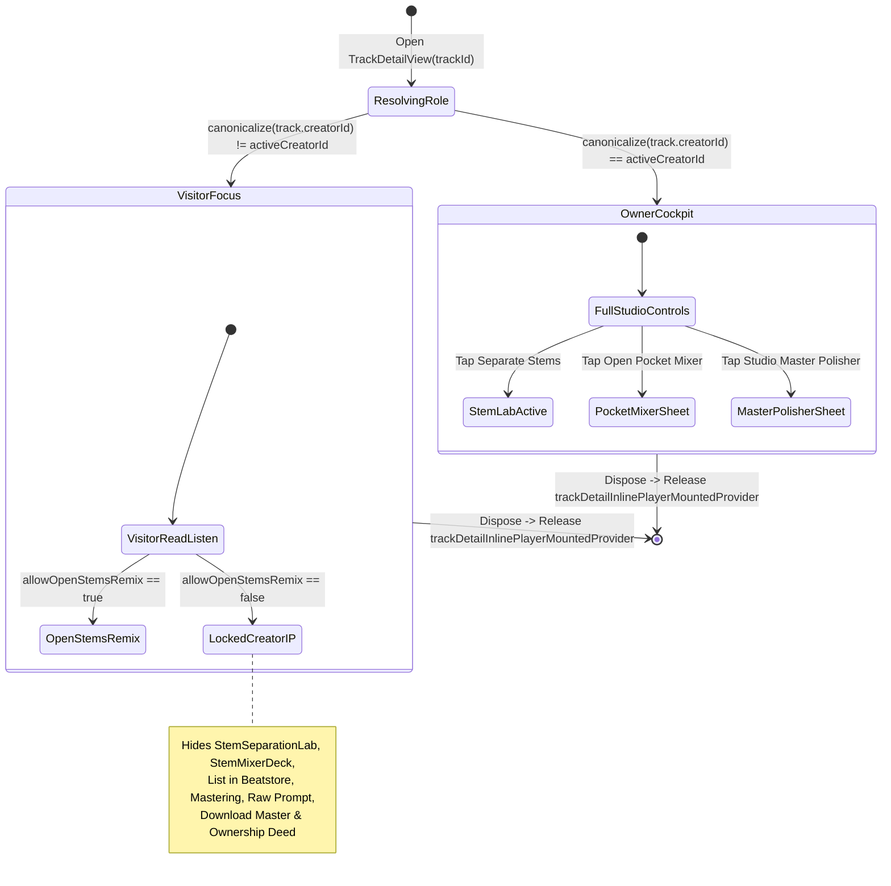
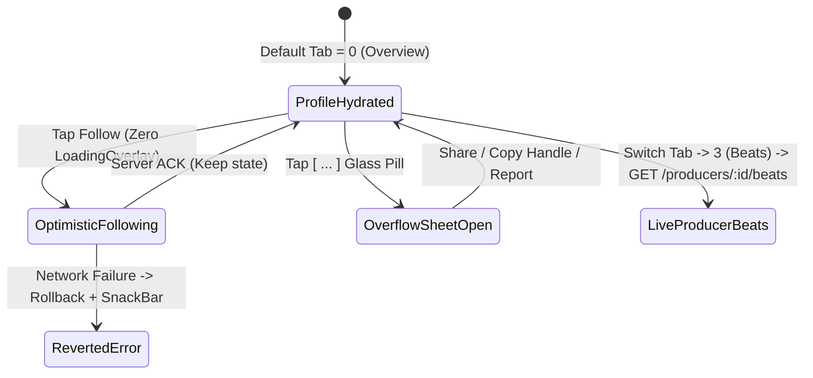
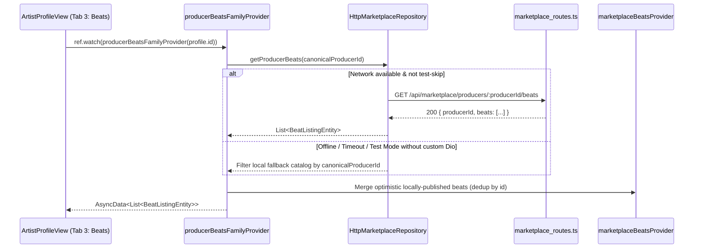

# Phase 70 Architectural Blueprint: Role-Aware Song Cockpit, Facebook-Benchmark Public Visitor Profile, Canonical `VhunambiMood` & `VhunambiGlassSurface` Two-Pass Overhaul

- **Document ID:** `VHUNAMBI-SPEC-P70-BLUEPRINT-V1`
- **Phase:** `Phase 70` (`phase_70_song_cockpit_and_visitor_profile_glass_overhaul`)
- **Upstream Forensic Audit:** [PHASE70_SONG_COCKPIT_AND_VISITOR_PROFILE_GLASS_OVERHAUL_AUDIT.md](../../audits/PHASE70_SONG_COCKPIT_AND_VISITOR_PROFILE_GLASS_OVERHAUL_AUDIT.md)
- **Status:** Stage 2/3 Argon-Hardened Specification Suite (5-Document Standard)
- **Target Surfaces:** `apps/vhunambi_client` (`core/`, `features/track/`, `features/profile/`, `features/player/`, `features/marketplace/`), `apps/vhunambi_api` (`src/db/`, `src/routes/`, `src/utils/`), `supabase/migrations/`

---

## 1. Executive Overview & Visual North Star

Physical device verification recordings (`video_1.mp4`, `video_2.mp4` `00:02–00:52` & `01:24–01:36` Facebook DW Africa benchmark, `video_3.mp4`) and the frosted glassmorphic UI reference (`fe152b56a44357bd9dd1ecf3e27e888e.jpg`) revealed two critical architectural fractures across Vhunambi's song and creator destinations:

1. **Creator Sovereignty Breach in `TrackDetailView` (`SC-01`–`SC-07`):**
   - When signed in as `@cern`/`@ndugelo` and opening a song created by `@lerato`, `TrackDetailView` fails to distinguish `ViewerRole.owner` from `ViewerRole.visitor`. It displays an ownership notice asserting *"This track is 100% royalty-free and owned by you"* and exposes paid creator studio machinery (`StemSeparationLab`, raw `.wav` stem downloads, `StemMixerDeck` including `'List in Beatstore'`, `Master Track (Studio Polisher)`, `TrackLivingBiomePreviewCard`, `UtilityToolDock` variation/reel export, and raw `PromptAttributionCard`).
   - Simultaneously, `TrackActionsBar` paints hardcoded `Colors.white` text/icons onto dynamic `AppColors.surfaceElevated` (`#FFFFFF` in Warm African Daylight Light Mode), creating an invisible white-on-white ghost pill, while `TrackHeroSection` renders a flat genre gradient instead of `VhunambiTrackArtwork`, `TrackDetailEntity` lacks structured sonic telemetry (`description`, `createdAt`, `bpm`, `musicalKey`, `moodId`, `coverUrl`, `allowOpenStemsRemix`), and comments still rely on the legacy flat `CommentsSection`.
2. **Broken Public Visitor Destination in `ArtistProfileView` (`VP-01`–`VP-07`):**
   - Visiting another creator's profile defaults to an empty `'Clips'` tab displaying owner studio copy (*"Publish a reel from the Content Studio!"*), renders hardcoded static tracks (`'seed-01'`, `'Ndo Mufuna Matibe'`, `'Fifi'`), leaks private studio tools (`ArtistVoiceShowcaseCard` `'Zero-Shot AI Clone'` and `CreatorDnaProfileCard` `'Open 3D DNA Lab'`), exposes private `Day Streak` in 5 oversized boxes, locks the entire screen behind `LoadingOverlay` during optimistic follow toggles, renders `'Following'` as white-on-white in Light Mode, leaves `GET /api/marketplace/producers/:producerId/beats` (`EP-P58-MKT-VERIFY-PRODUCER`) unwired, and allows floating `MiniPlayerHost` to occlude mid-screen content on pushed routes.

### Visual & Product North Star
Phase 70 establishes three enduring Vhunambi platform primitives while executing a clean two-pass overhaul:
- **`VhunambiGlassSurface` & `VhunambiAmbientMeshBackdrop` (`EP-P70-GLASS-SURFACE`):** Dual-theme 3-layer glassmorphism calibrated for **Warm African Daylight ("Morning Mist")** and **Obsidian Studio ("Obsidian Night")** with a strict Android 60 FPS blur budget (`enableLiveBlur: false` default on repeating list cards; hard viewport cap of `<= 2` active `BackdropFilter` passes at `sigma <= 16.0`).
- **Canonical `VhunambiMood` (`EP-P70-MOOD-TAXONOMY`):** Single immutable 6-mood wire taxonomy (`'uplifting'`, `'soulful'`, `'energetic'`, `'chill'`, `'hypnotic'`, `'romantic'`) with lossless `normalize(String? raw)` unification across `design_enums.dart`, `StudioFormState`, `explore_providers.dart`, `TrackDetailEntity`, and `apps/vhunambi_api`.
- **Deterministic `ViewerRole` Sovereignty Gate (`EP-P70-VIEWER-ROLE`):** Strictly separates **Visitor Song Focus & Description Domain** (`ViewerRole.visitor`) from **Creator Studio Cockpit** (`ViewerRole.owner`) using `EP-P61-IDENTITY-UTILS`, and elevates `ArtistProfileView` into a 5-tab Facebook-benchmark public creator destination (`Overview`, `Songs`, `Posts & Reels`, `Beats`, `About`).

---

## 2. Forensic Post-Mortem Comparison Box

```text
+------------------------------------------+-----------------------------------------------+----------------------------------------------------+
| Dimension                                | Previous Broken Implementation (Pre-Phase 70) | Phase 70 Glass & Sovereignty Architecture          |
+------------------------------------------+-----------------------------------------------+----------------------------------------------------+
| Track Ownership & Provenance (SC-01)     | Unconditional "[Personal Use] owned by you"   | ViewerRole.visitor -> Provenance Pill              |
|                                          | on every track regardless of viewer identity. | ("Created by @handle | All Rights Reserved");      |
|                                          |                                               | ViewerRole.owner -> Personal License Deed.         |
+------------------------------------------+-----------------------------------------------+----------------------------------------------------+
| Studio Tool Isolation (SC-02)            | Stem Lab, Pocket Mixer ("List in Beatstore"), | Strict ViewerRole.owner gate; visitors retain      |
|                                          | Mastering, Download & Raw Prompt exposed.     | Listen, Like, Save, Share, Tip & conditional       |
|                                          |                                               | Open-Stem Remix (only if allowOpenStemsRemix).     |
+------------------------------------------+-----------------------------------------------+----------------------------------------------------+
| Artwork & Contrast (SC-03, SC-04, VP-01) | Flat genre gradient square; Colors.white on   | VhunambiTrackArtwork (EP-P68) + VhunambiGlass      |
|                                          | #FFFFFF surfaceElevated -> invisible pills.   | Surface + textPrimaryOf(context) >= 4.5:1 ratio.   |
+------------------------------------------+-----------------------------------------------+----------------------------------------------------+
| Mood & Sonic Telemetry (SC-05)           | 4 conflicting Mood strings/enums; TrackDetail | Canonical VhunambiMood (6 moodId slugs) + Glass    |
|                                          | lacks description, bpm, musicalKey, moodId.   | Telemetry Card (BPM, Key, Mood, Date, Desc).       |
+------------------------------------------+-----------------------------------------------+----------------------------------------------------+
| Track Discussion (SC-06)                 | Legacy flat CommentsSection (5 stock Icons.*) | Shared EP-P69-THREADED-COMMENTS + sticky           |
|                                          | with zero Reply threading or sort toggle.     | StudioReactionComposerBar + Author badge.          |
+------------------------------------------+-----------------------------------------------+----------------------------------------------------+
| Visitor Creator Profile (VP-01..VP-05)   | Defaults to empty "Clips" tab; hardcoded Fifi | 5-tab Facebook benchmark defaulting to Overview;   |
|                                          | songs; leaks Voice Clone & 3D DNA Lab;        | instant optimistic Follow pill; inline metrics;    |
|                                          | blocking LoadingOverlay; lone Flag icon row.  | [ ... ] overflow menu; EP-P58 live Beats tab.      |
+------------------------------------------+-----------------------------------------------+----------------------------------------------------+
| Pushed-Route MiniPlayer (SC-07, VP-06)   | MiniPlayerHost floats mid-screen over unnamed | Reference-counted pushedFullScreenOverlayCount &   |
|                                          | TrackDetailView / ArtistProfileView routes.   | trackDetailInlinePlayerMounted suppression hook.   |
+------------------------------------------+-----------------------------------------------+----------------------------------------------------+
| Iconography & Emojis (SC-07, VP-07)      | 32+ stock Icons.* + raw medal/coin/sparkle    | 100% PhosphorIcons* / AppIcons.* compliance        |
|                                          | Unicode emojis across track/ and profile/.    | (STD-UIUX-001 zero raw UI emojis).                 |
+------------------------------------------+-----------------------------------------------+----------------------------------------------------+
```

---

## 3. Multi-Layer Decoupled System Architecture

```text
====================================================================================================
LAYER 1: CLOUD & EDGE PERSISTENCE (apps/vhunambi_api + supabase/migrations/)
  - supabase/migrations/20261119000001_phase70_track_mood_and_metadata.sql
      -> explore_tracks: + mood_id TEXT, + description TEXT, + allow_open_stems_remix BOOLEAN
  - apps/vhunambi_api/src/utils/mood_taxonomy.ts -> normalizeVhunambiMoodId(raw): VhunambiMoodId
  - apps/vhunambi_api/src/db/vhunambi_db.ts & edge_persistence_bridge.ts -> dual-engine parity
  - apps/vhunambi_api/src/routes/marketplace_routes.ts -> GET /api/marketplace/producers/:id/beats
====================================================================================================
                                               |
                                               v
====================================================================================================
LAYER 2: PURE DART DOMAIN & POLICY PRIMITIVES (apps/vhunambi_client/lib/core/)
  - lib/core/auth/viewer_role.dart            -> ViewerRole { owner, visitor } + resolveViewerRole()
  - lib/core/design_system/tokens/vhunambi_mood.dart -> VhunambiMood enum + normalize() + toLegacy()
  - lib/core/navigation/navigation_providers.dart -> trackDetailInlinePlayerMountedProvider,
                                                     pushedFullScreenOverlayCountProvider
====================================================================================================
                                               |
                                               v
====================================================================================================
LAYER 3: REPOSITORIES & RIVERPOD STATE PROJECTION
  - TrackDetailNotifier._lookupInitialTrack   -> Hydrates coverUrl, description, bpm, musicalKey,
                                                 moodId, createdAt, allowOpenStemsRemix
  - HttpMarketplaceRepository.getProducerBeats -> Calls GET /api/marketplace/producers/:producerId/beats
  - producerBeatsFamilyProvider               -> Live remote producer beats + graceful local fallback
  - creatorCatalogTracksProvider              -> Merges live exploreTracksProvider + libraryTracksProvider
  - creatorKineticPostsProvider               -> Filters socialFeedPostsProvider by canonical creatorId
====================================================================================================
                                               |
                                               v
====================================================================================================
LAYER 4: GLASS DESIGN PRIMITIVES & COMPOSITE HUD SURFACES
  - lib/core/widgets/vhunambi_glass_surface.dart          (EP-P70-GLASS-SURFACE)
  - lib/core/widgets/vhunambi_ambient_mesh_backdrop.dart  (RepaintBoundary radial orbs)
  - TrackDetailView        -> Role-gated Visitor Song Focus vs Owner Studio Cockpit + P69 Comments
  - ArtistProfileView      -> 5-Tab Facebook-Benchmark Profile (Overview|Songs|Posts & Reels|Beats|About)
  - MiniPlayerHost         -> Suppresses on TrackDetailView & clears pushed full-screen routes cleanly
====================================================================================================
```

---

## 4. Spatial Topology & Canonical Domain Taxonomy

### 4.1 Canonical `VhunambiMood` Taxonomy (`EP-P70-MOOD-TAXONOMY`)

| `moodId` (Wire Slug) | Display `label` | Phosphor Icon | Accent Color | Absorbed Legacy Aliases |
|---|---|---|---|---|
| `'uplifting'` | `Uplifting` | `PhosphorIconsFill.sunHorizon` | `#F59E0B` | `'uplifting'`, `'vibrant'`, `'joyful'`, `Mood.joyful` |
| `'soulful'` | `Soulful` | `PhosphorIconsFill.heartHalf` | `#D97706` | `'soulful'`, `'soulful & nostalgic'`, `'nostalgic'`, `'melancholic'`, `'warm'`, `Mood.melancholic` |
| `'energetic'` | `Energetic` | `PhosphorIconsFill.lightning` | `#EF4444` | `'energetic'`, `'electrifying'`, `'party'`, `Mood.energetic` |
| `'chill'` | `Chill` | `PhosphorIconsFill.moonStars` | `#0EA5E9` | `'chill'`, `'peaceful'`, `'calm'`, `Mood.calm` |
| `'hypnotic'` | `Hypnotic` | `PhosphorIconsFill.spiral` | `#7C3AED` | `'hypnotic'`, `'deep'`, `'dark'`, `'atmospheric'` |
| `'romantic'` | `Romantic` | `PhosphorIconsFill.sparkle` | `#EC4899` | `'romantic'`, `Mood.romantic` |

### 4.2 `VhunambiGlassSurface` Dual-Theme Token Matrix (`EP-P70-GLASS-SURFACE`)

| Property | Warm African Daylight ("Morning Mist") | Obsidian Studio ("Obsidian Night") | Guardrail |
|---|---|---|---|
| Canvas Base | `#F7F5F0` (`lightSurfaceCanvas`) | `#0A0A0C` (`darkSurfaceCanvas`) | `AppColors.surfaceCanvasOf(context)` |
| Ambient Orbs | Genre/brand radial blooms (`alpha: 0.16`) | Genre/brand radial blooms (`alpha: 0.22`) | Static `RepaintBoundary` layer |
| Surface Gradient | `#FFFFFF` (`0.78`) -> `#FAF8F5` (`0.62`) | `#1B1B22` (`0.74`) -> `#141418` (`0.58`) | Zero `BackdropFilter` on list cards |
| Specular Border | `#DFDBD0` + top `#FFFFFF` (`0.65`) | `#2D2D38` + top `#FFFFFF` (`0.12`) | `1.0px` crisp hairline |
| Interactive Pill | `#EDEAE2` (`0.88`) + `#121216` text | `#1B1B22` (`0.88`) + `#FFFFFF` text | WCAG AA `>= 4.5:1` contrast |
| Live Blur Mode | `enableLiveBlur: true` -> `sigma <= 16.0` | `enableLiveBlur: true` -> `sigma <= 16.0` | Hard cap `<= 2` per viewport |

---

## 5. State Machines

### 5.1 Song Cockpit Role & Playback Isolation State Machine



### 5.2 Visitor Profile Optimistic Follow & Overflow Menu State Machine



---

## 6. Dual-Viewport Wireframes

### 6.1 Mobile Portrait (`< 600dp`) — Visitor Song Focus (`TrackDetailView`)

```text
+-----------------------------------------------+
| [<]  Song Focus                 [Share] [...] |  <- VhunambiTopBarSurface (Live blur #1)
+-----------------------------------------------+
|  [ Ambient Mesh Backdrop (RepaintBoundary) ]  |
|        +-----------------------------+        |
|        |   VhunambiTrackArtwork      |        |  <- Real coverUrl / cultural art
|        |       (220 x 220 dp)        |        |
|        +-----------------------------+        |
|   Soweto Sunset Groove                        |
|   @lerato_prod  [Verified]                    |
|   [Shield] Created by @lerato_prod            |  <- Provenance Pill (NO "owned by you")
|            All Rights Reserved                |
|                                               |
|   [ >  ||||||o|||||||||||||  01:12 / 03:20 ]  |  <- WaveformScrubber (Phosphor icons)
|                                               |
|   [Heart 420] [Play 3.1K] [Share] [Tip]       |  <- High-contrast Glass Actions Bar
|   (Fire 18)(Crown 9)(Piano 14)(Sparkle 11)    |  <- Compact horizontal Phosphor rail
|                                               |
|  +- VhunambiGlassSurface (Telemetry Card) --+ |
|  | Song Description                         | |
|  | Warm log-drum twilight groove recorded...| |
|  | [Amapiano] [113 BPM] [F#m] [Soulful]     | |  <- Canonical VhunambiMood pill
|  | [isiZulu]  [3:20]    [Nov 2026]          | |
|  +------------------------------------------+ |
|                                               |
|   Discussion  (Most relevant v)               |  <- EP-P69-THREADED-COMMENTS
|   - @ndugelo: Heavy log drums!                |
|     Reply | View 2 replies                    |
|                                               |
|   More Like This  [Artwork][Artwork][Artwork] |  <- VhunambiTrackArtwork shelf
+-----------------------------------------------+
| [Fire][Crown][Log Drum]                       |  <- Sticky StudioReactionComposerBar
| [ Add a comment...                  ] [Send]  |     (MiniPlayerHost suppressed!)
+-----------------------------------------------+
```

### 6.2 Mobile Portrait (`< 600dp`) — Facebook-Benchmark Visitor Profile (`ArtistProfileView`)

```text
+-----------------------------------------------+
| [<]  Lerato                            [ ... ]|  <- VhunambiTopBarSurface
+-----------------------------------------------+
|  [========= Cover Artwork Banner ==========]  |
|   ( Avatar )  Lerato [Verified]               |
|               @lerato_prod                    |
|               Soweto Amapiano & Vocalist...   |
|                                               |
|   1.8K followers · 14.2K monthly · 6 songs    |  <- Clean inline strip (NO Day Streak)
|                                               |
|   [ + Follow / Following ] [ Support ] [ ... ]|  <- Instant contrast pills, zero modal lock
+-----------------------------------------------+
| Overview* | Songs | Posts & Reels | Beats | Ab|  <- 5 Tabs, Default index 0 (Overview)
+-----------------------------------------------+
|  +- Featured Anthem (VhunambiGlassSurface) -+ |
|  | [Art] Soweto Sunset Groove         ( > ) | |
|  |       Amapiano · 113 BPM · Soulful       | |
|  +------------------------------------------+ |
|  +- Top Songs (Real Creator Catalog) -------+ |
|  | 1. [Art] Soweto Sunset Groove      ( > ) | |
|  | 2. [Art] Jozi Midnight Keys        ( > ) | |
|  +------------------------------------------+ |
|  +- Latest Post -> KineticPostFocusView ----+ |
|  | "New private school progression live..." | |
|  +------------------------------------------+ |
|  [Amapiano] [Afro Soul] [Soulful] [Uplifting] |  <- Public Sonic Genres & Moods
+-----------------------------------------------+
```

### 6.3 Desktop / Tablet Split Layout (`>= 600dp`)

```text
+---------------------------------------------------------------------------------+
| [<]  Song Cockpit / Creator Profile                               [Share] [...] |
+------------------------------------+--------------------------------------------+
| LEFT COLUMN (max 420dp, sticky)    | RIGHT COLUMN (Scrollable Glass Feed)       |
| - VhunambiTrackArtwork / Banner    | - Song Description & Sonic Telemetry Card  |
| - Provenance / Ownership Deed      | - [Owner Only] Stem Lab / Mixer / Master   |
| - WaveformScrubber & Actions Bar   | - ThreadedCommentsSection (EP-P69)         |
| - Compact Phosphor Reaction Rail   | - MoreLikeThisShelf / 5-Tab Profile Body   |
+------------------------------------+--------------------------------------------+
```

---

## 7. Sequence & Data-Flow Diagrams

### 7.1 Live Producer Beats (`EP-P58-MKT-VERIFY-PRODUCER`) & Fallback Sequence



---

## 8. Two-Pass Execution Boundary & Verification Gates

Phase 70 strictly enforces a **zero cross-pass compile dependency** boundary:
- **Pass 1 (`M70.1`–`M70.2`):** Ships `VhunambiGlassSurface`, `VhunambiAmbientMeshBackdrop`, `VhunambiMood`, `ViewerRole`, `MiniPlayerHost` route suppression, and the complete role-aware `TrackDetailView` overhaul. Pass 1 compiles, passes `flutter analyze`, and passes all Pass 1 tests independently before Pass 2 begins.
- **Pass 2 (`M70.3`–`M70.4`):** Ships the 5-tab Facebook-benchmark `ArtistProfileView`, consumes `EP-P58-MKT-VERIFY-PRODUCER` (`GET /api/marketplace/producers/:producerId/beats`), adds backend `mood_id`/`description`/`allow_open_stems_remix` schema parity across Supabase/SQLite/EdgeIsolate, and passes all client + backend verification gates.

| Gate | Target | Passing Criterion |
|---|---|---|
| **G-01** | Static Analysis (`apps/vhunambi_client`) | `flutter analyze` exits `0` with `No issues found!` (zero `unused_field`, zero warnings) |
| **G-02** | TypeScript Check (`apps/vhunambi_api`) | `npx tsc --noEmit` exits `0` |
| **G-03** | Pass 1 Client Tests | `phase70_song_cockpit_and_glass_test.dart`, `track_detail_view_test.dart`, `mini_player_host_test.dart`, `phase33_adaptive_mini_player_test.dart` 100% pass |
| **G-04** | Pass 2 Client Tests | `phase70_visitor_profile_and_producer_beats_test.dart`, `artist_profile_view_test.dart`, `artist_profile_tabs_test.dart`, `phase30_creator_profile_convergence_test.dart` 100% pass |
| **G-05** | Backend API Tests | `apps/vhunambi_api/test/phase70_mood_and_producer_beats.test.ts` + full API suite 100% pass |
| **G-06** | `STD-UIUX-001` & Connectome | Zero stock `Icons.*` and zero raw emojis in `features/track/` & touched `features/profile/` files; `memory.md` finalized & `consolidate_memory.mjs` promotes `EP-P58-MKT-VERIFY-PRODUCER` |
