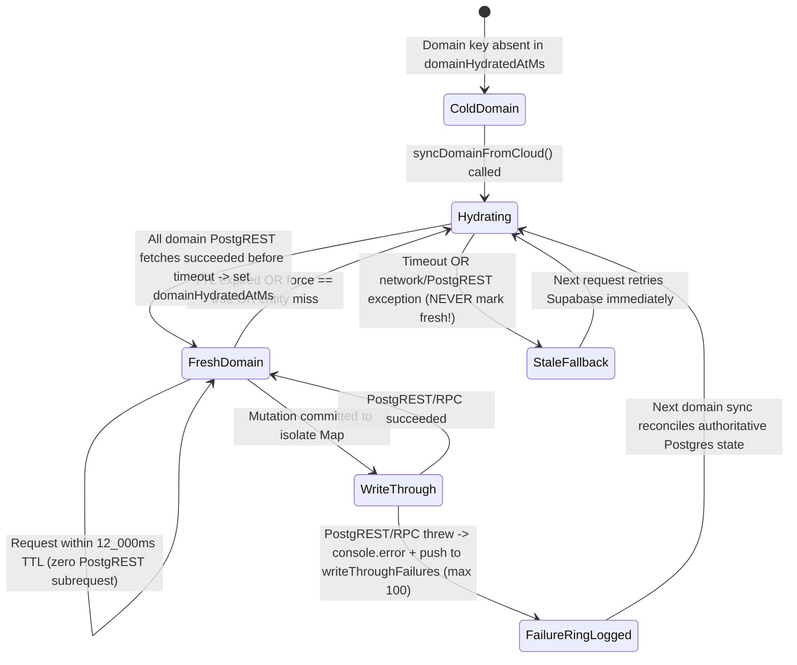
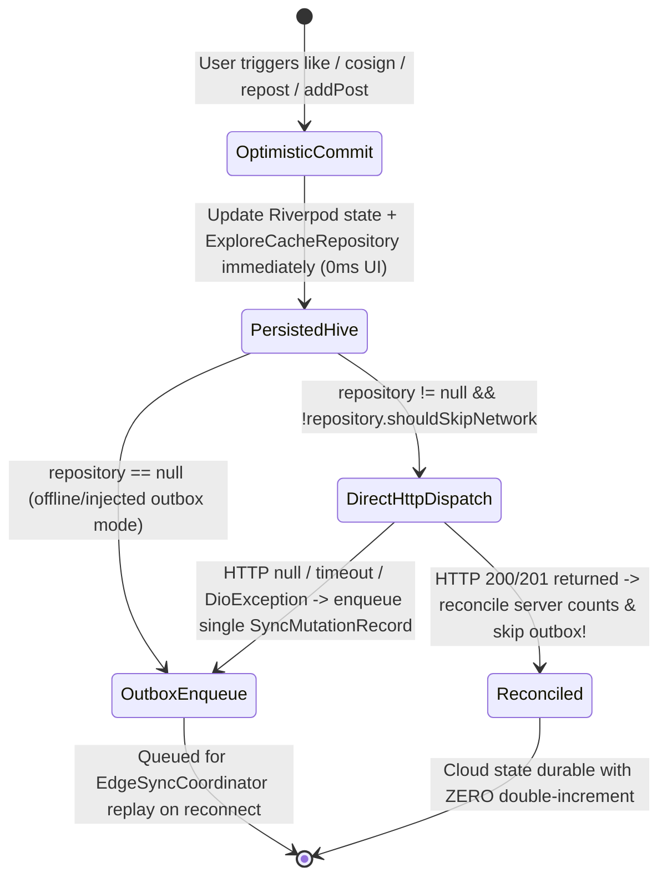
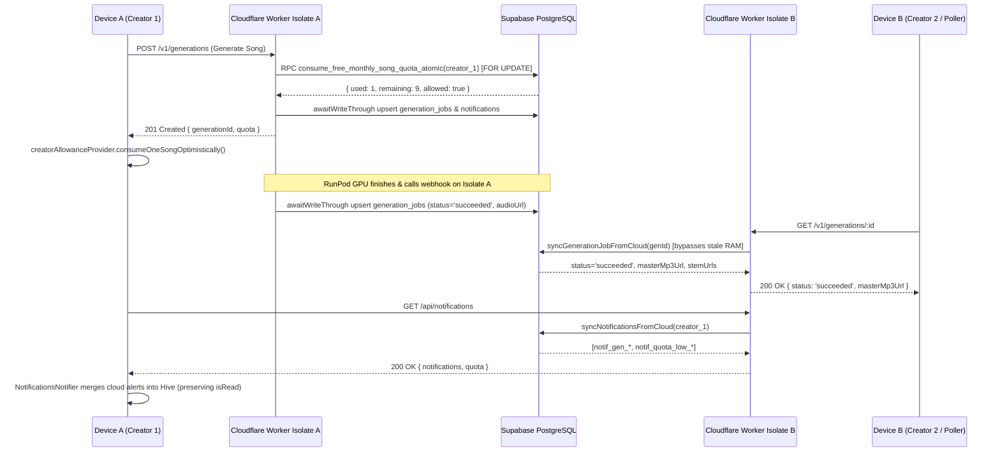

# Phase 71 — Cloudflare Worker Supabase Read/Write-Through Durability, `OPEN` Connectome Closure & 100% Green Test Baseline Blueprint

**Document ID:** `VHUNAMBI-SPEC-P71-BLUEPRINT-V1`  
**Phase:** `71` — Cloud Persistence Durability, `OPEN` Connectome Closure (`EP-P67`, `EP-P69`, `EP-P37`, `EP-P68`) & 100% Green Test Baseline  
**Date:** `2026-11-20`  
**Status:** `SPECIFICATION HARDENED (STAGE 2 & 3)`  
**Upstream Forensic Audit:** [`docs/audits/PHASE71_CLOUD_PERSISTENCE_AND_OPEN_CONNECTOME_AUDIT.md`](../../audits/PHASE71_CLOUD_PERSISTENCE_AND_OPEN_CONNECTOME_AUDIT.md) (`AUDIT-P71-CLOUD-CONNECTOME-BASELINE-001`)  
**Memory Card:** [`docs/phases/phase_71_cloud_persistence_and_open_connectome_closure/memory.md`](./memory.md) (`MEM-P71-CLOUD-SPINE-CONNECTOME-CLOSURE`)

---

## 1. Executive Overview & Architectural North Star

Phases 67 through 70 unified the physical-device visual journey across Vhunambi (`Splash -> Home Main Room -> Notifications -> Explore Kinetic Posts -> Role-Aware Song Cockpit -> Visitor Profile`) and left `test/features/track/` (`5/5`), `test/features/profile/` (`11/11`), and `test/features/studio/` (`38/38`) at `100%` pass. However, the Phase 71 forensic audit uncovered three foundational production gaps that block true multi-user durability, end-to-end cloud feedback, and a zero-failure CI baseline:

1. **Cloudflare Worker Multi-Isolate Desync & Silent Write-Through Loss (`VLT-01` – `VLT-04`):**  
   `EdgeIsolateDatabaseEngine` already performs a 21-table cold-start fetch (`ensureColdStartHydrated`) and 27 `mirrorWriteThrough(...)` PostgREST mutations, yet multi-user persistence breaks silently in production `workerd` because:
   - A single boolean lock (`this.coldStartHydrated = true`) permanently seals warm isolates after the first request—even when `withTimeout(..., 4500)` times out or individual `.catch(() => [])` calls fail—so posts, threaded replies, notifications, wallet ledger entries, and RunPod webhook completions (`POST /v1/webhooks/ace-step`) committed on Isolate A are invisible to polling clients routed to Isolate B.
   - `mirrorWriteThrough` swallows all Supabase PostgREST/RPC errors via `.catch(() => {})` with zero diagnostics or retry visibility, while `consumeFreeMonthlySongQuota` executes a non-atomic RAM read-modify-write that permits concurrent Worker isolates to double-spend the `10 Free Monthly Songs` limit.
   - `reel_comments` hydration and `mapReelCommentRow` drop `likes_count`, `username`, `display_name`, `avatar_url`, and `is_creator`; `applyMutationsBatch` track `like` never mirrors `likes_count` to Postgres `explore_tracks`; Postgres DDLs for `explore_tracks` and `user_library_sync` lack parity columns; and `vision_routes.ts` keeps `VisionJobMeta` solely in module-level RAM (`visionMetaFallbackStore`).
2. **Four High-Value `OPEN` / Partial Connectome Closures (`CON-01` – `CON-04`):**  
   - `EP-P67-NOTIF-API` (`/api/notifications*`): Zero Dart HTTP callers exist; server-generated studio render and low-quota alerts never reach the device.
   - `EP-P69-POST-COSIGN-REPOST-HTTP` (`/api/explore/feed`, `/posts/:id/cosign`, `/posts/:id/repost`, `/comments/:id/like`): `SocialFeedPostsNotifier` (referred to in the audit as `ExplorePostsNotifier`) bypasses direct HTTP for outbox-only enqueueing and skips hydrating `likeCount`/`commentCount` on `refreshFromCloud()`; `ReelsCommentsNotifier.toggleCommentLike` routes Kinetic Post comment likes to `/api/social/comments/:id/like` instead of `/api/explore/comments/:id/like`.
   - `EP-P37-REMIX-TREE-API` (`GET /api/social/clips/:id/remixes`): `RemixLineageTreeSheet` renders only static `kSeedMakhadziRemixTree` or a 1-node fallback.
   - `EP-P68-CREATOR-ALLOWANCE`: `consumeOneSongOptimistically()` has `0` callers; `StudioActionBar` (which also contains a stock `Icons.check_circle_rounded` violation) and `SubscriptionUpgradeModal` (which has hardcoded `Colors.white`) do not surface live `10/10` free quota status.
3. **CI Baseline Hygiene (`TST-01` – `TST-02`):**  
   - `apps/vhunambi_api` has `src/phase67_notifications_quota.test.ts` misplaced inside `src/` (compiled into `dist/` by `tsc`) and omits both it and `test/phase65_foundation_resilience.test.ts` from `package.json` `npm test`.
   - `apps/vhunambi_client` has exactly `5` pre-existing failing test files (`9` stale assertions) caused by intentional post-Phase 63/64/65 behavioral upgrades (lazy stem loading, paused cold-start player seed, `AppConstants.normalizeCloudMediaUrl`, `_SoftIconButton` replacing Material `IconButton`, and `playerStateProvider.notifier` materialization order).

**Clean Two-Pass Execution Boundary:**
- **Overhaul Pass 1 (`M71.1` – `M71.2`)** touches ONLY `supabase/` and `apps/vhunambi_api/` (`npx tsc --noEmit` + `27/27` API test suites).
- **Overhaul Pass 2 (`M71.3` – `M71.4`)** touches ONLY `apps/vhunambi_client/` and `docs/phases/phase_71_.../memory.md` (`flutter analyze --no-pub` + full client test suite + `consolidate_memory.mjs`).

---

## 2. Forensic Post-Mortem Comparison Box

```text
+------------------------------------------+------------------------------------------------------+
|      PRE-PHASE 71 DEFECTIVE BEHAVIOR     |         PHASE 71 TARGET DURABLE ARCHITECTURE         |
+------------------------------------------+------------------------------------------------------+
| [VLT-01] Global `coldStartHydrated=true` | Per-domain SWR freshness Map<string, number>         |
| permanently locks warm isolates after 1  | (`domainHydratedAtMs`, TTL = 12,000 ms). Freshness   |
| 21-table fan-out, even after 4.5s timeout| timestamp is NEVER set on timeout or caught error.   |
| or `.catch(() => [])` failures.          | Targeted `sync*FromCloud()` helpers pull only the    |
|                                          | active tenant/entity rows on demand.                 |
+------------------------------------------+------------------------------------------------------+
| [VLT-02] `mirrorWriteThrough` swallows   | Structured `console.error` diagnostics + bounded     |
| errors with `.catch(() => {})`; free     | 100-entry `writeThroughFailures` ring buffer +       |
| 10-song quota uses non-atomic RAM RMW.   | `awaitWriteThrough` + atomic Postgres RPC            |
|                                          | `consume_free_monthly_song_quota_atomic(p_user_id)`  |
|                                          | with `FOR UPDATE` row lock and 30-day cycle reset.   |
+------------------------------------------+------------------------------------------------------+
| [VLT-03] `reel_comments` drops likes &   | `reel_comments` hydration + `mapReelCommentRow`      |
| author identity; track like has 0 mirror;| preserve `likes_count`, `username`, `display_name`,  |
| `explore_tracks` & `user_library_sync`   | `avatar_url`, `is_creator`; track like patches PG    |
| PG tables miss parity columns.           | `explore_tracks.likes_count`; migration `20261120`   |
|                                          | adds all missing parity columns cleanly.             |
+------------------------------------------+------------------------------------------------------+
| [VLT-04] `vision_routes.ts` keeps prompt | Vision metadata (`promptText`, `seed`, `width`,      |
| /seed/resolution in `visionMetaFallback  | `height`, `resolution`, `fps`, `preset`, `engine`)   |
| Store` module RAM Map only.              | persisted inside `generation_jobs.manifest_json`     |
|                                          | (`job_kind = 'vision' | 'render-video'`) + cloud     |
|                                          | read-through via `syncGenerationJobFromCloud(id)`.   |
+------------------------------------------+------------------------------------------------------+
| [CON-01] `NotificationsNotifier` is      | `HttpNotificationRepository` backed by               |
| Hive-only (`0` HTTP callers); backend    | `SovereignApiClient` (`GET/POST/PATCH/DELETE`).      |
| studio/quota alerts never reach client.  | Hive renders at 0ms; `syncFromCloud()` merges remote |
|                                          | alerts preserving `isRead` & mirrors mutations.      |
+------------------------------------------+------------------------------------------------------+
| [CON-02] `SocialFeedPostsNotifier` skips | `HttpExploreRepository` adds `/feed`, `/cosign`,     |
| direct HTTP for outbox-only enqueue;     | `/repost`, `/comments/:id/like`. Notifier fires      |
| `refreshFromCloud()` ignores likeCount / | direct HTTP optimistically and enqueues to outbox    |
| commentCount; post comment likes misroute| ONLY on failure/offline (zero double-increment).     |
+------------------------------------------+------------------------------------------------------+
| [CON-03] `RemixLineageTreeSheet` always  | `ISocialRepository.getClipRemixes(clipId)` ->        |
| shows hardcoded Makhadzi mock or 1 node. | `GET /api/social/clips/:id/remixes` +                |
|                                          | `remixLineageRemoteChildrenProvider` merges live     |
|                                          | remote descendants onto root with sync fallback.     |
+------------------------------------------+------------------------------------------------------+
| [CON-04] `consumeOneSongOptimistically`  | `StudioActionBar` mounts `studio_allowance_chip` +   |
| has `0` callers; `StudioActionBar` uses  | replaces stock `Icons.check_circle_rounded`;         |
| stock `Icons.*`; Upgrade Modal hides     | `GenerationPipelineNotifier` calls optimistic        |
| live 10/10 monthly allowance status.     | decrement on dispatch; Upgrade Modal embeds live     |
|                                          | `upgrade_modal_allowance_card` with theme tokens.    |
+------------------------------------------+------------------------------------------------------+
| [TST-01/02] 5 failing client test files  | All 5 client test files aligned to live contracts;   |
| (9 stale assertions); API test in `src/` | `src/phase67_notifications_quota.test.ts` moved to   |
| compiled into `dist/` & omitted from CI. | `test/`; `27/27` API suites + new Phase 71 cross-    |
|                                          | isolate & client connectome closure suites green.    |
+------------------------------------------+------------------------------------------------------+
```

---

## 3. Multi-Layer Decoupled System Architecture

```text
+================================================================================================+
|                             LAYER 1: FLUTTER CLIENT (`apps/vhunambi_client/`)                  |
+================================================================================================+
|  [UI Surfaces — STD-UIUX-001, PhosphorIcon, *Of(context)]                                      |
|   |-- StudioActionBar (Key('studio_allowance_chip')) -> SubscriptionUpgradeModal               |
|   |-- SubscriptionUpgradeModal (Key('upgrade_modal_allowance_card'))                           |
|   |-- RemixLineageTreeSheet (merges remixLineageTreeProvider + remixLineageRemoteChildren)     |
|   |-- NotificationsCenter / Bell / ExploreSocialPostCard / KineticPostFocusView                |
|                                          |                                                     |
|  [Riverpod StateNotifiers & FutureProviders]                                                   |
|   |-- NotificationsNotifier  (Hive 0ms + HttpNotificationRepository bidirectional sync)        |
|   |-- SocialFeedPostsNotifier (Direct HTTP first -> EdgeSyncCoordinator offline-only fallback) |
|   |-- ReelsCommentsNotifier  (Routes post_*/kpost_* likes -> /api/explore/comments/:id/like)   |
|   |-- GenerationPipelineNotifier (Calls creatorAllowanceProvider.consumeOneSongOptimistically) |
|   |-- remixLineageRemoteChildrenProvider (FutureProvider.family -> getClipRemixes)             |
|                                          |                                                     |
|  [HTTP Repositories (Test-Safe `_shouldSkipNetwork` Guards)]                                   |
|   |-- HttpNotificationRepository (SovereignApiClient: GET/POST/PATCH/DELETE /api/notifications) |
|   |-- HttpExploreRepository      (Dio: /feed, /posts/:id/cosign, /repost, /comments/:id/like)  |
|   |-- HttpSocialRepository       (Dio: GET /api/social/clips/:id/remixes)                      |
+==========================================|=====================================================+
                                           | HTTPS + Bearer JWT + X-Vhunambi-Creator-Id
                                           v
+================================================================================================+
|                     LAYER 2: CLOUDFLARE WORKER API (`apps/vhunambi_api/`)                      |
+================================================================================================+
|  [Hono Routes (`server.ts`, `notification_routes.ts`, `explore_routes.ts`, `wallet_routes.ts`, |
|                `generation_routes.ts`, `webhook_routes.ts`, `vision_routes.ts`)]               |
|   |-- Strict Fresh Read-Through: Notifications, Quotas, Generation Jobs, Vision Jobs, Wallet   |
|   |-- 12s SWR Read-Through: Explore Tracks, Kinetic Posts, Reel Comments                       |
|   |-- Awaited Critical Write-Through: Atomic Quota RPC, Webhook Completion, Notification Upsert|
|                                          |                                                     |
|  [EdgeIsolateDatabaseEngine (`edge_persistence_bridge.ts`) + VhunambiDatabase (`vhunambi_db`)] |
|   |-- domainHydratedAtMs: Map<string, number> (SWR TTL = 12,000ms; never sealed on error)      |
|   |-- writeThroughFailures: WriteThroughFailureRecord[] (bounded ring max 100 + console.error) |
|   |-- syncNotificationsFromCloud / syncCreatorQuotaFromCloud / syncGenerationJobFromCloud /    |
|       syncExploreFromCloud / syncCreatorWalletFromCloud / consumeFreeMonthlySongQuotaAsync     |
+==========================================|=====================================================+
                                           | PostgREST HTTPS + PL/pgSQL RPC (Service Role Key)
                                           v
+================================================================================================+
|                      LAYER 3: SUPABASE POSTGRESQL (`supabase/migrations/`)                     |
+================================================================================================+
|  [20261120000001_phase71_schema_parity_and_rpcs.sql]                                           |
|   |-- public.explore_tracks     (+ mood, language, discovery_stage, data_json, created_at)     |
|   |-- public.user_library_sync  (+ item_type, created_at)                                      |
|   |-- public.consume_free_monthly_song_quota_atomic(p_user_id TEXT) -> JSONB (`FOR UPDATE`)    |
+================================================================================================+
```

---

## 4. Domain Taxonomy & Canonical Entity Mapping

### 4.1 Cloudflare Worker Domain SWR Freshness Registry (`EP-P71-EDGE-SWR-READTHROUGH`)

| Domain Scope Key | Sync Helper Method | Triggered By Routes | SWR TTL / Freshness Policy | Tables Pulled |
| :--- | :--- | :--- | :--- | :--- |
| `notifications:<creatorId>` | `syncNotificationsFromCloud(userId, c?)` | `GET /api/notifications` | Strict fresh (`force = true` or TTL `0ms` on GET) | `notifications` (`user_id=eq.<cid>`) |
| `quota:<creatorId>` | `syncCreatorQuotaFromCloud(userId, c?)` | `GET /api/wallet/allowance`, `POST /v1/generations` | Strict fresh (`0ms` on GET; atomic RPC on POST) | `creator_quotas` (`user_id=eq.<cid>`) |
| `generation:<genId>` | `syncGenerationJobFromCloud(genId, c?)` | `GET /v1/generations/:id`, `GET /v1/generations/:id/manifest`, `GET /v1/vision/:id`, `GET /v1/vision/render-video/:id` | Strict fresh whenever missing or `status` in `{queued, running}` | `generation_jobs` (`generation_id=eq.<id>`) |
| `explore:global` | `syncExploreFromCloud(force?, c?)` | `GET /api/explore`, `GET /api/explore/tracks`, `GET /api/explore/feed`, `GET /api/explore/posts/:id`, `GET /api/explore/posts/:id/comments` | SWR `12_000 ms` TTL (`force = true` bypasses TTL) | `explore_tracks`, `kinetic_posts`, `reel_comments` |
| `wallet:<creatorId>` | `syncCreatorWalletFromCloud(creatorId, c?)` | `GET /api/wallet/:creatorId`, `POST /api/wallet/topup`, `POST /api/wallet/payout`, `GET /api/creators/:id/wallet` | Strict fresh (`force = true` on wallet read/payout) | `wallet_ledger`, `bank_accounts`, `payment_topups` |

### 4.2 Class Name Reconciliation Note (Anti-Trap 6 Verification)

Forensic inspection of the live client codebase confirmed one naming distinction between the audit prose and the live Dart file:
- **Live Class & Provider:** `SocialFeedPostsNotifier` (`socialFeedPostsProvider`) in [`apps/vhunambi_client/lib/features/explore/presentation/providers/explore_providers.dart`](../../../apps/vhunambi_client/lib/features/explore/presentation/providers/explore_providers.dart#L692-L1029) — referred to colloquially in the Phase 71 audit as `ExplorePostsNotifier`.
- All code blocks in `design.md` and tasks in `tasks.md` target the authentic symbol **`SocialFeedPostsNotifier`** (`socialFeedPostsProvider`) so zero class-rename breakage occurs across existing Explore tests or callers.

---

## 5. Worker Read/Write-Through & Client Sync State Machines

### 5.1 Cloudflare Worker Domain SWR Hydration State Machine



### 5.2 Client Direct-HTTP + Offline-Only Outbox Fallback State Machine (`CON-02`)



---

## 6. Dual-Viewport UI Wireframes (`CON-03` & `CON-04`)

### 6.1 `StudioActionBar` — Mobile Portrait ($< 600\text{dp}$) & Desktop ($\ge 600\text{dp}$)

```text
MOBILE PORTRAIT (< 600dp) — StudioActionBar
+-----------------------------------------------------------------------+
|  [ (sparkle) 10/10 Free Songs Left  |  Upgrade -> ]  <- studio_allowance_chip (44dp tap target)
+-----------------------------------------------------------------------+
|  [ (globe) Public [O] ]   [      (sparkle) Generate Song            ] |
+-----------------------------------------------------------------------+
|   By generating, you agree to our Terms of Service. See licensing ->  |
+-----------------------------------------------------------------------+

DESKTOP / WIDE (>= 600dp) — StudioActionBar
+-------------------------------------------------------------------------------------------+
| [ (globe) Public [O] ]  [ (sparkle) 10/10 Free ]  [        (sparkle) Generate Song      ] |
+-------------------------------------------------------------------------------------------+
|                By generating, you agree to our Terms of Service. See licensing ->         |
+-------------------------------------------------------------------------------------------+
```

### 6.2 `SubscriptionUpgradeModal` Live Allowance Card (`Key('upgrade_modal_allowance_card')`)

```text
+-----------------------------------------------------------------------+
|   ===                                                                 |
|   Creator Plans & Credits                                       [ X ] |
|   Unlock unlimited stems, high-bitrate WAVs & 100% commercial rights  |
|                                                                       |
|   +---------------------------------------------------------------+   |
|   | (musicNotes) Monthly Free Allowance             [ 7/10 Left ] |   |
|   | [===================>-----------]  3 of 10 free songs used    |   |
|   | Resets in 30-day rolling cycle · Pro unlocks unlimited songs  |   |
|   +---------------------------------------------------------------+   |
|                                                                       |
|                [ Monthly ]   [ Yearly (-20%) ]                        |
|   +---------------------------------------------------------------+   |
|   | (coins) Instant Coin Top-Up (ZAR)                             |   |
|   | [ 500 / R55 ]     [+15% 1500 / R150]     [POPULAR 5000 / R450]|   |
|   +---------------------------------------------------------------+   |
+-----------------------------------------------------------------------+
```

### 6.3 `RemixLineageTreeSheet` Live Remote Children Merge (`CON-03`)

```text
+-----------------------------------------------------------------------+
|   ===                                                                 |
|   [gitFork] Remix Lineage Tree                                        |
|             4 Remixes · Automatic 70/30 Splits     [Live Sync Badge]  |
|   +---------------------------------------------------------------+   |
|   | (M) Ndo Mufuna Matibe  [ROOT]                                 |   |
|   |     @makhadzi · Amapiano · 113 BPM                            |   |
|   +---------------------------------------------------------------+   |
|      |                                                                |
|   +---------------------------------------------------------------+   |
|   | (F) Ndo Mufuna Matibe (Open Verse)                            |   |
|   |     @fifi_vocals · 70/30 Split                                |   |
|   +---------------------------------------------------------------+   |
|      |  (merged remote children from GET /api/social/clips/:id/remixes|
|   +---------------------------------------------------------------+   |
|   | (T) Soweto Amapiano Flip (Remote Cloud Child)                 |   |
|   |     @thabo_beats · Live Cloud Remix                           |   |
|   +---------------------------------------------------------------+   |
|   [          (microphone) Drop Your Verse on This Chain           ]   |
+-----------------------------------------------------------------------+
```

---

## 7. Mathematical & Concurrency Formulations

### 7.1 Domain-Scoped SWR Freshness Invariant

For any Worker isolate $I$, domain key $k \in \{\text{explore:global}, \text{notifications:}u, \text{quota:}u, \text{generation:}g, \text{wallet:}u\}$, current wall-clock time $t_{\text{now}}$ (ms), and configured TTL $\Delta_k \ge 0$:

$$\text{needsCloudSync}(I, k, t_{\text{now}}, \text{force}) = \text{force} \lor \bigl(k \notin H_I\bigr) \lor \bigl(t_{\text{now}} - H_I[k] \ge \Delta_k\bigr)$$

where $H_I: \text{String} \to \mathbb{N}$ is `domainHydratedAtMs`. Crucially:

$$H_I[k] \leftarrow t_{\text{now}} \iff \text{allFetchedOk} = \text{true} \land \text{timedOut} = \text{false}$$

This strictly eliminates the Phase 62–70 failure mode where a single transient timeout permanently froze `coldStartHydrated = true`.

### 7.2 Atomic Monthly Song Quota Transition (`EP-P71-ATOMIC-QUOTA-RPC`)

Under concurrent generation requests from $N$ Cloudflare Worker isolates for creator $u$ at timestamp $t_{\text{now}}$:

1. Row lock `SELECT ... FROM public.creator_quotas WHERE user_id = p_user_id FOR UPDATE` serializes all isolates in Postgres.
2. Cycle rollover check:
   $$(\text{used}', \text{resetAt}') = \begin{cases} (0,\; t_{\text{now}} + 30\text{ days}) & \text{if } t_{\text{now}} \ge \text{resetAt} \\ (\text{used},\; \text{resetAt}) & \text{otherwise} \end{cases}$$
3. Paid tier bypass (`plan_tier <> 'free'` OR `free_monthly_songs_limit < 0`): `allowed = true`, `used` unchanged.
4. Free tier atomic increment:
   $$\text{allowed} = (\text{used}' < \text{limit}), \quad \text{used}'' = \begin{cases} \text{used}' + 1 & \text{if } \text{allowed} \\ \text{used}' & \text{otherwise} \end{cases}, \quad \text{remaining}'' = \max(0, \text{limit} - \text{used}'')$$

Therefore, across $M$ parallel requests starting from $\text{used} = 0$ and $\text{limit} = 10$, **at most 10** calls return `allowed = true` and `freeMonthlySongsUsed` converges deterministically to $\min(M, 10)$.

### 7.3 Notification Cloud Merge Invariant (`CON-01`)

Given local Hive set $L$ and remote server set $R$ indexed by `id`:

$$\forall n \in L \cup R,\quad \text{merged}(n.\text{id}) = \begin{cases} \text{remote}.\text{copyWith}(\text{isRead}: \text{local}.\text{isRead} \lor \text{remote}.\text{isRead}) & \text{if } n.\text{id} \in L \cap R \\ \text{remote} & \text{if } n.\text{id} \in R \setminus L \\ \text{local} & \text{if } n.\text{id} \in L \setminus R \end{cases}$$

Legacy Phase 40 mock IDs (`notif_p40_*`, `notif_seed_*`) are excluded from both $L$ and $R$, and the merged list is sorted descending by `createdAt`.

---

## 8. End-to-End Cross-Isolate & Connectome Sequence Diagram



---

## 9. Verification Gates & Quality Matrix

| Gate ID | Pass | Verification Command / Target | Mandatory Pass Condition |
| :--- | :---: | :--- | :--- |
| **`G-71-01`** | Pass 1 | `supabase/migrations/20261120000001_phase71_schema_parity_and_rpcs.sql` | Valid idempotent Postgres DDL (`ADD COLUMN IF NOT EXISTS`) + `CREATE OR REPLACE FUNCTION public.consume_free_monthly_song_quota_atomic(TEXT)` |
| **`G-71-02`** | Pass 1 | `npx tsc --noEmit` in `apps/vhunambi_api/` | Exit code `0`, zero TypeScript errors across `src/` (and zero test files left inside `src/`) |
| **`G-71-03`** | Pass 1 | `npm test` in `apps/vhunambi_api/` | `27/27` suites pass 100%, including `phase65_foundation_resilience.test.ts`, `phase67_notifications_quota.test.ts`, and `phase71_worker_supabase_readthrough.test.ts` |
| **`G-71-04`** | Pass 2 | `flutter analyze --no-pub` in `apps/vhunambi_client/` | `0` errors, `0` warnings, `0` infos; zero raw Unicode emojis or stock `Icons.*` in touched widgets (`STD-UIUX-001`) |
| **`G-71-05`** | Pass 2 | `flutter test --no-pub --timeout=60s` on 5 repaired test files + `test/features/phase71_connectome_closure_test.dart` | `100%` pass across all 5 repaired legacy suites and new Phase 71 connectome closure tests |
| **`G-71-06`** | Pass 2 | `node .agents/skills/vhunambi-memory/scripts/consolidate_memory.mjs` | Zero schema errors; `EP-P67-NOTIF-API`, `EP-P69-POST-COSIGN-REPOST-HTTP`, and `EP-P37-REMIX-TREE-API` promoted from `OPEN` -> `CONNECTED_EXTENSIBLE`; `EP-P71-EDGE-SWR-READTHROUGH` & `EP-P71-ATOMIC-QUOTA-RPC` registered |
