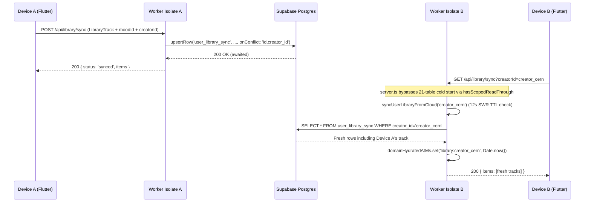
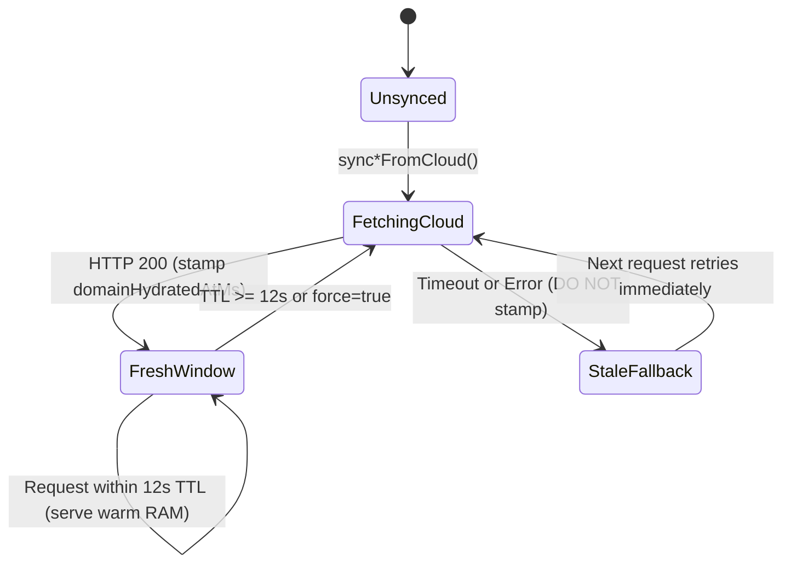

# Phase 72 — Asset Vault (`LibraryView`), Owner Studio Profile (`OwnerProfileView`) Glass Overhaul, `ViewerRole.owner` Parity & Library/Playlist/License Cloud SWR — Architectural Blueprint

**Document ID:** `VHUNAMBI-SPEC-P72-BLUEPRINT-V1`  
**Date:** 2026-11-20  
**Target Branch:** `fix/studio-cockpit-bugs-vh001-vh006`  
**Upstream Forensic Audit:** [`docs/audits/PHASE72_ASSET_VAULT_AND_OWNER_PROFILE_GLASS_OVERHAUL_AUDIT.md`](../../audits/PHASE72_ASSET_VAULT_AND_OWNER_PROFILE_GLASS_OVERHAUL_AUDIT.md)  
**Predecessor Memory Anchors:** `MEM-P68-HOME-MAIN-ROOM`, `MEM-P69-KINETIC-POST-FOCUS`, `MEM-P70-SONG-COCKPIT-VISITOR-PROFILE`, `MEM-P71-CLOUD-SPINE-CONNECTOME-CLOSURE`

---

## 1. Executive Overview & Visual North Star

Phases 68–71 modernized **Home**, **Explore / Kinetic Posts**, **Track Detail Cockpit (`TrackDetailView`)**, **Public Visitor Profile (`ArtistProfileView`)**, **Notifications**, and **Edge SWR Read-Through** for notifications, wallets, explore, and generations. Phase 72 completes the cohesive production aesthetic and multi-isolate cloud durability across the final two primary creator surfaces:

1. **Asset Vault (`LibraryView` + `PlaylistsVaultView` + `CollectionsVaultView` + `BeatsVaultView` + `VaultStorageModal`):**
   - Migrates the entire vault onto `VhunambiAmbientMeshBackdrop` and `VhunambiGlassSurface` (`EP-P70-GLASS-SURFACE`, strictly enforcing `enableLiveBlur: false` on repeating list/grid tiles for 60 FPS Android performance).
   - Eliminates broken `'asset:'` cover art loading and flat gradient placeholders by routing `LibraryCoverArt`, `PlaylistCoverArt`, `CollectionArtworkPlaceholder`, `BeatsVaultView`, and `VaultStorageModal` through `VhunambiTrackArtwork` (`EP-P68-TRACK-ARTWORK`).
   - Enriches `LibraryTrack` with `creatorId`, `creatorHandle`, `mood`, `moodId`, `bpm`, `description`, and `allowOpenStemsRemix` so opening any owned vault track in `TrackDetailView` deterministically resolves `ViewerRole.owner` (`EP-P70-VIEWER-ROLE`) with full Studio Cockpit & Stem Separation Lab access.
   - Connects live `creatorAllowanceProvider` (`EP-P68-CREATOR-ALLOWANCE`), non-blocking `LibraryTracksNotifier.syncWithCloud()`, mobile-visible `Cached Only` filtering, and `GET /api/marketplace/licenses/:buyerId` (`EP-P72-BUYER-LICENSES-HTTP`).

2. **Owner Studio Profile (`OwnerProfileView` + 11 Supporting Studio Cards):**
   - Fixes all Light-Mode white-on-white contrast defects (`ChoiceChip`, `VhunambiBackButton`, Settings icon, edit button) and prevents `MiniPlayerHost` overlap on the pushed route via `pushedFullScreenOverlayCountProvider` (`EP-P68-MINIPLAYER-SUPPRESS`).
   - Harmonizes `OwnerProfileView` with Phase 70's glass visual language while preserving **100% of private Owner Studio controls** (3D Creator DNA Helix Lab, Vocal Identity & Clones, Multi-Track Melody Sketchpad, Edit Profile, Pin Song, Producer Beatstore, Discography Releases, Creator Wallet / ZAR Payouts, Studio Analytics Console, Settings Drawer, Cloud Diagnostics).
   - Replaces hardcoded `"Your Songs"` (`track_own_01`/`track_own_02`) and hardcoded `'creator_ndugelo'` Beatstore scoping with live `libraryTracksProvider` + `currentCreatorIdProvider` projections, persists track visibility, wires songs & `PinnedSpotlightCard` to `TrackDetailView` (`ViewerRole.owner`), mounts owner Kinetic Posts into `KineticPostFocusView` (`EP-P69-KPOST-FOCUS-ROUTE`), and embeds live `creatorAllowanceProvider` (`10/10 Free Monthly Songs`) inside `CreatorWalletDeck`.

3. **Backend Multi-Isolate Supabase SWR Durability (`EP-P72-VAULT-CLOUD-SWR`):**
   - Extends `EP-P71-EDGE-SWR-READTHROUGH` (`DEFAULT_SWR_TTL_MS = 12_000`, `withTimeoutResult`, never sealing `domainHydratedAtMs` on timeout/error) to `library_routes.ts`, `playlist_routes.ts`, and `marketplace_routes.ts` via `syncUserLibraryFromCloud`, `syncPlaylistsFromCloud`, `syncBuyerLicensesFromCloud`, and `syncMarketplaceFromCloud` on `EdgeIsolateDatabaseEngine` + matching local-SQLite proxy methods on `VhunambiDatabase`.
   - Adds `/api/library`, `/api/playlists`, and `/api/marketplace` (plus `/api/v1/*` aliases) to `hasScopedReadThrough` in `server.ts` so they bypass the monolithic 21-table cold-start wall cleanly.

---

## 2. Forensic Post-Mortem Comparison Box

```
┌──────────────────────────────────────────────┬─────────────────────────────────────────────────────────┐
│ LEGACY PRE-PHASE-72 STATE (AUDIT DEFECTS)    │ PHASE 72 TARGET ARCHITECTURE (VERIFIED INVARIANTS)      │
├──────────────────────────────────────────────┼─────────────────────────────────────────────────────────┤
│ AV-01: LibraryCoverArt & PlaylistCoverArt    │ VhunambiTrackArtwork resolves 'asset:', 'http(s)://',   │
│ pass 'asset:...' to CachedNetworkImage ->    │ and deterministic bundled cultural PNG covers with      │
│ HTTP error -> flat gradient + stock Icons.*  │ Phosphor fallback and zero stock Material icons         │
├──────────────────────────────────────────────┼─────────────────────────────────────────────────────────┤
│ AV-02: LibraryTrack omits creatorId, moodId, │ LibraryTrack persists creatorId, creatorHandle, mood,   │
│ bpm, description -> track_providers guesses  │ moodId, bpm, description, allowOpenStemsRemix ->        │
│ owner from creatorName -> visitor lockout    │ TrackDetailNotifier guarantees ViewerRole.owner         │
├──────────────────────────────────────────────┼─────────────────────────────────────────────────────────┤
│ AV-03 / AV-04: TrackActionsSheet Stems is a  │ "Open Song Cockpit & Stems" pushes TrackDetailView;     │
│ SnackBar dead-end; syncWithCloud() uncalled; │ LibraryView triggers non-blocking syncWithCloud + pull- │
│ LibraryAppBar keeps dead '10 songs left'     │ to-refresh + live creatorAllowanceProvider chip         │
├──────────────────────────────────────────────┼─────────────────────────────────────────────────────────┤
│ OP-01 / OP-02: Colors.white on Light-Mode    │ Theme-adaptive AppColors.*Of(context) + VhunambiGlass   │
│ white surfaces; MiniPlayerHost overlaps      │ Surface; pushedFullScreenOverlayCountProvider           │
│ pushed OwnerProfileView route                │ ref-counted in initState/dispose matching ArtistProfile │
├──────────────────────────────────────────────┼─────────────────────────────────────────────────────────┤
│ OP-03 / OP-04 / OP-05: Hardcoded ZaYN/own02, │ Live libraryTracksProvider owner songs + persisted      │
│ ephemeral _trackVisibility, hardcoded        │ visibility + VhunambiTrackArtwork on PinnedSpotlight    │
│ 'creator_ndugelo' Beatstore, no Posts route  │ + currentCreatorIdProvider Beatstore + KineticPostFocus │
├──────────────────────────────────────────────┼─────────────────────────────────────────────────────────┤
│ SWR-01..03: library/playlist/marketplace     │ Domain-scoped 12s SWR syncUserLibraryFromCloud,         │
│ routes read stale Worker isolate RAM; 0 Dart │ syncPlaylistsFromCloud, syncBuyerLicensesFromCloud,     │
│ callers for GET /marketplace/licenses/:buyer │ syncMarketplaceFromCloud + HttpMarketplaceRepository    │
└──────────────────────────────────────────────┴─────────────────────────────────────────────────────────┘
```

---

## 3. Multi-Layer Decoupled System Architecture

```
┌─────────────────────────────────────────────────────────────────────────────────────────┐
│ LAYER 4 — FLUTTER GLASS PRESENTATION & NAVIGATION SHELL                                 │
│  • Tab 3: LibraryView (VhunambiAmbientMeshBackdrop + VhunambiGlassSurface, blur=false)  │
│    ├── LibraryAppBar (live creatorAllowanceProvider + sync badge + Overflow)            │
│    ├── LibraryCategoryRail (Songs | Playlists | Collections | Beats | Licensing | Trash)│
│    ├── Vault Tiles/Grid (VhunambiTrackArtwork + >=44dp targets + TrackDetailView push)  │
│    └── Embedded Vault Sub-Views (Playlists, Collections, Beats/Licensed, Storage Modal) │
│  • Pushed Route: OwnerProfileView (pushedFullScreenOverlayCountProvider++ / --)         │
│    ├── VhunambiAmbientMeshBackdrop + VhunambiGlassSurface Studio Cards                  │
│    ├── Live Owner Songs -> TrackDetailView (ViewerRole.owner)                           │
│    ├── Owner Reels & Kinetic Posts -> KineticReelsModal / KineticPostFocusView          │
│    ├── OwnerBeatstoreCockpit (dynamic currentCreatorIdProvider)                         │
│    └── CreatorWalletDeck (Live 10/10 Free Song Allowance + ZAR Payouts + Supporters)    │
├─────────────────────────────────────────────────────────────────────────────────────────┤
│ LAYER 3 — RIVERPOD DOMAIN STATE & REPOSITORIES                                          │
│  • LibraryTrack (+ creatorId, creatorHandle, mood, moodId, bpm, description, openStems) │
│  • LibraryTracksNotifier (toggleVisibility + non-blocking syncWithCloud + Hive L1)      │
│  • TrackDetailNotifier._lookupInitialTrack (explicit creatorId -> ViewerRole.owner)     │
│  • HttpMarketplaceRepository.getBuyerLicenses(buyerId) + buyerLicensesFamilyProvider    │
├─────────────────────────────────────────────────────────────────────────────────────────┤
│ LAYER 2 — CLOUDFLARE WORKER HONO ROUTES (hasScopedReadThrough BYPASS IN server.ts)      │
│  • library_routes.ts      -> await syncUserLibraryFromCloud / syncLibraryTracksAsync    │
│  • playlist_routes.ts     -> await syncPlaylistsFromCloud / upsertPlaylistAsync         │
│  • marketplace_routes.ts  -> await syncMarketplaceFromCloud / syncBuyerLicensesFromCloud│
├─────────────────────────────────────────────────────────────────────────────────────────┤
│ LAYER 1 — EDGE ISOLATE SWR BRIDGE & SUPABASE POSTGRES (cbnruevwrqwjnnoscgsz)            │
│  • EdgeIsolateDatabaseEngine (12s TTL per domainKey, never sealed on timeout/error)     │
│  • VhunambiDatabase (1:1 local SQLite proxy parity for every async method)              │
│  • Supabase tables: user_library_sync, playlists, marketplace_assets, beat_licenses     │
└─────────────────────────────────────────────────────────────────────────────────────────┘
```

---

## 4. Spatial Topology, Dual-Viewport Wireframes & Touch Geometry

### 4.1 Mobile Portrait Wireframe (`360x800dp` — Asset Vault `/library`)

```
┌──────────────────────────────────────────────┐
│ [Logo] VHUNAMBI  [10 songs left][Bell][Av][⋮][+] │ 56dp VhunambiTopBarSurface (all >=44dp)
├──────────────────────────────────────────────┤
│ (Songs) (Playlists) (Collections) (Beats)... │ Horizontal Glass Pill Rail (44dp height)
├──────────────────────────────────────────────┤
│ [🔍 Search my songs... [x]] [Offline] [≡][⊞] │ Clearable Glass Search + Mobile Offline Toggle
├──────────────────────────────────────────────┤
│ Recently Played   [Art][Art][Art][Art]       │ 44x44 VhunambiTrackArtwork thumbnails
├──────────────────────────────────────────────┤
│ ┌──────────────────────────────────────────┐ │
│ │ [48 Art] Grateful in the Light   [♡] [⋮] │ │ VhunambiGlassSurface (enableLiveBlur: false)
│ │          cern • 3:36 • Uplifting [Offline]│ │ Favorite & More targets strictly 44x44dp
│ └──────────────────────────────────────────┘ │
│ ┌──────────────────────────────────────────┐ │
│ │ [48 Art] Ndo Mufuna Matibe       [♡] [⋮] │ │ Tap tile -> plays; Tap cockpit/actions ->
│ │          Fifi • 3:18 • Soulful   [Cloud] │ │ TrackDetailView (ViewerRole.owner for owned)
│ └──────────────────────────────────────────┘ │
│            (VhunambiBottomDockMetrics)       │ Bottom scroll inset clears MiniPlayerHost
└──────────────────────────────────────────────┘
```

### 4.2 Mobile Portrait Wireframe (`360x800dp` — Owner Studio Profile `/profile/me`)

```
┌──────────────────────────────────────────────┐
│ [<]         [Studio] CREATOR STUDIO      [⚙] │ Theme-adaptive textPrimaryOf(context) icons!
├──────────────────────────────────────────────┤
│  ┌────────────────────────────────────────┐  │ VhunambiGlassSurface Hero Card
│  │ (68dp Avatar) cern                     │  │ (pushedFullScreenOverlayCountProvider = 1
│  │               @cern • Verified Creator │  │  -> MiniPlayerHost cleanly suppressed!)
│  │               [Producer] [4.2K Monthly]│  │
│  └────────────────────────────────────────┘  │
│  [DAW Upload][Avatar][Edit][Pin][Analytics]  │ Glass Action Pills (>=44dp height)
│  TOP GENRES: [House (1)] [Amapiano (4)]      │ PhosphorIcon + Plain text (ZERO emojis)
│  ┌────────────────────────────────────────┐  │ PinnedSpotlightCard (VhunambiTrackArtwork
│  │ PINNED ANTHEM  [52 Art] Title     (▶)  │  │  + tap card -> TrackDetailView owner)
│  └────────────────────────────────────────┘  │
│  [CreatorDnaProfileCard (isOwner: true)]     │ 3D Helix DNA preserved 100%
│  (Songs)(Reels)(Beatstore)(Voices)(Releases) │ Glass Studio Segmented Switcher
│  ┌────────────────────────────────────────┐  │ Live Your Songs (from libraryTracksProvider)
│  │ [1] [Art] Grateful in the Light        │  │ Tap row -> TrackDetailView (ViewerRole.owner)
│  │     Amapiano • 3:36   [Public] (▶ 44dp)│  │ Visibility switch persisted in notifier
│  └────────────────────────────────────────┘  │
│  [My Clips & Reels] + [My Kinetic Posts]     │ Clips -> ReelsModal | Posts -> KineticPostFocus
│  ┌────────────────────────────────────────┐  │ CreatorWalletDeck (Glass)
│  │ Monthly Free Songs: 10/10 left [Upgrade]│ │ Live creatorAllowanceProvider strip!
│  │ Lifetime Earnings: R1,420.00 + Payout  │  │
│  └────────────────────────────────────────┘  │
└──────────────────────────────────────────────┘
```

---

## 5. Cross-Isolate SWR & Buyer-License Sequence Diagrams





---

## 6. Pass Boundary & Verification Gates (`G-72-01` – `G-72-06`)

Phase 72 is structured into two independent passes with zero cross-pass compile dependencies:
- **Pass 1 (`M72.1` – `M72.2`):** Backend Library/Playlist/Marketplace SWR durability (`apps/vhunambi_api/`) + Client Asset Vault Glass/Artwork/`ViewerRole.owner`/Buyer Licenses overhaul (`features/library/`, `playlists_vault_view.dart`, `collections_vault_view.dart`, `beats_vault_view.dart`, `vault_storage_modal.dart`, `http_marketplace_repository.dart`, `track_providers.dart`).
- **Pass 2 (`M72.3` – `M72.4`):** Owner Studio Profile Glass overhaul, Light-Mode contrast fix, `MiniPlayerHost` suppression, live owner catalog/Beatstore/Posts/Allowance wiring (`features/profile/`), legacy test realignments, Phase 72 verification suites, and `vhunambi-memory` Sleep consolidation.

| Gate ID | Verification Target | Pass Condition |
| :--- | :--- | :--- |
| **`G-72-01`** | Backend TypeScript Compilation (`apps/vhunambi_api`) | `.\node_modules\.bin\tsc.cmd --noEmit` exits `0` (`0` errors; 1:1 `VhunambiDatabase` parity). |
| **`G-72-02`** | Backend Test Suite (`apps/vhunambi_api`) | `npm test` exits `0` across all **28/28** suites including `test/phase72_vault_swr_and_licenses.test.ts`. |
| **`G-72-03`** | Flutter Static Analysis (`apps/vhunambi_client`) | `flutter analyze --no-pub` exits `0` (`No issues found!`). |
| **`G-72-04`** | Asset Vault & Marketplace Test Suites | `flutter test --no-pub --timeout=60s test/features/library/ test/features/playlists/ test/features/collections/ test/features/beats/ test/features/marketplace/` exits `0`. |
| **`G-72-05`** | Owner Profile, Track & Phase 72 Suite | `flutter test --no-pub --timeout=60s test/features/profile/ test/features/track/ test/features/phase72_asset_vault_and_owner_profile_test.dart` exits `0`. |
| **`G-72-06`** | `STD-UIUX-001` & Connectome Sleep Consolidation | Zero stock `Icons.*` or raw Unicode emojis in Phase 72 modified widgets; `consolidate_memory.mjs` registers `EP-P72-VAULT-CLOUD-SWR` and `EP-P72-BUYER-LICENSES-HTTP` cleanly. |
