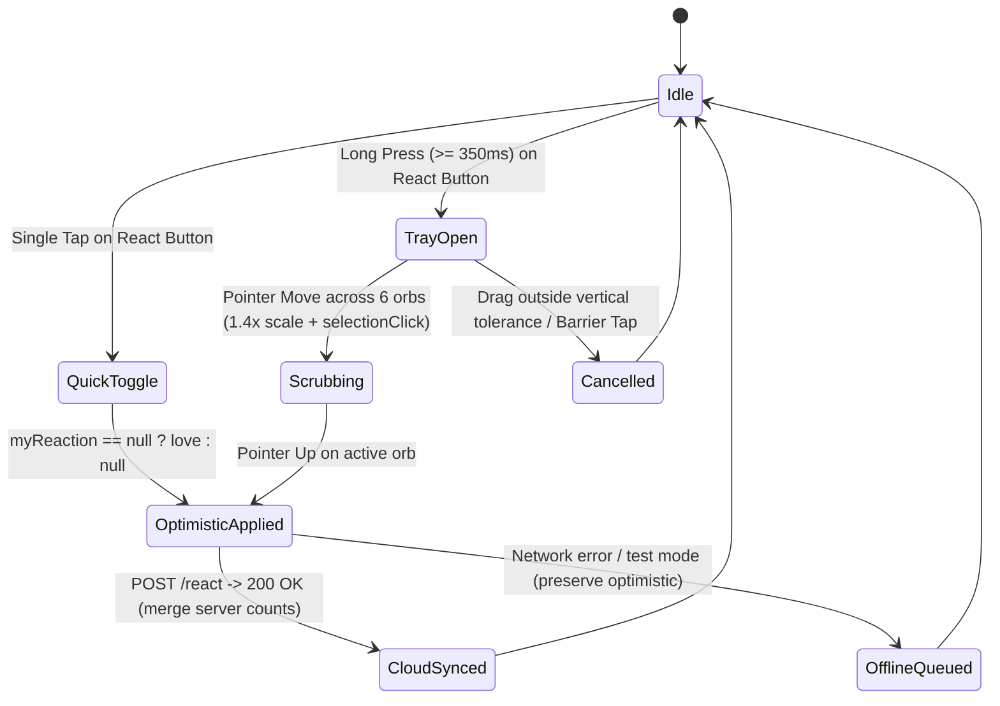
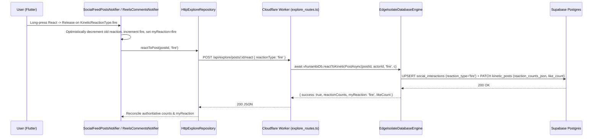

# VHUNAMBI PHASE 73 BLUEPRINT — KINETIC POST FOCUS V2, 3-TIER DYNAMIC CHROMATIC SYNTHESIS, MULTI-REACTIONS, GIFS/STICKERS, GLOBAL INPUT BORDER PURGE & SOCIAL HYGIENE

**Document ID:** `VHUNAMBI-SPEC-P73-BLUEPRINT-V1`  
**Phase:** Phase 73 (`phase_73_kinetic_post_focus_chromatic_reactions_and_hygiene`)  
**Upstream Forensic Audit:** [`docs/audits/PHASE73_74_SOCIAL_DOMAIN_AND_REELS_STUDIO_AUDIT.md`](../../audits/PHASE73_74_SOCIAL_DOMAIN_AND_REELS_STUDIO_AUDIT.md) (`AUDIT-SOC-073_074`, Part A)  
**Target Stacks:** Supabase Postgres (`supabase/migrations/`), Cloudflare Workers Hono TypeScript (`apps/vhunambi_api/`), Flutter/Dart Client (`apps/vhunambi_client/`)  
**Execution Split:** Two-Pass Execution — **Pass 1 (`M73.1`–`M73.2`)** + **Pass 2 (`M73.3`–`M73.4`)**

---

## 1. Executive Overview & Visual North Star

Physical device captures (`video_2.mp4` 00:00–05:26) proved that Vhunambi's audio engine, notifications surface, and Phase 69–72 Supabase Cloud SWR pipeline are durable across cold restarts, yet the **Social Domain (`KineticPostFocusView`, `ExploreSocialPostCard`, `ThreadedCommentsSection`, `CreateKineticPostSheet`, `ExploreSearchView`, and app-wide `TextField` focus chrome)** still exhibits prototype seams that degrade trust on 360dp Android viewports:

1. **Broken 360dp Action Bar & Truncated Engagement Strip (`SOC-01`):** `KineticPostFocusView` squeezes four `Expanded(TextButton.icon(...))` buttons into `328dp` without single-line constraints, splitting words mid-glyph (`Com\nment`, `Repo\nst`, `Remi\nx`) while clipping the summary row into `0 Repos...`.
2. **Harsh Bright Orange `#F97316` Input Outlines (`SOC-02`):** Both `AppTheme.darkTheme` and `AppTheme.lightTheme` globally assign `AppColors.brandPrimary` (`1.5px`) to `inputDecorationTheme.focusedBorder`, painting thick neon-orange rectangles around comment composers, search bars, and modal inputs — including borderless pills that only declare `border: InputBorder.none`.
3. **Flat Uniform Canvas on Focused Posts (`SOC-03`):** Entering a Kinetic Post with rich sunset artwork and soulful audio stays locked on flat `#F7F5F0` / `#0A0A0C` instead of synthesizing an atmospheric, WCAG AA legible world anchored to the song's `VhunambiMood` and cover art palette.
4. **Binary Likes & Plain-Text-Only Comments (`SOC-04`):** Creators and listeners cannot long-press for expressive multi-reactions (`Like`, `Love`, `Haha`, `Fire`, `Wow`, `Angry`) or drop GIFs and Sovereign Cultural Stickers into comments and nested replies.
5. **Social Identity, Splash Race, Post Composer & Search Hygiene (`SOC-07`–`SOC-10`):** Tapping one's own avatar opens visitor `ArtistProfileView` instead of `OwnerProfileView`; legacy `@current_user` tokens remain in card/DAW upload paths; `MiniPlayerHost` flashes over `"A PRODUCT OF MADONI SOFTWARE"` during the 420ms splash fade; `CreateKineticPostSheet` ignores aspect toggles on already-attached images and throws red error SnackBars at the 4-image cap; and clean installs inject hardcoded mock search history (`'Kabza de Small log drum'`).

**Visual North Star:** Every focused Kinetic Post becomes a living, frosted-glass, mood-and-artwork-tinted world (`PostChromaticPaletteResolver` + `VhunambiAmbientMeshBackdrop` + `VhunambiGlassSurface`), with crisp non-wrapping controls, tactile long-press custom-vector reaction badges (`STD-UIUX-001` compliant — zero raw OS Unicode emojis), an integrated GIF & Sovereign Cultural Sticker composer backed by Supabase Cloud SWR, and zero visual leaks from Splash to Search.

---

## 2. Forensic Post-Mortem Comparison Box (`AUDIT-SOC-073_074` Part A)

```text
+------------------------------------------+-----------------------------------------------+
| PREVIOUS FAILURE MODE (VIDEO_2.MP4)      | PHASE 73 PRODUCTION ARCHITECTURE              |
+------------------------------------------+-----------------------------------------------+
| SOC-01: Expanded(TextButton.icon) wraps  | Vertical icon+label / FittedBox(scaleDown)    |
| into "Com\nment", "Repo\nst", "Remi\nx"; | action bar (maxLines: 1, softWrap: false,     |
| single Row clips "0 Repos...".           | >= 44dp touch height) + non-truncating Wrap   |
|                                          | engagement strip with top-3 reaction cluster. |
+------------------------------------------+-----------------------------------------------+
| SOC-02: Global AppTheme focusedBorder =  | Subtle 1.0px tonal hairline globally (white   |
| 1.5px #F97316 orange box + 3 borderless  | 24% dark / black 18% light); all 3 leak sites |
| leak sites + 8 explicit orange overrides.| sealed with focusedBorder: InputBorder.none;  |
|                                          | all 8 explicit modal overrides harmonized.    |
+------------------------------------------+-----------------------------------------------+
| SOC-03: Flat cream/charcoal focus view   | 3-Tier PostChromaticPaletteResolver consuming |
| ignoring track mood & cover artwork;     | VhunambiMood + palette_generator (bundled)    |
| palette_generator unused.                | -> VhunambiAmbientMeshBackdrop + AA clamped   |
|                                          | glass accents & composer ring tint.           |
+------------------------------------------+-----------------------------------------------+
| SOC-04: Single heart toggle & plain text | 6-reaction KineticReactionType rendered as    |
| comments only; no /react or /gifs route; | glossy custom-vector badges (zero raw emojis) |
| no reaction/media DB columns.            | + long-press drag-scrub ReactionTrayOverlay   |
|                                          | + Worker GIF proxy + 8 Sovereign Stickers.    |
+------------------------------------------+-----------------------------------------------+
| SOC-07: Self-avatar taps push visitor    | Unified navigateToCreatorProfile() using      |
| ArtistProfileView; @current_user leaks   | resolveViewerRole() -> OwnerProfileView for   |
| in feed card & DAW vocal upload sheet.   | self, ArtistProfileView for visitors; zero    |
|                                          | @current_user strings in client runtime.      |
+------------------------------------------+-----------------------------------------------+
| SOC-08: SplashView clears splash flag    | SplashView keeps isSplashActiveProvider=true  |
| before 420ms fade; MiniPlayerHost sits   | across fade; RootShell.initState clears it    |
| above Navigator so ModalRoute is null.   | post-frame -> zero MiniPlayer flash on boot.  |
+------------------------------------------+-----------------------------------------------+
| SOC-09: Aspect chips don't update picked | Aspect toggle maps .copyWith(aspectRatio)     |
| images; Vision fallback shows duplicate  | over all attached images + live preview;      |
| crate box; 4-slot cap throws error toast.| VhunambiTrackArtwork Vision thumbs; disabled  |
|                                          | buttons + "4/4 Max images attached" pill.     |
+------------------------------------------+-----------------------------------------------+
| SOC-10: Clean installs seed 4 mock       | RecentSearchesNotifier starts at [] on clean  |
| searches ("Kabza de Small log drum");    | install (section hidden when empty); "You May |
| static kAfricanTrendingQueries list.     | Like" derived live from exploreTracksProvider |
|                                          | + canonical VhunambiMood taxonomy.            |
+------------------------------------------+-----------------------------------------------+
```

---

## 3. Multi-Layer Decoupled System Architecture

```text
┌────────────────────────────────────────────────────────────────────────────────────────┐
│ LAYER 1: PERSISTENCE & EDGE CLOUD SPINE (Supabase Postgres + Cloudflare Workers Hono)  │
│  - Migration 20261121000001: kinetic_posts.reaction_counts_json,                       │
│    reel_comments.{reaction_counts_json, gif_url, sticker_id, media_aspect_ratio},      │
│    social_interactions.reaction_type                                                   │
│  - vhunambi_db.ts (SQLite) <-> edge_persistence_bridge.ts (12s SWR + Awaited Write)    │
│  - explore_routes.ts: POST /posts/:id/react, POST /comments/:id/react, media comments  │
│  - social_routes.ts:  POST /comments/:id/react, GET /social/gifs/{search,trending}     │
└───────────────────────────────────────────┬────────────────────────────────────────────┘
                                            │ HTTPS JSON (Dio + Sovereign Auth JWT)
                                            ▼
┌────────────────────────────────────────────────────────────────────────────────────────┐
│ LAYER 2: REPOSITORY & RIVERPOD STATE ORCHESTRATION (apps/vhunambi_client)              │
│  - HttpExploreRepository: reactToPost(), reactToComment(), addPostComment(media)       │
│  - ISocialRepository / HttpSocialRepository: reactToComment(), searchGifs(),           │
│    getTrendingGifs(), addComment(media)                                                │
│  - SocialFeedPostsNotifier.reactToPost() (optimistic counts + myReaction + rollback)   │
│  - ReelsCommentsNotifier.reactToComment() & addComment(gifUrl, stickerId, aspectRatio) │
│  - RecentSearchesNotifier (clean [] default + Hive persistence)                        │
└───────────────────────────────────────────┬────────────────────────────────────────────┘
                                            │ Immutable Domain Models & Palette Tokens
                                            ▼
┌────────────────────────────────────────────────────────────────────────────────────────┐
│ LAYER 3: PURE DOMAIN & CHROMATIC SYNTHESIS ENGINES                                     │
│  - KineticReactionType (6 canonical enum values, wire codecs, color/label metadata)    │
│  - SovereignStickerPack (8 curated offline vector studio stickers, zero raw emojis)    │
│  - PostChromaticPaletteResolver (3-Tier Mood+Art -> Art+Complement -> Default,         │
│    LRU cache, 150ms timeout, FakeAsync test-safe bypass, WCAG AA contrast normalizer)  │
│  - navigateToCreatorProfile() consuming EP-P70-VIEWER-ROLE                             │
└───────────────────────────────────────────┬────────────────────────────────────────────┘
                                            │
                                            ▼
┌────────────────────────────────────────────────────────────────────────────────────────┐
│ LAYER 4: FLUTTER GLASS SURFACES & INTERACTIVE WIDGETS (STD-UIUX-001 COMPLIANT)         │
│  - KineticPostFocusView v2 (VhunambiAmbientMeshBackdrop + non-wrapping Focus Bar v2)   │
│  - ReactionTrayOverlay (long-press frosted pill, drag-to-scrub 1.4x scale, haptics)    │
│  - KineticReactionBadge (CustomPainter + PhosphorIconsFill glossy vector badges)       │
│  - GifStickerPickerSheet (Stickers + GIF Search tabs) & StudioReactionComposerBar      │
│  - Global AppTheme subtle focus borders + CreateKineticPostSheet + Splash/RootShell    │
└────────────────────────────────────────────────────────────────────────────────────────┘
```

---

## 4. Spatial Topology, Chromatic Spectrum & Reaction Taxonomy

### 4.1 3-Tier Chromatic World Synthesis Spectrum

```text
TIER 1: AUDIO ATTACHED + COVER ART (Highest Priority)
  [Track.mood -> VhunambiMood.accentColor] (C1 Primary Anchor)
       +  [Cover Art Dominant/Vibrant via PaletteGenerator] (C2 Secondary Atmospheric Glow)
       => Blended mist glow (16-22% alpha) + AA-clamped accent & composer focus ring.

TIER 2: COVER ART / PHOTO ONLY (No Audio / No Resolvable Mood)
  [Artwork Dominant/Vibrant via PaletteGenerator] (C1 Primary Anchor)
       +  [Split-Complementary HSL Hue: (H + 150 deg) mod 360, S <= 0.65] (C2 Secondary)
       => Harmonized dual-orb radial mesh + AA-clamped accent.

TIER 3: TEXT-ONLY / DEFAULT FALLBACK
  [AppColors.brandPrimary #F97316] (C1) + [AppColors.accentElectric #8B5CF6] (C2)
       => Clean Vhunambi brand ambient glow matching canvas brightness.
```

### 4.2 Canonical `KineticReactionType` Visual Table (`STD-UIUX-001` — Zero Raw Unicode Emojis)

| Enum Value | Wire ID | Label | Vector Orb Gradient | Custom Vector / Phosphor Motif | Accent Hex |
| :--- | :--- | :--- | :--- | :--- | :--- |
| `KineticReactionType.like` | `'like'` | `'Like'` | Royal Blue `#3B82F6` -> `#1D4ED8` | `PhosphorIconsFill.thumbsUp` | `#3B82F6` |
| `KineticReactionType.love` | `'love'` | `'Love'` | Crimson Rose `#FB7185` -> `#E11D48` | `PhosphorIconsFill.heart` | `#F43F5E` |
| `KineticReactionType.haha` | `'haha'` | `'Haha'` | Sunburst Amber `#FDE047` -> `#F59E0B` | Custom Painter laughing arc eyes + grin | `#F59E0B` |
| `KineticReactionType.fire` | `'fire'` | `'Fire'` | Studio Ember `#FB923C` -> `#EA580C` | `PhosphorIconsFill.fire` | `#F97316` |
| `KineticReactionType.wow` | `'wow'` | `'Wow'` | Electric Violet `#C084FC` -> `#7C3AED` | Custom Painter star-eyes + open O mouth | `#A855F7` |
| `KineticReactionType.angry` | `'angry'` | `'Angry'` | Deep Vermilion `#F87171` -> `#B91C1C` | Custom Painter furrowed brow + scowl | `#EF4444` |

### 4.3 Bundled Sovereign Cultural Sticker Pack (8 Offline Vector Studio Stickers)

| Sticker ID | Title | Cultural Theme | Visual Vector Composition |
| :--- | :--- | :--- | :--- |
| `stk_log_drum_hit` | `'Log Drum Hit'` | Amapiano bassline drop | Concentric bass shockwaves + `PhosphorIconsFill.waveform` in Amber Gold |
| `stk_100_real` | `'100% Real'` | Human craft provenance | Verified geometric seal + `PhosphorIconsFill.sealCheck` in Emerald Mint |
| `stk_amapiano_groove` | `'Amapiano Groove'` | Private school keys | Dual diagonal keyboard bars + `PhosphorIconsFill.pianoKeys` in Electric Purple |
| `stk_makhado_wave` | `'Makhado Wave'` | Limpopo sunset energy | Layered mountain horizon + sun disc (`PhosphorIconsFill.sunHorizon`) in Terracotta |
| `stk_crown_royalty` | `'Crown Royalty'` | Khare producer salute | Regal faceted emblem + `PhosphorIconsFill.crown` in Coin Gold |
| `stk_studio_cookin` | `'Studio Cookin'` | Late-night DAW heat | Rising flame rings + `PhosphorIconsFill.fire` in Studio Ember |
| `stk_mic_drop` | `'Mic Drop'` | Vocal take perfection | Tilted condenser silhouette + `PhosphorIconsFill.microphoneStage` in Cyan |
| `stk_sa_heritage` | `'SA Heritage'` | Sovereign African roots | Diamond Ndbele-inspired chevron geometry + `PhosphorIconsFill.sparkle` in Ochre/Teal |

---

## 5. Interactive State Machines & Dual-Viewport Wireframes

### 5.1 Multi-Reaction Gesture & Persistence State Machine



### 5.2 Mobile Portrait (`360dp`) vs. Wide (`>= 600dp`) Focus View Wireframes

```text
MOBILE PORTRAIT (360dp — KineticPostFocusView v2)
┌─────────────────────────────────────────────┐
│ [<-]   Post   (VhunambiGlassSurface chrome) │ <- Subtle post-accent tint
├─────────────────────────────────────────────┤
│ (Ambient Mesh Backdrop — Tier 1/2/3 World)  │
│  [Avatar] Makhadzi [v]  • 2h ago   [Follow] │ <- Owner taps -> OwnerProfileView
│  Caption text with full readable contrast   │
│  ┌───────────────────────────────────────┐  │
│  │  Normalized Cover / Multi-Image 1/2   │  │
│  │  [KineticPostSonicPill Play/Wave]     │  │
│  └───────────────────────────────────────┘  │
│  [O][O][O] 142  • 4 Comments • 0 Reposts    │ <- Wrap row, zero ellipsis clip
│  • 2 Remixes                                │
├─────────────────────────────────────────────┤
│   [O]        [C]        [R]        [X]      │ <- Vertical icon + 1-line label
│   Fire     Comment    Repost     Remix      │    (maxLines: 1, >= 44dp height)
├─────────────────────────────────────────────┤
│  Comments (4)              [Most relevant v]│
│  [Avatar] @thabo_beats  • 1h                │
│    Clean bassline!                          │
│    [GIF / Sticker rounded card if attached] │
│    (O) 12  • Reply   [View 1 reply]         │
├─────────────────────────────────────────────┤
│  [Replying to @thabo_beats              x ] │ <- Optional active reply banner
│  [Fire][LogDrum][Vibe][Crown]               │ <- Quick studio chips (preserved)
│  [Attached Sticker/GIF preview chip     x ] │ <- Optional pending media chip
│  ┌───────────────────────────────────────┐  │
│  │ [GIF]  Add a comment...          [->] │  │ <- Zero orange focus box!
│  └───────────────────────────────────────┘  │
└─────────────────────────────────────────────┘

DESKTOP / TABLET (>= 600dp)
┌──────────────────────────────────────────────────────────────────────────┐
│  Centered MaxWidth(680dp) Glass Column Floating Over Full-Bleed          │
│  VhunambiAmbientMeshBackdrop (Tier 1/2/3 World Synthesis)                │
│  Same non-wrapping 4-action bar + docked sticky glass composer at bottom │
└──────────────────────────────────────────────────────────────────────────┘
```

---

## 6. End-to-End Persistence Sequence & Verification Gates



### Verification Gates

| Gate ID | Scope | Pass Criterion |
| :--- | :--- | :--- |
| **`G73-01`** | Backend TypeScript & Migration | `.\node_modules\.bin\tsc.cmd --noEmit` exits `0`; SQL migration applies idempotently with `IF NOT EXISTS`. |
| **`G73-02`** | Backend Test Suites | `npm test` in `apps/vhunambi_api` passes **29/29** `tsx test/*.test.ts` suites including `phase73_reactions_gifs_and_comment_media.test.ts`. |
| **`G73-03`** | Flutter Static Analysis | `flutter analyze --no-pub` in `apps/vhunambi_client` returns **0 issues**. |
| **`G73-04`** | Viewport & Theme Hygiene | `KineticPostFocusView` renders at `320x780` & `360x800` in Light & Dark modes with zero `RenderFlex` overflow, zero mid-word label wraps, and zero `#F97316` `focusedBorder`. |
| **`G73-05`** | Functional & Hygiene Suites | `phase73_kinetic_post_chromatic_reactions_test.dart`, `phase69_kinetic_post_focus_and_threading_test.dart`, `mini_player_host_test.dart`, and `ignored_domains_persistence_test.dart` pass 100% under `--timeout=60s`. |
| **`G73-06`** | `STD-UIUX-001` & Memory Closure | Zero raw OS Unicode emojis in all Phase 73 Dart files; `memory.md` finalized and `consolidate_memory.mjs` exits `0` only in Stage 4 after G73-01..G73-05 pass. |
