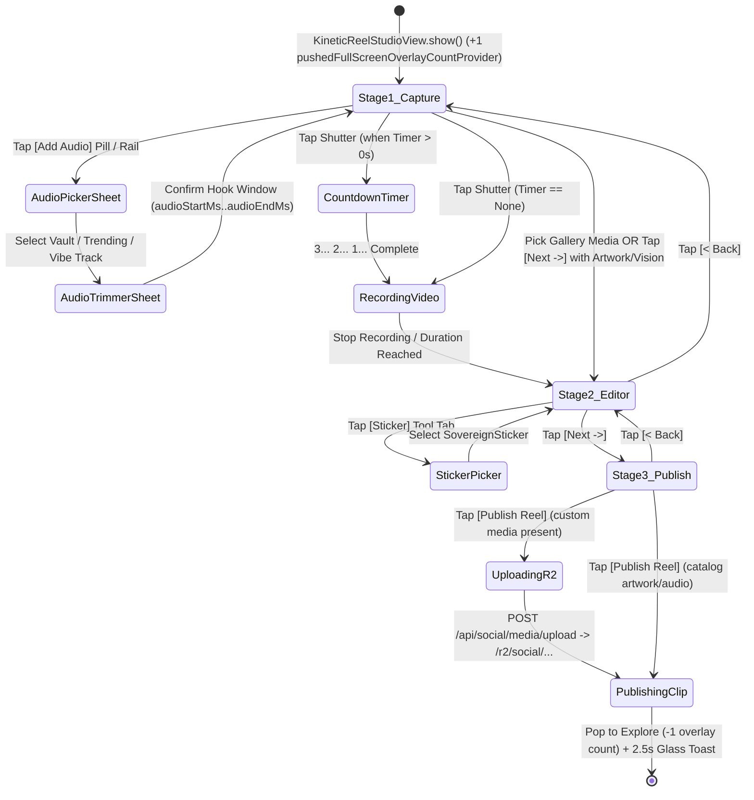

# VHUNAMBI PHASE 74 ARCHITECTURAL BLUEPRINT — INSTAGRAM-BENCHMARK FULL-SCREEN KINETIC REELS STUDIO (`KineticReelStudioView`), REELS PLAYBACK V4, KARAOKE LYRIC SANITIZER & SOCIAL CLOUD SWR / R2 MEDIA UPLOAD

**Document ID:** `VHUNAMBI-SPEC-P74-BLUEPRINT-V1`  
**Phase:** Phase 74 (`phase_74_kinetic_reels_studio_and_playback_v4`)  
**Stage:** Stage 2 & Stage 3 Argon-Hardened Specification Suite  
**Audit Lineage:** [`docs/audits/PHASE73_74_SOCIAL_DOMAIN_AND_REELS_STUDIO_AUDIT.md`](../../audits/PHASE73_74_SOCIAL_DOMAIN_AND_REELS_STUDIO_AUDIT.md) (`AUDIT-SOC-073_074`, Part B: `SOC-05`, `SOC-06a..c`, `BE-SOC-01`)  
**Connectome Dependencies:** `EP-P70-GLASS-SURFACE`, `EP-P70-MOOD-TAXONOMY`, `EP-P68-TRACK-ARTWORK`, `EP-P68-MINIPLAYER-SUPPRESS`, `EP-P71-EDGE-SWR-READTHROUGH`, `EP-P73-POST-CHROMATIC-SYNTH`, `EP-P73-MULTI-REACTIONS-API`, `EP-P73-GIF-STICKER-MEDIA`, `EP-P73-PROFILE-ROUTER`

---

## 1. Executive Overview & Visual North Star

Physical device captures (`video_1.mp4` 00:08–02:48 Instagram Reels Creation benchmark vs. `video_2.mp4` 03:20–04:50 Vhunambi Reels flow) proved that Vhunambi's existing audio-reactive shaders (`KineticPreviewCanvas`), trim controls (`DurationTrimScrubber`), atmospheric filters (`AtmosphericEffectsDeck`), and kinetic typography (`TypographyPresetPicker`) were already engineered inside `lib/features/content_studio/`, yet were completely bypassed by the Explore `+ Post Reel` funnel. Instead, tapping `+ Post Reel` on `TrendingReelsShelf` popped a bare track-list modal followed by a 2-field bottom sheet (`PublishClipModal`) that:
1. Forced a hardcoded `'New track drop 🔥'` post onto the Explore Social Feed on every Reel publish (`SOC-06c`).
2. Attached a `SnackBarAction(label: 'COPY')` that froze the orange banner on Android for ~65 seconds due to Material 3 accessibility persistence rules (`SOC-06a`).
3. Rendered blank `'VHUNAMBI 9:16 COVER'` placeholders and broken thumbnails whenever a track used `asset:` URIs or relative Cloudflare R2 keys (`SOC-06c`).
4. Tokenized raw `[Intro]`, `[Verse 1]`, and `[Crisp soft shakers, airy synth pads]` production cues directly into the karaoke teleprompter (`SOC-06c`).
5. Painted dark charcoal `AppColors.textPrimary` (`#121216`) onto the dark `Trending | For You` header inside `KineticReelsModal` whenever the user ran Light Mode (`SOC-06b`).
6. Executed `GET /api/social/feed` and `POST /api/social/publish` synchronously against single-isolate Worker memory without domain-scoped Supabase SWR read-through or authenticated R2 custom media uploads (`BE-SOC-01`).

Phase 74 unifies the orphaned `content_studio` engines with native camera capture (`camera`), gallery photo/video selection (`image_picker`), and hardware-accelerated video playback (`video_player`) inside a full-screen 4-stage **`KineticReelStudioView`**, upgrades **`KineticReelsModal` to Playback V4**, sanitizes karaoke lyrics at the DNA boundary, hardens Supabase `SECURITY DEFINER` RPCs to zero advisor warnings, and wires 12-second multi-isolate Social Cloud SWR plus authenticated R2 media uploads (`POST /api/social/media/upload`).

---

## 2. Forensic Post-Mortem Comparison Box

```text
╔══════════════════════════════════════════════════════════╦══════════════════════════════════════════════════════════╗
║ LEGACY PHASE 46–72 REELS FUNNEL (OBSERVED DEFECTS)       ║ PHASE 74 KINETIC REELS STUDIO & PLAYBACK V4 ARCHITECTURE ║
╠══════════════════════════════════════════════════════════╬══════════════════════════════════════════════════════════╣
║ • SOC-05: Tapping "+ Post Reel" opens a basic ListTile   ║ • Full-screen 4-stage KineticReelStudioView unifying     ║
║   bottom sheet + cramped PublishClipModal dialog.        ║   Camera, Gallery Photo/Video, Vault Cover & Vision AI.  ║
║ • Orphaned Engines: KineticPreviewCanvas,                ║ • Stage 1 Floating Chrome: Audio pill, Left/Right rail,  ║
║   DurationTrimScrubber, AtmosphericEffectsDeck, and      ║   Length (15s/30s/60s/90s), Speed (0.5x..2x), Timer,     ║
║   TypographyPresetPicker unreachable from Explore.       ║   5 Preset Orbs, 0–100 Intensity slider & countdown HUD. ║
║ • SOC-06a: Publish SnackBar includes SnackBarAction,     ║ • Stage 3 KineticReelPublishView: opt-in "Also share to  ║
║   causing Material 3 to pin it on screen for ~65s.       ║   Explore Feed" (DEFAULT FALSE) + 2.5s action-free glass ║
║ • SOC-06b: _ReelTopFilterTab uses static                 ║   toast that auto-dismisses deterministically.           ║
║   AppColors.textPrimary (#121216 in Light Mode) over     ║ • Explicit Colors.white / Colors.white70 over frosted    ║
║   a black canvas, making Trending | For You invisible.   ║   dark theatre scrim in KineticReelsModal V4.            ║
║ • SOC-06c: Raw "[Intro] [Crisp soft shakers...]" lyrics  ║ • LyricKaraokeSanitizer strips [...] and (...) stage     ║
║   appear on teleprompter; cover art falls back to        ║   directions before word alignment; VhunambiTrackArtwork ║
║   "VHUNAMBI 9:16 COVER" and stock Icons.music_note.      ║   renders all asset:/R2/HTTP covers with zero stock icons║
║ • BE-SOC-01: social_routes.ts runs synchronously against ║ • 12s SWR syncSocialFromCloud + publishClipAsync +       ║
║   single-isolate RAM; no clip multi-reactions or R2      ║   POST /api/social/clips/:id/react + authenticated 25MB  ║
║   social media upload endpoint.                          ║   POST /api/social/media/upload to VHUNAMBI_VAULT (R2).  ║
╚══════════════════════════════════════════════════════════╩══════════════════════════════════════════════════════════╝
```

---

## 3. Multi-Layer Decoupled System Architecture

```text
┌─────────────────────────────────────────────────────────────────────────────────────────┐
│ LAYER 5: FULL-SCREEN FLUTTER STUDIO & THEATRE HUD (apps/vhunambi_client)                │
│  ┌────────────────────────────────────────┐  ┌────────────────────────────────────────┐ │
│  │ KineticReelStudioView (Stages 1 & 2)   │  │ KineticReelPublishView (Stage 3)       │ │
│  │ • Camera/Gallery/Artwork/Vision Canvas │  │ • 9:16 Cover Preview + Caption/Tags    │ │
│  │ • ReelAudioPickerSheet & TrimmerSheet  │  │ • Audience (Everyone / Followers)      │ │
│  │ • SovereignStickerGraphic Overlay      │  │ • Opt-in Explore Cross-Post (false)    │ │
│  └───────────────────┬────────────────────┘  └───────────────────┬────────────────────┘ │
│                      └─────────────────────┬─────────────────────┘                      │
│                                            ▼                                            │
│  ┌────────────────────────────────────────────────────────────────────────────────────┐ │
│  │ KineticReelsModal V4 + TrendingReelsShelf                                          │ │
│  │ • VideoPlayer Layer (with FLUTTER_TEST fallback) + 60 FPS KineticPreviewCanvas     │ │
│  │ • High-Contrast White Theatre Tabs + ReactionTrayOverlay (6 Vector Reactions)      │ │
│  │ • Self-Aware navigateToCreatorProfile() (EP-P73-PROFILE-ROUTER)                    │ │
│  └─────────────────────────────────────────┬──────────────────────────────────────────┘ │
├────────────────────────────────────────────┼────────────────────────────────────────────┤
│ LAYER 4: PURE DART DOMAIN & SANITIZATION   ▼                                            │
│  • LyricKaraokeSanitizer.cleanLyricTextForKaraoke() -> strips [...] & (...)             │
│  • PublishedClip (videoUrl, mediaKind, audioStartMs, audioEndMs, effectPreset,          │
│    effectIntensity, typographyPreset, speedRate, stickerId, reactionCounts, myReaction) │
│  • KineticReelStudioNotifier (4-stage state machine, draft persistence, R2 upload)      │
├────────────────────────────────────────────┼────────────────────────────────────────────┤
│ LAYER 3: HTTP REPOSITORY & DIO CLIENT      ▼                                            │
│  • HttpSocialRepository.uploadReelMedia() -> POST /api/social/media/upload              │
│  • HttpSocialRepository.publishClip()     -> POST /api/social/publish                   │
│  • HttpSocialRepository.reactToClip()     -> POST /api/social/clips/:id/react           │
├────────────────────────────────────────────┼────────────────────────────────────────────┤
│ LAYER 2: CLOUDFLARE WORKER HONO API (apps/vhunambi_api)                                 │
│  • server.ts: hasScopedReadThrough includes /api/social & /api/v1/social                │
│  • social_routes.ts: async SWR read-through + awaited write-through + R2 media upload   │
│  • EdgeIsolateDatabaseEngine & VhunambiDatabase: 1:1 proxy parity                       │
├────────────────────────────────────────────┼────────────────────────────────────────────┤
│ LAYER 1: SUPABASE POSTGRES 17 & CLOUDFLARE R2 (VHUNAMBI_VAULT)                          │
│  • public.published_clips (10 new Studio/Reaction columns)                              │
│  • public.social_interactions (interaction_type = 'clip_react', reaction_type)          │
│  • Hardened SECURITY DEFINER RPCs (search_path pinned, service_role only) + FK index    │
└─────────────────────────────────────────────────────────────────────────────────────────┘
```

---

## 4. Spatial Topology & Studio Stage Taxonomy

| Stage / Surface | Entry Trigger | Core Components | Output State Mutation |
| :--- | :--- | :--- | :--- |
| **Stage 1: Capture & Backdrop Source** | `TrendingReelsShelf` (`+ Post Reel`), `ContentStudioDockView` (`Open Full Reel Studio`) | Live `CameraPreview` (or test-safe chromatic studio fallback), Gallery Picker (`image_picker`), Top Audio Pill (`ReelAudioPickerSheet`), Collapsible Left/Right Tool Rail (`Audio`, `Effects`, `Backdrop`, `Lyrics`, `Length`), Speed bar (`0.5x..2x`), Timer (`None/3s/5s/10s`), 5 Preset Orbs, vertical `0–100` Intensity slider | Updates `mediaKind`, `localMediaBytes`/`videoUrl`, `coverArtUrl`, `speedRate`, `durationPreset`, `effectPreset`, `effectIntensity` |
| **Audio Hook Trimmer (`ReelAudioTrimmerSheet`)** | Automatic after picking a song or tapping `Audio` rail icon | Glowing multi-bar waveform scrubber + `DurationTrimScrubber` (`15s | 30s | 60s | 90s`), draggable window (`audioStartMs`..`audioEndMs`), `just_audio` preview loop | Updates `dna`, `audioUrl`, `startSeconds`, `endSeconds`, `words` (sanitized via `LyricKaraokeSanitizer`) |
| **Stage 2: 9:16 Studio Editor** | Tapping `Next` or completing camera capture in Stage 1 | Full-bleed `9:16` composite (`VideoPlayer` or `VhunambiTrackArtwork` + `KineticPreviewCanvas` + optional `SovereignStickerGraphic`), bottom tool tabs (`TypographyPresetPicker`, `AtmosphericEffectsDeck`, `Stickers`, `Audio Mix`) | Updates `typographyPreset`, `effects`, `stickerId`, `originalAudioVolume`, `trackAudioVolume` |
| **Stage 3: Full-Screen Publish (`KineticReelPublishView`)** | Tapping `Next` in Stage 2 | 9:16 cover preview card, caption `TextField` (subtle 1px tonal focus ring), `#Hashtag` chips, `ClipVisibility` pills (`Everyone` / `Followers`), opt-in `SwitchListTile` `"Also share to Explore Feed"` (`false` default) | Uploads custom bytes via `uploadReelMedia` (if present), calls `publishClip`, prepends to `socialFeedProvider`, shows `2.5s` glass toast |
| **Playback V4 (`KineticReelsModal`)** | Tapping any `TrendingReelCard` or `View all ->` | Explicit white `Trending | For You | Following | Newest` header over dark frosted scrim, `VideoPlayer` backing layer (when `clip.videoUrl != null`), `KineticPreviewCanvas`, `SovereignStickerGraphic`, `ReactionTrayOverlay` on `reel_like_btn`, `navigateToCreatorProfile` | Calls `reactToClip(clip.id, reaction)`, syncs across Worker isolates via `syncSocialFromCloud` |

---

## 5. State Machine & Dual-Viewport Wireframes



### 5.1 Mobile Portrait (`< 600dp`) & Desktop (`>= 600dp`) Studio Wireframes

```text
MOBILE PORTRAIT (< 600dp) — STAGE 1 CAPTURE & STAGE 2 EDITOR:
┌───────────────────────────────────────────┐   ┌───────────────────────────────────────────┐
│ [×]       [♪ Ndo Mufuna • 0:15-0:45]  [⇄] │   │ [‹ Back]     Studio Editor     [Next ->]  │
│  [⚡] [1x] [⏱ 3s]                          │   ├───────────────────────────────────────────┤
│                                        ╭─╮│   │  ┌─────────────────────────────────────┐  │
│  ╭───╮                                 │ ││   │  │   9:16 Video / VhunambiTrackArtwork │  │
│  │ ♪ │ Audio                           │8││   │  │   + Sanitized Karaoke Teleprompter  │  │
│  ├───┤                                 │5││   │  │   + [SovereignStickerGraphic]       │  │
│  │ ✨│ Effects                         │%││   │  │   + Audio-Reactive Equalizer        │  │
│  ├───┤                                 ╰─╯│   │  └─────────────────────────────────────┘  │
│  │ 🖼│ Backdrop      ╭─────────╮          │   ├───────────────────────────────────────────┤
│  ├───┤               │  30s    │          │   │ [Typography] [Effects] [Stickers] [Trim]  │
│  │ Aa│ Lyrics        ╰─────────╯          │   ├───────────────────────────────────────────┤
│  ├───┤                                    │   │  ┌─────────────────┐ ┌─────────────────┐  │
│  │30s│ Length                             │   │  │ Kinetic Bounce  │ │ Luminous Glow   │  │
│  ╰───╯                                    │   │  └─────────────────┘ └─────────────────┘  │
│  (○) (○)   (( ◉ SHUTTER ))   (○)   [Next] │   └───────────────────────────────────────────┘
│ [Gallery]  Kinetic / 8mm / Noir    [Flip] │
└───────────────────────────────────────────┘

STAGE 3 DEDICATED PUBLISH VIEW (`KineticReelPublishView`):
┌───────────────────────────────────────────┐
│ [‹ Back]         New Reel                 │
├───────────────────────────────────────────┤
│  ┌──────────┐  Write a caption...         │
│  │  9:16    │  (Zero orange focus border; │
│  │  Cover   │   1px subtle tonal ring)    │
│  │  Preview │                             │
│  │ [Sticker]│  42 / 220                   │
│  └──────────┘                             │
├───────────────────────────────────────────┤
│  #Amapiano  #Tshivenda  #LogDrum  #Groove │
├───────────────────────────────────────────┤
│  Audience        ( Everyone ) (Followers) │
│  Also share to Explore Feed       [ OFF ] │ <- Opt-in (false by default!)
│  Audio Slice     00:15.0s -> 00:45.0s     │
├───────────────────────────────────────────┤
│       [       Publish Reel       ]        │
└───────────────────────────────────────────┘
```

---

## 6. Mathematical Formulations, APK Footprint Budget & Verification Gates

### 6.1 Lyric Sanitization & Time-Window Rescaling Equations
1. **Bracket & Stage-Direction Sanitizer (`cleanLyricTextForKaraoke`):**
   Given raw lyric string $L_{\text{raw}}$, strip all square-bracket production tags and standalone parenthetical stage directions before whitespace tokenization:
   $$L_{\text{clean}} = \text{trim}\Big( \text{replace}\big( L_{\text{raw}}, \; \text{RegExp}(\text{r'\[[^\]]*\]|\([^\)]*\)'}), \; \text{' '} \big) \Big)$$
2. **Trimmed Audio Window Word Alignment:**
   For a selected hook window $[t_{\text{start}}, t_{\text{end}}]$ with duration $\Delta t = \max(1.0, t_{\text{end}} - t_{\text{start}})$ and sanitized word list $W = [w_0, w_1, \dots, w_{N-1}]$, each token $w_i$ is scheduled across the active hook window:
   $$\delta = \frac{0.88 \cdot \Delta t}{\max(1, N)}, \quad t_{i,\text{start}} = t_{\text{start}} + 0.4 + i \cdot \delta, \quad t_{i,\text{end}} = t_{i,\text{start}} + 0.92 \cdot \delta$$

### 6.2 Android APK Footprint Budget (`<= 200 MiB` Hard Cap)
| Component | Verified / Projected Size (arm64-v8a) | Budget Status |
| :--- | :---: | :---: |
| Existing Phase 73 Release APK Baseline | `43.25 MiB` (`45,349,059` bytes) | Verified on disk |
| `camera: ^0.11.0+2` (CameraX Android bridge) | `+ ~1.20 MiB` | Approved |
| `image_picker: ^1.1.2` (Android Photo Picker) | `+ ~0.65 MiB` | Approved |
| `video_player: ^2.9.2` (ExoPlayer core) | `+ ~5.40 MiB` | Approved |
| **Projected Phase 74 Total Release APK** | **`~50.50 MiB`** | **`25.2%` of `200 MiB` cap (`~149.5 MiB` free)** |

### 6.3 Stage 4 Verification Gates (`G74-01` – `G74-06`)
| Gate ID | Pass | Command / Verification Scope | Required Exit Criteria |
| :--- | :---: | :--- | :--- |
| **`G74-01`** | Pass 1 | `apps/vhunambi_api`: `.\node_modules\.bin\tsc.cmd --noEmit` | `0` TypeScript compile or 1:1 proxy parity errors |
| **`G74-02`** | Pass 1 | `apps/vhunambi_api`: `npm test` (`30/30` `tsx` suites incl. `phase74_reels_studio_swr_and_media.test.ts`) | `30/30` suites green |
| **`G74-03`** | Pass 1 & 2 | `apps/vhunambi_client`: `flutter analyze --no-pub` | `No issues found!` (`0` errors, `0` warnings) |
| **`G74-04`** | Pass 2 | `flutter test --no-pub --timeout=60s test/features/phase74_reels_studio_and_playback_v4_test.dart` | `100%` pass covering sanitizer, 4-stage studio, Light-Mode tabs, clip reactions |
| **`G74-05`** | Pass 2 | `flutter test --no-pub --timeout=60s test/features/content_studio/ test/features/social/` | `100%` regression pass across all content_studio and social suites |
| **`G74-06`** | Pass 2 | PowerShell `STD-UIUX-001` audit across Phase 74 files | `0` raw OS Unicode emojis, `0` stock `Icons.*`, `0` orange `focusedBorder`s |
