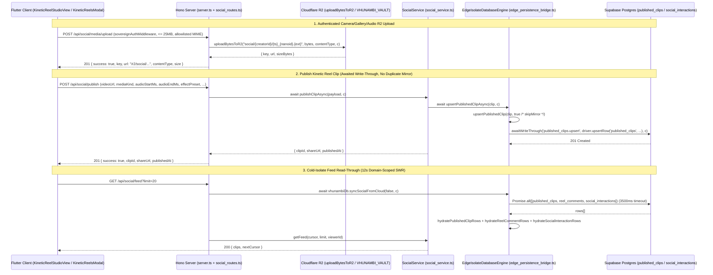

# VHUNAMBI PHASE 74: SYSTEM ARCHITECTURE & LOW-LEVEL TECHNICAL DESIGN
**Document ID**: `VHUNAMBI-SPEC-P74-DESIGN-V1`  
**Phase**: `74`  
**Status**: `STAGE 3 HARDENED — READY FOR STAGE 4 EXECUTION`  
**Baseline Commit**: `75695b1`  

---

## 1. End-to-End Architecture & Data-Flow Diagrams

### 1.1 Social Reels Cloud SWR, Multi-Reaction & R2 Media Upload Pipeline (`M74.1`)



---

## 2. Milestone `M74.1` — Supabase Migration (`published_clips` Studio Columns + RPC Hardening), Edge SWR & R2 Media Upload

### 2.1 File: `supabase/migrations/20261121000002_phase74_reels_studio_and_rpc_hardening.sql` (NEW)

```sql
-- ============================================================================
-- VHUNAMBI PHASE 74: KINETIC REELS STUDIO COLUMNS & RPC SECURITY HARDENING
-- Migration: 20261121000002_phase74_reels_studio_and_rpc_hardening.sql
-- ============================================================================

-- 1. Extend public.published_clips with Reels Studio v4 & Multi-Reaction JSONB columns
ALTER TABLE public.published_clips
  ADD COLUMN IF NOT EXISTS video_url TEXT,
  ADD COLUMN IF NOT EXISTS media_kind TEXT NOT NULL DEFAULT 'artwork',
  ADD COLUMN IF NOT EXISTS audio_start_ms INTEGER NOT NULL DEFAULT 0,
  ADD COLUMN IF NOT EXISTS audio_end_ms INTEGER NOT NULL DEFAULT 30000,
  ADD COLUMN IF NOT EXISTS effect_preset TEXT NOT NULL DEFAULT 'kinetic_gold',
  ADD COLUMN IF NOT EXISTS effect_intensity DOUBLE PRECISION NOT NULL DEFAULT 0.65,
  ADD COLUMN IF NOT EXISTS typography_preset TEXT NOT NULL DEFAULT 'kinetic_bounce',
  ADD COLUMN IF NOT EXISTS speed_rate DOUBLE PRECISION NOT NULL DEFAULT 1.0,
  ADD COLUMN IF NOT EXISTS sticker_id TEXT,
  ADD COLUMN IF NOT EXISTS reaction_counts_json JSONB NOT NULL DEFAULT '{}'::jsonb;

DO $$
BEGIN
  IF NOT EXISTS (
    SELECT 1 FROM pg_constraint WHERE conname = 'published_clips_media_kind_check'
  ) THEN
    ALTER TABLE public.published_clips
      ADD CONSTRAINT published_clips_media_kind_check
      CHECK (
        media_kind IN (
          'artwork',
          'camera_video',
          'gallery_video',
          'gallery_photo',
          'vision'
        )
      );
  END IF;
END $$;

CREATE INDEX IF NOT EXISTS idx_published_clips_created_at_desc
  ON public.published_clips (created_at DESC);

CREATE INDEX IF NOT EXISTS idx_published_clips_creator_created_desc
  ON public.published_clips (creator_id, created_at DESC);

-- 2. Covering Foreign Key Index for public.auth_sessions(creator_id)
CREATE INDEX IF NOT EXISTS idx_auth_sessions_creator_id
  ON public.auth_sessions (creator_id);

-- 3. Harden pre-existing SECURITY DEFINER functions (immutable search_path = public, pg_temp + service_role lockdown)
DO $$
DECLARE
  fn_record RECORD;
BEGIN
  FOR fn_record IN
    SELECT p.oid::regprocedure AS sig, p.proname
    FROM pg_proc p
    JOIN pg_namespace n ON n.oid = p.pronamespace
    WHERE n.nspname = 'public'
      AND p.proname IN (
        'execute_atomic_payout',
        'record_beat_license_atomic',
        'send_cultural_tip_atomic',
        'custom_access_token_hook'
      )
  LOOP
    EXECUTE format('ALTER FUNCTION %s SET search_path = public, pg_temp;', fn_record.sig);

    IF fn_record.proname IN (
      'execute_atomic_payout',
      'record_beat_license_atomic',
      'send_cultural_tip_atomic'
    ) THEN
      EXECUTE format('REVOKE EXECUTE ON FUNCTION %s FROM PUBLIC, anon, authenticated;', fn_record.sig);
      EXECUTE format('GRANT EXECUTE ON FUNCTION %s TO service_role;', fn_record.sig);
    END IF;
  END LOOP;
END $$;
```

### 2.2 SQLite (`vhunambi_db.ts`) & Edge SWR (`edge_persistence_bridge.ts`) 1:1 Parity

#### 2.2.1 File: `apps/vhunambi_api/src/modules/social/social_types.ts` (MODIFY)

Extend the live `PublishClipRequest` and `PublishedClipDto` interfaces with Phase 74 studio, video/photo, and multi-reaction fields:

```ts
export type ReelMediaKind =
  | 'artwork'
  | 'camera_video'
  | 'gallery_video'
  | 'gallery_photo'
  | 'vision';

export interface PublishClipRequest {
  trackId: string;
  title: string;
  caption: string;
  tags: string[];
  visibility: ClipVisibility;
  dna: Record<string, unknown>;
  creatorId?: string;
  creatorUsername?: string;
  creatorDisplayName?: string;
  creatorAvatarUrl?: string;
  isCreatorVerified?: boolean;
  audioUrl?: string;
  coverUrl?: string;
  videoUrl?: string | null;
  mediaKind?: ReelMediaKind;
  audioStartMs?: number;
  audioEndMs?: number;
  effectPreset?: string;
  effectIntensity?: number;
  typographyPreset?: string;
  speedRate?: number;
  stickerId?: string | null;
  remixedFromClipId?: string;
  remixAttribution?: string;
}

export interface PublishedClipDto {
  id: string;
  trackId: string;
  creatorId: string;
  creatorUsername: string;
  creatorDisplayName: string;
  creatorAvatarUrl: string | null;
  isCreatorVerified: boolean;
  title: string;
  caption: string;
  tags: string[];
  genre: string;
  audioUrl: string;
  coverUrl: string;
  videoUrl?: string | null;
  mediaKind?: ReelMediaKind;
  audioStartMs?: number;
  audioEndMs?: number;
  effectPreset?: string;
  effectIntensity?: number;
  typographyPreset?: string;
  speedRate?: number;
  stickerId?: string | null;
  dna: Record<string, unknown>;
  playCount: number;
  likeCount: number;
  commentCount: number;
  remixCount: number;
  isLikedByMe: boolean;
  isSavedByMe: boolean;
  reactionCounts?: Record<string, number>;
  myReaction?: string | null;
  remixedFromClipId?: string;
  remixAttribution?: string;
  publishedAt: string;
}
```

#### 2.2.2 File: `apps/vhunambi_api/src/db/edge_persistence_bridge.ts` (MODIFY)

Use the live `EdgeIsolateDatabaseEngine` primitives (`resolveCloudDriver`, `withTimeoutResult`, `domainHydratedAtMs`, `domainInFlightPromises`, `DEFAULT_SWR_TTL_MS`, `mirrorWriteThrough`, `awaitWriteThrough`, `KineticReactionWire`, `normalizeKineticReactionWire`, `normalizeReactionCounts`, `compactReactionCounts`, `sumReactionCounts`, `KineticReactionMutationResult`, `socialInteractions`, `socialInteractionReactions`):

1. **Add `hydratePublishedClipRows` helper and call it in both `ensureColdStartHydrated` (`L859-891`) and `syncSocialFromCloud`**:
```ts
  private hydratePublishedClipRows(clipsRows: Array<Record<string, any>>): void {
    for (const pc of clipsRows) {
      if (!pc.id) continue;
      const parsedData =
        pc.data_json && typeof pc.data_json === 'object'
          ? (pc.data_json as Record<string, any>)
          : this.parseJsonField(pc.data_json);
      const createdMs = Number(pc.created_at);
      const updatedMs = Number(pc.updated_at);
      const createdIso = Number.isFinite(createdMs) && createdMs > 0
        ? new Date(createdMs).toISOString()
        : String(pc.created_at || parsedData.publishedAt || new Date().toISOString());
      const updatedIso = Number.isFinite(updatedMs) && updatedMs > 0
        ? new Date(updatedMs).toISOString()
        : String(pc.updated_at || createdIso);
      const cid = canonicalizeCreatorId(String(pc.creator_id ?? 'creator_cern'));
      const reactionCounts = compactReactionCounts(
        normalizeReactionCounts(pc.reaction_counts_json ?? parsedData.reactionCounts),
      );
      const videoUrl =
        typeof pc.video_url === 'string' && pc.video_url.trim().length > 0
          ? pc.video_url.trim()
          : (typeof parsedData.videoUrl === 'string' && parsedData.videoUrl.trim().length > 0
            ? parsedData.videoUrl.trim()
            : null);
      const mediaKind = String(pc.media_kind ?? parsedData.mediaKind ?? 'artwork');
      const audioStartMs = Number(pc.audio_start_ms ?? parsedData.audioStartMs ?? 0);
      const audioEndMs = Number(pc.audio_end_ms ?? parsedData.audioEndMs ?? 30000);
      const effectPreset = String(pc.effect_preset ?? parsedData.effectPreset ?? 'kinetic_gold');
      const effectIntensity = Number(pc.effect_intensity ?? parsedData.effectIntensity ?? 0.65);
      const typographyPreset = String(
        pc.typography_preset ?? parsedData.typographyPreset ?? 'kinetic_bounce',
      );
      const speedRate = Number(pc.speed_rate ?? parsedData.speedRate ?? 1.0);
      const stickerId =
        typeof pc.sticker_id === 'string' && pc.sticker_id.trim().length > 0
          ? pc.sticker_id.trim()
          : (typeof parsedData.stickerId === 'string' && parsedData.stickerId.trim().length > 0
            ? parsedData.stickerId.trim()
            : null);

      const mergedPayload = {
        ...parsedData,
        id: String(pc.id),
        trackId: pc.track_id ?? parsedData.trackId ?? String(pc.id),
        creatorId: cid,
        creatorUsername: String(
          parsedData.creatorUsername ?? `@${cid.replace(/^creator_/, '')}`,
        ),
        title: String(parsedData.title ?? pc.title ?? 'Untitled Clip'),
        genre: String(pc.genre ?? parsedData.genre ?? 'Amapiano'),
        audioUrl: String(pc.audio_url ?? parsedData.audioUrl ?? ''),
        coverUrl: String(pc.cover_url ?? parsedData.coverUrl ?? ''),
        videoUrl,
        mediaKind,
        audioStartMs,
        audioEndMs,
        effectPreset,
        effectIntensity,
        typographyPreset,
        speedRate,
        stickerId,
        reactionCounts,
        likeCount: Number(pc.likes_count ?? parsedData.likeCount ?? 0),
        commentCount: Number(pc.comments_count ?? parsedData.commentCount ?? 0),
        remixCount: Number(pc.remixes_count ?? parsedData.remixCount ?? 0),
        publishedAt: String(parsedData.publishedAt ?? createdIso),
      };

      this.publishedClips.set(String(pc.id), {
        id: String(pc.id),
        creator_id: cid,
        creator_handle: mergedPayload.creatorUsername,
        video_url: videoUrl ?? '',
        audio_title: mergedPayload.title,
        bantu_language: mergedPayload.genre,
        views_count: Number(parsedData.playCount ?? pc.views_count ?? 0),
        likes_count: mergedPayload.likeCount,
        comments_count: mergedPayload.commentCount,
        remixes_count: mergedPayload.remixCount,
        remixed_from_clip_id: pc.remixed_from_clip_id
          ? String(pc.remixed_from_clip_id)
          : null,
        reaction_counts_json: JSON.stringify(reactionCounts),
        data_json: JSON.stringify(mergedPayload),
        created_at: createdIso,
        updated_at: updatedIso,
      });
    }
  }
```

2. **Add `syncSocialFromCloud` with `12_000 ms` SWR TTL (`DEFAULT_SWR_TTL_MS`), in-flight deduplication, and 3-table atomic gate (`published_clips`, `reel_comments`, `social_interactions`)**:
```ts
  public async syncSocialFromCloud(
    force = false,
    cOrEnv?: unknown,
  ): Promise<boolean> {
    const driver = this.resolveCloudDriver(cOrEnv);
    if (!driver.isConfigured()) return false;

    const domainKey = 'social:global';
    const lastHydrated = this.domainHydratedAtMs.get(domainKey) ?? 0;
    if (
      !force &&
      lastHydrated > 0 &&
      Date.now() - lastHydrated < EdgeIsolateDatabaseEngine.DEFAULT_SWR_TTL_MS
    ) {
      return true;
    }

    const existingFlight = this.domainInFlightPromises.get(domainKey);
    if (existingFlight && !force) {
      return existingFlight;
    }

    const syncPromise = (async (): Promise<boolean> => {
      const [clipsRes, commentsRes, interactionsRes] = await Promise.all([
        EdgeIsolateDatabaseEngine.withTimeoutResult(
          driver.selectRows<Record<string, any>>(
            'published_clips',
            'select=*&order=created_at.desc&limit=120',
          ),
          3500,
        ),
        EdgeIsolateDatabaseEngine.withTimeoutResult(
          driver.selectRows<Record<string, any>>(
            'reel_comments',
            'select=*&order=timestamp_ms.desc&limit=400',
          ),
          3500,
        ),
        EdgeIsolateDatabaseEngine.withTimeoutResult(
          driver.selectRows<Record<string, any>>(
            'social_interactions',
            'select=*&limit=1000',
          ),
          3500,
        ),
      ]);

      if (clipsRes.ok) this.hydratePublishedClipRows(clipsRes.value);
      if (commentsRes.ok) this.hydrateReelCommentRows(commentsRes.value);
      if (interactionsRes.ok) {
        this.hydrateSocialInteractionRows(interactionsRes.value);
      }

      const allSucceeded = clipsRes.ok && commentsRes.ok && interactionsRes.ok;
      if (allSucceeded) {
        this.domainHydratedAtMs.set(domainKey, Date.now());
      }
      return allSucceeded;
    })().finally(() => {
      if (this.domainInFlightPromises.get(domainKey) === syncPromise) {
        this.domainInFlightPromises.delete(domainKey);
      }
    });

    this.domainInFlightPromises.set(domainKey, syncPromise);
    return syncPromise;
  }
```

3. **Upgrade `upsertPublishedClip` (with `skipMirror = false`), add `upsertPublishedClipAsync`, fix `listPublishedClipRows` timestamp DESC sorting, and add `reactToClip` / `reactToClipAsync`**:
```ts
  private buildPublishedClipCloudPayload(clip: Record<string, any>): Record<string, any> {
    const now = new Date().toISOString();
    const id = String(clip.id);
    const creatorId = canonicalizeCreatorId(String(clip.creatorId || 'creator_cern'));
    const creatorHandle = String(
      clip.creatorUsername || clip.creatorHandle || `@${creatorId.replace(/^creator_/, '')}`,
    );
    const createdAt = String(
      clip.publishedAt || clip.createdAt || this.publishedClips.get(id)?.created_at || now,
    );
    const createdMs = Date.parse(createdAt) || Date.now();
    const updatedMs = Date.parse(now) || Date.now();
    const reactionCounts = compactReactionCounts(
      normalizeReactionCounts(clip.reactionCounts),
    );
    const videoUrl =
      typeof clip.videoUrl === 'string' && clip.videoUrl.trim().length > 0
        ? clip.videoUrl.trim()
        : null;
    const clipPayload = {
      ...clip,
      id,
      creatorId,
      creatorUsername: creatorHandle,
      videoUrl,
      mediaKind: String(clip.mediaKind || 'artwork'),
      audioStartMs: Number(clip.audioStartMs ?? 0),
      audioEndMs: Number(clip.audioEndMs ?? 30000),
      effectPreset: String(clip.effectPreset || 'kinetic_gold'),
      effectIntensity: Number(clip.effectIntensity ?? 0.65),
      typographyPreset: String(clip.typographyPreset || 'kinetic_bounce'),
      speedRate: Number(clip.speedRate ?? 1.0),
      stickerId: clip.stickerId ? String(clip.stickerId) : null,
      reactionCounts,
      publishedAt: createdAt,
    };
    return {
      localRow: {
        id,
        creator_id: creatorId,
        creator_handle: creatorHandle,
        video_url: videoUrl ?? '',
        audio_title: String(clip.title || 'Untitled Clip'),
        bantu_language: clip.genre ? String(clip.genre) : null,
        views_count: Number(clip.playCount ?? clip.viewsCount ?? 0),
        likes_count: Number(clip.likeCount ?? clip.likesCount ?? 0),
        comments_count: Number(clip.commentCount ?? clip.commentsCount ?? 0),
        remixes_count: Number(clip.remixCount ?? clip.remixesCount ?? 0),
        remixed_from_clip_id: clip.remixedFromClipId
          ? String(clip.remixedFromClipId)
          : null,
        reaction_counts_json: JSON.stringify(reactionCounts),
        data_json: JSON.stringify(clipPayload),
        created_at: createdAt,
        updated_at: now,
      },
      cloudRow: {
        id,
        track_id: String(clip.trackId || id),
        creator_id: creatorId,
        title: String(clip.title || 'Untitled Groove'),
        caption: String(clip.caption || ''),
        genre: String(clip.genre || 'Amapiano'),
        bpm: Math.round(Number(clip.bpm ?? 113)),
        likes_count: Number(clip.likeCount ?? clip.likesCount ?? 0),
        comments_count: Number(clip.commentCount ?? clip.commentsCount ?? 0),
        remixes_count: Number(clip.remixCount ?? clip.remixesCount ?? 0),
        shares_count: Number(clip.shareCount ?? clip.sharesCount ?? 0),
        audio_url: String(clip.audioUrl || ''),
        cover_url: String(clip.coverUrl || ''),
        video_url: videoUrl,
        media_kind: clipPayload.mediaKind,
        audio_start_ms: clipPayload.audioStartMs,
        audio_end_ms: clipPayload.audioEndMs,
        effect_preset: clipPayload.effectPreset,
        effect_intensity: clipPayload.effectIntensity,
        typography_preset: clipPayload.typographyPreset,
        speed_rate: clipPayload.speedRate,
        sticker_id: clipPayload.stickerId,
        reaction_counts_json: reactionCounts,
        remixed_from_clip_id: clip.remixedFromClipId ? String(clip.remixedFromClipId) : null,
        remix_attribution: clip.remixAttribution ? String(clip.remixAttribution) : null,
        tags_json: Array.isArray(clip.tags) ? clip.tags : [],
        dna_json: clip.dna ?? {},
        data_json: clipPayload,
        created_at: createdMs,
        updated_at: updatedMs,
      },
    };
  }

  public upsertPublishedClip(
    clip: Record<string, any>,
    skipMirror = false,
  ): void {
    const { localRow, cloudRow } = this.buildPublishedClipCloudPayload(clip);
    this.publishedClips.set(localRow.id, localRow);
    if (!skipMirror) {
      this.mirrorWriteThrough('published_clips.upsert', async (driver) => {
        await driver.upsertRow('published_clips', cloudRow, 'id');
      });
    }
  }

  public async upsertPublishedClipAsync(
    clip: Record<string, any>,
    cOrEnv?: unknown,
  ): Promise<void> {
    const { localRow, cloudRow } = this.buildPublishedClipCloudPayload(clip);
    this.publishedClips.set(localRow.id, localRow);
    await this.awaitWriteThrough(
      'published_clips.upsert',
      async (driver) => {
        await driver.upsertRow('published_clips', cloudRow, 'id');
      },
      cOrEnv,
    );
  }

  public listPublishedClipRows(): Record<string, any>[] {
    return Array.from(this.publishedClips.values())
      .sort((a, b) => {
        const ta = Date.parse(String(a.created_at || '')) || 0;
        const tb = Date.parse(String(b.created_at || '')) || 0;
        return tb - ta;
      })
      .map((r) => this.mapPublishedClipRow(r));
  }

  public reactToClip(
    clipId: string,
    actorCreatorId = 'creator_cern',
    reactionType: KineticReactionWire | null = null,
    skipMirror = false,
  ): KineticReactionMutationResult {
    const row = this.publishedClips.get(clipId);
    if (!row) {
      return {
        success: false,
        targetId: clipId,
        myReaction: null,
        reactionCounts: {},
        likeCount: 0,
        liked: false,
      };
    }

    const actor = canonicalizeCreatorId(actorCreatorId);
    const key = `clip_react::${clipId}::${actor}`;
    const prevReaction = this.socialInteractionReactions.get(key) ?? null;
    const requested = normalizeKineticReactionWire(reactionType);
    const nextReaction: KineticReactionWire | null =
      requested === null || requested === prevReaction ? null : requested;

    const parsedData = this.parseJsonField(row.data_json);
    const counts = normalizeReactionCounts(
      row.reaction_counts_json ?? parsedData.reactionCounts,
    );
    const legacyLikeCount = Math.max(0, Number(row.likes_count ?? parsedData.likeCount ?? 0));
    if (sumReactionCounts(counts) === 0 && legacyLikeCount > 0) {
      counts.love = legacyLikeCount;
    }

    if (prevReaction) {
      counts[prevReaction] = Math.max(0, counts[prevReaction] - 1);
    }
    if (nextReaction) {
      counts[nextReaction] = counts[nextReaction] + 1;
      this.socialInteractions.add(key);
      this.socialInteractionReactions.set(key, nextReaction);
    } else {
      this.socialInteractions.delete(key);
      this.socialInteractionReactions.delete(key);
    }

    const compact = compactReactionCounts(counts);
    const nextLikes = Math.max(sumReactionCounts(counts), 0);
    row.reaction_counts_json = JSON.stringify(compact);
    row.likes_count = nextLikes;
    row.updated_at = new Date().toISOString();
    parsedData.reactionCounts = compact;
    parsedData.likeCount = nextLikes;
    row.data_json = JSON.stringify(parsedData);

    if (!skipMirror) {
      this.mirrorWriteThrough('published_clips.react', async (driver) => {
        if (nextReaction) {
          await driver.upsertRow(
            'social_interactions',
            {
              interaction_type: 'clip_react',
              target_id: clipId,
              actor_creator_id: actor,
              reaction_type: nextReaction,
              created_at: Date.now(),
            },
            'interaction_type,target_id,actor_creator_id',
          );
        } else {
          await driver.deleteRows(
            'social_interactions',
            `interaction_type=eq.clip_react&target_id=eq.${encodeURIComponent(clipId)}&actor_creator_id=eq.${encodeURIComponent(actor)}`,
          );
        }
        await driver.patchRows(
          'published_clips',
          `id=eq.${encodeURIComponent(clipId)}`,
          {
            reaction_counts_json: compact,
            likes_count: nextLikes,
            data_json: parsedData,
            updated_at: Date.now(),
          },
        );
      });
    }

    return {
      success: true,
      targetId: clipId,
      myReaction: nextReaction,
      reactionCounts: compact,
      likeCount: nextLikes,
      liked: nextReaction !== null,
    };
  }

  public async reactToClipAsync(
    clipId: string,
    actorCreatorId = 'creator_cern',
    reactionType: KineticReactionWire | null = null,
    cOrEnv?: unknown,
  ): Promise<KineticReactionMutationResult> {
    const result = this.reactToClip(clipId, actorCreatorId, reactionType, true);
    if (!result.success) return result;
    const actor = canonicalizeCreatorId(actorCreatorId);
    const row = this.publishedClips.get(clipId);
    const parsedData = row ? this.parseJsonField(row.data_json) : {};
    await this.awaitWriteThrough(
      'published_clips.react',
      async (driver) => {
        await Promise.all([
          result.myReaction
            ? driver.upsertRow(
              'social_interactions',
              {
                interaction_type: 'clip_react',
                target_id: clipId,
                actor_creator_id: actor,
                reaction_type: result.myReaction,
                created_at: Date.now(),
              },
              'interaction_type,target_id,actor_creator_id',
            )
            : driver.deleteRows(
              'social_interactions',
              `interaction_type=eq.clip_react&target_id=eq.${encodeURIComponent(clipId)}&actor_creator_id=eq.${encodeURIComponent(actor)}`,
            ),
          driver.patchRows(
            'published_clips',
            `id=eq.${encodeURIComponent(clipId)}`,
            {
              reaction_counts_json: result.reactionCounts,
              likes_count: result.likeCount,
              data_json: parsedData,
              updated_at: Date.now(),
            },
          ),
        ]);
      },
      cOrEnv,
    );
    return result;
  }
```

#### 2.2.3 File: `apps/vhunambi_api/src/db/vhunambi_db.ts` (MODIFY)

Add 1:1 matching signatures on `VhunambiDatabase` (`syncSocialFromCloud(_force = false, _cOrEnv?: unknown)`, `upsertPublishedClipAsync(clip, _cOrEnv?: unknown)`, `reactToClip(clipId, actorCreatorId, reactionType)`, `reactToClipAsync(clipId, actorCreatorId, reactionType, _cOrEnv?)`) plus idempotent `ALTER TABLE published_clips ADD COLUMN ...` statements for `reaction_counts_json` and Phase 74 studio columns, and sort `listPublishedClipRows()` by `created_at DESC`.

### 2.3 Worker REST Routes (`social_routes.ts` & `server.ts`)

#### 2.3.1 File: `apps/vhunambi_api/src/server.ts` (MODIFY)

Preserve ALL existing live prefixes in `hasScopedReadThrough` (`L53-68`) and append `/api/social` and `/api/v1/social`:
```ts
    const hasScopedReadThrough =
      p.startsWith('/api/notifications') ||
      p.startsWith('/api/v1/notifications') ||
      p.startsWith('/api/wallet') ||
      p.startsWith('/api/v1/wallet') ||
      p.startsWith('/api/explore') ||
      p.startsWith('/api/v1/explore') ||
      p.startsWith('/api/social') ||
      p.startsWith('/api/v1/social') ||
      p.startsWith('/api/library') ||
      p.startsWith('/api/v1/library') ||
      p.startsWith('/api/playlists') ||
      p.startsWith('/api/v1/playlists') ||
      p.startsWith('/api/marketplace') ||
      p.startsWith('/api/v1/marketplace') ||
      p.startsWith('/v1/generations') ||
      p.startsWith('/v1/vision') ||
      p.startsWith('/v1/webhooks');
```

#### 2.3.2 File: `apps/vhunambi_api/src/modules/social/social_service.ts` (MODIFY)

1. In `orderedClips(viewerCreatorId = 'creator_cern')`: hydrate `myReaction` from `vhunambiDb.listSocialInteractionReactions('clip_react', canonicalizeCreatorId(viewerCreatorId))`, hydrate `reactionCounts`, `videoUrl` (via `resolveMediaUrl` when present), `mediaKind`, `audioStartMs`, `audioEndMs`, `effectPreset`, `effectIntensity`, `typographyPreset`, `speedRate`, `stickerId`, and set `isLikedByMe: likedTargets.has(clip.id) || Boolean(myReaction)`.
2. Add `getClipById(clipId: string, viewerCreatorId = 'creator_cern'): PublishedClipDto | null`.
3. Add `export async function publishClipAsync(req: PublishClipRequest, cOrEnv?: unknown)` persisting via `await vhunambiDb.upsertPublishedClipAsync(clip, cOrEnv)`.
4. Add `export async function reactToClipAsync(clipId: string, actorCreatorId: string, reactionType: KineticReactionWire | null, cOrEnv?: unknown)` calling `await vhunambiDb.reactToClipAsync(clipId, actorCreatorId, reactionType, cOrEnv)`.

#### 2.3.3 File: `apps/vhunambi_api/src/routes/social_routes.ts` (MODIFY)

1. Extend `PublishClipSchema` with `videoUrl`, `mediaKind`, `audioStartMs`, `audioEndMs`, `effectPreset`, `effectIntensity`, `typographyPreset`, `speedRate`, and `stickerId`.
2. Make `GET /social/feed`, `GET /social/clips/:id`, `GET /social/clips/:id/comments`, `GET /social/clips/:id/remixes`, and `GET /creators/:id/clips` `async (c) =>` with `await vhunambiDb.syncSocialFromCloud(false, c)`.
3. Update `POST /social/publish` to call `await publishClipAsync(..., c)`.
4. Add `POST /social/clips/:id/react` validating `reactionType` against `VALID_KINETIC_REACTIONS` (or `null`) and returning `await reactToClipAsync(id, actorId, reactionType, c)` (`404` if `!result.success`).
5. Add authenticated `POST /social/media/upload` (gated by `socialRoutes.use('/social/*', sovereignAuthMiddleware)` plus explicit `authUser` check returning `401` if absent):
```ts
const MAX_SOCIAL_MEDIA_BYTES = 25 * 1024 * 1024; // 26,214,400 bytes
const ALLOWED_SOCIAL_MEDIA_MIMES: Record<string, string> = {
  'video/mp4': 'mp4',
  'video/quicktime': 'mov',
  'video/webm': 'webm',
  'image/jpeg': 'jpg',
  'image/png': 'png',
  'image/webp': 'webp',
  'audio/mpeg': 'mp3',
  'audio/mp4': 'm4a',
};

socialRoutes.post('/social/media/upload', async (c) => {
  const authUser = c.get('authUser');
  if (!authUser) {
    return c.json({ error: 'UNAUTHORIZED', message: 'Authentication required' }, 401);
  }
  const creatorId = canonicalizeCreatorId(authUser.creatorId);
  const reqContentType = (c.req.header('content-type') || '').toLowerCase();

  let bytes: Uint8Array;
  let mimeType = '';

  if (reqContentType.includes('multipart/form-data')) {
    const form = await c.req.formData();
    const file = form.get('file');
    if (!(file instanceof File)) {
      return c.json({ error: 'INVALID_REQUEST', message: 'Missing multipart file field' }, 400);
    }
    mimeType = (file.type || '').split(';')[0].trim().toLowerCase();
    bytes = new Uint8Array(await file.arrayBuffer());
  } else {
    mimeType = reqContentType.split(';')[0].trim().toLowerCase();
    bytes = new Uint8Array(await c.req.arrayBuffer());
  }

  const ext = ALLOWED_SOCIAL_MEDIA_MIMES[mimeType];
  if (!ext) {
    return c.json(
      {
        error: 'UNSUPPORTED_MEDIA_TYPE',
        message: `Unsupported MIME type: ${mimeType || 'unknown'}`,
      },
      415,
    );
  }
  if (bytes.byteLength === 0) {
    return c.json({ error: 'INVALID_REQUEST', message: 'Empty media payload' }, 400);
  }
  if (bytes.byteLength > MAX_SOCIAL_MEDIA_BYTES) {
    return c.json(
      {
        error: 'PAYLOAD_TOO_LARGE',
        message: 'Media payload exceeds 25 MB limit',
      },
      413,
    );
  }

  const objectKey = `social/${creatorId}/${Date.now()}_${nanoid(8)}.${ext}`;
  const stored = await uploadBytesToR2(objectKey, bytes, mimeType, c);
  return c.json(
    {
      success: true,
      key: stored.key,
      url: `/r2/${stored.key}`,
      contentType: mimeType,
      size: bytes.byteLength,
    },
    201,
  );
});
```

---

## 3. Milestone `M74.2` — Media Packages, Lyric Karaoke Sanitizer, `PublishedClip` Schema & Artwork Parity

### 3.1 File: `apps/vhunambi_client/pubspec.yaml` & `android/app/src/main/AndroidManifest.xml` (MODIFY)

1. Add under `dependencies:` in `apps/vhunambi_client/pubspec.yaml`:
```yaml
  camera: ^0.11.0+2
  image_picker: ^1.1.2
  video_player: ^2.9.2
```
2. Add above `<application` in `apps/vhunambi_client/android/app/src/main/AndroidManifest.xml`:
```xml
    <uses-permission android:name="android.permission.CAMERA" />
    <uses-permission android:name="android.permission.READ_MEDIA_VIDEO" />
    <uses-permission android:name="android.permission.READ_MEDIA_IMAGES" />
    <uses-permission android:name="android.permission.READ_EXTERNAL_STORAGE" android:maxSdkVersion="32" />
```

### 3.2 Karaoke Lyric Bracket Sanitizer (`lyric_karaoke_sanitizer.dart`)

#### File: `apps/vhunambi_client/lib/features/content_studio/domain/utils/lyric_karaoke_sanitizer.dart` (NEW)

```dart
import 'package:vhunambi_client/features/content_studio/domain/models/song_metadata_dna.dart';

/// Deterministic lyric sanitizer for Kinetic Reels 60 FPS Karaoke Canvas & MiniPlayer.
///
/// Strips structural section cues (`[Intro]`, `[Verse 1]`, `[Chorus]`,
/// `[Crisp soft shakers, airy synth pads]`), stage directions (`(x2)`, `[Repeat]`),
/// and metadata labels (`Title:`, `Genre:`, `BPM:`) before word tokenization (`SOC-06c`).
class LyricKaraokeSanitizer {
  const LyricKaraokeSanitizer._();

  static final RegExp _squareBracketBlock = RegExp(r'\[[^\]]*\]');
  static final RegExp _parenCueBlock = RegExp(
    r'\(\s*(?:intro|verse\s*\d*|chorus|pre[-\s]*chorus|bridge|outro|hook|drop|repeat(?:\s*x?\d+)?|x\d+|\d+x|instrumental|solo|ad[-\s]*libs?)\s*\)',
    caseSensitive: false,
  );
  static final RegExp _metadataHeaderLine = RegExp(
    r'^\s*(?:title|song\s*title|track|artist|creator|genre|sub[-\s]*genre|bpm|tempo|key|style|mood|language|duration|prompt)\s*:\s*.*$',
    caseSensitive: false,
    multiLine: true,
  );
  static final RegExp _pureCueToken = RegExp(
    r'^(?:\[.*\]|\((?:x\d+|\d+x|repeat|chorus|verse|intro|outro|hook|bridge)\)|(?:intro|verse|chorus|bridge|outro|hook):?)$',
    caseSensitive: false,
  );

  /// Cleans raw multi-line lyric text before word-level [AlignedWord] tokenization.
  static String cleanLyricTextForKaraoke(String rawLyrics) {
    if (rawLyrics.trim().isEmpty) return '';
    var text = rawLyrics.replaceAll('\r\n', '\n');
    text = text.replaceAll(_metadataHeaderLine, ' ');
    text = text.replaceAll(_squareBracketBlock, ' ');
    text = text.replaceAll(_parenCueBlock, ' ');

    final cleanedTokens = <String>[];
    for (final rawToken in text.split(RegExp(r'\s+'))) {
      final token = rawToken.trim();
      if (token.isEmpty || _pureCueToken.hasMatch(token)) continue;
      final stripped = token
          .replaceAll(RegExp(r'^[\[\]+*#]+|[\[\]+*#]+$'), '')
          .trim();
      if (stripped.isEmpty || _pureCueToken.hasMatch(stripped)) continue;
      cleanedTokens.add(stripped);
    }
    return cleanedTokens.join(' ');
  }

  /// Sanitizes an existing list of [AlignedWord] timestamps so legacy clips containing
  /// bracketed section tags or multi-word bracket runs (`[Crisp`, `soft`, `shakers]`)
  /// render only clean vocal words.
  static List<AlignedWord> sanitizeAlignment(List<AlignedWord> words) {
    if (words.isEmpty) return const <AlignedWord>[];
    final result = <AlignedWord>[];
    var insideBracketRun = false;

    for (final item in words) {
      final rawWord = item.word.trim();
      if (rawWord.isEmpty) continue;

      if (insideBracketRun) {
        if (rawWord.contains(']')) {
          insideBracketRun = false;
        }
        continue;
      }

      if (rawWord.startsWith('[') && !rawWord.contains(']')) {
        insideBracketRun = true;
        continue;
      }

      if (_squareBracketBlock.hasMatch(rawWord) ||
          _parenCueBlock.hasMatch(rawWord) ||
          _pureCueToken.hasMatch(rawWord)) {
        continue;
      }

      final cleaned = cleanLyricTextForKaraoke(rawWord);
      if (cleaned.isEmpty) continue;
      result.add(
        AlignedWord(
          word: cleaned,
          startSec: item.startSec,
          endSec: item.endSec,
        ),
      );
    }
    return result;
  }
}
```

### 3.3 `SongMetadataDna`, `DurationPreset`, `PublishedClip`, `ISocialRepository`, `KineticPreviewCanvas` & `TrendingReelsShelf`

1. **`song_metadata_dna.dart`**: Run `LyricKaraokeSanitizer.cleanLyricTextForKaraoke(lyrics)` inside `SongMetadataDna.fromTrackInfo` before splitting into `AlignedWord`, and run `LyricKaraokeSanitizer.sanitizeAlignment(...)` in `SongMetadataDna.fromJson`.
2. **`content_studio_preset.dart`**: Add `reel60s(60, '60s Reel')` and `reel90s(90, '90s Extended')` to `DurationPreset` while keeping `hook15s`, `reel30s`, and `fullTrack` intact.
3. **`published_clip.dart`**: Add `videoUrl`, `mediaKind` (default `'artwork'`), `audioStartMs` (`0`), `audioEndMs` (`30000`), `effectPreset` (`'kinetic_gold'`), `effectIntensity` (`0.65`), `typographyPreset` (`'kinetic_bounce'`), `speedRate` (`1.0`), `stickerId`, `reactionCounts` (`Map<KineticReactionType, int>`), `myReaction` (`KineticReactionType?`), `totalReactionCount`, and `clearMyReaction` in `copyWith`. Sanitize `effectiveLyrics` via `LyricKaraokeSanitizer.sanitizeAlignment(dna.alignment)` (falling back to rhythm-locked African karaoke tokens if sanitization leaves 0 words).
4. **`i_social_repository.dart` & `http_social_repository.dart`**: Add `reactToClip(String clipId, KineticReactionType? reaction)` (`POST /api/social/clips/$clipId/react`) and `uploadReelMedia({required Uint8List bytes, required String filename, required String mimeType})` (`POST /api/social/media/upload` via `FormData.fromMap({'file': MultipartFile.fromBytes(...)})`), both with deterministic offline/`FLUTTER_TEST` fallbacks.
5. **`kinetic_preview_canvas.dart`**: Add optional `this.genre = 'Amapiano'`, `this.trackId`, and `this.transparentBackground = false`; render `VhunambiTrackArtwork(coverUrl: widget.coverArtUrl, genre: widget.genre, trackId: widget.trackId, borderRadius: BorderRadius.zero, showSubtleBorder: false)` when `!widget.transparentBackground`; replace `Icons.play_arrow_rounded` with `PhosphorIcon(AppIcons.play, ...)`.
6. **`trending_reels_shelf.dart`**: Replace `Image.network` in `TrendingReelCard` with `VhunambiTrackArtwork` and replace every `Icons.*` with `PhosphorIcon(AppIcons.*)`. (Wire `_PostKineticReelCard` to `KineticReelStudioView.show(context)` in `M74.3`.)

---

## 4. Pass 2 (`M74.3`) — Instagram-Benchmark 4-Stage `KineticReelStudioView`

### 4.1 File: `apps/vhunambi_client/lib/features/content_studio/presentation/widgets/reel_audio_picker_sheet.dart` (NEW)

```dart
import 'dart:typed_data';
import 'package:file_picker/file_picker.dart';
import 'package:flutter/material.dart';
import 'package:flutter_riverpod/flutter_riverpod.dart';
import 'package:phosphor_icons/phosphor_icons.dart';
import 'package:vhunambi_client/core/design_system/tokens/vhunambi_mood.dart';
import 'package:vhunambi_client/core/theme/app_colors.dart';
import 'package:vhunambi_client/core/theme/app_dimensions.dart';
import 'package:vhunambi_client/core/design_system/tokens/app_icons.dart';
import 'package:vhunambi_client/core/theme/app_typography.dart';
import 'package:vhunambi_client/core/widgets/vhunambi_track_artwork.dart';
import 'package:vhunambi_client/features/content_studio/domain/models/song_metadata_dna.dart';
import 'package:vhunambi_client/features/explore/presentation/providers/explore_providers.dart';
import 'package:vhunambi_client/features/library/domain/models/track.dart';
import 'package:vhunambi_client/features/library/presentation/providers/library_providers.dart';

/// Selected audio payload returned from [ReelAudioPickerSheet] (`REQ-P74-STU-03`).
@immutable
class ReelStudioAudioSelection {
  final String trackId;
  final String title;
  final String creatorHandle;
  final String genre;
  final String mood;
  final String audioUrl;
  final String coverUrl;
  final double durationSeconds;
  final SongMetadataDna dna;
  final Uint8List? importedAudioBytes;
  final String? importedAudioMime;

  const ReelStudioAudioSelection({
    required this.trackId,
    required this.title,
    required this.creatorHandle,
    required this.genre,
    required this.mood,
    required this.audioUrl,
    required this.coverUrl,
    required this.durationSeconds,
    required this.dna,
    this.importedAudioBytes,
    this.importedAudioMime,
  });

  factory ReelStudioAudioSelection.fromTrack(Track track) {
    return ReelStudioAudioSelection(
      trackId: track.id,
      title: track.title,
      creatorHandle: track.creatorName,
      genre: track.genre,
      mood: track.mood ?? 'uplifting',
      audioUrl: track.remoteAudioUrl ?? '',
      coverUrl: track.coverImageUrl ?? '',
      durationSeconds: track.durationSeconds > 5 ? track.durationSeconds.toDouble() : 120.0,
      dna: track.toSongMetadataDna(),
    );
  }
}

/// 4-tab Instagram-grade audio picker (`My Vault`, `Trending`, `Saved`, `Vibes`)
/// with live search (`Key('reel_audio_search_input')`) and local `[Import]` (`REQ-P74-STU-03`).
class ReelAudioPickerSheet extends ConsumerStatefulWidget {
  final ValueChanged<ReelStudioAudioSelection> onSelected;

  const ReelAudioPickerSheet({super.key, required this.onSelected});

  static Future<ReelStudioAudioSelection?> show(BuildContext context) {
    return showModalBottomSheet<ReelStudioAudioSelection>(
      context: context,
      isScrollControlled: true,
      backgroundColor: Colors.transparent,
      builder: (ctx) => ReelAudioPickerSheet(
        onSelected: (selection) => Navigator.of(ctx).pop(selection),
      ),
    );
  }

  @override
  ConsumerState<ReelAudioPickerSheet> createState() => _ReelAudioPickerSheetState();
}

class _ReelAudioPickerSheetState extends ConsumerState<ReelAudioPickerSheet>
    with SingleTickerProviderStateMixin {
  late final TabController _tabController;
  final TextEditingController _searchController = TextEditingController();
  final Set<String> _savedTrackIds = <String>{};
  String _query = '';
  VhunambiMood _selectedMood = VhunambiMood.uplifting;

  @override
  void initState() {
    super.initState();
    _tabController = TabController(length: 4, vsync: this);
  }

  @override
  void dispose() {
    _tabController.dispose();
    _searchController.dispose();
    super.dispose();
  }

  Future<void> _importLocalAudio() async {
    try {
      final picked = await FilePicker.platform.pickFiles(
        type: FileType.custom,
        allowedExtensions: const <String>['mp3', 'm4a'],
        withData: true,
      );
      if (picked == null || picked.files.isEmpty) return;
      final file = picked.files.first;
      final ext = (file.extension ?? 'mp3').toLowerCase();
      final mime = ext == 'm4a' ? 'audio/mp4' : 'audio/mpeg';
      final title = file.name.replaceAll(RegExp(r'\.[^.]+$'), '');
      widget.onSelected(
        ReelStudioAudioSelection(
          trackId: 'local_audio_${DateTime.now().millisecondsSinceEpoch}',
          title: title.isEmpty ? 'Imported Audio' : title,
          creatorHandle: 'local_import',
          genre: 'Amapiano',
          mood: _selectedMood.moodId,
          audioUrl: file.path ?? '',
          coverUrl: '',
          durationSeconds: 90.0,
          dna: SongMetadataDna.fromTrackInfo(
            title: title.isEmpty ? 'Imported Audio' : title,
            genre: 'Amapiano',
            lyrics: null,
            durationSeconds: 90.0,
          ),
          importedAudioBytes: file.bytes,
          importedAudioMime: mime,
        ),
      );
    } catch (_) {
      // Safe no-op in headless test environments
    }
  }

  List<Track> _filterTracks(List<Track> source, {bool requireMood = false}) {
    final q = _query.trim().toLowerCase();
    return source.where((t) {
      if (requireMood) {
        final mood = VhunambiMood.tryNormalize(t.mood) ?? VhunambiMood.uplifting;
        if (mood != _selectedMood) return false;
      }
      if (q.isEmpty) return true;
      return t.title.toLowerCase().contains(q) ||
          t.genre.toLowerCase().contains(q) ||
          t.creatorName.toLowerCase().contains(q);
    }).toList(growable: false);
  }

  @override
  Widget build(BuildContext context) {
    final vaultTracks = ref.watch(libraryTracksProvider);
    final exploreTracks = ref.watch(exploreTracksProvider);
    final combined = <Track>[...vaultTracks, ...exploreTracks];
    final savedTracks = combined
        .where((t) => _savedTrackIds.contains(t.id) || t.isLiked)
        .toList(growable: false);

    return Container(
      key: const Key('reel_audio_picker_sheet'),
      height: MediaQuery.sizeOf(context).height * 0.78,
      decoration: BoxDecoration(
        color: AppColors.surfaceModalOf(context),
        borderRadius: const BorderRadius.vertical(top: Radius.circular(24)),
      ),
      child: Column(
        children: <Widget>[
          const SizedBox(height: 10),
          Container(
            width: 40,
            height: 4,
            decoration: BoxDecoration(
              color: AppColors.borderSubtleOf(context),
              borderRadius: BorderRadius.circular(2),
            ),
          ),
          Padding(
            padding: const EdgeInsets.fromLTRB(16, 12, 16, 8),
            child: Row(
              children: <Widget>[
                Expanded(
                  child: TextField(
                    key: const Key('reel_audio_search_input'),
                    controller: _searchController,
                    onChanged: (v) => setState(() => _query = v),
                    decoration: InputDecoration(
                      hintText: 'Search Vault, Trending, or Moods...',
                      prefixIcon: Padding(
                        padding: const EdgeInsets.all(12),
                        child: PhosphorIcon(
                          AppIcons.search,
                          size: 18,
                          color: AppColors.textSecondaryOf(context),
                        ),
                      ),
                      isDense: true,
                    ),
                  ),
                ),
                const SizedBox(width: 8),
                OutlinedButton.icon(
                  key: const Key('reel_audio_import_btn'),
                  onPressed: _importLocalAudio,
                  icon: const PhosphorIcon(AppIcons.upload, size: 16),
                  label: const Text('Import'),
                ),
              ],
            ),
          ),
          TabBar(
            controller: _tabController,
            labelColor: AppColors.brandPrimary,
            unselectedLabelColor: AppColors.textSecondaryOf(context),
            indicatorColor: AppColors.brandPrimary,
            tabs: const <Tab>[
              Tab(text: 'My Vault'),
              Tab(text: 'Trending'),
              Tab(text: 'Saved'),
              Tab(text: 'Vibes'),
            ],
          ),
          Expanded(
            child: TabBarView(
              controller: _tabController,
              children: <Widget>[
                _buildTrackList(_filterTracks(vaultTracks), prefix: 'vault'),
                _buildTrackList(_filterTracks(exploreTracks), prefix: 'trending'),
                _buildTrackList(_filterTracks(savedTracks), prefix: 'saved'),
                Column(
                  children: <Widget>[
                    SizedBox(
                      height: 48,
                      child: ListView.separated(
                        scrollDirection: Axis.horizontal,
                        padding: const EdgeInsets.symmetric(horizontal: 16, vertical: 8),
                        itemCount: VhunambiMood.values.length,
                        separatorBuilder: (_, _) => const SizedBox(width: 8),
                        itemBuilder: (context, idx) {
                          final mood = VhunambiMood.values[idx];
                          final active = mood == _selectedMood;
                          return ChoiceChip(
                            key: Key('reel_audio_vibe_${mood.moodId}'),
                            selected: active,
                            label: Text(mood.label),
                            avatar: PhosphorIcon(mood.icon, size: 14, color: mood.accentColor),
                            onSelected: (_) => setState(() => _selectedMood = mood),
                          );
                        },
                      ),
                    ),
                    Expanded(
                      child: _buildTrackList(
                        _filterTracks(combined, requireMood: true),
                        prefix: 'vibes',
                      ),
                    ),
                  ],
                ),
              ],
            ),
          ),
        ],
      ),
    );
  }

  Widget _buildTrackList(List<Track> tracks, {required String prefix}) {
    if (tracks.isEmpty) {
      return Center(
        child: Text(
          'No matching tracks found',
          style: AppTypography.bodySmall.copyWith(
            color: AppColors.textSecondaryOf(context),
          ),
        ),
      );
    }
    return ListView.builder(
      padding: const EdgeInsets.all(AppSpacing.md),
      itemCount: tracks.length,
      itemBuilder: (context, i) {
        final track = tracks[i];
        final isSaved = _savedTrackIds.contains(track.id) || track.isLiked;
        return ListTile(
          key: Key('reel_audio_pick_${prefix}_${track.id}'),
          contentPadding: const EdgeInsets.symmetric(vertical: 4),
          leading: SizedBox(
            width: 48,
            height: 48,
            child: VhunambiTrackArtwork(
              coverUrl: track.coverImageUrl,
              genre: track.genre,
              trackId: track.id,
              borderRadius: AppRadius.thumbBorder,
            ),
          ),
          title: Text(
            track.title,
            maxLines: 1,
            overflow: TextOverflow.ellipsis,
            style: AppTypography.bodyMedium.copyWith(fontWeight: FontWeight.w700),
          ),
          subtitle: Text(
            '${track.genre} • ${track.creatorName}',
            maxLines: 1,
            overflow: TextOverflow.ellipsis,
            style: AppTypography.caption,
          ),
          trailing: IconButton(
            onPressed: () {
              setState(() {
                if (!_savedTrackIds.add(track.id)) {
                  _savedTrackIds.remove(track.id);
                }
              });
            },
            icon: PhosphorIcon(
              isSaved ? PhosphorIconsFill.bookmarkSimple : PhosphorIconsRegular.bookmarkSimple,
              size: 20,
              color: isSaved ? AppColors.brandPrimary : AppColors.textSecondaryOf(context),
            ),
          ),
          onTap: () => widget.onSelected(ReelStudioAudioSelection.fromTrack(track)),
        );
      },
    );
  }
}
```

### 4.2 File: `apps/vhunambi_client/lib/features/content_studio/presentation/widgets/reel_audio_trimmer_sheet.dart` (NEW)

```dart
import 'dart:math' as math;
import 'package:flutter/material.dart';
import 'package:phosphor_icons/phosphor_icons.dart';
import 'package:vhunambi_client/core/theme/app_colors.dart';
import 'package:vhunambi_client/core/design_system/tokens/app_icons.dart';
import 'package:vhunambi_client/core/theme/app_typography.dart';
import 'package:vhunambi_client/features/content_studio/domain/models/content_studio_preset.dart';

/// Glowing 48-bar waveform hook trimmer supporting 15s / 30s / 60s / 90s windows (`REQ-P74-STU-03`).
class ReelAudioTrimmerSheet extends StatefulWidget {
  final String trackTitle;
  final double totalDurationSec;
  final int initialStartMs;
  final int initialEndMs;

  const ReelAudioTrimmerSheet({
    super.key,
    required this.trackTitle,
    required this.totalDurationSec,
    required this.initialStartMs,
    required this.initialEndMs,
  });

  static Future<({int startMs, int endMs})?> show(
    BuildContext context, {
    required String trackTitle,
    required double totalDurationSec,
    required int initialStartMs,
    required int initialEndMs,
  }) {
    return showModalBottomSheet<({int startMs, int endMs})>(
      context: context,
      backgroundColor: Colors.transparent,
      builder: (_) => ReelAudioTrimmerSheet(
        trackTitle: trackTitle,
        totalDurationSec: totalDurationSec,
        initialStartMs: initialStartMs,
        initialEndMs: initialEndMs,
      ),
    );
  }

  @override
  State<ReelAudioTrimmerSheet> createState() => _ReelAudioTrimmerSheetState();
}

class _ReelAudioTrimmerSheetState extends State<ReelAudioTrimmerSheet> {
  static const List<DurationPreset> _windowPresets = <DurationPreset>[
    DurationPreset.hook15s,
    DurationPreset.reel30s,
    DurationPreset.reel60s,
    DurationPreset.reel90s,
  ];

  late double _startSec;
  late double _windowSec;

  double get _maxTrackSec => math.max(15.0, widget.totalDurationSec);

  @override
  void initState() {
    super.initState();
    _startSec = (widget.initialStartMs / 1000.0).clamp(0.0, _maxTrackSec - 5.0);
    final rawWin = (widget.initialEndMs - widget.initialStartMs) / 1000.0;
    _windowSec = rawWin.clamp(15.0, math.min(90.0, _maxTrackSec));
  }

  String _fmt(double seconds) {
    final s = seconds.round();
    final mins = s ~/ 60;
    final rem = (s % 60).toString().padLeft(2, '0');
    return '$mins:$rem';
  }

  @override
  Widget build(BuildContext context) {
    final maxStart = math.max(0.0, _maxTrackSec - _windowSec);
    final clampedStart = _startSec.clamp(0.0, maxStart);
    final endSec = math.min(_maxTrackSec, clampedStart + _windowSec);

    return Container(
      key: const Key('reel_audio_trimmer_sheet'),
      padding: const EdgeInsets.fromLTRB(20, 14, 20, 24),
      decoration: BoxDecoration(
        color: AppColors.surfaceModalOf(context),
        borderRadius: const BorderRadius.vertical(top: Radius.circular(24)),
      ),
      child: Column(
        mainAxisSize: MainAxisSize.min,
        crossAxisAlignment: CrossAxisAlignment.start,
        children: <Widget>[
          Row(
            children: <Widget>[
              const PhosphorIcon(AppIcons.waveform, size: 18, color: AppColors.brandPrimary),
              const SizedBox(width: 8),
              Expanded(
                child: Text(
                  'Trim Hook • ${widget.trackTitle}',
                  maxLines: 1,
                  overflow: TextOverflow.ellipsis,
                  style: AppTypography.titleMedium.copyWith(fontWeight: FontWeight.w700),
                ),
              ),
              Text(
                '${_fmt(clampedStart)} – ${_fmt(endSec)}',
                style: AppTypography.caption.copyWith(
                  color: AppColors.brandPrimary,
                  fontWeight: FontWeight.w700,
                ),
              ),
            ],
          ),
          const SizedBox(height: 14),
          Wrap(
            spacing: 8,
            children: _windowPresets.map((preset) {
              final sec = (preset.maxSeconds ?? 30).toDouble();
              final active = (_windowSec - sec).abs() < 0.5;
              return ChoiceChip(
                key: Key('reel_duration_pill_${preset.maxSeconds}'),
                selected: active,
                label: Text('${preset.maxSeconds}s'),
                onSelected: (_) {
                  setState(() {
                    _windowSec = math.min(sec, _maxTrackSec);
                    _startSec = _startSec.clamp(0.0, math.max(0.0, _maxTrackSec - _windowSec));
                  });
                },
              );
            }).toList(growable: false),
          ),
          const SizedBox(height: 16),
          SizedBox(
            height: 64,
            width: double.infinity,
            child: CustomPaint(
              painter: _GlowingWaveformPainter(
                startFrac: clampedStart / _maxTrackSec,
                endFrac: endSec / _maxTrackSec,
                accentColor: AppColors.brandPrimary,
              ),
            ),
          ),
          Slider(
            key: const Key('reel_audio_trim_slider'),
            value: clampedStart,
            min: 0.0,
            max: maxStart > 0 ? maxStart : 1.0,
            activeColor: AppColors.brandPrimary,
            onChanged: maxStart > 0 ? (v) => setState(() => _startSec = v) : null,
          ),
          const SizedBox(height: 8),
          SizedBox(
            width: double.infinity,
            child: ElevatedButton(
              key: const Key('reel_audio_trimmer_done_btn'),
              onPressed: () {
                Navigator.of(context).pop((
                  startMs: (clampedStart * 1000).round(),
                  endMs: (endSec * 1000).round(),
                ));
              },
              style: ElevatedButton.styleFrom(
                backgroundColor: AppColors.brandPrimary,
                foregroundColor: AppColors.brandContrast,
              ),
              child: const Text('Use Hook Segment'),
            ),
          ),
        ],
      ),
    );
  }
}

class _GlowingWaveformPainter extends CustomPainter {
  final double startFrac;
  final double endFrac;
  final Color accentColor;

  const _GlowingWaveformPainter({
    required this.startFrac,
    required this.endFrac,
    required this.accentColor,
  });

  @override
  void paint(Canvas canvas, Size size) {
    const barCount = 48;
    final barSpacing = size.width / barCount;
    final barWidth = math.max(2.0, barSpacing * 0.52);

    for (var i = 0; i < barCount; i++) {
      final frac = i / barCount;
      final inWindow = frac >= startFrac && frac <= endFrac;
      final amp = 0.25 + 0.72 * ((math.sin(i * 0.72) + math.cos(i * 0.31)).abs() / 2.0);
      final h = size.height * amp;
      final x = i * barSpacing;
      final y = (size.height - h) / 2.0;

      final paint = Paint()
        ..color = inWindow ? accentColor : accentColor.withValues(alpha: 0.22)
        ..style = PaintingStyle.fill;
      canvas.drawRRect(
        RRect.fromRectAndRadius(Rect.fromLTWH(x, y, barWidth, h), const Radius.circular(3)),
        paint,
      );
    }
  }

  @override
  bool shouldRepaint(_GlowingWaveformPainter oldDelegate) =>
      oldDelegate.startFrac != startFrac || oldDelegate.endFrac != endFrac;
}
```

### 4.3 File: `apps/vhunambi_client/lib/features/content_studio/presentation/views/kinetic_reel_publish_view.dart` (NEW)

Uses the unified keys from `requirements.md` (`Key('reel_studio_stage_publish')`, `Key('reel_publish_caption_input')`, `Key('reel_publish_visibility_public')`, `Key('reel_publish_visibility_followers')`, `Key('reel_publish_share_to_explore_switch')`, `Key('reel_publish_submit_btn')`):

```dart
import 'dart:typed_data';
import 'package:flutter/material.dart';
import 'package:flutter_riverpod/flutter_riverpod.dart';
import 'package:phosphor_icons/phosphor_icons.dart';
import 'package:vhunambi_client/core/theme/app_colors.dart';
import 'package:vhunambi_client/core/theme/app_dimensions.dart';
import 'package:vhunambi_client/core/design_system/tokens/app_icons.dart';
import 'package:vhunambi_client/core/theme/app_typography.dart';
import 'package:vhunambi_client/core/widgets/vhunambi_track_artwork.dart';
import 'package:vhunambi_client/features/auth/presentation/providers/auth_provider.dart';
import 'package:vhunambi_client/features/content_studio/domain/models/content_studio_preset.dart';
import 'package:vhunambi_client/features/content_studio/presentation/widgets/reel_audio_picker_sheet.dart';
import 'package:vhunambi_client/features/social/domain/models/published_clip.dart';
import 'package:vhunambi_client/features/social/domain/models/social_music_post.dart';
import 'package:vhunambi_client/features/social/presentation/providers/social_feed_posts_provider.dart';
import 'package:vhunambi_client/features/social/presentation/providers/social_feed_provider.dart';

/// Stage 3 full-screen Publish View for [KineticReelStudioView] (`REQ-P74-STU-05`).
class KineticReelPublishView extends ConsumerStatefulWidget {
  final ReelStudioAudioSelection audio;
  final String mediaKind;
  final Uint8List? customMediaBytes;
  final String? customMediaFilename;
  final String? customMediaMime;
  final int audioStartMs;
  final int audioEndMs;
  final String effectPreset;
  final double effectIntensity;
  final LyricTypographyPreset typographyPreset;
  final double speedRate;
  final String? stickerId;
  final VoidCallback onBackToEditor;
  final VoidCallback onPublishComplete;

  const KineticReelPublishView({
    super.key,
    required this.audio,
    required this.mediaKind,
    this.customMediaBytes,
    this.customMediaFilename,
    this.customMediaMime,
    required this.audioStartMs,
    required this.audioEndMs,
    required this.effectPreset,
    required this.effectIntensity,
    required this.typographyPreset,
    required this.speedRate,
    this.stickerId,
    required this.onBackToEditor,
    required this.onPublishComplete,
  });

  @override
  ConsumerState<KineticReelPublishView> createState() =>
      _KineticReelPublishViewState();
}

class _KineticReelPublishViewState
    extends ConsumerState<KineticReelPublishView> {
  static const List<String> _suggestedTags = <String>[
    '#Amapiano',
    '#LimpopoGroove',
    '#VhunambiStudio',
    '#BantuSoul',
    '#60FPS',
  ];

  final TextEditingController _captionController = TextEditingController();
  final Set<String> _selectedTags = <String>{'#Amapiano', '#VhunambiStudio'};
  ClipVisibility _visibility = ClipVisibility.public;
  bool _alsoShareToExplore = false; // MUST default to false (REQ-P74-STU-05)
  bool _isPublishing = false;

  @override
  void dispose() {
    _captionController.dispose();
    super.dispose();
  }

  Future<void> _submitPublish() async {
    if (_isPublishing) return;
    setState(() => _isPublishing = true);

    try {
      final repo = ref.read(socialRepositoryProvider);
      final authState = ref.read(authProvider);
      final user = authState.user;

      String? uploadedVideoUrl;
      String resolvedCoverUrl = widget.audio.coverUrl;
      String resolvedAudioUrl = widget.audio.audioUrl;

      if (widget.customMediaBytes != null &&
          widget.customMediaBytes!.isNotEmpty &&
          widget.customMediaMime != null) {
        final upload = await repo.uploadReelMedia(
          bytes: widget.customMediaBytes!,
          filename: widget.customMediaFilename ?? 'reel_media.mp4',
          mimeType: widget.customMediaMime!,
        );
        if (widget.customMediaMime!.startsWith('image/')) {
          resolvedCoverUrl = upload.url;
        } else {
          uploadedVideoUrl = upload.url;
        }
      }

      if (widget.audio.importedAudioBytes != null &&
          widget.audio.importedAudioBytes!.isNotEmpty &&
          widget.audio.importedAudioMime != null) {
        final audioUpload = await repo.uploadReelMedia(
          bytes: widget.audio.importedAudioBytes!,
          filename: '${widget.audio.trackId}.mp3',
          mimeType: widget.audio.importedAudioMime!,
        );
        resolvedAudioUrl = audioUpload.url;
      }

      final caption = _captionController.text.trim();
      final payload = <String, dynamic>{
        'trackId': widget.audio.trackId,
        'title': widget.audio.title,
        'caption': caption,
        'tags': _selectedTags.toList(growable: false),
        'visibility': _visibility.name,
        'genre': widget.audio.genre,
        'audioUrl': resolvedAudioUrl,
        'coverUrl': resolvedCoverUrl,
        if (uploadedVideoUrl != null) 'videoUrl': uploadedVideoUrl,
        'mediaKind': widget.mediaKind,
        'audioStartMs': widget.audioStartMs,
        'audioEndMs': widget.audioEndMs,
        'effectPreset': widget.effectPreset,
        'effectIntensity': widget.effectIntensity,
        'typographyPreset': widget.typographyPreset.name,
        'speedRate': widget.speedRate,
        if (widget.stickerId != null) 'stickerId': widget.stickerId,
        'dna': widget.audio.dna.toJson(),
      };

      final published = await repo.publishClip(payload);
      final newClip = PublishedClip(
        id: published.clipId,
        trackId: widget.audio.trackId,
        creatorId: user?.creatorId ?? 'creator_cern',
        creatorUsername: (user?.handle ?? 'creator').replaceFirst('@', ''),
        creatorDisplayName: user?.displayName ?? 'Vhunambi Creator',
        creatorAvatarUrl: user?.avatarUrl,
        isCreatorVerified: true,
        title: widget.audio.title,
        caption: caption,
        tags: _selectedTags.toList(growable: false),
        genre: widget.audio.genre,
        audioUrl: resolvedAudioUrl,
        coverUrl: resolvedCoverUrl,
        videoUrl: uploadedVideoUrl,
        mediaKind: widget.mediaKind,
        audioStartMs: widget.audioStartMs,
        audioEndMs: widget.audioEndMs,
        effectPreset: widget.effectPreset,
        effectIntensity: widget.effectIntensity,
        typographyPreset: widget.typographyPreset.name,
        speedRate: widget.speedRate,
        stickerId: widget.stickerId,
        dna: widget.audio.dna,
        playCount: 0,
        likeCount: 0,
        commentCount: 0,
        publishedAt: published.publishedAt,
      );

      ref.read(socialFeedProvider.notifier).prependPublishedClip(newClip);

      // Opt-in ONLY — NEVER inject 'New track drop 🔥' (REQ-P74-STU-05)
      if (_alsoShareToExplore) {
        ref.read(socialFeedPostsProvider.notifier).addPost(
              SocialMusicPost(
                id: 'post_reel_${published.clipId}',
                authorId: newClip.creatorId,
                authorName: newClip.creatorDisplayName,
                authorHandle: '@${newClip.creatorUsername}',
                caption: caption.isNotEmpty ? caption : newClip.title,
                trackId: newClip.trackId,
                trackTitle: newClip.title,
                trackGenre: newClip.genre,
                audioUrl: newClip.audioUrl,
                coverImageUrl: newClip.coverUrl,
                moodId: widget.audio.mood,
                createdAt: published.publishedAt,
              ),
            );
      }

      if (!mounted) return;
      final messenger = ScaffoldMessenger.maybeOf(context);
      widget.onPublishComplete();
      messenger
        ?..hideCurrentSnackBar()
        ..showSnackBar(
          const SnackBar(
            content: Text('Kinetic Reel published'),
            behavior: SnackBarBehavior.floating,
            duration: Duration(milliseconds: 2500),
          ),
        );
    } finally {
      if (mounted) setState(() => _isPublishing = false);
    }
  }

  @override
  Widget build(BuildContext context) {
    final durationSec = ((widget.audioEndMs - widget.audioStartMs) / 1000).round();
    return Scaffold(
      key: const Key('reel_studio_stage_publish'),
      backgroundColor: AppColors.surfaceCanvasOf(context),
      appBar: AppBar(
        backgroundColor: Colors.transparent,
        leading: IconButton(
          onPressed: widget.onBackToEditor,
          icon: const PhosphorIcon(AppIcons.arrowLeft),
        ),
        title: const Text('Publish Kinetic Reel'),
      ),
      body: ListView(
        padding: const EdgeInsets.all(AppSpacing.md),
        children: <Widget>[
          Row(
            crossAxisAlignment: CrossAxisAlignment.start,
            children: <Widget>[
              SizedBox(
                width: 96,
                height: 156,
                child: Stack(
                  fit: StackFit.expand,
                  children: <Widget>[
                    VhunambiTrackArtwork(
                      coverUrl: widget.audio.coverUrl,
                      genre: widget.audio.genre,
                      trackId: widget.audio.trackId,
                      borderRadius: AppRadius.cardBorder,
                    ),
                    Positioned(
                      right: 6,
                      bottom: 6,
                      child: Container(
                        padding: const EdgeInsets.symmetric(horizontal: 6, vertical: 2),
                        decoration: BoxDecoration(
                          color: Colors.black87,
                          borderRadius: BorderRadius.circular(8),
                        ),
                        child: Text(
                          '${durationSec}s',
                          style: AppTypography.caption.copyWith(color: Colors.white),
                        ),
                      ),
                    ),
                  ],
                ),
              ),
              const SizedBox(width: 12),
              Expanded(
                child: TextField(
                  key: const Key('reel_publish_caption_input'),
                  controller: _captionController,
                  maxLines: 5,
                  decoration: const InputDecoration(
                    hintText: 'Write a caption for your Kinetic Reel...',
                  ),
                ),
              ),
            ],
          ),
          const SizedBox(height: 16),
          Wrap(
            spacing: 8,
            runSpacing: 8,
            children: _suggestedTags.map((tag) {
              final active = _selectedTags.contains(tag);
              return FilterChip(
                selected: active,
                label: Text(tag),
                onSelected: (v) {
                  setState(() {
                    if (v) {
                      _selectedTags.add(tag);
                    } else {
                      _selectedTags.remove(tag);
                    }
                  });
                },
              );
            }).toList(growable: false),
          ),
          const SizedBox(height: 16),
          Row(
            children: <Widget>[
              ChoiceChip(
                key: const Key('reel_publish_visibility_public'),
                selected: _visibility == ClipVisibility.public,
                label: const Text('Public'),
                onSelected: (_) => setState(() => _visibility = ClipVisibility.public),
              ),
              const SizedBox(width: 8),
              ChoiceChip(
                key: const Key('reel_publish_visibility_followers'),
                selected: _visibility == ClipVisibility.followers,
                label: const Text('Followers Only'),
                onSelected: (_) => setState(() => _visibility = ClipVisibility.followers),
              ),
            ],
          ),
          const SizedBox(height: 12),
          SwitchListTile(
            key: const Key('reel_publish_share_to_explore_switch'),
            contentPadding: EdgeInsets.zero,
            title: const Text('Also share to Explore Feed'),
            subtitle: const Text('Off by default — publish exclusively to Reels unless toggled'),
            value: _alsoShareToExplore,
            onChanged: (v) => setState(() => _alsoShareToExplore = v),
          ),
          const SizedBox(height: 20),
          SizedBox(
            width: double.infinity,
            height: 50,
            child: ElevatedButton.icon(
              key: const Key('reel_publish_submit_btn'),
              onPressed: _isPublishing ? null : _submitPublish,
              style: ElevatedButton.styleFrom(
                backgroundColor: AppColors.brandPrimary,
                foregroundColor: AppColors.brandContrast,
              ),
              icon: const PhosphorIcon(AppIcons.upload, size: 18),
              label: Text(_isPublishing ? 'Publishing...' : 'Publish Reel'),
            ),
          ),
        ],
      ),
    );
  }
}
```

### 4.4 File: `apps/vhunambi_client/lib/features/content_studio/presentation/views/kinetic_reel_studio_view.dart` (NEW)

Implements ALL `REQ-P74-STU-01..05` capabilities:
- `pushedFullScreenOverlayCountProvider` ref-counted post-frame in `initState` and decremented in `dispose()`.
- `PostChromaticPaletteResolver.resolveSync(...)` backdrop synthesis tint.
- `FLUTTER_TEST` hardware guards (deterministic `Key('reel_studio_camera_fallback_canvas')`, zero native `CameraController` / `VideoPlayerController` calls in headless tests).
- Collapsible Left/Right rail swap (`Key('reel_studio_rail_side_btn')`).
- 5 scrollable Visual Preset Orbs: `Kinetic Gold` (`kinetic_gold`), `Super 8mm` (`super_8mm`), `Amapiano Pulse` (`amapiano_pulse`), `Noir Studio` (`noir_studio`), `Makhado Warm` (`makhado_warm`) with `Key('reel_preset_orb_<id>')`.
- Vertical `0–100` Effect Intensity slider (`Key('reel_studio_intensity_slider')`).
- Countdown HUD (`Key('reel_studio_countdown_hud')`) when Timer > 0.
- Stage 2 Editor (`Key('reel_studio_stage_editor')`) embedding `KineticPreviewCanvas`, `TypographyPresetPicker`, `AtmosphericEffectsDeck`, `SovereignStickerPack.all` / `SovereignStickerGraphic(sticker: ..., width: 96, height: 74)` (`Key('reel_editor_tab_stickers')`), and `ReelAudioTrimmerSheet` (`Key('reel_editor_tab_trim')`).
- Stage 3 Publish (`KineticReelPublishView`).

```dart
import 'dart:async';
import 'dart:io' show Platform;
import 'dart:typed_data';
import 'package:camera/camera.dart';
import 'package:flutter/foundation.dart';
import 'package:flutter/material.dart';
import 'package:flutter_riverpod/flutter_riverpod.dart';
import 'package:image_picker/image_picker.dart';
import 'package:phosphor_icons/phosphor_icons.dart';
import 'package:vhunambi_client/core/theme/app_colors.dart';
import 'package:vhunambi_client/core/design_system/tokens/app_icons.dart';
import 'package:vhunambi_client/core/theme/app_typography.dart';
import 'package:vhunambi_client/core/theme/post_chromatic_palette_resolver.dart';
import 'package:vhunambi_client/core/widgets/vhunambi_glass_surface.dart';
import 'package:vhunambi_client/features/content_studio/domain/models/content_studio_preset.dart';
import 'package:vhunambi_client/features/content_studio/domain/models/song_metadata_dna.dart';
import 'package:vhunambi_client/features/content_studio/presentation/views/kinetic_reel_publish_view.dart';
import 'package:vhunambi_client/features/content_studio/presentation/widgets/atmospheric_effects_deck.dart';
import 'package:vhunambi_client/features/content_studio/presentation/widgets/kinetic_preview_canvas.dart';
import 'package:vhunambi_client/features/content_studio/presentation/widgets/reel_audio_picker_sheet.dart';
import 'package:vhunambi_client/features/content_studio/presentation/widgets/reel_audio_trimmer_sheet.dart';
import 'package:vhunambi_client/features/content_studio/presentation/widgets/typography_preset_picker.dart';
import 'package:vhunambi_client/features/library/domain/models/track.dart';
import 'package:vhunambi_client/features/library/presentation/providers/library_providers.dart';
import 'package:vhunambi_client/features/player/presentation/providers/player_providers.dart';
import 'package:vhunambi_client/features/social/domain/models/published_clip.dart';
import 'package:vhunambi_client/features/social/domain/models/sovereign_sticker_pack.dart';

enum _ReelStudioStage { capture, editor, publish }
enum _BackdropMode { artwork, camera, vision }

@immutable
class _VisualPresetOrb {
  final String id;
  final String label;
  final Color tint;
  final AtmosphericEffects effects;

  const _VisualPresetOrb({
    required this.id,
    required this.label,
    required this.tint,
    required this.effects,
  });
}

/// Full-Screen 4-Stage Instagram-Benchmark Kinetic Reels Studio (`EP-P74-REELS-STUDIO-PIPELINE`).
class KineticReelStudioView extends ConsumerStatefulWidget {
  final Track? initialTrack;
  final PublishedClip? initialClip;

  const KineticReelStudioView({
    super.key,
    this.initialTrack,
    this.initialClip,
  });

  static Future<void> show(
    BuildContext context, {
    Track? initialTrack,
    PublishedClip? initialClip,
  }) {
    return Navigator.of(context, rootNavigator: true).push<void>(
      MaterialPageRoute<void>(
        fullscreenDialog: true,
        builder: (_) => KineticReelStudioView(
          initialTrack: initialTrack,
          initialClip: initialClip,
        ),
      ),
    );
  }

  @override
  ConsumerState<KineticReelStudioView> createState() =>
      _KineticReelStudioViewState();
}

class _KineticReelStudioViewState extends ConsumerState<KineticReelStudioView> {
  static const List<_VisualPresetOrb> _presetOrbs = <_VisualPresetOrb>[
    _VisualPresetOrb(
      id: 'kinetic_gold',
      label: 'Kinetic Gold',
      tint: Color(0xFFF59E0B),
      effects: AtmosphericEffects(filmGrain: false, bassPulse: true, kenBurnsMotion: true),
    ),
    _VisualPresetOrb(
      id: 'super_8mm',
      label: 'Super 8mm',
      tint: Color(0xFFD97706),
      effects: AtmosphericEffects(filmGrain: true, bassPulse: false, kenBurnsMotion: true),
    ),
    _VisualPresetOrb(
      id: 'amapiano_pulse',
      label: 'Amapiano Pulse',
      tint: Color(0xFF7C3AED),
      effects: AtmosphericEffects(filmGrain: false, bassPulse: true, kenBurnsMotion: false),
    ),
    _VisualPresetOrb(
      id: 'noir_studio',
      label: 'Noir Studio',
      tint: Color(0xFF334155),
      effects: AtmosphericEffects(filmGrain: true, bassPulse: false, kenBurnsMotion: false),
    ),
    _VisualPresetOrb(
      id: 'makhado_warm',
      label: 'Makhado Warm',
      tint: Color(0xFFEA580C),
      effects: AtmosphericEffects(filmGrain: true, bassPulse: true, kenBurnsMotion: true),
    ),
  ];

  static const List<double> _speedSteps = <double>[0.5, 1.0, 1.5, 2.0];
  static const List<int> _timerSteps = <int>[0, 3, 5, 10];
  static const List<int> _lengthSteps = <int>[15, 30, 60, 90];

  StateController<int>? _overlayCountController;
  bool _incrementedOverlayCount = false;

  _ReelStudioStage _stage = _ReelStudioStage.capture;
  _BackdropMode _backdropMode = _BackdropMode.artwork;
  bool _railOnRight = true;
  bool _flashOn = false;
  bool _showLyrics = true;
  bool _showIntensitySlider = false;
  int _speedIdx = 1;
  int _timerIdx = 0;
  int _lengthIdx = 1; // 30s
  int _countdownRemaining = 0;
  Timer? _countdownTimer;

  String _selectedPresetId = 'kinetic_gold';
  double _effectIntensity = 0.65;
  AtmosphericEffects _effects = const AtmosphericEffects(
    filmGrain: false,
    bassPulse: true,
    kenBurnsMotion: true,
  );
  LyricTypographyPreset _typographyPreset = LyricTypographyPreset.kineticBounce;
  String? _selectedStickerId;
  String _activeEditorDrawer = 'lyrics'; // lyrics | effects | stickers

  late ReelStudioAudioSelection _audio;
  int _audioStartMs = 0;
  int _audioEndMs = 30000;

  String _mediaKind = 'artwork';
  Uint8List? _customMediaBytes;
  String? _customMediaFilename;
  String? _customMediaMime;

  CameraController? _cameraController;
  List<CameraDescription> _cameras = const <CameraDescription>[];
  int _cameraIdx = 0;

  static bool get _isTestEnv {
    if (const bool.fromEnvironment('FLUTTER_TEST')) return true;
    try {
      if (!kIsWeb && Platform.environment.containsKey('FLUTTER_TEST')) {
        return true;
      }
    } catch (_) {}
    return false;
  }

  @override
  void initState() {
    super.initState();
    _audio = _resolveInitialAudio();
    _audioEndMs = (_lengthSteps[_lengthIdx] * 1000).clamp(15000, 90000);

    WidgetsBinding.instance.addPostFrameCallback((_) {
      if (!mounted) return;
      _overlayCountController =
          ref.read(pushedFullScreenOverlayCountProvider.notifier);
      _overlayCountController!.state++;
      _incrementedOverlayCount = true;
    });
  }

  ReelStudioAudioSelection _resolveInitialAudio() {
    if (widget.initialTrack != null) {
      return ReelStudioAudioSelection.fromTrack(widget.initialTrack!);
    }
    if (widget.initialClip != null) {
      final clip = widget.initialClip!;
      return ReelStudioAudioSelection(
        trackId: clip.trackId,
        title: clip.title,
        creatorHandle: clip.creatorUsername,
        genre: clip.genre,
        mood: 'uplifting',
        audioUrl: clip.audioUrl,
        coverUrl: clip.coverUrl,
        durationSeconds: 90.0,
        dna: clip.dna,
      );
    }
    final tracks = ref.read(libraryTracksProvider);
    if (tracks.isNotEmpty) {
      return ReelStudioAudioSelection.fromTrack(tracks.first);
    }
    return ReelStudioAudioSelection(
      trackId: 'studio_seed_track',
      title: 'Limpopo Sunset Groove',
      creatorHandle: 'vhunambi',
      genre: 'Amapiano',
      mood: 'uplifting',
      audioUrl: '',
      coverUrl: '',
      durationSeconds: 90.0,
      dna: SongMetadataDna.fromTrackInfo(
        title: 'Limpopo Sunset Groove',
        genre: 'Amapiano',
        lyrics: 'Vhunambi rhythm rising under golden skies tonight',
        durationSeconds: 90.0,
      ),
    );
  }

  Future<void> _initCameraIfAllowed() async {
    if (_isTestEnv || kIsWeb) return;
    try {
      _cameras = await availableCameras();
      if (_cameras.isEmpty) return;
      await _cameraController?.dispose();
      final controller = CameraController(
        _cameras[_cameraIdx % _cameras.length],
        ResolutionPreset.high,
        enableAudio: false,
      );
      await controller.initialize();
      if (!mounted) {
        await controller.dispose();
        return;
      }
      setState(() => _cameraController = controller);
    } catch (_) {
      // Fall back to chromatic artwork canvas when camera is unavailable
    }
  }

  Future<void> _pickGalleryMedia() async {
    if (_isTestEnv) {
      setState(() {
        _mediaKind = 'gallery_photo';
        _customMediaFilename = 'gallery_test.jpg';
        _customMediaMime = 'image/jpeg';
        _stage = _ReelStudioStage.editor;
      });
      return;
    }
    try {
      final picker = ImagePicker();
      final media = await picker.pickMedia();
      if (media == null) return;
      final bytes = await media.readAsBytes();
      final lower = media.name.toLowerCase();
      final isVideo = lower.endsWith('.mp4') || lower.endsWith('.mov') || lower.endsWith('.webm');
      setState(() {
        _mediaKind = isVideo ? 'gallery_video' : 'gallery_photo';
        _customMediaBytes = bytes;
        _customMediaFilename = media.name;
        _customMediaMime = isVideo ? 'video/mp4' : 'image/jpeg';
        _stage = _ReelStudioStage.editor;
      });
    } catch (_) {}
  }

  void _handleShutterTap() {
    final timerSec = _timerSteps[_timerIdx];
    if (timerSec > 0 && _countdownRemaining == 0) {
      setState(() => _countdownRemaining = timerSec);
      _countdownTimer?.cancel();
      _countdownTimer = Timer.periodic(const Duration(seconds: 1), (t) {
        if (!mounted) {
          t.cancel();
          return;
        }
        if (_countdownRemaining <= 1) {
          t.cancel();
          setState(() {
            _countdownRemaining = 0;
            _stage = _ReelStudioStage.editor;
          });
        } else {
          setState(() => _countdownRemaining--);
        }
      });
      return;
    }
    setState(() => _stage = _ReelStudioStage.editor);
  }

  @override
  void dispose() {
    _countdownTimer?.cancel();
    _cameraController?.dispose();
    if (_incrementedOverlayCount && _overlayCountController != null) {
      final ctrl = _overlayCountController!;
      WidgetsBinding.instance.addPostFrameCallback((_) {
        if (ctrl.state > 0) ctrl.state--;
      });
    }
    super.dispose();
  }

  @override
  Widget build(BuildContext context) {
    if (_stage == _ReelStudioStage.publish) {
      return KineticReelPublishView(
        audio: _audio,
        mediaKind: _mediaKind,
        customMediaBytes: _customMediaBytes,
        customMediaFilename: _customMediaFilename,
        customMediaMime: _customMediaMime,
        audioStartMs: _audioStartMs,
        audioEndMs: _audioEndMs,
        effectPreset: _selectedPresetId,
        effectIntensity: _effectIntensity,
        typographyPreset: _typographyPreset,
        speedRate: _speedSteps[_speedIdx],
        stickerId: _selectedStickerId,
        onBackToEditor: () => setState(() => _stage = _ReelStudioStage.editor),
        onPublishComplete: () => Navigator.of(context).pop(),
      );
    }

    final palette = PostChromaticPaletteResolver.resolveSync(
      brightness: Brightness.dark,
      rawMood: _audio.mood,
      artworkUrl: _audio.coverUrl,
      hasAudioAttachment: true,
    );
    final activeOrb = _presetOrbs.firstWhere(
      (o) => o.id == _selectedPresetId,
      orElse: () => _presetOrbs.first,
    );
    final activeSticker = SovereignStickerPack.findById(_selectedStickerId);

    return Scaffold(
      key: const Key('kinetic_reel_studio_view'),
      backgroundColor: Colors.black,
      body: SafeArea(
        child: Stack(
          key: Key(
            _stage == _ReelStudioStage.capture
                ? 'reel_studio_stage_capture'
                : 'reel_studio_stage_editor',
          ),
          fit: StackFit.expand,
          children: <Widget>[
            // 1. 9:16 Backdrop / Camera / Chromatic Canvas
            if (_backdropMode == _BackdropMode.camera &&
                _cameraController != null &&
                _cameraController!.value.isInitialized)
              CameraPreview(_cameraController!)
            else
              DecoratedBox(
                key: const Key('reel_studio_camera_fallback_canvas'),
                decoration: BoxDecoration(
                  gradient: LinearGradient(
                    begin: Alignment.topLeft,
                    end: Alignment.bottomRight,
                    colors: <Color>[
                      palette.primaryGlow.withValues(alpha: 0.72),
                      palette.secondaryGlow.withValues(alpha: 0.85),
                      Colors.black,
                    ],
                  ),
                ),
                child: KineticPreviewCanvas(
                  coverArtUrl: _audio.coverUrl,
                  genre: _audio.genre,
                  trackId: _audio.trackId,
                  words: _showLyrics ? _audio.dna.alignment : const <AlignedWord>[],
                  preset: _typographyPreset,
                  effects: _effects,
                  playbackPositionSec: _audioStartMs / 1000.0,
                  isPlaying: false,
                  fullScreen: true,
                  showInternalPlayOverlay: false,
                ),
              ),

            // 2. Active Visual Preset Atmospheric Tint
            IgnorePointer(
              child: ColoredBox(
                color: activeOrb.tint.withValues(alpha: (_effectIntensity * 0.24).clamp(0.0, 0.28)),
              ),
            ),

            // 3. Optional Sovereign Cultural Sticker Overlay
            if (activeSticker != null)
              Positioned(
                top: 84,
                right: 76,
                child: SovereignStickerGraphic(
                  key: Key('reel_studio_canvas_sticker_${activeSticker.id}'),
                  sticker: activeSticker,
                  width: 96,
                  height: 74,
                ),
              ),

            // 4. Countdown HUD
            if (_countdownRemaining > 0)
              Center(
                key: const Key('reel_studio_countdown_hud'),
                child: Text(
                  '$_countdownRemaining',
                  style: AppTypography.displayLarge.copyWith(
                    color: Colors.white,
                    fontSize: 88,
                    fontWeight: FontWeight.w900,
                  ),
                ),
              ),

            // 5. Top Translucent Chrome
            Positioned(
              top: 10,
              left: 12,
              right: 12,
              child: Row(
                children: <Widget>[
                  IconButton(
                    key: const Key('reel_studio_close_btn'),
                    onPressed: () => Navigator.of(context).pop(),
                    icon: const PhosphorIcon(AppIcons.close, color: Colors.white),
                  ),
                  Expanded(
                    child: GestureDetector(
                      key: const Key('reel_studio_audio_pill'),
                      onTap: () async {
                        final picked = await ReelAudioPickerSheet.show(context);
                        if (picked != null && mounted) {
                          setState(() => _audio = picked);
                        }
                      },
                      child: VhunambiGlassSurface(
                        variant: VhunambiGlassVariant.pill,
                        padding: const EdgeInsets.symmetric(horizontal: 12, vertical: 7),
                        child: Row(
                          mainAxisSize: MainAxisSize.min,
                          mainAxisAlignment: MainAxisAlignment.center,
                          children: <Widget>[
                            const PhosphorIcon(AppIcons.songsOutline, size: 14, color: Colors.white),
                            const SizedBox(width: 6),
                            Flexible(
                              child: Text(
                                _audio.title,
                                maxLines: 1,
                                overflow: TextOverflow.ellipsis,
                                style: AppTypography.caption.copyWith(
                                  color: Colors.white,
                                  fontWeight: FontWeight.w700,
                                ),
                              ),
                            ),
                          ],
                        ),
                      ),
                    ),
                  ),
                  IconButton(
                    key: const Key('reel_studio_flash_btn'),
                    onPressed: () => setState(() => _flashOn = !_flashOn),
                    icon: PhosphorIcon(
                      _flashOn ? AppIcons.lightning : AppIcons.sparkle,
                      color: _flashOn ? AppColors.brandPrimary : Colors.white,
                      size: 20,
                    ),
                  ),
                  TextButton(
                    key: const Key('reel_studio_speed_btn'),
                    onPressed: () => setState(() => _speedIdx = (_speedIdx + 1) % _speedSteps.length),
                    child: Text(
                      '${_speedSteps[_speedIdx]}x',
                      style: AppTypography.caption.copyWith(color: Colors.white, fontWeight: FontWeight.w800),
                    ),
                  ),
                  TextButton(
                    key: const Key('reel_studio_timer_btn'),
                    onPressed: () => setState(() => _timerIdx = (_timerIdx + 1) % _timerSteps.length),
                    child: Text(
                      _timerSteps[_timerIdx] == 0 ? '0s' : '${_timerSteps[_timerIdx]}s',
                      style: AppTypography.caption.copyWith(color: Colors.white, fontWeight: FontWeight.w800),
                    ),
                  ),
                  IconButton(
                    key: const Key('reel_studio_rail_side_btn'),
                    onPressed: () => setState(() => _railOnRight = !_railOnRight),
                    icon: const PhosphorIcon(PhosphorIconsRegular.arrowsLeftRight, color: Colors.white, size: 18),
                  ),
                ],
              ),
            ),

            // 6. Collapsible Left/Right Floating Tool Rail + Vertical Intensity Slider
            if (_stage == _ReelStudioStage.capture)
              Positioned(
                top: 96,
                right: _railOnRight ? 12 : null,
                left: _railOnRight ? null : 12,
                child: Column(
                  key: const Key('reel_studio_tool_rail'),
                  mainAxisSize: MainAxisSize.min,
                  children: <Widget>[
                    _RailToolButton(
                      key: const Key('reel_rail_audio_btn'),
                      icon: AppIcons.songsOutline,
                      label: 'Audio',
                      onTap: () async {
                        final picked = await ReelAudioPickerSheet.show(context);
                        if (picked != null && mounted) setState(() => _audio = picked);
                      },
                    ),
                    _RailToolButton(
                      key: const Key('reel_rail_effects_btn'),
                      icon: AppIcons.sparkle,
                      label: 'FX',
                      active: _showIntensitySlider,
                      onTap: () => setState(() => _showIntensitySlider = !_showIntensitySlider),
                    ),
                    _RailToolButton(
                      key: const Key('reel_rail_backdrop_btn'),
                      icon: PhosphorIconsRegular.camera,
                      label: _backdropMode.name,
                      onTap: () {
                        final nextIdx = (_backdropMode.index + 1) % _BackdropMode.values.length;
                        final nextMode = _BackdropMode.values[nextIdx];
                        setState(() {
                          _backdropMode = nextMode;
                          _mediaKind = nextMode == _BackdropMode.camera
                              ? 'camera_video'
                              : (nextMode == _BackdropMode.vision ? 'vision' : 'artwork');
                        });
                        if (nextMode == _BackdropMode.camera) {
                          _initCameraIfAllowed();
                        }
                      },
                    ),
                    _RailToolButton(
                      key: const Key('reel_rail_lyrics_btn'),
                      icon: PhosphorIconsRegular.textAa,
                      label: 'Lyrics',
                      active: _showLyrics,
                      onTap: () => setState(() => _showLyrics = !_showLyrics),
                    ),
                    _RailToolButton(
                      key: const Key('reel_rail_length_btn'),
                      icon: PhosphorIconsRegular.timer,
                      label: '${_lengthSteps[_lengthIdx]}s',
                      onTap: () {
                        setState(() {
                          _lengthIdx = (_lengthIdx + 1) % _lengthSteps.length;
                          _audioEndMs = _audioStartMs + (_lengthSteps[_lengthIdx] * 1000);
                        });
                      },
                    ),
                    if (_showIntensitySlider)
                      SizedBox(
                        height: 120,
                        child: RotatedBox(
                          quarterTurns: 3,
                          child: Slider(
                            key: const Key('reel_studio_intensity_slider'),
                            value: _effectIntensity * 100.0,
                            min: 0,
                            max: 100,
                            activeColor: AppColors.brandPrimary,
                            onChanged: (v) => setState(() => _effectIntensity = v / 100.0),
                          ),
                        ),
                      ),
                  ],
                ),
              ),

            // 7. Bottom Capture Deck (Stage 1) OR Studio Editor Drawers (Stage 2)
            Positioned(
              left: 0,
              right: 0,
              bottom: 0,
              child: _stage == _ReelStudioStage.capture
                  ? _buildCaptureBottomDeck()
                  : _buildEditorBottomDeck(),
            ),
          ],
        ),
      ),
    );
  }

  Widget _buildCaptureBottomDeck() {
    return Container(
      padding: const EdgeInsets.fromLTRB(12, 10, 12, 18),
      decoration: const BoxDecoration(
        gradient: LinearGradient(
          begin: Alignment.topCenter,
          end: Alignment.bottomCenter,
          colors: <Color>[Colors.transparent, Colors.black87],
        ),
      ),
      child: Column(
        mainAxisSize: MainAxisSize.min,
        children: <Widget>[
          SizedBox(
            height: 44,
            child: ListView.separated(
              scrollDirection: Axis.horizontal,
              itemCount: _presetOrbs.length,
              separatorBuilder: (_, _) => const SizedBox(width: 8),
              itemBuilder: (context, idx) {
                final orb = _presetOrbs[idx];
                final active = orb.id == _selectedPresetId;
                return GestureDetector(
                  key: Key('reel_preset_orb_${orb.id}'),
                  onTap: () {
                    setState(() {
                      _selectedPresetId = orb.id;
                      _effects = orb.effects;
                    });
                  },
                  child: Container(
                    padding: const EdgeInsets.symmetric(horizontal: 12, vertical: 8),
                    decoration: BoxDecoration(
                      color: active ? orb.tint : Colors.black54,
                      borderRadius: BorderRadius.circular(20),
                      border: Border.all(color: active ? Colors.white : Colors.white24),
                    ),
                    child: Text(
                      orb.label,
                      style: AppTypography.caption.copyWith(
                        color: Colors.white,
                        fontWeight: active ? FontWeight.w800 : FontWeight.w600,
                      ),
                    ),
                  ),
                );
              },
            ),
          ),
          const SizedBox(height: 14),
          Row(
            mainAxisAlignment: MainAxisAlignment.spaceBetween,
            children: <Widget>[
              IconButton(
                key: const Key('reel_studio_gallery_btn'),
                onPressed: _pickGalleryMedia,
                icon: const PhosphorIcon(PhosphorIconsRegular.image, color: Colors.white, size: 26),
              ),
              IconButton(
                key: const Key('reel_studio_flip_camera_btn'),
                onPressed: () {
                  _cameraIdx++;
                  if (_backdropMode == _BackdropMode.camera) _initCameraIfAllowed();
                },
                icon: const PhosphorIcon(PhosphorIconsRegular.cameraRotate, color: Colors.white, size: 24),
              ),
              GestureDetector(
                key: const Key('reel_studio_shutter_btn'),
                onTap: _handleShutterTap,
                child: Container(
                  width: 68,
                  height: 68,
                  decoration: BoxDecoration(
                    shape: BoxShape.circle,
                    border: Border.all(color: Colors.white, width: 4),
                    color: AppColors.brandPrimary,
                  ),
                ),
              ),
              ElevatedButton(
                key: const Key('reel_studio_next_to_editor_btn'),
                onPressed: () => setState(() => _stage = _ReelStudioStage.editor),
                style: ElevatedButton.styleFrom(
                  backgroundColor: Colors.white,
                  foregroundColor: Colors.black,
                ),
                child: const Text('Edit'),
              ),
            ],
          ),
        ],
      ),
    );
  }

  Widget _buildEditorBottomDeck() {
    return Container(
      padding: const EdgeInsets.fromLTRB(12, 10, 12, 18),
      decoration: const BoxDecoration(
        color: Color(0xE6111116),
        borderRadius: BorderRadius.vertical(top: Radius.circular(22)),
      ),
      child: Column(
        mainAxisSize: MainAxisSize.min,
        children: <Widget>[
          Row(
            children: <Widget>[
              TextButton(
                onPressed: () => setState(() => _activeEditorDrawer = 'lyrics'),
                child: Text(
                  'Lyrics',
                  style: TextStyle(
                    color: _activeEditorDrawer == 'lyrics' ? AppColors.brandPrimary : Colors.white70,
                  ),
                ),
              ),
              TextButton(
                onPressed: () => setState(() => _activeEditorDrawer = 'effects'),
                child: Text(
                  'Effects',
                  style: TextStyle(
                    color: _activeEditorDrawer == 'effects' ? AppColors.brandPrimary : Colors.white70,
                  ),
                ),
              ),
              TextButton(
                key: const Key('reel_editor_tab_stickers'),
                onPressed: () => setState(() => _activeEditorDrawer = 'stickers'),
                child: Text(
                  'Stickers',
                  style: TextStyle(
                    color: _activeEditorDrawer == 'stickers' ? AppColors.brandPrimary : Colors.white70,
                  ),
                ),
              ),
              TextButton(
                key: const Key('reel_editor_tab_trim'),
                onPressed: () async {
                  final trimmed = await ReelAudioTrimmerSheet.show(
                    context,
                    trackTitle: _audio.title,
                    totalDurationSec: _audio.durationSeconds,
                    initialStartMs: _audioStartMs,
                    initialEndMs: _audioEndMs,
                  );
                  if (trimmed != null && mounted) {
                    setState(() {
                      _audioStartMs = trimmed.startMs;
                      _audioEndMs = trimmed.endMs;
                    });
                  }
                },
                child: const Text('Trim', style: TextStyle(color: Colors.white70)),
              ),
              const Spacer(),
              ElevatedButton(
                key: const Key('reel_editor_next_to_publish_btn'),
                onPressed: () => setState(() => _stage = _ReelStudioStage.publish),
                style: ElevatedButton.styleFrom(
                  backgroundColor: AppColors.brandPrimary,
                  foregroundColor: AppColors.brandContrast,
                ),
                child: const Text('Next'),
              ),
            ],
          ),
          const SizedBox(height: 8),
          if (_activeEditorDrawer == 'lyrics')
            TypographyPresetPicker(
              selectedPreset: _typographyPreset,
              onPresetSelected: (p) => setState(() => _typographyPreset = p),
            )
          else if (_activeEditorDrawer == 'effects')
            AtmosphericEffectsDeck(
              effects: _effects,
              onEffectsChanged: (e) => setState(() => _effects = e),
            )
          else
            SizedBox(
              height: 82,
              child: ListView.separated(
                scrollDirection: Axis.horizontal,
                itemCount: SovereignStickerPack.all.length,
                separatorBuilder: (_, _) => const SizedBox(width: 8),
                itemBuilder: (context, idx) {
                  final sticker = SovereignStickerPack.all[idx];
                  final selected = _selectedStickerId == sticker.id;
                  return GestureDetector(
                    key: Key('reel_editor_sticker_${sticker.id}'),
                    onTap: () {
                      setState(() {
                        _selectedStickerId = selected ? null : sticker.id;
                      });
                    },
                    child: DecoratedBox(
                      decoration: BoxDecoration(
                        borderRadius: BorderRadius.circular(18),
                        border: selected ? Border.all(color: Colors.white, width: 2) : null,
                      ),
                      child: SovereignStickerGraphic(
                        sticker: sticker,
                        width: 96,
                        height: 74,
                      ),
                    ),
                  );
                },
              ),
            ),
        ],
      ),
    );
  }
}

class _RailToolButton extends StatelessWidget {
  final IconData icon;
  final String label;
  final bool active;
  final VoidCallback onTap;

  const _RailToolButton({
    super.key,
    required this.icon,
    required this.label,
    this.active = false,
    required this.onTap,
  });

  @override
  Widget build(BuildContext context) {
    return Padding(
      padding: const EdgeInsets.only(bottom: 10),
      child: GestureDetector(
        onTap: onTap,
        child: Column(
          mainAxisSize: MainAxisSize.min,
          children: <Widget>[
            Container(
              width: 40,
              height: 40,
              decoration: BoxDecoration(
                color: active ? AppColors.brandPrimary : Colors.black54,
                shape: BoxShape.circle,
                border: Border.all(color: Colors.white24),
              ),
              child: Center(child: PhosphorIcon(icon, size: 18, color: Colors.white)),
            ),
            const SizedBox(height: 2),
            Text(
              label,
              style: AppTypography.caption.copyWith(color: Colors.white, fontSize: 10),
            ),
          ],
        ),
      ),
    );
  }
}
```

### 4.5 `TrendingReelsShelf`, `ContentStudioDockView`, `PublishClipModal` & Studio Widgets Wiring (`M74.3`)

1. In `trending_reels_shelf.dart`, wire `_PostKineticReelCard` (`Key('explore_post_kinetic_reel_card')`) `onTap` to `KineticReelStudioView.show(context)`.
2. In `content_studio_dock_view.dart`, add `Key('content_studio_open_full_reel_studio_btn')` launching `KineticReelStudioView.show(context)`.
3. Replace remaining stock `Icons.*` in `duration_trim_scrubber.dart`, `atmospheric_effects_deck.dart`, `typography_preset_picker.dart`, and `publish_clip_modal.dart` with `PhosphorIcon`.
4. In `publish_clip_modal.dart`, keep `PublishClipModal` compatible with `publish_clip_modal_test.dart`, gate `socialFeedPostsProvider.notifier.addPost(...)` behind `bool _alsoShareToExplore = false`, and remove `SnackBarAction` (`duration: const Duration(milliseconds: 2500)`).

---

## 5. Milestone `M74.4` — `KineticReelsModal` V4 Playback, Multi-Reactions & Contrast Fix

### 5.1 File: `apps/vhunambi_client/lib/features/social/presentation/providers/social_feed_provider.dart` (MODIFY)

Add `prependPublishedClip(PublishedClip clip)` (if not already present) and `Future<void> reactToClip(String clipId, KineticReactionType? reaction)` preserving pre-existing unindexed `likeCount` (`unindexedLegacyLikes = math.max(0, clip.likeCount - prevReactionSum)`).

### 5.2 File: `apps/vhunambi_client/lib/features/social/presentation/widgets/kinetic_reels_modal.dart` (MODIFY)

1. **Fix `_ReelTopFilterTab` Dark-Text-on-Dark-Canvas Bug (`SOC-06a`)**:
   - Explicitly set `color: isActive ? Colors.white : Colors.white70`, `fontWeight: isActive ? FontWeight.w800 : FontWeight.w500`, with a dark shadow inside a frosted dark header scrim.
2. **Purge Raw OS Unicode Emojis (`STD-UIUX-001`)**:
   - Replace `_burstEmoji = '❤️'` and `_culturalEmojis = ['🔥', '👑', '🇿🇦', '🎹', '❤️']` with `KineticReactionType _burstReaction = KineticReactionType.love;` and `KineticReactionBadge(type: _burstReaction, size: 78)`.
   - Replace `'Loaded sound into Studio: ${clip.title} 🎵'` with `'Loaded sound into Studio: ${clip.title}'` and set `duration: const Duration(milliseconds: 2500)` on SnackBars.
3. **Wire 6-Type Multi-Reaction Long-Press on `Key('reel_like_btn')` (Exact Phase 73 Signatures)**:
   - Call:
   ```dart
   ReactionTrayOverlay.show(
     context: context,
     anchorGlobalPosition: details.globalPosition,
     activeReaction: clip.myReaction,
     onSelected: (rx) => ref.read(socialFeedProvider.notifier).reactToClip(clip.id, rx),
   );
   ```
   - Call `ReactionTrayOverlay.dismiss();` inside `_KineticReelsModalState.dispose()`.
   - When `clip.myReaction != null && clip.myReaction != KineticReactionType.love`, display `KineticReactionBadge(type: clip.myReaction!, size: 28)`; when `clip.isLikedByMe` (default tap or `love`), keep `PhosphorIcon(AppIcons.heart, color: AppColors.error, size: 28)` so `kinetic_reels_modal_test.dart#L123` (`expect(find.byIcon(AppIcons.heart), findsOneWidget)`) passes cleanly.
4. **VideoPlayer Backing Layer & Canvas Sticker**:
   - When `clip.videoUrl != null && clip.videoUrl!.isNotEmpty`, mount `_ReelVideoBackingLayer(key: Key('reel_video_backing_layer_${clip.id}'), videoUrl: clip.videoUrl!, isActive: isActive && isPlaying)` (guarded against `FLUTTER_TEST`) beneath `KineticPreviewCanvas(transparentBackground: true, genre: clip.genre, trackId: clip.trackId, ...)`.
   - When `SovereignStickerPack.findById(clip.stickerId) != null`, render `SovereignStickerGraphic(key: Key('reel_canvas_sticker_${clip.id}'), sticker: SovereignStickerPack.findById(clip.stickerId)!, width: 96, height: 74)`.

---

## 6. Verification & Regression Safeguards

1. **Existing Test Realignments Required by `SOC-06b` & `STD-UIUX-001`**:
   - `apps/vhunambi_client/test/features/content_studio/presentation/widgets/kinetic_preview_canvas_test.dart#L32`: update `expect(find.text('VHUNAMBI 9:16 COVER'), findsOneWidget)` to `expect(find.byType(VhunambiTrackArtwork), findsOneWidget)` and `expect(find.text('VHUNAMBI 9:16 COVER'), findsNothing)`.
   - `apps/vhunambi_client/test/features/social/kinetic_reels_modal_test.dart#L144`: update `expect(find.text('Loaded sound into Studio: Makhado Sun 🎵'), findsOneWidget)` to `expect(find.text('Loaded sound into Studio: Makhado Sun'), findsOneWidget)`.
2. **Preserve `AppIcons.heart` on Default Like State**: Keep `AppIcons.heart` when `clip.isLikedByMe && (clip.myReaction == null || clip.myReaction == KineticReactionType.love)` so `kinetic_reels_modal_test.dart#L123` passes.
