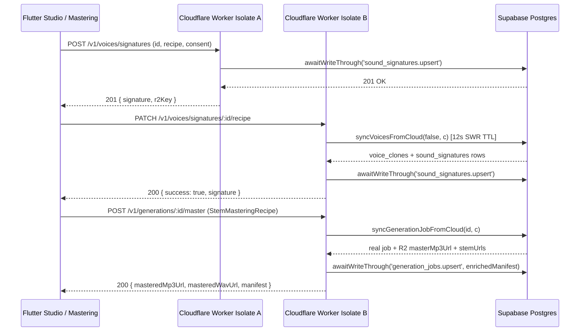
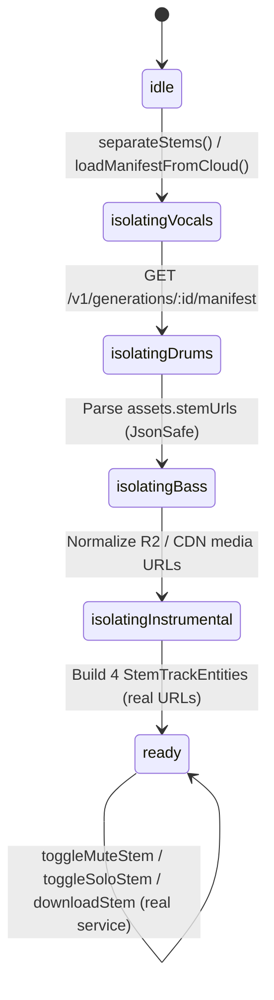

# VHUNAMBI PHASE 75: STUDIO COCKPIT V5, 100% CONNECTOME CLOSURE (`EP-P66`/`P27`/`P26`/`P25`), WORKER VOICE/MASTERING SWR & DIRECT-TO-REELS BRIDGE — ARCHITECTURAL BLUEPRINT

**Document ID:** `VHUNAMBI-SPEC-P75-BLUEPRINT-V1`  
**Phase:** `75`  
**Status:** `ARGON-HARDENED SPECIFICATION (READY FOR STAGE 4 EXECUTION)`  
**Grounding Audit:** [`docs/audits/PHASE75_STUDIO_COCKPIT_V5_AND_CONNECTOME_CLOSURE_AUDIT.md`](file:///c:/Users/Ndugelo/VHUNAMBI/monorepo/docs/audits/PHASE75_STUDIO_COCKPIT_V5_AND_CONNECTOME_CLOSURE_AUDIT.md) (`AUDIT-P75-STUDIO-CONNECTOME-001`)  
**Execution Model:** Two Sequential Self-Contained Passes (`Pass 1: M75.1–M75.2` $\to$ `Pass 2: M75.3–M75.4`)

---

## 1. Executive Overview & Strategic North Star

Phases 68 through 74 elevated Vhunambi's consumer and creator surfaces—Home Dashboard (`P68`), Kinetic Posts & Threading (`P69`, `P73`), Track Detail & Visitor Profile (`P70`), Cloud SWR Spine (`P71`), Asset Vault & Owner Profile (`P72`), and Full-Screen 4-Stage Kinetic Reels Studio (`P74`)—leaving **zero** open endpoints in Social, Explore, Vault, Notifications, or Wallet.

All **`4` remaining `OPEN` endpoints** in Vhunambi's Connectome (`CORTEX_INDEX.md`) belong to the **flagship AI Music Creation Spine** (`studio/`, `sound_signature/`, `mastering/`, and `track/`):

1. **`EP-P66-LYRICS-REFINE-STORY`** (`POST /v1/lyrics/refine`, `POST /v1/lyrics/story-transform`)
2. **`EP-P27-MELODY-PRESETS-PACKS`** (`GET /v1/melodies/presets`, `GET /v1/melodies/sound-packs`)
3. **`EP-P26-VOICE-CALIBRATION-RECIPE`** (`POST /v1/voices/extract-calibration`, `PATCH /v1/voices/signatures/:id/recipe`, `GET /v1/voices/signatures/:id`, `DELETE /v1/voices/signatures/:id`)
4. **`EP-P25-GEN-MASTER-PRESETS`** (`GET /v1/generations/mastering/presets`, `GET /v1/generations/:id/manifest`)

Phase 75 closes **100% of remaining `OPEN` endpoints (`4` $\to$ `0`)**, seals the last two **Cloudflare Worker multi-isolate SWR gaps** (`voice_routes.ts` & `POST /v1/generations/:id/master`), unifies all **4 legacy creation-to-reel entrypoints** straight into Phase 74's `KineticReelStudioView.show(context)`, extends `LyricKaraokeSanitizer` into `TrackDetailView`'s teleprompter, and eliminates `70+` stock Material `Icons.*` and `90+` raw Unicode emojis across Studio and Mastering under `STD-UIUX-001`.

---

## 2. Forensic Post-Mortem Comparison Box (Legacy Broken Spine vs. Phase 75 Architecture)

```text
+=========================================================================================+
|  SUBSYSTEM          |  PRE-PHASE-75 DEFECT (AUDIT-P75-001)  |  PHASE 75 TARGET STATE    |
+=====================+=======================================+===========================+
| Mastering Bake      | POST /v1/generations/:id/master skips | Calls syncGenerationJob   |
| (MST-01 / P0)       | syncGenerationJobFromCloud -> 404 on  | FromCloud + awaits DB     |
|                     | warm isolate B -> Flutter fakes       | write; Flutter surfaces   |
|                     | /mock-storage/*_mastered.mp3          | real errors, no fake URLs |
+---------------------+---------------------------------------+---------------------------+
| Voice Clones &      | Zero syncVoicesFromCloud SWR; fire-   | 12s SWR syncVoicesFrom    |
| Sound Signatures    | and-forget mirrorWriteThrough; client | Cloud + awaitWriteThrough |
| (VOC-01..03 / P1)   | vclone_<ms> != server random ID; null | + unified client voiceId  |
|                     | onSaveRecipe in CrossModuleSynergyDeck| + live PATCH /recipe sync |
+---------------------+---------------------------------------+---------------------------+
| Lyrics Review &     | Story toggle only shows static info   | Interactive Story box ->  |
| Story Mode          | banner; zero AI stanza polish; raw    | POST /story-transform +   |
| (LYR-01..03 / P1)   | emoji descriptors; stock Icons.*      | stanza Refine -> /refine  |
+---------------------+---------------------------------------+---------------------------+
| Sketchpad & Sound   | Static kStarterMelodyPatterns &       | Live GET /melodies/presets|
| Pack Store          | kOfficialSoundPacks; 30ms fake timer  | & /sound-packs + verified |
| (SKP-01..03 / P1)   | loop without fetching R2 downloadUrl  | R2 Dio pack fetch         |
+---------------------+---------------------------------------+---------------------------+
| Track Stems &       | separateStems() fabricates dead       | Fetches /generations/:id  |
| Teleprompter        | cdn.vhunambi.com URLs; onDownloadStem | /manifest real R2 stems + |
| (TRK-01 / P1)       | is a SnackBar dead-end; raw cues leak | real downloader +         |
|                     | into LyricsTeleprompter               | LyricKaraokeSanitizer     |
+---------------------+---------------------------------------+---------------------------+
| Creation-to-Viral   | 4 entrypoints launch legacy           | Unified 1-tap bridge into |
| Reels Bridge        | ContentStudioDockView.open() or       | KineticReelStudioView     |
| (REEL-01 / P1)      | VideoExportModal w/ dead URLs         | .show(context, initial..) |
+---------------------+---------------------------------------+---------------------------+
| Visual & Token      | 70+ stock Icons.*, 90+ raw Unicode    | 100% PhosphorIcon +       |
| Hygiene (UI-01..03) | emojis, flat canvases, missing        | VhunambiGlassSurface +    |
|                     | focusedBorder: InputBorder.none       | AppColors.*Of(context)    |
+=========================================================================================+
```

---

## 3. Multi-Layer Decoupled System Architecture

```text
+-----------------------------------------------------------------------------------------+
|  LAYER 4: FLUTTER PRESENTATION & GLASS SURFACES (STD-UIUX-001, 0 Stock Icons, 0 Emojis) |
|  • StudioView + GenerationPipelineCard -> KineticReelStudioView.show(initialTrack)      |
|  • LyricsReviewModal (Story-to-Lyrics Drawer + Per-Stanza AI Refine + Phosphor UI)      |
|  • MelodySketchpadModal + StudioSoundPackSheet (Cloud Presets + Real Pack Fetch)        |
|  • CrossModuleSynergyDeck + SoundSignatureIdealizerSheet (Live PATCH Recipe + Delete)   |
|  • DesktopMasteringStudioView + MobileQuickMasterSheet (Cloud Presets + Glass Strips)   |
|  • TrackDetailView + LyricsTeleprompter (Manifest Stems + Sanitizer + Reel Studio CTA)  |
+-------------------------------------------+---------------------------------------------+
                                            | Riverpod Notifiers & HTTP Repositories
                                            v
+-----------------------------------------------------------------------------------------+
|  LAYER 3: CLIENT STATE & NETWORK ENGINES (FLUTTER_TEST Safe + JsonSafe Parsing)         |
|  • HttpLyricsGenerationService (generate, refine, storyTransform + Bantu ISO mapper)    |
|  • MelodySketchpadNotifier + SoundPackManagerNotifier (GET /presets & /sound-packs)     |
|  • VocalIdentityNotifier + SoundSignatureRepository (extract-calibration, PATCH recipe) |
|  • MasteringSessionNotifier + TrackDetailNotifier (GET /mastering/presets & /manifest)  |
+-------------------------------------------+---------------------------------------------+
                                            | HTTPS JSON / Binary R2 (Bearer JWT)
                                            v
+-----------------------------------------------------------------------------------------+
|  LAYER 2: CLOUDFLARE WORKER EDGE API (`apps/vhunambi_api/src/`)                         |
|  • server.ts: 100% Scoped Read-Through (+ /v1/voices, /v1/melodies, /v1/lyrics)         |
|  • voice_routes.ts: async syncVoicesFromCloud + awaited voice_clones / sound_signatures |
|  • generation_routes.ts: POST /:id/master hydrates via syncGenerationJobFromCloud       |
|  • lyrics_routes.ts & melody_routes.ts: zero 21-table cold-start stall                  |
+-------------------------------------------+---------------------------------------------+
                                            | EdgeIsolateDatabaseEngine (12s SWR TTL)
                                            v
+-----------------------------------------------------------------------------------------+
|  LAYER 1: SUPABASE POSTGRES + CLOUDFLARE R2 (`VHUNAMBI_VAULT`)                          |
|  • voice_clones (voice_id PK) + sound_signatures (id PK) + generation_jobs (id PK)      |
|  • Zero new SQL migration needed (all columns/indexes verified live in P62/P71/P74)     |
+-----------------------------------------------------------------------------------------+
```

---

## 4. Spatial Topology & Connectome Closure Map

### 4.1 Complete Endpoint Closure Table (4 `OPEN` $\to$ 0 `OPEN`)

| Endpoint ID | Backend Route(s) | Client Caller(s) Wired in Phase 75 | Post-Phase-75 Lifecycle State |
| :--- | :--- | :--- | :---: |
| `EP-P66-LYRICS-REFINE-STORY` | `POST /v1/lyrics/refine`, `POST /v1/lyrics/story-transform` | `HttpLyricsGenerationService`, `LyricsReviewNotifier`, `LyricsReviewModal` | `CONNECTED_EXTENSIBLE` |
| `EP-P27-MELODY-PRESETS-PACKS` | `GET /v1/melodies/presets`, `GET /v1/melodies/sound-packs` | `MelodySketchpadNotifier`, `SoundPackManagerNotifier` | `CONNECTED_EXTENSIBLE` |
| `EP-P26-VOICE-CALIBRATION-RECIPE` | `POST /v1/voices/extract-calibration`, `PATCH/GET/DELETE /v1/voices/signatures/:id*`, `POST /v1/voices/clone` | `VocalIdentityNotifier`, `PreGenR2UploadService`, `SoundSignatureRepository`, `CrossModuleSynergyDeck` | `CONNECTED_EXTENSIBLE` |
| `EP-P25-GEN-MASTER-PRESETS` | `GET /v1/generations/mastering/presets`, `GET /v1/generations/:id/manifest`, `POST /v1/generations/:id/master` | `MasteringSessionNotifier`, `TrackDetailNotifier`, `DesktopMasteringStudioView`, `MobileQuickMasterSheet` | `CONNECTED_EXTENSIBLE` |

### 4.2 Direct Creation-to-Viral Entrypoint Topology

| Origin Screen / Widget | Legacy Target (Pre-P75) | Phase 75 Unified Target (`EP-P74-REELS-STUDIO-PIPELINE`) |
| :--- | :--- | :--- |
| `GenerationPipelineCard` (`_ReadyTrackCard`) | `ContentStudioDockView.open(...)` w/ `r2.vhunambi.com` | `KineticReelStudioView.show(context, initialTrack: track.toLibraryTrack())` |
| `TrackDetailView` (`UtilityToolDock` -> Export Reel) | `VideoExportModal.show(...)` w/ `cdn.vhunambi.com` | `KineticReelStudioView.show(context, initialTrack: track.toLibraryTrack())` |
| `TrackActionsSheet` (`Create Lyric Reel`) | `ContentStudioDockView.open(...)` | `KineticReelStudioView.show(hostContext ?? context, initialTrack: track)` |
| `ExpandedCockpitModal` (`_openContentStudio`) | `ContentStudioDockView.open(...)` w/ `r2.vhunambi.com` | `KineticReelStudioView.show(context, initialTrack: resolvedLibraryTrack)` |

---

## 5. Dual-Viewport Wireframes (Lyrics Story/Refine & Mastering Glass Console)

### 5.1 Mobile Portrait (`360x800`) — `LyricsReviewModal` V5

```text
+------------------------------------------+
| [Music] Review Lyrics    [Book] [Tree] X |  <- >=44x44dp PhosphorIcon controls
| Amapiano · Tshivenda              [Copy] |
+------------------------------------------+
| [Glass Card: Story-to-Lyrics Mode Active]|  <- Preserves legacy test text
| +--------------------------------------+ |
| | Paste your story (20+ chars)...      | |  <- Key('lyrics_story_input')
| +--------------------------------------+ |
| [ Sparkle: Transform Story to Lyrics ]   |  <- Key('lyrics_story_transform_btn')
+------------------------------------------+
| +--------------------------------------+ |
| | [VERSE 1]     [Sparkle Polish] [Edit]| |  <- Key('stanza_refine_section_1')
| | Ndaa, mbilu yanga i khou tshina...   | |  <- Zero focusedBorder rect leak
| +--------------------------------------+ |
| [Cultural idioms: Ndaa! | Ahee! | ...]   |
+------------------------------------------+
| [Regenerate] [Clone Voice] [Raw] [Next]  |  <- All PhosphorIcon, zero '➔'
+------------------------------------------+
```

### 5.2 Desktop (`>= 1024dp`) & Mobile Sheet — Mastering Studio V5

```text
+------------------------------------------------------------------------------+
| <-  [Sparkle] Vhunambi Mastering Studio        [Preset: Amapiano Club Knock] |
|     Track Title · Amapiano (Cloud Presets Synced)   [A/B Bypass] [Bake]      |
+------------------------------------------------------------------------------+
| [Glass: Vocals] | [Glass: Log Drum] | [Glass: Drums] | [Glass: Keys] | [Out] |
| [Mic] Cleanse   | [Wave] Sub Knock  | [Wave] Snap    | [Piano] Width | LUFS  |
| (0 raw emojis, 0 stock Icons.*, 100% AppColors.*Of(context) Dark & Light)   |
+------------------------------------------------------------------------------+
```

---

## 6. State Machines & Cross-Boundary Sequence Diagrams

### 6.1 Cross-Isolate Voice & Mastering SWR Sequence



### 6.2 `TrackDetailNotifier` Manifest-Backed Stem FSM



---

## 7. Non-Functional Guarantees & Verification Gates

| Gate ID | Dimension | Pass Criterion |
| :---: | :--- | :--- |
| **`G75-01`** | Backend TypeScript & Tests | `.\node_modules\.bin\tsc.cmd --noEmit` exits `0`; `npm test` passes `31/31` suites (including `phase75_studio_connectome_closure.test.ts`). |
| **`G75-02`** | Connectome Closure | `node .agents/skills/vhunambi-memory/scripts/consolidate_memory.mjs` exits `0` with **`0 OPEN`** endpoints across the entire monorepo. |
| **`G75-03`** | Client Static Analysis | `dart analyze lib/features/studio lib/features/sound_signature lib/features/mastering lib/features/track lib/features/home lib/features/library lib/features/player test/features/phase75_studio_connectome_closure_test.dart` $\to$ **0 issues**. |
| **`G75-04`** | Client Regression & Phase 75 Tests | `flutter test --no-pub --timeout=60s` passes `100%` across `phase75_studio_connectome_closure_test.dart`, `studio/`, `sound_signature/`, `mastering/`, `track/`, and `library/track_actions_sheet` suites. |
| **`G75-05`** | `STD-UIUX-001` Hygiene | Zero stock `Icons.*` and zero raw Unicode emojis in Phase 75 target UI files (`mastering/`, `lyrics_review_modal.dart`, `generation_pipeline_card.dart`, `bantu_voice_deck.dart`, `vocal_identity_picker_sheet.dart`, `voice_clone_recorder_sheet.dart`, `studio_view.dart`, `track/`). |
| **`G75-06`** | Performance & Test Determinism | Zero `BackdropFilter` inside repeating scroll tiles (`enableLiveBlur: false`); all new HTTP fetches bypass live network cleanly in `FLUTTER_TEST` unless an injected `Dio`/`http.Client` is provided. |
