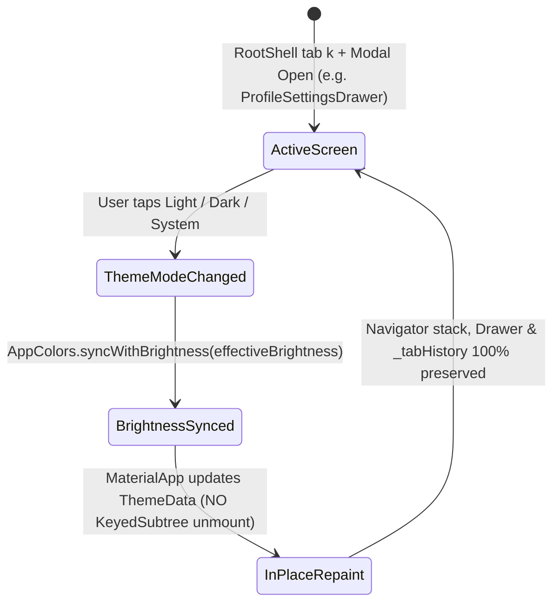
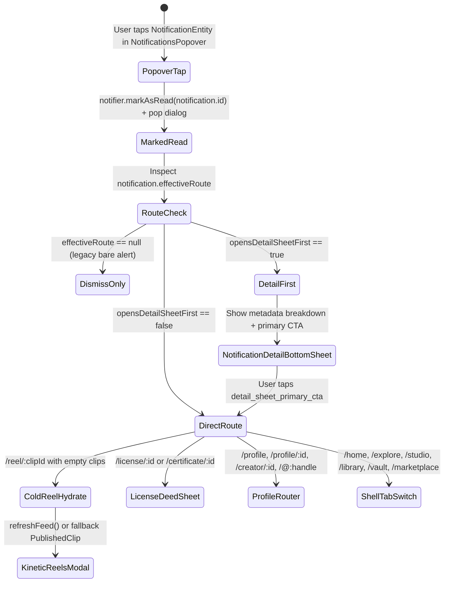
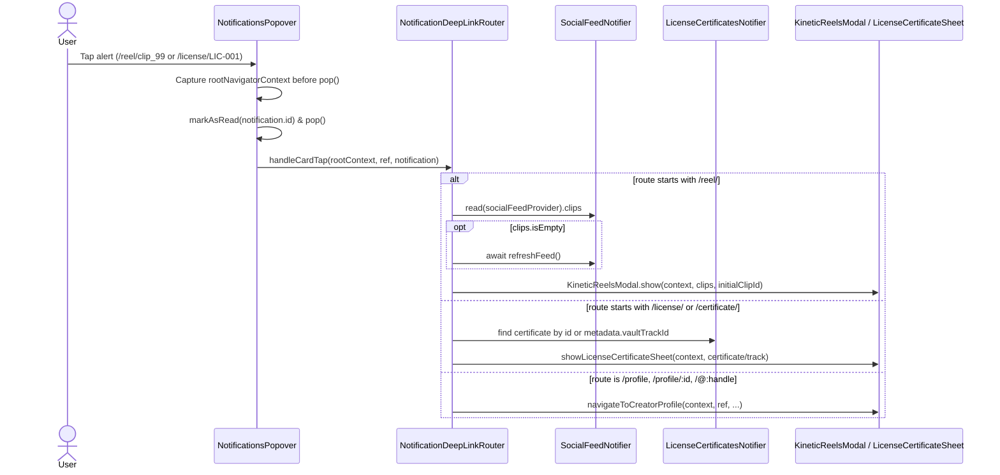

# Phase 76 — Post-Release Live Device Stability, Auth/Onboarding Glass, Full Notification Deep-Link Routing & Platform Hygiene (`blueprint.md`)

**Document ID:** `SPEC-P76-BLUEPRINT`  
**Phase Folder:** `docs/phases/phase_76_post_release_auth_onboarding_deeplink_and_platform_polish/`  
**Source Forensic Audit:** [`docs/audits/PHASE76_POST_RELEASE_AUTH_ONBOARDING_DEEPLINK_AND_PLATFORM_AUDIT.md`](../../audits/PHASE76_POST_RELEASE_AUTH_ONBOARDING_DEEPLINK_AND_PLATFORM_AUDIT.md) (`AUDIT-P76-POST-RELEASE-PLATFORM-001`)  
**Target Branch:** `fix/studio-cockpit-bugs-vh001-vh006`  
**Target Physical Device:** Huawei `JNY_LX1` (`EPHUT20917014649`, Android ARM64) & Desktop Viewport (`>= 600dp`)  
**Execution Standard:** All-Gemini 4-Stage Engineering Pipeline (`STD-UIUX-001`, Dual-Theme Contrast Parity, 2-Pass Sequential Execution)

---

## 1. Executive Overview & Visual North Star

Phase 75 brought the Vhunambi Connectome to **`0 OPEN` endpoints** (`43 CONNECTED_EXTENSIBLE`, `3 SEALED`) and unified the Creation-to-Reels flagship loop. Before opening wider creator beta testing on physical Android devices (Huawei `JNY_LX1`) and Desktop builds, Phase 76 eliminates the **8 post-release rough edges** uncovered in `AUDIT-P76-POST-RELEASE-PLATFORM-001` across four tightly coupled engineering pillars:

1. **Zero-State-Loss Live Theme Switching (`BOOT-01`, `P0`):**
   - Today, [`main.dart#L128-L131`](../../../apps/vhunambi_client/lib/main.dart#L128-L131) wraps `MaterialApp.builder`'s `?child` (`Navigator`) inside `KeyedSubtree(key: ValueKey<Brightness>(effectiveBrightness), ...)`. Switching between `System`, `Light` ("Morning Mist"), and `Dark` ("Obsidian Night") destroys the entire `Navigator` subtree, dismisses `ProfileSettingsDrawer` mid-tap, and resets `RootShell`'s `_currentIndex` and `_tabHistory`.
   - Phase 76 removes the `KeyedSubtree` wrapper around `?child` so `Theme.of(context)` and `AppColors.*Of(context)` repaint every mounted route, modal sheet, and bottom navigation dock seamlessly in place with **zero route or tab loss**.
2. **Release-Hardened Auth & Dual-Theme Glass Surfaces (`AUTH-01/02`, `SET-01/02`, `P1`/`P2`):**
   - `SovereignAuthSheet` currently renders un-gated `QUICK STUDIO CREATORS` chips (`@cern`, `@makhadzi`, `@sigwa`) in production `--release` APKs backed by `AuthSessionNotifier.switchToSeededCreator` with hardcoded `defaultSeededPassword` and local tenant spoofing (`usr_studio_$raw`). Phase 76 gates both the UI chips and the local offline studio bypass behind `kEnableDemoCreatorQuickSwitch = kDebugMode || bool.fromEnvironment('ENABLE_DEMO_CREATOR_SWITCH')` so `--release` builds strictly enforce real `/api/auth/login` & `/api/auth/register` while `flutter test` (`kDebugMode == true`) remains 100% green.
   - `SovereignAuthSheet`, `ProfileSettingsDrawer` (plus `AccountIdentitySecurityCard`, `HiveBrainTelemetryCard`, `CloudStackDiagnosticCard`), and `NotificationsPopover` are upgraded to `VhunambiGlassSurface(enableLiveBlur: false)` with 100% `AppColors.*Of(context)` dynamic tokens and minimum `44x44dp` interactive touch targets, eliminating Light-Mode white-on-white ghost tabs.
3. **100% Notification Deep-Link Closure & Bell Popover Delegation (`DL-01/02/03`, `NOTIF-UI-01`, `P1`/`P2`):**
   - `NotificationsPopover._openNotification` previously inspected ONLY `notification.targetTrackId`, silently dropping Reel, Post, Creator, DNA, Wallet, Studio, and License Certificate notifications. Phase 76 delegates popover taps to `NotificationDeepLinkRouter.handleCardTap` (preserving safe dismiss semantics for legacy route-less alerts).
   - `NotificationDeepLinkRouter.navigateDirect` and `NotificationDetailBottomSheet._defaultCtaLabel` expand to cover:
     - Cold-start `/reel/:clipId` hydration (`await ref.read(socialFeedProvider.notifier).refreshFeed()` + fallback clip construction so reels never silently drop to a text modal).
     - Cryptographic License Certificates (`/license/:id`, `/certificate/:certId`, `/licenses`) launching `showLicenseCertificateSheet` (`EP-P72-BUYER-LICENSES-HTTP`) — AND wiring `BeatCheckoutNotifier.purchaseBeat` to emit `targetRoute: '/license/${cert.certificateId}'`.
     - Self & Handle Profiles (`/profile`, `/profile/:id`, `/@:handle`) routed via `navigateToCreatorProfile` (`EP-P73-PROFILE-ROUTER`).
     - Core Shell Tabs (`/home`, `/explore`, `/library`, `/vault`, `/marketplace`).
4. **Onboarding `STD-UIUX-001` Glass Polish & Platform Hygiene (`ONB-01..06`, `SEC-01`, `PLAT-01`, `P1`/`P2`):**
   - Purges all **7 stock `Icons.*`**, **3 raw Unicode emoji sites** (`RoleOption.emoji`, `'Quest: ...'`, `'Era Match'`), and **26 hardcoded dark hex card fills** in `lib/features/onboarding/` into `PhosphorIcon(AppIcons.*)` + `VhunambiGlassSurface(enableLiveBlur: false)` + `AppColors.*Of(context)`.
   - Closes remaining platform debt: enables Supabase Auth **Leaked Password Protection (HIBP)** on project `cbnruevwrqwjnnoscgsz` (`0 WARN` security advisors), adds a clean `prebuild` `dist/` wipe in `apps/vhunambi_api/package.json` eliminating stale `dist/phase67_notifications_quota.test.js`, and tunes `apps/vhunambi_client/android/gradle.properties` (`-Xmx4096m`, `parallel=true`, `caching=true`, `workers.max=4`) for faster release APK builds + live Huawei `JNY_LX1` ADB telemetry verification.

---

## 2. Forensic Post-Mortem Comparison Box

```
┌────────────────────────────────────────────────────────────────────────────────────────────┐
│                   PHASE 76 — CURRENT DEFECTS VS. TARGET SOVEREIGN ARCHITECTURE             │
├──────────────────────────────────────────────┬─────────────────────────────────────────────┤
│ CURRENT POST-RELEASE DEFECT (AUDIT-P76)      │ PHASE 76 HARDENED ARCHITECTURE              │
├──────────────────────────────────────────────┼─────────────────────────────────────────────┤
│ BOOT-01 (P0): KeyedSubtree(ValueKey(bright)) │ Plain Stack(children: [?child, MiniPlayer]) │
│ wraps MaterialApp Navigator; Light/Dark tap  │ inside MaterialApp.builder; Theme.of(ctx)   │
│ kills Drawer & resets RootShell tab history. │ repaints live with zero Navigator unmount.  │
├──────────────────────────────────────────────┼─────────────────────────────────────────────┤
│ AUTH-01 (P1): QUICK STUDIO CREATORS chips &  │ kEnableDemoCreatorQuickSwitch compile-time  │
│ local usr_studio_$raw bypass active in       │ gate (kDebugMode || ENABLE_DEMO_CREATOR_    │
│ production --release Android APK builds.     │ SWITCH); release builds enforce live auth.  │
├──────────────────────────────────────────────┼─────────────────────────────────────────────┤
│ SET-01/02 (P1): ProfileSettingsDrawer uses   │ VhunambiGlassSurface(enableLiveBlur: false) │
│ static Dark AppColors.textPrimary (#F8FAFC)  │ + 100% AppColors.*Of(context) tokens +      │
│ on Light surfaceElevated (#FFFFFF) + 36dp    │ >= 44x44dp touch targets across Drawer and  │
│ buttons; 0 glass cards.                      │ all 3 identity/telemetry/cloud cards.       │
├──────────────────────────────────────────────┼─────────────────────────────────────────────┤
│ DL-01/02/03 (P1): Bell Popover only reads    │ Popover delegates effectiveRoute alerts to  │
│ targetTrackId; cold /reel/:id drops to text; │ NotificationDeepLinkRouter; cold reel sync, │
│ zero handlers for /license/:id, /profile,    │ showLicenseCertificateSheet, /profile,      │
│ /@:handle, or /vault & /marketplace tabs.    │ /@:handle & all 5 shell tabs routed 100%.   │
├──────────────────────────────────────────────┼─────────────────────────────────────────────┤
│ ONB-01..06 (P2): 7 stock Icons.*, 3 emoji    │ 0 Icons.*, 0 raw Unicode emojis, Phosphor   │
│ surfaces, 26 hardcoded Color(0xFF...) fills, │ vector glyphs via RoleOption.resolvedIcon,  │
│ 0 VhunambiGlassSurface in onboarding/.       │ VhunambiGlassSurface + *Of(context) parity. │
├──────────────────────────────────────────────┼─────────────────────────────────────────────┤
│ SEC-01 & PLAT-01 (P1/P2): Supabase HIBP OFF; │ Supabase HIBP enabled (0 security WARNs);   │
│ orphan dist/phase67_notifications_quota.js;  │ package.json prebuild cleans dist/ before   │
│ gradle.properties parallel=false, max=2,     │ tsc; Gradle -Xmx4096m + parallel + caching  │
│ -Xmx2048m, no caching -> ~45m cold builds.   │ + workers.max=4 + safe plugin hygiene.      │
└──────────────────────────────────────────────┴─────────────────────────────────────────────┘
```

---

## 3. Multi-Layer Decoupled System Architecture

```
┌────────────────────────────────────────────────────────────────────────────────────────────┐
│ LAYER 5: PLATFORM INFRASTRUCTURE & BUILD PIPELINE (M76.1)                                  │
│  ├── Supabase Auth (cbnruevwrqwjnnoscgsz): HIBP Leaked Password Protection = ENABLED       │
│  ├── Cloudflare Worker API (apps/vhunambi_api): prebuild rmSync('dist') -> clean tsc       │
│  └── Android Gradle (apps/vhunambi_client/android): -Xmx4096m, parallel=true, caching=true │
├──────────────────────────────────────────────┬─────────────────────────────────────────────┤
│                                              ▼                                             │
│ LAYER 4: ROOT SHELL & RELEASE AUTH SECURITY BOUNDARY (M76.2)                               │
│  ├── main.dart -> MaterialApp.builder (no ValueKey<Brightness> Navigator unmount)          │
│  ├── auth_providers.dart -> kEnableDemoCreatorQuickSwitch compile-time release guard       │
│  └── SovereignAuthSheet + ProfileSettingsDrawer (+ 3 cards) -> VhunambiGlassSurface        │
├──────────────────────────────────────────────┬─────────────────────────────────────────────┤
│                                              ▼                                             │
│ LAYER 3: UNIFIED NOTIFICATION DEEP-LINK ENGINE & BELL POPOVER (M76.3)                      │
│  ├── BeatCheckoutNotifier -> emits targetRoute: '/license/<certId>' + certificate metadata │
│  ├── NotificationsPopover -> delegates effectiveRoute to NotificationDeepLinkRouter        │
│  └── NotificationDeepLinkRouter -> /reel (cold hydration), /license & /certificate,        │
│      /profile & /@handle (EP-P73-PROFILE-ROUTER), /home /explore /studio /vault /market    │
├──────────────────────────────────────────────┬─────────────────────────────────────────────┤
│                                              ▼                                             │
│ LAYER 2: FIRST-RUN ONBOARDING GLASS & STD-UIUX-001 SURFACE LAYER (M76.4)                   │
│  ├── onboarding_view.dart, app_tour_overlay.dart, role_carousel_widget.dart                │
│  ├── genre_color_chip.dart, mood_color_chip.dart, creator_dna_helix_finale.dart            │
│  └── onboarding_act1_showcase.dart, onboarding_act3_roots_deck.dart, identity_card_stack   │
├──────────────────────────────────────────────┬─────────────────────────────────────────────┤
│                                              ▼                                             │
│ LAYER 1: VERIFICATION, REGRESSION HARNESS & LIVE DEVICE TELEMETRY (M76.4 + SLEEP)          │
│  ├── phase76_auth_onboarding_deeplink_polish_test.dart (Theme/Auth/DeepLink/Onboarding)    │
│  ├── STD-UIUX-001 regex gate (0 Icons.*, 0 raw emojis across auth/onboarding/notifs)       │
│  └── Optional Huawei JNY_LX1 ADB release install + logcat check -> consolidate_memory.mjs  │
└────────────────────────────────────────────────────────────────────────────────────────────┘
```

---

## 4. Two-Pass Sequential Execution Topology & Canonical Route Taxonomy

Phase 76 executes in **two strict sequential passes** under `/vhunambi-executioner`:

| Pass | Milestones | Scope | Exit Gate |
| :---: | :---: | :--- | :--- |
| **Pass 1** | `M76.1` + `M76.2` | Platform Hygiene (`dist/` prebuild clean, Gradle tuning, Supabase HIBP check), `main.dart` theme-safe Navigator fix, `AuthSessionNotifier` & `SovereignAuthSheet` release gate + Glass, `ProfileSettingsDrawer` + 3 cards Light/Dark Glass & `44dp` targets. | `G76-01` (API clean build + 31/31 tests), `G76-02` (`dart analyze` 0 issues on `main.dart`, `core/auth`, `features/auth`, `features/profile` + passing auth/profile tests). |
| **Pass 2** | `M76.3` + `M76.4` | `NotificationDeepLinkRouter` + `NotificationDetailBottomSheet` + `BeatCheckoutNotifier` + `NotificationsPopover` + `NotificationsView`/`SearchBar`/`EmptyState` Light/Dark Glass; full `onboarding/` `STD-UIUX-001` & Glass sweep; Phase 76 regression test suite; ADB device check (if connected) + `SLEEP` (`consolidate_memory.mjs`). | `G76-03` (`notifications/` + `onboarding/` analyze & tests), `G76-04` (`STD-UIUX-001` 0 stock `Icons.*` & 0 raw emojis), `G76-05` (full Phase 76 regression suite + existing suites 100% pass), `G76-06` (`memory.md` completed + `consolidate_memory.mjs` `0 OPEN`). |

### Canonical Notification Deep-Link Route Table (`EP-P76-DEEPLINK-COVERAGE`)

| Route Pattern | Handler Target | Fallback Behavior | CTA Label (`_defaultCtaLabel`) |
| :--- | :--- | :--- | :--- |
| `/home` | `appNavigationTabProvider = 0` + `popUntil(isFirst)` | Never fails | `'Go to Home'` |
| `/explore` | `appNavigationTabProvider = 1` + `popUntil(isFirst)` | Never fails | `'Explore Feed'` |
| `/studio` | `appNavigationTabProvider = 2` + `popUntil(isFirst)` | Never fails | `'Open Studio Cockpit'` |
| `/library`, `/vault`, `/licenses` | `appNavigationTabProvider = 3` + `popUntil(isFirst)` | Never fails | `'Open Asset Vault'` |
| `/marketplace`, `/market` | `appNavigationTabProvider = 4` + `popUntil(isFirst)` | Never fails | `'Open Marketplace'` |
| `/creator-dna` | `CreatorDnaHelixLabSheet.show(context)` | Modal opens directly | `'Calibrate Creator DNA'` |
| `/wallet` | `SubscriptionUpgradeModal.show(context)` | Modal opens directly | `'View Balance & Usage'` |
| `/track/:trackId` | Push `TrackDetailView(trackId: trackId)` | Falls through to Detail Sheet if empty ID | `'Open Track Cockpit'` |
| `/reel/:clipId` | Hydrate `socialFeedProvider` if empty (`refreshFeed()` + metadata/synthetic fallback), open `KineticReelsModal.show(...)` | Opens Detail Sheet only if `clipId` empty & feed empty | `'Watch Kinetic Reel'` |
| `/post/:postId` | Match in `socialFeedPostsProvider` -> `KineticPostFocusView.show(...)` | Fetches by `postId` inside focus view | `'View Kinetic Post'` |
| `/creator/:id`, `/profile/:id` | `navigateToCreatorProfile(context, ref, creatorId: id)` | Self routes to `OwnerProfileView`, visitor to `ArtistProfileView` | `'View Creator Profile'` |
| `/profile` | `navigateToCreatorProfile(context, ref, creatorId: ref.read(currentCreatorIdProvider))` | Always opens `OwnerProfileView` | `'Open My Profile'` |
| `/@:handle` | `navigateToCreatorProfile(context, ref, creatorId: canonicalizeCreatorId(handle), creatorHandle: '@$handle')` | Resolves canonical ID + owner/visitor role | `'View Creator Profile'` |
| `/license/:certId`, `/certificate/:certId` | Resolve `SovereignLicenseCertificate` in `licenseCertificatesProvider` (or matching `LibraryTrack` in `libraryTracksProvider`), open `showLicenseCertificateSheet(...)` | If cert missing locally, switch to Vault tab (`3`) or open Detail Sheet | `'View License Deed'` |

---

## 5. State Machines & Notification / Auth / Theme Lifecycles





---

## 6. Dual-Viewport HUD Wireframes

### 6.1 Mobile Portrait (`< 600dp` — Huawei `JNY_LX1` `360x800dp`)

```
┌──────────────────────────────────────┐   ┌──────────────────────────────────────┐
│  PROFILE SETTINGS DRAWER (GLASS)     │   │  SOVEREIGN AUTH SHEET (RELEASE)      │
│  ═══════════  (44dp handle)          │   │  ═══════════  (44dp handle)          │
│  [Gear] Appearance & Preferences [X] │   │  [Shield] Sovereign Identity     [X] │
│                                      │   │  ┌────────────────────────────────┐  │
│  APPLICATION THEME                   │   │  │ [  Sign In  ] | Create Account │  │
│  ┌────────────────────────────────┐  │   │  └────────────────────────────────┘  │
│  │ [Sys] | [Light] | [*Dark*]     │  │   │  (NO Quick Studio Creators in Rel!)  │
│  └────────────────────────────────┘  │   │                                      │
│  (46dp glass pill; *Of(ctx) contrast)│   │  [ @ ] Handle or Email               │
│                                      │   │  [Lock] Password              [Eye]  │
│  ┌─ VhunambiGlassSurface (Audio) ──┐ │   │                                      │
│  │ 44.1 kHz / 24-bit PCM Studio    │ │   │  ┌─ VhunambiGlassSurface (Error) ──┐ │
│  └─────────────────────────────────┘ │   │  │ (!) Invalid credentials         │ │
│  ┌─ VhunambiGlassSurface (Sync) ───┐ │   │  └─────────────────────────────────┘ │
│  │ Edge-Sync Outbox  [Sync Now 44] │ │   │                                      │
│  └─────────────────────────────────┘ │   │  ┌────────────────────────────────┐  │
│  [AccountIdentity] [HiveBrain] [API] │   │  │       Sign In to Studio        │  │
└──────────────────────────────────────┘   └──────────────────────────────────────┘
```

### 6.2 Desktop / Wide Viewport (`>= 600dp` — Notifications Popover & Onboarding)

```
┌──────────────────────────────────────────────────────────┐
│ Top Bar                         [Bell (2)] [Profile]     │
│                                 ┌──────────────────────┐ │
│                                 │ VhunambiGlassSurface │ │
│                                 │ [Bell] Alerts (2)    │ │
│                                 │   [Check] Mark read  │ │
│                                 │ ──────────────────── │ │
│                                 │ > Reel Loved (/reel) │ │
│                                 │ > License (/license) │ │
│                                 │ > Follow (/@makhadzi)│ │
│                                 │ ──────────────────── │ │
│                                 │ [View All Center ->] │ │
│                                 │ Clear all      Close │ │
│                                 └──────────────────────┘ │
└──────────────────────────────────────────────────────────┘
```

---

## 7. End-to-End Sequence Diagrams



---

## 8. Risk & Pre-Verified Stage 4 Anti-Trap Matrix

| Trap ID | Verified Existing Test / Runtime Constraint | Mandatory Prevention Rule in Phase 76 |
| :--- | :--- | :--- |
| **`TRAP-76-01`** | [`sovereign_auth_hud_widget_test.dart#L355`](../../../apps/vhunambi_client/test/features/auth/sovereign_auth_hud_widget_test.dart#L355) taps `Key('auth_quick_chip_makhadzi')`. | Gate quick-switch chips with `kEnableDemoCreatorQuickSwitch` (`kDebugMode \|\| const bool.fromEnvironment('ENABLE_DEMO_CREATOR_SWITCH')`) — evaluates `true` in `flutter test` (`kDebugMode == true`) and `false` in `--release` APKs! Add an explicit `bool? enableDemoQuickSwitchOverride` constructor parameter on `SovereignAuthSheet` so widget tests can also verify the release-mode hidden state deterministically. |
| **`TRAP-76-02`** | [`role_carousel_widget_test.dart`](../../../apps/vhunambi_client/test/features/onboarding/widgets/role_carousel_widget_test.dart) constructs `RoleOption(..., emoji: '...')`. | Keep `this.emoji = ''` optional on `RoleOption` alongside `this.icon` and compute `IconData get resolvedIcon` from `icon ?? _iconForRole(role)`. Render `PhosphorIcon(role.resolvedIcon)` in UI so zero emojis appear on screen while legacy test constructors compile unchanged. |
| **`TRAP-76-03`** | [`notifications_popover_test.dart#L166-L180`](../../../apps/vhunambi_client/test/features/notifications/presentation/widgets/notifications_popover_test.dart#L166-L180) taps bare `notif_b` (`targetTrackId: null`, `targetRoute: null`) and asserts `NotificationsPopover` is gone and `TrackDetailView` is not pushed (and `#L118` asserts `PhosphorIconsRegular.bellSlash`; `#L187` taps `AppIcons.close`). | In `NotificationsPopover._openNotification`, if `notification.effectiveRoute == null` (no route and no track), mark read and dismiss only (no extra bottom sheet), preserving `notifications_popover_test.dart` 100%! When `effectiveRoute != null`, capture `navigator.context` before `pop()` and call `NotificationDeepLinkRouter.handleCardTap(hostContext, ref, notification)`. Keep `PhosphorIconsRegular.bellSlash` and `AppIcons.close`. |
| **`TRAP-76-04`** | `VhunambiGlassSurface` uses `tintAccent` and `borderColorOverride` (NOT `tintColor` / `borderColor`), and `enableLiveBlur` MUST remain `false` inside scrollable sheets/lists for 60 FPS ARM64 stability. | Every Phase 76 `VhunambiGlassSurface` call strictly passes `enableLiveBlur: false`, `tintAccent`, and `borderColorOverride`. |
| **`TRAP-76-05`** | `AppTourOverlay` tests (`app_tour_overlay_test.dart`) assert exact card titles (`'Compose'`, `'Write Lyrics First'`, `'Voice'`, `'Crate & MPC'`, `'Credits & Library'`), `AnimatedContainer` dots, and keys (`app_tour_skip`, `app_tour_continue`, `app_tour_get_started`). | Preserve all 5 titles, descriptions, `AnimatedContainer` dots, and exact `Key` identifiers while upgrading icons to `PhosphorIcon` and card surface to `VhunambiGlassSurface`. |
| **`TRAP-76-06`** | `GenreColorChip` tests (`genre_color_chip_test.dart`) assert `Semantics` label containing genre name + `'selected'`, `isButton == true`, and `size >= 44x44`. | Preserve exact `Semantics` wrapper and `minHeight: 44, minWidth: 44` constraints while swapping `Icons.check_circle` -> `PhosphorIcon(AppIcons.checkCircle)` and `*Of(context)` tokens. |
| **`TRAP-76-07`** | `adb` is not on the default Windows PATH; Huawei `JNY_LX1` was disconnected during audit. | Always invoke `C:\Users\Ndugelo\AppData\Local\Android\Sdk\platform-tools\adb.exe devices -l`; if `0` devices attached during Stage 4, log status honestly and complete all automated verification gates without fabricating device logs. |

---

## 9. Verification Gates Matrix (`G76-01` – `G76-06`)

| Gate ID | Scope | Exact Pass Condition |
| :---: | :--- | :--- |
| **`G76-01`** | Backend `dist/` Hygiene & Unit Suites | `apps/vhunambi_api`: `npm run build` cleans `dist/`, zero `*.test.js` files exist in `dist/`, `npx tsc --noEmit` exits `0`, `npm test` passes `31/31` suites. |
| **`G76-02`** | Pass 1 Client Analysis & Tests (`main.dart`, `auth/`, `profile/`) | `dart analyze` exits `0` across `lib/main.dart`, `lib/core/auth`, `lib/features/auth`, `lib/features/profile`; `flutter test --no-pub --timeout=60s test/features/auth/ test/features/profile/` passes 100%. |
| **`G76-03`** | Pass 2 Client Analysis & Tests (`notifications/`, `onboarding/`) | `dart analyze` exits `0` across `lib/features/notifications`, `lib/features/onboarding`, `lib/features/marketplace/presentation/providers/beat_checkout_provider.dart`; `flutter test --no-pub --timeout=60s test/features/notifications/ test/features/onboarding/` passes 100%. |
| **`G76-04`** | `STD-UIUX-001` Icon & Emoji Zero-Violation Scan | PowerShell regex scan across `lib/features/auth`, `lib/features/onboarding`, `lib/features/notifications`, and `lib/features/profile/presentation/widgets/profile_settings_drawer.dart` returns **0 stock `Icons.*`** and **0 raw Unicode emojis**. |
| **`G76-05`** | Phase 76 Dedicated Regression Suite + Supabase / Gradle Verification | `test/features/phase76_auth_onboarding_deeplink_polish_test.dart` passes 100% (Theme Navigator preservation, release-mode demo chip hide, cold-start `/reel`, `/license`, `/profile`, `/@handle`, shell tab routing, Popover delegation, Onboarding Light/Dark Glass); `gradle.properties` tuned & Supabase HIBP remediation verified/recorded via `supabase_mcp:get_advisors`. |
| **`G76-06`** | Hippocampus `SLEEP` & Connectome Consolidation | `docs/phases/phase_76_post_release_auth_onboarding_deeplink_and_platform_polish/memory.md` updated to `"status": "completed"` + UTC timestamp, `node .agents/skills/vhunambi-memory/scripts/consolidate_memory.mjs` succeeds, and `query_connectome.mjs --open` stays **`0` OPEN endpoints**. |
