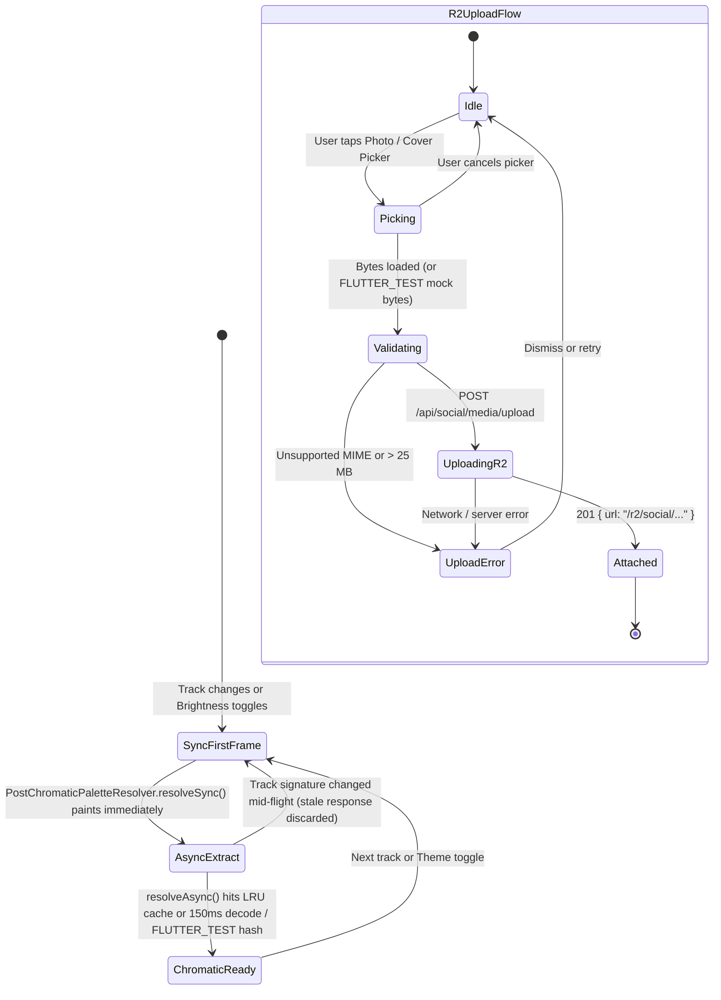
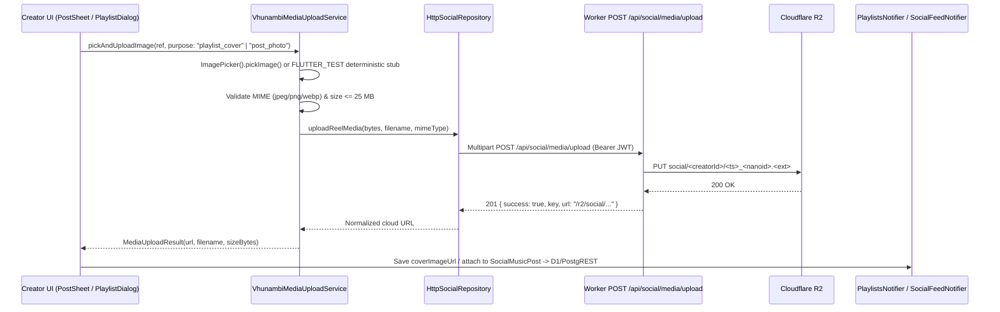

# Phase 77 Blueprint: Chromatic Full-Screen Player, Synced Sing-Along Lyrics & Unified R2 Media Uploads

**Phase ID:** `P77`  
**Memory Key:** `MEM-P77-CHROMATIC-PLAYER-LYRICS-R2-UPLOADS`  
**Audit Source:** [`docs/audits/PHASE77_CHROMATIC_PLAYER_LYRICS_AND_R2_UPLOADS_AUDIT.md`](../../audits/PHASE77_CHROMATIC_PLAYER_LYRICS_AND_R2_UPLOADS_AUDIT.md)  
**Target Modules:** `apps/vhunambi_client/lib/features/{player,track,playlists,collections,explore,studio}/` · `apps/vhunambi_client/lib/core/{media,theme,widgets}/`  
**Execution Cadence:** Two Sequential Passes (`Pass 1: M77.1–M77.2`, `Pass 2: M77.3–M77.4`)

---

## 1. Executive Overview & Visual North Star

Phases 73 and 74 introduced four flagship Vhunambi primitives:
1. **`EP-P73-POST-CHROMATIC-SYNTH`** (`PostChromaticPaletteResolver`) — 3-tier WCAG AA artwork + mood chromatic color synthesis (`Light <= 0.42`, `Dark >= 0.62`, 64-entry LRU cache, 150ms timeout, `FLUTTER_TEST` deterministic bypass).
2. **`EP-P74-KARAOKE-LYRIC-SANITIZER`** (`LyricKaraokeSanitizer`) — strips AI stage-direction bracket leaks (`[Intro]`, `[Crisp soft shakers, airy synth pads]`) before vocal display.
3. **`BantuLyricTranslationService`** — 9-language Southern Bantu (`zu`, `xh`, `ss`, `nr`, `nso`, `tn`, `st`, `ve`, `ts`) lexicon, penultimate-stress syllabification, and peer-branch cognate matching (`BantuSimilarity`).
4. **`EP-P74-SOCIAL-MEDIA-R2-UPLOAD`** (`POST /api/social/media/upload` via `HttpSocialRepository.uploadReelMedia`) — authenticated 25 MB Cloudflare R2 media uploads (`image/jpeg`, `image/png`, `image/webp`, video, audio).

Phase 77 unifies these stranded primitives into the daily listening, sing-along, playlist curation, and social creation flows so every song paints a living Dark/Light-safe stage, every lyric view synchronizes cleanly to live playback with interactive 9-language Bantu word definitions, and every image upload in Explore Posts and Playlists persists real media bytes to Cloudflare R2 — paired with one-tap visitor **"Share as Reel"** on `TrackDetailView` and a targeted `STD-UIUX-001` sweep.

---

## 2. Forensic Post-Mortem Comparison Box

```text
┌───────────────────────────┬──────────────────────────────────────────────┬──────────────────────────────────────────────┐
│ Surface / Domain          │ Phase 76 Baseline (Audited Defects)          │ Phase 77 Target Architecture                 │
├───────────────────────────┼──────────────────────────────────────────────┼──────────────────────────────────────────────┤
│ Full-Screen Player        │ Static Dark AppColors.surfaceModal + generic │ PostChromaticPaletteResolver backdrop aura + │
│ (ExpandedCockpitModal)    │ AppGradients.forGenre & AppIcons.piano box;  │ VhunambiTrackArtwork + Dark/Light *Of(ctx);  │
│                           │ zero Light-Mode adaptation (F77-03).         │ WCAG AA clamped controls & glow halo.        │
├───────────────────────────┼──────────────────────────────────────────────┼──────────────────────────────────────────────┤
│ Mini-Player & Transport   │ PillForm runs un-guarded PaletteGenerator    │ Unified resolvePlayerChromatic helper;       │
│ (MobileMiniPlayer,        │ (4s timeout, no test guard); Dock kit uses   │ VhunambiTrackArtwork thumbnails; Light/Dark  │
│ PillForm, DesktopBar)     │ dark surfaceModal; DesktopBar has 3 Icons.*. │ VhunambiFloatingTransportSurface + Phosphor. │
├───────────────────────────┼──────────────────────────────────────────────┼──────────────────────────────────────────────┤
│ Full-Screen & Track       │ Player splits raw lyrics verbatim ([Intro]   │ Shared Synced Karaoke engine using           │
│ Synced Sing-Along Lyrics  │ leaks); Copy uses AppIcons.edit; no playback │ LyricKaraokeSanitizer + playerStateProvider  │
│ (Player + TrackDetail)    │ sync; 5/9 default Bantu cognates; no word UI │ sync + tap-to-seek + 9-lang Bantu word sheet.│
├───────────────────────────┼──────────────────────────────────────────────┼──────────────────────────────────────────────┤
│ Explore Kinetic Post      │ _mockPickImage hardcodes mock CDN URL; dead  │ Shared VhunambiMediaUploadService picking    │
│ Photo Uploads             │ duplicate ternary #L117-119; dark tokens.    │ real device photos -> R2 /social/media/upload│
├───────────────────────────┼──────────────────────────────────────────────┼──────────────────────────────────────────────┤
│ Playlists Custom Covers   │ DB/API/Entity/PlaylistCoverArt ready, but    │ PlaylistsNotifier + Create/Edit dialogs &    │
│ (Vault & Detail View)     │ Notifier & dialogs lack coverImageUrl picker │ PlaylistDetailView Edit Cover -> R2 upload.  │
├───────────────────────────┼──────────────────────────────────────────────┼──────────────────────────────────────────────┤
│ TrackDetail "Share Reel"  │ _openVideoExport trapped inside isTrackOwner │ TrackActionsBar exposes visitor-safe 'Reel'  │
│ & STD-UIUX-001 Hygiene    │ gate; 68 Icons.*, 19 emojis, 368 dark hits.  │ pill -> KineticReelStudioView; 0 Icons/emoji.│
└───────────────────────────┴──────────────────────────────────────────────┴──────────────────────────────────────────────┘
```

---

## 3. Multi-Layer Decoupled System Architecture

```text
┌──────────────────────────────────────────────────────────────────────────────────────────┐
│ LAYER 1: STATE & CLOUD SOURCES                                                           │
│  PlayerState (currentTrack: coverUrl, mood; position, duration)                          │
│  LibraryTracksProvider / TrackDetailProvider (raw lyrics, language, bpm, moodId)         │
│  Worker API: POST /api/social/media/upload (R2 25MB) · PUT/POST /api/playlists (D1)      │
└──────────────────────┬──────────────────────────────┬────────────────────────────────────┘
                       ▼                              ▼
┌────────────────────────────────────┐ ┌───────────────────────────────────────────────────┐
│ LAYER 2: PURE DART DOMAIN ENGINES  │ │ LAYER 2B: MEDIA UPLOAD SERVICE                    │
│ • PostChromaticPaletteResolver     │ │ • VhunambiMediaUploadService                      │
│   (Tier 1 Mood+Art / Tier 2 Art /  │ │   - ImagePicker().pickImage(imageQuality: 88)     │
│    Tier 3 Brand; WCAG AA clamp)    │ │   - MIME sniff (jpg/png/webp) + 25MB size cap     │
│ • SyncedLyricTimeline              │ │   - Deterministic FLUTTER_TEST bypass             │
│   (position/duration -> lineIdx)   │ │   - ISocialRepository.uploadReelMedia(...)        │
│ • LyricKaraokeSanitizer            │ │     -> /r2/social/<creatorId>/<ts>_<id>.<ext>     │
│ • BantuLyricTranslationService     │ └────────────────────────┬──────────────────────────┘
│   (9-lang lookupWord + cognates)   │                          │
└──────────────────────┬─────────────┘                          │
                       ▼                                        ▼
┌──────────────────────────────────────────────────────────────────────────────────────────┐
│ LAYER 3: PRESENTATION CHROME & INTERACTIVE SURFACES (Light + Dark WCAG AA Parity)        │
│ • Player: ExpandedCockpitModal · MobileMiniPlayer · PillForm · DesktopTransportBar ·     │
│           VhunambiFloatingTransportSurface · QueueDrawer                                 │
│ • Track:  LyricsTeleprompter · BantuWordGlossarySheet · TrackActionsBar ('Reel' pill)    │
│ • Create: CreateKineticPostSheet (R2 photo upload)                                       │
│ • Vault:  PlaylistsVaultView · PlaylistDetailView (R2 custom cover upload)               │
└──────────────────────────────────────────────────────────────────────────────────────────┘
```

---

## 4. Domain Taxonomy & 9-Language Bantu Matrix

### 4.1 Chromatic Synthesis Tier Behavior (`PostChromaticPaletteResolver`)

| Tier | Trigger Condition | Primary Glow | Secondary Glow | Light Clamp (`L`) | Dark Clamp (`L`) |
| :--- | :--- | :--- | :--- | :---: | :---: |
| **`moodAndArtwork`** | `track.mood` resolves via `VhunambiMood` AND artwork color extracted/cached | Mood anchor color | Extracted artwork color | `[0.24, 0.42]` | `[0.62, 0.78]` |
| **`artworkOnly`** | No explicit mood; artwork extracted or URI-hashed | Artwork primary | Split-complement (`+150 deg`) | `[0.24, 0.42]` | `[0.62, 0.78]` |
| **`themeDefault`** | Neither mood nor artwork available | `AppColors.brandPrimary` | `AppColors.accentElectric` | `[0.24, 0.42]` | `[0.62, 0.78]` |

### 4.2 Nine Constitutional Southern Bantu Languages (`BantuLanguage`)

| ISO Code | Language | Guthrie Branch | Zone | Glossary & Cognate Coverage |
| :---: | :--- | :--- | :---: | :--- |
| `zu` | isiZulu | Nguni | S40 | Curated phrases + `BantuSimilarity` |
| `xh` | isiXhosa | Nguni | S40 | Curated phrases + `BantuSimilarity` |
| `ss` | siSwati | Nguni | S40 | Curated phrases + `BantuSimilarity` |
| `nr` | isiNdebele | Nguni | S40 | Curated phrases + `BantuSimilarity` |
| `nso` | Sepedi | Sotho-Tswana | S30 | Curated phrases + `BantuSimilarity` |
| `tn` | Setswana | Sotho-Tswana | S30 | Curated phrases + `BantuSimilarity` |
| `st` | Sesotho | Sotho-Tswana | S30 | Curated phrases + `BantuSimilarity` |
| `ve` | Tshivenda | Tshivenda | S20 | Curated phrases + `BantuSimilarity` |
| `ts` | Xitsonga | Tswa-Ronga | S50 | Curated phrases + `BantuSimilarity` |

---

## 5. Lifecycle State Machines



---

## 6. Dual-Viewport HUD Wireframes

### 6.1 Mobile Portrait (`< 600dp`) — Living Chromatic Full-Screen Player & Synced Lyrics

```text
┌─────────────────────────────────────────────┐
│  [v]   NOW PLAYING · AMAPIANO    [Reel] [:] │  <- Chromatic Top Radial Aura
├─────────────────────────────────────────────┤
│       ┌─────────────────────────────┐       │
│       │                             │       │
│       │   VhunambiTrackArtwork      │       │  <- Real coverUrl + primaryGlow shadow
│       │       (260 x 260)           │       │
│       └─────────────────────────────┘       │
│  Grateful in the Light          [Heart] [+] │
│  Sigwa & Inaf · Tshivenda                   │
│  ─────────●──────────────────────── 01:12   │  <- Clamped palette.accent scrubber
│     [Shuffle]  [|<]  (( || ))  [>|]  [Rep]  │
├─────────────────────────────────────────────┤
│ [Lyrics (Clean)]  [Bantu Sing-Along: ON] [C]│  <- PhosphorIconsRegular.copy
│  Ndi a livhuwa musi duvha li tshi bva       │  <- Dimmed past line
│> [Ndi-a-LI-vhu-wa]  (tap any word!)         │  <- Active synced line (accent border)
│  Meaning: I am grateful (Tshivenda)         │
│  Shumela vhana vha mavu                     │  <- Upcoming line
└─────────────────────────────────────────────┘
        │ (User taps word "livhuwa")
        ▼
┌─────────────────────────────────────────────┐
│  "livhuwa" · Tshivenda (S20)            [X] │  <- BantuWordGlossarySheet (Glass)
│  Syllables: li-VU-wa                        │
│  Meaning:   be grateful / give thanks       │
│  Cognates:  [zu: bonga] [ts: khensa]        │
└─────────────────────────────────────────────┘
```

### 6.2 Desktop Viewport (`>= 600dp`) — Chromatic Transport Bar & Split Cockpit

```text
┌──────────────────────────────────────────────────────────────────────────────────┐
│ [VhunambiTrackArtwork]  Track Title         [|<] (( || )) [>|]  ───●───  [1x][Q] │
│  44x44 + Chromatic Aura Creator · Genre    (Phosphor icons, Light/Dark safe)     │
└──────────────────────────────────────────────────────────────────────────────────┘

TrackDetailView Actions Row (Visitor & Owner Safe):
  [Heart 1.2k]  [Play 4.8k]  [Save]  [Share]  [Reel (FilmStrip)]  [Tip]
                                                 ▲
                                                 └─ Opens KineticReelStudioView.show()

Playlist Create / Edit Dialog (R2 Cover Picker):
  ┌──────────────┐   Playlist Title  [_______________________]
  │ PlaylistCover│   Description     [_______________________]
  │  (80 x 80)   │   [Upload Cover (R2)]   [Reset Collage]
  └──────────────┘
```

---

## 7. Mathematical Formulations

### 7.1 Chromatic Backdrop Alpha Blending (Light & Dark Contrast Guarantee)
For any surface with theme brightness $B \in \{\text{dark}, \text{light}\}$ and resolved `PostChromaticPalette` $P$:
- Top ambient tint alpha: $\alpha_{\text{top}}(B) = 0.28$ if $B = \text{dark}$, else $0.14$.
- Mid secondary tint alpha: $\alpha_{\text{mid}}(B) = 0.14$ if $B = \text{dark}$, else $0.07$.
- Base canvas color $C_{\text{base}} = \text{AppColors.surfaceModalOf(context)}$ ensures foreground typography (`textPrimaryOf(context)`) preserves $\ge 4.5:1$ contrast in both Light (`#F8FAFC`) and Dark (`#16161C`) modes.

### 7.2 Synced Lyric Active-Line Time Mapping & Tap-to-Seek Inversion
Given $N \ge 1$ sanitized display lyric lines, current playback position $p \ge 0$, and positive duration $D > 0$:
$$
r = \text{clamp}\!\left(\frac{p}{D},\; 0.0,\; 0.9999\right), \qquad i_{\text{active}} = \lfloor r \cdot N \rfloor \in \{0, 1, \dots, N - 1\}
$$
When the user taps line $k \in \{0, \dots, N - 1\}$, the exact seek target is:
$$
t_{\text{seek}}(k) = \left\lfloor \frac{k}{N} \cdot D_{\text{ms}} \right\rfloor \text{ ms}
$$
If the currently playing track ID does not match the displayed track ID, or $D \le 0$, $i_{\text{active}} = -1$ (no spurious highlight).

---

## 8. End-to-End R2 Upload & Persistence Sequence



---

## 9. Hardware, Frame & Test Determinism Budget

- **60 FPS Frame Budget ($\le 16.6\text{ms}$):** `PostChromaticPaletteResolver.resolveSync` computes synchronously in $< 0.2\text{ms}$ on frame 1; async artwork extraction is capped at `150ms` and memoized in a 64-entry LRU cache.
- **Zero Live-Blur Overdraw:** All new sheets/popovers (`BantuWordGlossarySheet`, `CreateKineticPostSheet`, playlist dialogs) use `VhunambiGlassSurface(enableLiveBlur: false)` on mobile scroll surfaces.
- **Headless Test Determinism (`FLUTTER_TEST`):** Neither `PostChromaticPaletteResolver` nor `VhunambiMediaUploadService` opens real platform channels or network sockets under `flutter test`, preventing `FakeAsync` timer leaks and eliminating `PillForm`'s legacy 4-second `PaletteGenerator` timer.
- **Zero New Native Plugins:** Reuses existing `image_picker`, `palette_generator`, `phosphor_icons`, and `dio` already pinned in `pubspec.yaml`.

---

## 10. Verification Gates (`G77-01` – `G77-06`)

| Gate ID | Scope | Exact Verification Criteria |
| :--- | :--- | :--- |
| **`G77-01`** | Static Analysis | `cd apps/vhunambi_client && dart analyze` exits `0` with `No issues found!`. |
| **`G77-02`** | Chromatic Player & Dock Parity | `PostChromaticPaletteResolver` drives `ExpandedCockpitModal`, `MobileMiniPlayer`, `PillForm` (`0` direct `PaletteGenerator` calls left in `pill_form.dart`), and `DesktopTransportBar`; `VhunambiTrackArtwork` replaces `AppIcons.piano` placeholders; Light & Dark widget renders pass. |
| **`G77-03`** | Synced Karaoke & 9-Lang Bantu Glossary | `ExpandedCockpitModal` and `LyricsTeleprompter` sanitize `[Intro]`/`[Crisp soft shakers]` tags, highlight active playback line from `playerStateProvider`, tap-to-seek, fix `cockpit_copy_lyrics` icon to `PhosphorIconsRegular.copy`, and open `BantuWordGlossarySheet` across all 9 `BantuLanguage` variants. |
| **`G77-04`** | Unified R2 Uploads & Visitor Reel Share | `CreateKineticPostSheet` (`_mockPickImage` deleted) and `PlaylistsVaultView` / `PlaylistDetailView` upload images via `VhunambiMediaUploadService` -> `uploadReelMedia`; `PlaylistsNotifier` propagates `coverImageUrl`; `TrackActionsBar` exposes visitor-safe `Key('track_reel_pill')` -> `KineticReelStudioView.show`. |
| **`G77-05`** | `STD-UIUX-001` Zero-Violation Scan | Regex scan over `player/`, `track/`, `playlists/`, `collections/`, and `explore/` confirms `0` stock Material `Icons.*` and `0` raw Unicode emojis in UI code. |
| **`G77-06`** | Full Targeted Tests & Connectome SLEEP | `flutter test test/features/phase77_chromatic_player_lyrics_r2_test.dart test/features/player test/features/track test/features/playlists test/features/explore --no-pub --timeout=60s` passes 100%; `memory.md` marked `"completed"`; `consolidate_memory.mjs` confirms `0 OPEN` endpoints. |
