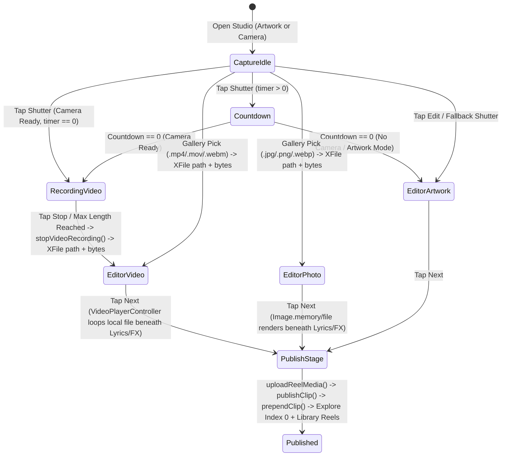
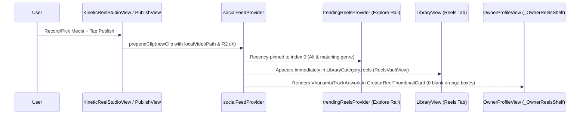

# Phase 78 Blueprint — Vault, Explore & Profile Continuity, Real Audio/Video Uploads & Unified Glass Tabs (`blueprint.md`)

**Phase ID:** `P78`  
**Audit Source:** [`PHASE78_VAULT_EXPLORE_CONTINUITY_UPLOADS_AND_GLASS_TABS_AUDIT.md`](../../audits/PHASE78_VAULT_EXPLORE_CONTINUITY_UPLOADS_AND_GLASS_TABS_AUDIT.md) (`AUDIT-CLIENT-078`)  
**Scope:** Layer 1 of the Flagship 3-Phase Polish Roadmap (**Phase 78 -> Phase 79 -> Phase 80**) — fixing every P0 data pipeline break, continuity disconnect, overlay collision, ownership lockout, and tab-bar fragmentation observed on live hardware (`video_1.mp4` & `video_2.mp4`).

---

## 1. Executive Overview & Visual North Star

Hardware screen recordings (`video_1.mp4` `00:00–00:36` and `video_2.mp4` `00:00–08:25`) demonstrated that Vhunambi's core flagship canvases (`TrackDetailView`, `KineticPostFocusView`, chromatic glow, 6-reaction tray, inline GIF replies, and 9:16 Reels Studio) already reach consumer-grade polish, **but six P0 pipeline and UX breaks undermine user trust**:

1. **Silent Upload & Capture Loss (`VA-02`):** `DirectDawVocalUploadSheet` has a non-clickable dropzone, fabricates a fake `cdn.vhunambi.com` URL, and flags DAW Masters `isInstrumental: true` so both `LibraryView` (`Songs`) and `OwnerProfileView` (`Your Songs`) hide them; meanwhile `KineticReelStudioView` never calls `startVideoRecording`/`stopVideoRecording`, has zero Stage 2 `VideoPlayerController`, and crushes the top Audio pill to `[🎵 U...]`.
2. **Explore $\leftrightarrow$ Library $\leftrightarrow$ Owner Profile Disconnection (`VA-01`):** Newly published Reels start at virality score `0` and get sorted to the bottom of `trendingReelsProvider`; `LibraryView` has no `Reels` tab; and `OwnerProfileView`'s `My Clips & Reels` renders 9 blank orange gradient slabs (`CreatorReelThumbnailCard`) while duplicating `_OwnerReelsShelf` inside `Songs`.
3. **Overlay & Feedback Chaos (`VA-03`, `VA-05`):** Rapidly loving a Reel queues 39 separate orange `SnackBar`s for 60+ seconds across tabs, while `MiniPlayerHost` floats across `KineticReelsModal`, Comments, and mid-screen Library because `KineticReelsModal` omits `pushedFullScreenOverlayCountProvider` and `RootShell._switchTab` never resets dragged `PlayerMode.manual` pills.
4. **`@aistudio` Creator Lockout & Sanitizer Leaks (`VA-06`, `VA-09`):** Generated tracks omit `creatorId`/`creatorHandle` and stamp `creatorName: 'AI Studio'`, forcing `resolveViewerRole` to lock creators out of their own songs as `ViewerRole.visitor`; unclosed parenthetical lyric fragments (`(Sacred drum;`, `(Li-ste-en`) and `[INTRO]` leak into playback views.
5. **Visual Tab Fragmentation & Legacy Seams (`VA-04`, `VA-09`):** `OwnerProfileView` uses solid orange boxy tabs, `ArtistProfileView` uses flat Material 2 underlines, `CatalogFilterBar` stacks 10 mood pills vertically with static Dark tokens, `Fastest Growing Tracks` (`TrackListTile`) paints flat orange glyph squares, `KineticPostFocusView` renders an unlabeled gold coin button, legacy reposts still display `@current_user`, and uninitialized/offline Reel video backing renders a solid black slab.

**North Star:** Every uploaded track, recorded camera video, picked gallery clip, generated song, and published Reel flows reliably through one continuous **Create $\to$ Vault (`Library`) $\to$ Explore $\to$ Profile** graph with zero silent drops, zero modal overlap, zero SnackBar storms, and one unified **Vhunambi Glass Tab Bar (`EP-P78-GLASS-TAB-BAR`)** across Light and Dark themes.

---

## 2. Forensic Post-Mortem Comparison Box (Broken `HEAD` vs. Phase 78 Architecture)

```text
┌──────────────────────────────┬─────────────────────────────────────────┬──────────────────────────────────────────────┐
│ Hardware Defect              │ Current HEAD Failure Mode               │ Phase 78 Target Architecture                 │
├──────────────────────────────┼─────────────────────────────────────────┼──────────────────────────────────────────────┤
│ VA-01: Reel Continuity       │ Score-0 Reel sorted to bottom; no Reels │ Newly published / session Reels pin to idx 0 │
│ Explore <-> Vault <-> Profile│ tab in Library; 9 blank orange boxes in │ of Explore; LibraryCategory.reels + Vault UI;│
│                              │ CreatorReelThumbnailCard; Songs dupes.  │ VhunambiTrackArtwork cards; clean tab split. │
├──────────────────────────────┼─────────────────────────────────────────┼──────────────────────────────────────────────┤
│ VA-02: Upload & Camera Video │ Static dropzone, fake URL, DAW hidden;  │ FilePicker + local persistence + R2 upload   │
│                              │ Shutter jumps to Stage 2 w/o recording; │ (WAV/MP3/M4A/AAC/OGG); real start/stop video │
│                              │ No Stage 2 VideoPlayer; crushed Audio.  │ recording + Stage 2 VideoPlayer + wide pill. │
├──────────────────────────────┼─────────────────────────────────────────┼──────────────────────────────────────────────┤
│ VA-03: Loved 39x! Storm      │ ScaffoldMessenger.showSnackBar queued   │ Zero SnackBar on rapid love; single in-place │
│                              │ 39x in FIFO queue across tabs (60s+).   │ floating glass counter pill (800ms reset).   │
├──────────────────────────────┼─────────────────────────────────────────┼──────────────────────────────────────────────┤
│ VA-04: Tab & Explore Drift   │ Orange boxy tabs (Owner), M2 underline  │ Unified VhunambiGlassTabBar across all 4     │
│                              │ (Artist), vertical Wrap moods, orange   │ surfaces; horizontal VhunambiMood rail;      │
│                              │ squares in Fastest Growing Tracks.      │ VhunambiTrackArtwork on TrackListTile.       │
├──────────────────────────────┼─────────────────────────────────────────┼──────────────────────────────────────────────┤
│ VA-05: MiniPlayer Overlap    │ No pushedOverlayCount in Reels modal;   │ Ref-counted pushedFullScreenOverlayCount in  │
│                              │ PlayerMode.manual sticks mid-screen.    │ KineticReelsModal + resetToDock on tab swap. │
├──────────────────────────────┼─────────────────────────────────────────┼──────────────────────────────────────────────┤
│ VA-06 / VA-09: Ownership,    │ Generated songs -> @aistudio -> visitor │ Authenticated creatorId/handle stamped on    │
│ Sanitizer & Polish Seams     │ lockout; [INTRO] & (Sacred drum; leak;  │ gen + legacy rescue; hardened sanitizer;     │
│                              │ @current_user cache; black video slab.  │ Tip glass pill; artwork beneath video layer. │
└──────────────────────────────┴─────────────────────────────────────────┴──────────────────────────────────────────────┘
```

---

## 3. Multi-Layer Decoupled System Architecture

```text
┌────────────────────────────────────────────────────────────────────────────┐
│ LAYER 4: PRESENTATION & UNIFIED CHROME (Flutter Light/Dark `*Of(context)`) │
│ • VhunambiGlassTabBar (`EP-P78-GLASS-TAB-BAR`)                             │
│   ├─ OwnerProfileView (`Songs | Reels | Beatstore | Voices | Releases`)    │
│   ├─ ArtistProfileView (`Overview | Songs | Posts & Reels | Beats | About`)│
│   ├─ ExploreView (`For You | Following | All Songs`)                       │
│   └─ LibraryCategoryRail (`Songs | Reels | Playlists | Collections | ...`) │
│ • ReelsVaultView (`LibraryCategory.reels`) + CreatorReelThumbnailCard      │
│ • KineticReelStudioView (Real Camera Record + Stage 2 VideoPlayer + Pill)  │
│ • KineticReelsModal (Overlay Suppression + Ephemeral Love Pill + Art Base) │
│ • DirectDawVocalUploadSheet (Interactive FilePicker + R2 Audio Upload)     │
├────────────────────────────────────────────────────────────────────────────┤
│ LAYER 3: RIVERPOD STATE & CONTINUITY PROJECTION                            │
│ • socialFeedProvider (`prependClip`, `deleteClip`)                         │
│ • trendingReelsProvider (Index-0 recency pin + viral momentum sort)        │
│ • libraryTracksProvider & libraryCategoryCountsProvider (+ `reels` count)  │
│ • generationPipelineProvider -> authenticated creator identity stamping    │
│ • miniPlayerControllerProvider + pushedFullScreenOverlayCountProvider      │
├────────────────────────────────────────────────────────────────────────────┤
│ LAYER 2: PURE DART DOMAIN & SANITIZATION                                   │
│ • resolveViewerRole (`viewer_role.dart`: legacy `@aistudio` owner rescue)  │
│ • LyricKaraokeSanitizer (`cleanLyricTextForKaraoke`, unclosed `(` guard)   │
│ • SocialMusicPost.fromJson (legacy `@current_user` normalization)          │
│ • PublishedClip (`localVideoPath` offline-first playback metadata)         │
├────────────────────────────────────────────────────────────────────────────┤
│ LAYER 1: CLOUDFLARE WORKER R2 MEDIA INGEST (`apps/vhunambi_api`)           │
│ • POST /api/social/media/upload (`social_routes.ts`)                       │
│   └─ Supports MP4, MOV, WEBM, JPG, PNG, WEBP, MP3, M4A + WAV, AAC, OGG     │
└────────────────────────────────────────────────────────────────────────────┘
```

---

## 4. State Machines & End-to-End Flow Diagrams

### 4.1 `KineticReelStudioView` Capture-to-Editor Video State Machine



### 4.2 Explore $\leftrightarrow$ Library $\leftrightarrow$ Owner Profile Continuity Sequence



---

## 5. Dual-Viewport Wireframes (`KineticReelStudioView` & `VhunambiGlassTabBar`)

### 5.1 `KineticReelStudioView` Unobstructed Top Chrome (Mobile `360dp`)
```text
┌────────────────────────────────────────────────────────┐
│ [X]      [ ♫ Underground Durban club... ▾ ]       [⇄] │  <- Only 3 items on top row (>=180dp pill!)
│                                                        │
│                                                  (FX)  │  <- Vertical tool rail holds:
│                                                 (Cam)  │     FX, Backdrop/Cam, Flash,
│                9:16 LIVE CAMERA /               (Spd)  │     Speed, Timer, Lyrics, Length
│             LOCAL VIDEO / ARTWORK               (Tmr)  │
│                                                 (Lyr)  │
│                                                 (30s)  │
│                                                        │
│  [Kinetic Gold] [Super 8mm] [Amapiano Pulse]           │
│  [🖼 Gallery]   [🔄 Flip]   (( REC / ● ))    [ Edit ]  │
└────────────────────────────────────────────────────────┘
```

### 5.2 Unified `VhunambiGlassTabBar` Anatomy (Light & Dark Parity)
```text
┌────────────────────────────────────────────────────────────────────┐
│ ╭────────────────────────────────────────────────────────────────╮ │
│ │ [ ♫ Songs 12 ]  🎬 Reels 4   🛍 Beats   🎙 Voices   💿 Releases │ │
│ │  ^^^^^^^^^^^^^                                                 │ │
│ │  Frosted translucent active capsule + specular rim + haptic    │ │
│ ╰────────────────────────────────────────────────────────────────╯ │
└────────────────────────────────────────────────────────────────────┘
```

### 5.3 `KineticReelsModal` Ephemeral Love Counter Pill (Zero SnackBar Queue)
```text
                                             ┌───────────┐
                                             │ ♥ 12x     │ <- Key('reel_ephemeral_love_pill')
                                             └─────┬─────┘    Updates in place, fades after 800ms
                                                 ( ♥ )
                                                  142
                                                 ( 💬 )
                                                   8
```

---

## 6. Verification Gates (`G78-01` – `G78-06`)

| Gate | Command / Check | Pass Criteria |
| :---: | :--- | :--- |
| **`G78-01`** | `cd apps/vhunambi_client; dart analyze` | `No issues found!` (`0` errors, `0` warnings, `0` infos) |
| **`G78-02`** | `cd apps/vhunambi_api; npx tsc --noEmit; npm test` | `0` TS errors; WAV/AAC/OGG upload tests + existing API suites 100% green |
| **`G78-03`** | `STD-UIUX-001` Regex Audit across `core/widgets`, `studio`, `content_studio`, `social`, `library`, `profile`, `explore`, `player`, `track` | `0` stock Material `Icons.*` and `0` raw Unicode emojis in UI code |
| **`G78-04`** | `flutter test test/features/phase78_vault_explore_continuity_uploads_glass_tabs_test.dart --no-pub --timeout=60s` | 100% pass covering `VA-01`–`VA-06`, `VA-09`, and Light/Dark `VhunambiGlassTabBar` |
| **`G78-05`** | `flutter test test/features/studio test/features/content_studio test/features/social test/features/library test/features/profile test/features/explore test/features/player test/features/track --no-pub --timeout=60s` | 100% pass with zero regressions across all existing suites |
| **`G78-06`** | `node .agents/skills/vhunambi-memory/scripts/consolidate_memory.mjs` | `0` OPEN endpoints; `P78` indexed as `"completed"` in `CORTEX_INDEX.md` |
