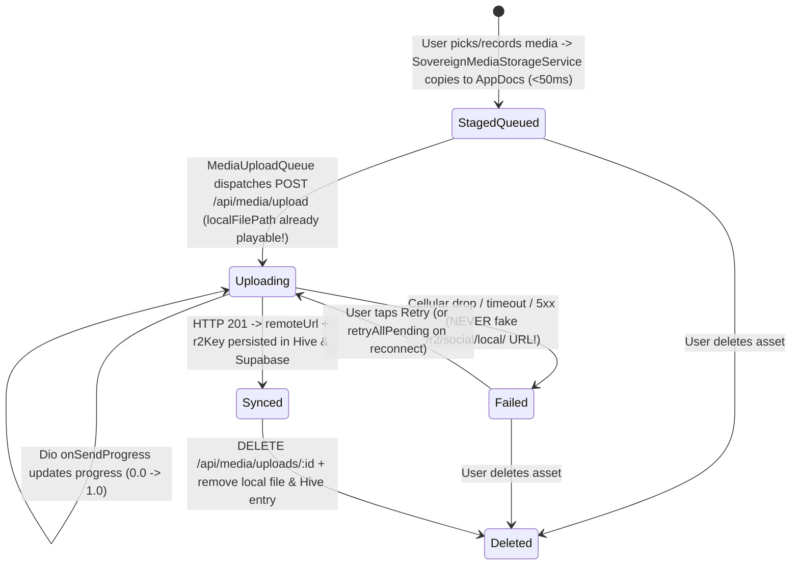
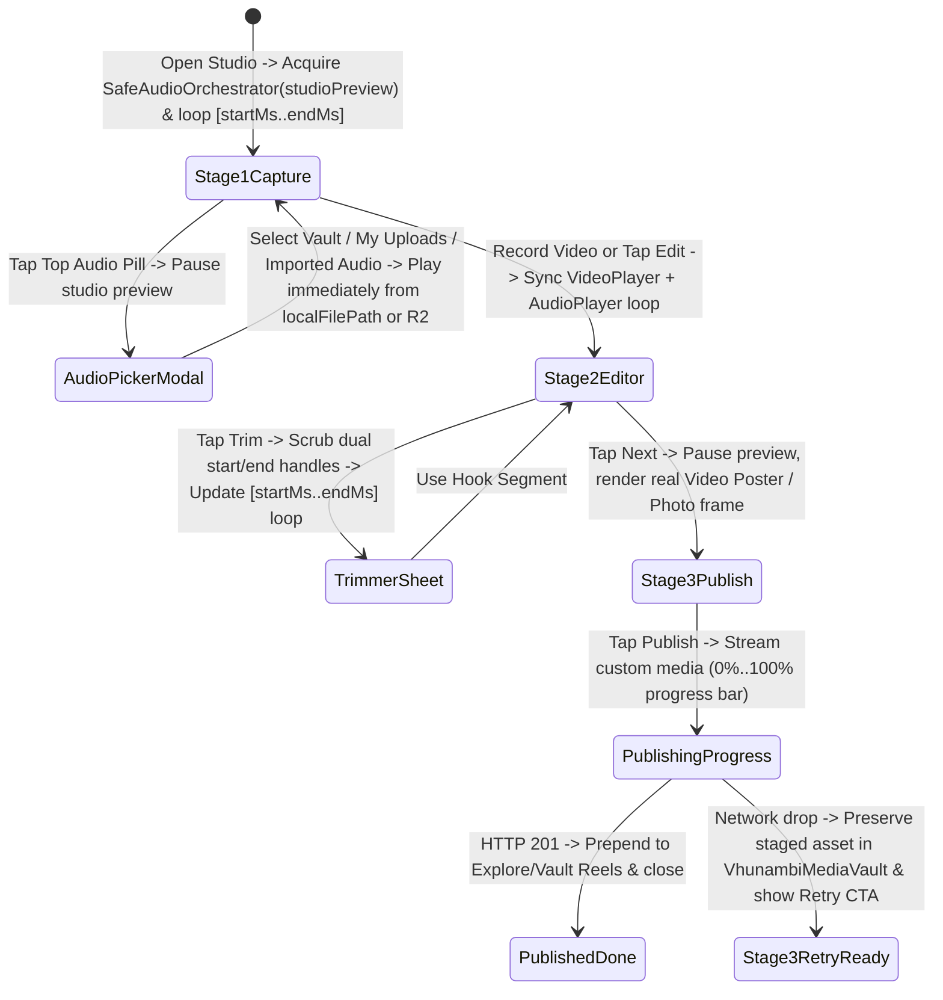
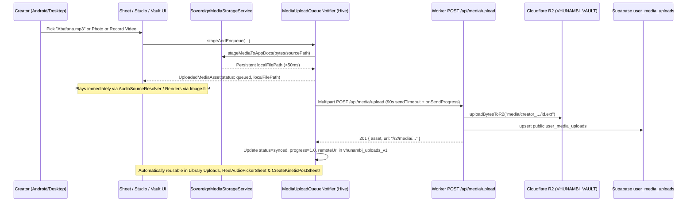

# Phase 79 Blueprint — Sovereign Media Upload & Reuse Engine (`VhunambiMediaVault`), Local-First R2 Sync Queue, `CreateKineticPostSheet` Glass Cockpit v2 & Reels Studio Layout Repairs (`blueprint.md`)

**Document ID:** `VHUNAMBI-SPEC-P79-BLUEPRINT-V1`  
**Phase ID:** `P79`  
**Audit Source:** [`PHASE79_SOVEREIGN_MEDIA_UPLOAD_ENGINE_AND_POST_COCKPIT_AUDIT.md`](../../audits/PHASE79_SOVEREIGN_MEDIA_UPLOAD_ENGINE_AND_POST_COCKPIT_AUDIT.md) (`AUDIT-CLIENT-079`)  
**Scope:** End-to-end local-first media staging, resumable R2 upload queue with byte progress & retry, durable Supabase/Worker `user_media_uploads` SWR registry, universal `"My Uploads"` reuse across Library/Reels/Kinetic Posts, real-time studio audio playback (`SafeAudioOrchestrator`), `CreateKineticPostSheet` Glass Cockpit v2, and Reels Studio layout/dark-mode repairs.

---

## 1. Executive Overview & Visual North Star

Physical device testing on Huawei `JNY-LX1` (`video_1.mp4`, `00:00–01:42`) revealed that while Vhunambi's R2 upload endpoint (`POST /api/social/media/upload`) succeeds on clean Wi-Fi, **all three creator upload surfaces (`ReelAudioPickerSheet`, `DirectDawVocalUploadSheet`, `KineticReelStudioView`/`KineticReelPublishView`, and `CreateKineticPostSheet`) treat user media as disposable widget-RAM buffers (`Uint8List?`)** gated behind synchronous, short-timeout HTTP requests:

1. **Silent Imported Audio & Zero Reuse (`UPL-01`):** Picking *Abafana* (`00:14–00:22`) updates the top pill label in `KineticReelStudioView`, yet cranking hardware volume plays **dead silence** because `KineticReelStudioView` contains zero `just_audio` `AudioPlayer` (`isPlaying: false` everywhere), `ReelAudioPickerSheet` restricts extensions to `['mp3','m4a']` without copying out of Android's transient cache into `ApplicationDocumentsDirectory` or writing to `My Vault`, and `AudioSourceResolver` bypasses unencrypted local files to attempt remote HTTPS streaming.
2. **Cellular Drop Data Loss & Invisible Photo Attachments (`UPL-01`):** Recording a camera Reel (`00:38–00:44`) loads in Stage 2, but Stage 3 (`01:10`) renders generic song cover art instead of the recorded video, and `Publishing...` freezes with `0%` progress when Vodacom mobile data drops (`01:24`) because `HttpSocialRepository` configures `4s` timeouts with zero `sendTimeout`, zero `onSendProgress`, and masks errors into fake `404` `/r2/social/local/...` URLs. Swiping back discards the recording from widget RAM. Meanwhile in `CreateKineticPostSheet` (`01:31–01:42`), picking a photo increments `Add Photo (1/4)` with **zero visible preview** because `VhunambiMediaUploadService` drops `picked.path`, `_attachedImages` renders `~500dp` below the scroll fold, and `VhunambiTrackArtwork` has no `Image.file` branch.
3. **Stateless Backend Uploads (`UPL-01`):** `POST /api/social/media/upload` writes raw bytes to Cloudflare R2 (`VHUNAMBI_VAULT`) without persisting a `public.user_media_uploads` database record—making cross-session or cross-device listing, reuse, and deletion impossible.
4. **Dated Kinetic Post Composer (`UPL-02`):** `CreateKineticPostSheet` still uses pre-glass non-contextual tokens (`AppColors.surfaceSecondary`, `AppColors.textPrimary`), solid-orange `ChoiceChip`s, no above-the-fold visual stage, and a bare text `PopupMenuButton` dropdown with zero artwork, zero audio auditioning, and zero connection to user uploads.
5. **Reels Studio & Dark-Mode Visual Defects (`UPL-03` – `UPL-06`):**
   - Right tool rail (`top: 96`, 8 unconstrained buttons ~528dp) overlaps bottom preset orbs and `Edit` (`UPL-03a`).
   - `ReelAudioTrimmerSheet` omits `isScrollControlled: true` + `SafeArea`, clipping `Use Hook Segment` half off-screen and lacking dual start/end range handles (`UPL-03b`).
   - `_PostKineticReelCard` (Card #0 on Explore `Kinetic Reels`) reads static `AppColors.surfaceElevated` / `surfaceCanvas` and renders as a stark white slab in Dark Mode (`UPL-04`).
   - `ReelAudioPickerSheet` uses a fixed 4-column `TabBar` truncating `'Trendin...'` and displays un-sanitized Hive `'AI Studio'` labels (`UPL-05`).
   - Stage 2 Editor bottom panel (`Lyrics` / `FX`) consumes `>55%` of screen height over the lyric canvas, while canvas stickers sit locked at static top-right coordinates (`UPL-06`).

**Visual & Architectural North Star:**  
Every audio file, vocal stem, recorded camera video, and gallery photo enters **one local-first `VhunambiMediaVault` (`EP-P79-MEDIA-UPLOAD-ENGINE`)**: staged to persistent sandbox disk in `< 50ms` for **zero-latency local playback and instant visual preview**, synchronized to Cloudflare R2 + Supabase `public.user_media_uploads` by a background **`MediaUploadQueue`** with live `0% -> 100%` byte progress and offline/cellular retry, and surfaced universally via **`My Uploads`** across `LibraryView`, `ReelAudioPickerSheet`, and the redesigned **`CreateKineticPostSheet` Glass Cockpit v2**.

---

## 2. Forensic Post-Mortem Comparison Box (Broken `HEAD` vs. Phase 79 Architecture)

```text
+---------------------------+-------------------------------------------+------------------------------------------------+
| Hardware Defect (ID)      | Current HEAD Failure Mode                 | Phase 79 Target Architecture                   |
+---------------------------+-------------------------------------------+------------------------------------------------+
| UPL-01a: Silent Audio     | ReelAudioPickerSheet keeps temp path only;| SovereignMediaStorageService copies MP3/M4A/   |
| Import (Abafana)          | KineticReelStudioView has ZERO AudioPlayer| WAV/AAC/OGG to AppDocs/vhunambi_media/audio/,  |
|                           | (isPlaying: false); AudioSourceResolver   | registers in My Vault + My Uploads; Studio     |
|                           | skips unencrypted local files.            | AudioPlayer plays local file via SafeAudioOrch.|
+---------------------------+-------------------------------------------+------------------------------------------------+
| UPL-01b: Lost Video &     | Stage 3 shows audio cover art; Dio 4s     | Stage 3 renders paused VideoPlayerController   |
| Vodacom Drop Hang         | timeout + zero onSendProgress -> masks    | first-frame / photo preview + 0-100% progress  |
|                           | error to /r2/social/local/ 404; pop loses | bar; 90s sendTimeout; failed uploads stay in   |
|                           | video bytes in State RAM.                 | vhunambi_uploads_v1 with 1-tap Retry.          |
+---------------------------+-------------------------------------------+------------------------------------------------+
| UPL-01c: Invisible Post   | VhunambiMediaUploadService drops path;    | Local path staged immediately; VhunambiTrack   |
| Photo & Zero Cloud Index  | _attachedImages buried 500dp down; no     | Artwork renders Image.file; carousel mounted   |
|                           | Image.file branch; R2 has no DB table.    | right below caption; Supabase user_media_uploads|
+---------------------------+-------------------------------------------+------------------------------------------------+
| UPL-02: Dated Blind       | Flat grey tokens, solid-orange ChoiceChip,| Full VhunambiGlassSurface + *Of(context)       |
| CreateKineticPostSheet    | bare text PopupMenuButton, no audition,   | Glass Cockpit v2: live visual stage carousel + |
|                           | no user uploads access.                   | interactive audio card + audition + My Uploads.|
+---------------------------+-------------------------------------------+------------------------------------------------+
| UPL-03: Reels Rail &      | Unbounded 8-btn rail overlaps preset orbs;| Rail bounded Positioned(top:76, bottom:156) +  |
| Trimmer Clipping          | Trimmer lacks isScrollControlled/SafeArea | SingleChildScrollView; Trimmer SafeArea +      |
|                           | & dual start/end range handles.           | RangeSlider dual handles over 48-bar waveform. |
+---------------------------+-------------------------------------------+------------------------------------------------+
| UPL-04 / UPL-05 / UPL-06: | White _PostKineticReelCard in Dark Mode;  | Dark-adaptive VhunambiGlassSurface Card #0;    |
| Dark Card, Picker Tabs &  | 4-col TabBar truncates 'Trendin...';      | VhunambiGlassTabBar (5 tabs) + 'AI Studio'     |
| Tall Stage 2 Tray         | Hive 'AI Studio' leak; >55% Stage 2 tray. | scrub; <=34% Stage 2 glass drawer + drag stkr. |
+---------------------------+-------------------------------------------+------------------------------------------------+
```

---

## 3. Multi-Layer Decoupled System Architecture

```text
+----------------------------------------------------------------------------------------+
| LAYER 4: GLASSMORPHIC CREATOR SURFACES (`STD-UIUX-001`, `*Of(context)`, 0 `Icons.*`)   |
|  - CreateKineticPostSheet v2 (Top Media Carousel + Progress + Audition + My Uploads)   |
|  - UploadsVaultView (`LibraryCategory.uploads`: All | Audio | Video | Images + Retry)  |
|  - ReelAudioPickerSheet v2 (`VhunambiGlassTabBar`: Vault | Uploads | Trending | ...)   |
|  - KineticReelStudioView (SafeAudioOrchestrator Player, Scroll Rail, <=34% Drawer)     |
|  - KineticReelPublishView (Video Poster / Photo Preview + Live Byte Progress + Retry)  |
|  - ReelAudioTrimmerSheet (SafeArea + Dual-Handle Waveform Range Scrubber)              |
|  - TrendingReelsShelf (`_PostKineticReelCard` Dark/Light `VhunambiGlassSurface`)       |
+-------------------------------------------+--------------------------------------------+
                                            |
                                            v
+----------------------------------------------------------------------------------------+
| LAYER 3: RIVERPOD QUEUE, TRANSPORT & ARTWORK RESOLUTION                                |
|  - mediaUploadQueueProvider (`MediaUploadQueueNotifier`: stage -> upload -> retry)     |
|  - SafeAudioOrchestrator (`AudioEngineSlot.studioPreview` mutex + `FLUTTER_TEST` guard)|
|  - AudioSourceResolver (1. Encrypted .vmf -> 2. Unencrypted Local File -> 3. R2 HTTPS) |
|  - VhunambiTrackArtwork (1. Local `Image.file` -> 2. `Image.network` -> 3. `Image.asset`)|
+-------------------------------------------+--------------------------------------------+
                                            |
                                            v
+----------------------------------------------------------------------------------------+
| LAYER 2: LOCAL-FIRST SANDBOX VAULT & MULTI-TENANT HIVE PERSISTENCE                     |
|  - SovereignMediaStorageService (`AppDocs/vhunambi_media/{audio,video,images}/<id>`)   |
|  - UploadedMediaAsset (`queued | uploading | synced | failed`, `progress: 0.0..1.0`)   |
|  - Hive Box `vhunambi_uploads_v1` (Tier-1, tenant-partitioned by `canonicalCreatorId`) |
+-------------------------------------------+--------------------------------------------+
                                            |
                                            v
+----------------------------------------------------------------------------------------+
| LAYER 1: CLOUDFLARE WORKER `/api/media/*`, R2 (`VHUNAMBI_VAULT`) & SUPABASE POSTGRES   |
|  - `media_routes.ts` (`POST /api/media/upload`, `GET /api/media/uploads`, `DELETE /:id`)|
|  - Backward-compatible `POST /api/social/media/upload` -> also indexes upload record   |
|  - `EdgeIsolateDatabaseEngine` <-> `VhunambiDatabase` 1:1 SWR (`12_000ms` TTL)         |
|  - Supabase `public.user_media_uploads` (RLS enabled, partial creator/date index)      |
+----------------------------------------------------------------------------------------+
```

---

## 4. Domain Taxonomy & Storage Partitioning

| Entity / Service | Layer | Storage / Wire Anchor | Multi-Tenant Key | Primary Responsibility |
| :--- | :---: | :--- | :--- | :--- |
| `public.user_media_uploads` | Postgres / SQLite | `20261124000001_phase79_user_media_uploads.sql` | `creator_id` (`creator_<slug>`) | Durable cloud index of user-uploaded audio, video, and image assets backed by R2 keys. |
| `mediaRoutes` | Worker Hono TS | `apps/vhunambi_api/src/routes/media_routes.ts` | `sovereignAuthMiddleware` + `assertTenantCreatorAccess` | Streams binary uploads (`<= 25 MB`) to R2, writes DB metadata, serves `12s` SWR list & owner-only soft delete. |
| `UploadedMediaAsset` | Pure Dart Domain | `lib/features/media/domain/models/uploaded_media_asset.dart` | `creatorId` | Immutable local+cloud asset descriptor tracking `localFilePath`, `remoteUrl`, `status`, and `progress`. |
| `SovereignMediaStorageService` | Client IO Service | `lib/core/media/sovereign_media_storage_service.dart` | Path + Hive key prefix | Copies transient `FilePicker`/`XFile` inputs into `AppDocs/vhunambi_media/{audio,video,images}/` (`FLUTTER_TEST` safe). |
| `MediaUploadQueueNotifier` | Riverpod Notifier | `lib/features/media/presentation/providers/media_upload_queue_provider.dart` | `currentCreatorIdProvider` | Manages optimistic staging, `Dio` `onSendProgress` (`90s` sendTimeout), offline `failed` retention, and `retryUpload`. |
| `UploadsVaultView` | Flutter Vault View | `lib/features/library/presentation/views/uploads_vault_view.dart` | `currentCreatorIdProvider` | `LibraryCategory.uploads` hub with `All | Audio | Video | Images` filter, audition, retry, delete, and reuse actions. |

---

## 5. Lifecycle State Machines

### 5.1 `UploadedMediaAsset` Local-First & Resumable Cloud Sync State Machine



### 5.2 `KineticReelStudioView` Audio Transport & Stage 3 Publish State Machine



---

## 6. Dual-Viewport Wireframes

### 6.1 `CreateKineticPostSheet` Glass Cockpit v2 (Mobile `< 600dp` & Desktop Modal)

```text
+------------------------------------------------------------------+
|                        ==== (Drag Handle)                        |
|  [X]  Create Kinetic Post                             [  Post  ] |
+------------------------------------------------------------------+
|  Tell the story behind your sound, beat, or take...              |
|  (#amapiano, @collaborator)                                      |
+------------------------------------------------------------------+
|  LIVE VISUAL STAGE (`Key('kpost_media_preview_carousel')`)       |
|  +---------------+  +---------------+  +----------------------+  |
|  | [Image.file]  |  | [Uploading]   |  |  + Add / Reuse       |  |
|  |  4:5 Frame    |  |   ( 68% )     |  |  From My Uploads     |  |
|  |           [X] |  |           [X] |  |                      |  |
|  +---------------+  +---------------+  +----------------------+  |
|  [ 1:1 Square ]     [ 4:5 Portrait * ]     [ 16:9 Wide ]         |
|  [ Add Photo (2/4) ] [ My Uploads ] [ Vision AI ]                |
|  [ PaintBrush: Prompt Vhunambi Vision ("Polokwane Golden Hour") ]|
+------------------------------------------------------------------+
|  ATTACH SOUND / SNIPPET (`VhunambiGlassTabBar`)                  |
|  ( My Uploads * ) ( My Vault ) ( Trending ) ( Beats & Grooves )  |
|  +------------------------------------------------------------+  |
|  | [Art 48x48]  Abafana (Uploaded Master)       [ Play/Pause ]|  |
|  |              Amapiano  •  @ndugelo  •  0:15 - 0:45         |  |
|  |  [15s Hook]  [30s Hook *]  [60s Verse]  [Full Song]        |  |
|  |  [Change Track v]                                          |  |
|  +------------------------------------------------------------+  |
+------------------------------------------------------------------+
```

### 6.2 `KineticReelStudioView` Bounded Right Rail, Compact Stage 2 Drawer & Trimmer

```text
STAGE 1 CAPTURE (360x800 Mobile)          STAGE 2 EDITOR (<= 34% Bottom Glass Drawer)
+------------------------------------+    +------------------------------------+
| [X]   [ Songs: Abafana     ]  [<->] |    | [X]   [ Songs: Abafana     ]  [<->] |
|                                    |    |                                    |
|                           (Audio)  |    |      +----------------------+      |
|                           ( FX  )  |    |      | Draggable Sticker    |      |
|       9:16 Live Camera    (Cam  )  |    |      | [100% Real]          |      |
|       or Chromatic Art    (Flash)  |    |      +----------------------+      |
|       + Audible Loop      (1.0x )  |    |                                    |
|                           ( 0s  )  |    |   "Vhunambi rhythm rising..."      |
|  [Scrollable Rail ends    (Lyric)  |    |   (Lyrics NEVER occluded!)         |
|   at bottom: 156dp!]      ( 30s )  |    |                                    |
|------------------------------------|    +------------------------------------+
| (Kinetic Gold) (Amapiano Pulse)... |    | (Lyrics*) (FX) (Stickers) (Trim) [Next]|
| [Gal]   [Flip]    ( O )    [Edit]  |    | [Kinetic Bounce*] [ Afro Pulse ]...|
+------------------------------------+    +------------------------------------+

REEL AUDIO TRIMMER SHEET (`isScrollControlled: true` + `SafeArea`)
+------------------------------------------------------------------+
|  Waveform: Trim Hook • Abafana                      0:15 - 0:45  |
|  (15s)  (30s *)  (60s)  (90s)                                    |
|  |..|||[======= GLOWING 48-BAR WAVEFORM WINDOW =======]|||..|    |
|        ^--- Start Handle               End Handle ---^           |
|  [==================== Use Hook Segment ====================]    |
|  (SafeArea bottom inset clearance — zero bottom clipping)        |
+------------------------------------------------------------------+
```

---

## 7. End-to-End Upload, Sync & Cross-Picker Reuse Sequence



---

## 8. Performance, Resilience & Guardrail Budgets

1. **Single Active Hardware Decoder (`EP-P65-CRASH-AUDIO-SHIELD`):** `AudioEngineSlot.studioPreview` registered on `SafeAudioOrchestrator.instance` ensures starting preview playback in `KineticReelStudioView` or `CreateKineticPostSheet` automatically preempts/pauses `masterPlayer`, `stemMixer`, `reelPool`, or `sketchpad`, and releases cleanly in `dispose()`. Under `FLUTTER_TEST`, native `just_audio` platform channels are bypassed cleanly.
2. **Multi-Tenant Hive Partitioning (`EP-P60-HIVE-SYNC-CORE`):** `vhunambi_uploads_v1` stores entries keyed by `${canonicalCreatorId}::${assetId}` and clears L1 memory in `SovereignDomainStorageMode.clearTenantMemory()`, guaranteeing zero cross-account leakage on sign-out or account switch.
3. **Zero Native `.so` Bloat:** Stage 3 video thumbnails reuse the already-bundled `video_player` first-frame texture (with deterministic `FLUTTER_TEST` fallback) and `Image.file`/`Image.memory` for photos—zero FFmpeg binary weight added to the APK.
4. **60 FPS Mobile Glass Guardrail:** All repeating list/carousel/rail surfaces keep `enableLiveBlur: false` on `VhunambiGlassSurface`.

---

## 9. Stage 4 Verification Gates (`G79-01` – `G79-06`)

| Gate ID | Verification Check | Pass Criterion |
| :--- | :--- | :--- |
| **`G79-01`** | Client Static Analysis (`cd apps/vhunambi_client && dart analyze`) | `0` errors, `0` warnings, `0` infos |
| **`G79-02`** | Backend Typecheck & 32-Suite Vitest/TSX (`cd apps/vhunambi_api && npx tsc --noEmit && npm test`) | `0` TS errors; all `32/32` suites green (including `phase79_media_uploads_registry.test.ts`) |
| **`G79-03`** | `STD-UIUX-001` Scan across touched/new Dart files | `0` stock `Icons.*` usages and `0` raw Unicode emojis |
| **`G79-04`** | Dedicated Phase 79 Suite (`phase79_media_upload_engine_and_post_cockpit_test.dart`) | `100%` pass covering staging, progress, cellular drop retry, local audio/art, Post Cockpit v2, Library `Uploads`, and Studio layout bounds |
| **`G79-05`** | Regression Sweep (`storage`, `library`, `explore`, `content_studio`, `social`, `studio`, `player`, `phase73`, `phase74`, `phase77`, `phase78`) | `100%` pass under `--no-pub --timeout=60s` |
| **`G79-06`** | Memory SLEEP (`consolidate_memory.mjs` + `query_connectome.mjs --open`) | `memory.md` promoted to `"completed"` and `0 OPEN` endpoints |
