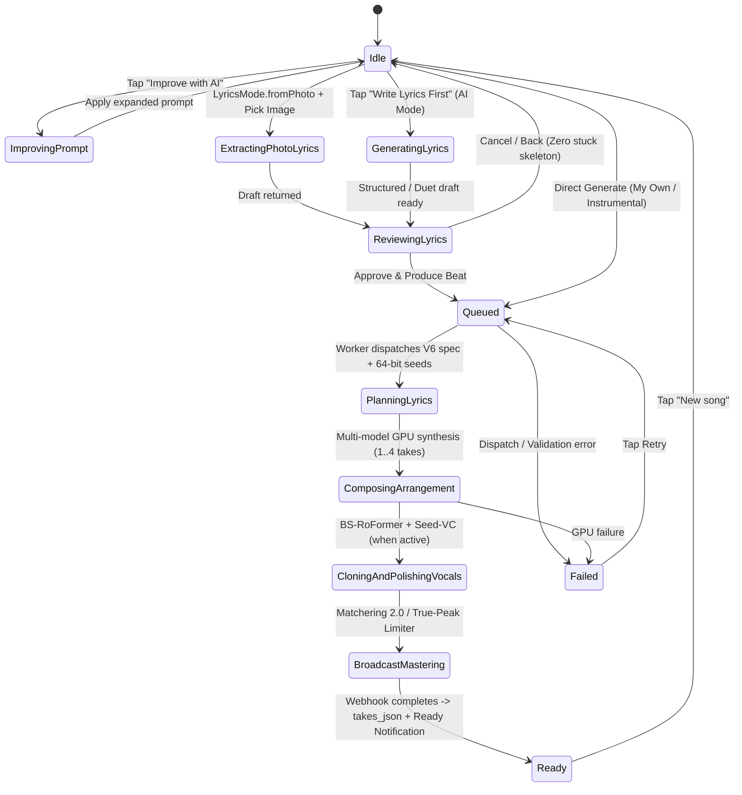

# Phase 80 Blueprint — Studio Cockpit V6 Glass Overhaul, `vhunambi.com` Production Parity & `StudioGenerationContractV6`

> **Phase ID:** `P80` (`MEM-P80-STUDIO-COCKPIT-V6-PRODUCTION-CONTRACT`)  
> **Program:** `PROG-P80-P83-SOVEREIGN-STUDIO-ENGINE` ([Master Tracker](../PHASE_80_PLUS_STUDIO_AND_RUNPOD_MASTER_TRACKER.md))  
> **Predecessor Audit:** [`PHASE80_STUDIO_COCKPIT_V6_AND_PRODUCTION_CONTRACT_AUDIT.md`](../../audits/PHASE80_STUDIO_COCKPIT_V6_AND_PRODUCTION_CONTRACT_AUDIT.md)  
> **Target Layers:** `supabase/migrations/` • `apps/vhunambi_api/` (Cloudflare Workers Hono TS) • `apps/vhunambi_client/` (Flutter 3.44+ / Riverpod)  
> **Design Standard:** `STD-UIUX-001` (Zero raw Unicode emojis, zero stock `Icons.*`, 100% `PhosphorIcon`, `VhunambiGlassSurface`, `VhunambiGlassTabBar`, dual Light "Morning Mist" / Dark "Mountain Silhouette" contrast parity, `>= 44x44dp` touch targets)

---

## 1. Executive Overview & Visual North Star

Phase 79 completed Vhunambi's local-first media storage and upload vault (`VhunambiMediaVault`, `EP-P79-MEDIA-UPLOAD-ENGINE`, `EP-P79-USER-MEDIA-REGISTRY-API`). However, live hardware recordings (`video_1.mp4` vs. `video_2.mp4` `vhunambi.com/create`) and the Stage 1 Forensic Audit (`AUDIT-STUDIO-080`) proved that the mobile **Studio Cockpit (`StudioView`)** suffers from two systemic gaps blocking commercial radio-grade music production:

1. **Presentation & Ergonomic Lag (`STU-01` – `STU-05`, `STU-14`):**
   - `StudioView` still renders flat solid-orange M2 mode tabs (`Compose | Voice | Crate & MPC`), a permanent `8/9 | Song DNA 83%` top progress strip across all 3 tabs, and six premature `2D <-> 3D Quantum Stem Authority` (`Lock | Inpaint | Resynth`) cards before any song exists.
   - Mobile `360dp` viewports suffer severe label truncation (`Advanced Opti...`, `24 Regional Vol...`, `8-Pad... | 5-Ch... | DAW...`), left-clipped voice cards, cramped MPC pads, and static dark-only `AppColors.*` boxes that break Light Mode.
   - High-value production controls from `vhunambi.com/create` — `Improve with AI`, `Reference Audio` via `VhunambiMediaVault` + `4 Recreate Modes` (`remix`, `cover`, `reference`, `inspiration`), a **40+ African & Global Genre Catalog** (fixing the completely empty `'Asia'` tab), `Instrumental Only`, `Song Length (10s – 360s)`, `3-Mode Lyrics (AI | My Own | From Photo)`, `Custom Song Title`, `Number of Songs (1–4 takes)`, `Production Engine / Bake Tier`, `Multi-Voice Duet Casting`, `Cinematic 4-Stage Baking Monitor`, and `Remix or reuse a past song` — are either completely missing or already defined in `StudioFormState` with zero UI widgets!
2. **Silent Wire Truncation & Async Bake Fragility (`STU-06` – `STU-13`):**
   - `generation_pipeline_providers.dart` drops `durationSeconds`, `vocalVoices` (`Solo`/`Duet`/`Choir`), `vocalGender`, `vocalMode`, `vocalEnergy`, `songStructure`, `era`, `dialectInflection`, and `visibility` before `POST /v1/generations`.
   - `prompt_compiler.ts` silently discards any user prompt longer than `48` characters, `lyrics_sanitizer.ts` strips `[Voice A]` / `[Voice B]` duet tags, `HttpGenerationSubmissionService` stops polling after `90` seconds (`maxAttempts = 60`), `POST /v1/generations` fires `"Studio Track Ready"` prematurely at `queued` time, `webhook_routes.ts` hardcodes `'creator_cern'` on completion, and `public.generation_jobs` lacks `batch_id` and `takes_json` for `1–4` multi-take bakes.

**Phase 80 North Star:** Transform `StudioView` into **Studio Cockpit V6** — a serene, zero-truncation frosted-glass workstation with 100% `vhunambi.com/create` production parity and a **lossless `StudioGenerationContractV6` wire & database spine** ready for Phase 81 (`MiniMax Music 3.0` + `ACE-Step 1.5 XL` on RunPod `L40S 48GB`) and Phase 82 (`BS-RoFormer` + Neural `Seed-VC` + `Matchering 2.0`).

---

## 2. Forensic Post-Mortem Comparison Box

```text
┌───────────────────────────────────────────────────┬───────────────────────────────────────────────────┐
│ LEGACY STUDIO V5 (video_1.mp4 / Pre-Phase 80)     │ STUDIO COCKPIT V6 (Phase 80 Target Architecture)  │
├───────────────────────────────────────────────────┼───────────────────────────────────────────────────┤
│ [STU-01] Flat solid-orange tabs + permanent       │ [V6-01] Unified VhunambiGlassTabBar across main   │
│          `8/9 | Song DNA 83%` bar on all 3 tabs.  │         tabs & 4-mode Crate/MPC deck; compact     │
│                                                   │         contextual DNA pill inside Compose only.  │
├───────────────────────────────────────────────────┼───────────────────────────────────────────────────┤
│ [STU-02] 6 cramped `Lock | Inpaint | Resynth`     │ [V6-02] Pre-gen Compose is 100% clutter-free.     │
│          cards crowding pre-gen Compose.          │         Stem Lock/Inpaint/Resynth reserved for    │
│                                                   │         post-gen Track/Remix mode (Phase 83).     │
├───────────────────────────────────────────────────┼───────────────────────────────────────────────────┤
│ [STU-03] Truncated labels (`Advanced Opti...`,    │ [V6-03] Responsive glass rows, scrollable pills,  │
│          `24 Regional Vol...`, `8-Pad...`),       │         `>= 44dp` tap bounds, 4x2 responsive MPC  │
│          `112 BPMStretch`, bottom-clipped pads.   │         grid, real `Record into Studio` wiring.   │
├───────────────────────────────────────────────────┼───────────────────────────────────────────────────┤
│ [STU-05] 18 genres (`0` in Asia); zero UI for     │ [V6-05] 42 genres across 5 regions (incl. Asia);  │
│          Instrumental, Length, LyricsMode, Title, │         full `vhunambi.com` parity + Phase 79     │
│          Batch (1–4), Bake Tier, 4 Recreate Modes │         VhunambiMediaVault audio/photo reuse.     │
├───────────────────────────────────────────────────┼───────────────────────────────────────────────────┤
│ [STU-06..13] Drops duration/voices/prompts >48c,  │ [V6-06] Lossless StudioGenerationContractV6,      │
│          strips [Voice A]/[Voice B], 90s poll     │         `batch_id` + `takes_json` in Supabase,    │
│          cliff, premature Ready alert, hardcoded  │         18-min adaptive polling, true owner       │
│          `'creator_cern'` webhook owner.          │         completion alerts, per-take 64-bit seeds. │
└───────────────────────────────────────────────────┴───────────────────────────────────────────────────┘
```

---

## 3. Multi-Layer Decoupled System Architecture

```text
┌─────────────────────────────────────────────────────────────────────────────────────────┐
│ LAYER 1: FLUTTER PRESENTATION — STUDIO COCKPIT V6 (`apps/vhunambi_client/lib/features/`)│
│  • StudioView (VhunambiGlassTabBar: Compose | Voice | Crate & MPC, IndexedStack)        │
│  • Compose: GenerationPipelineCard (4-Stage + Multi-Take) -> PromptInputBox (Improve AI)│
│             -> ReferenceAudioDropzone (Vault + 4 Modes + Preview) -> RegionalGenre (42) │
│             -> StudioLyricsAndBakeDeck (Lang, Instrumental, AI/Own/Photo, Engine Tier,  │
│                Length 10-360s, Title, Batch 1-4) -> AdvancedOptions -> PastSongsShelf   │
│  • Voice:   BantuVoiceDeck (Solo/Duet/Choir, Quick Duet, Multi-Select <=6, My Clones,   │
│             Expressive Nuance Drawer) + LivePhoneticAlignmentPreview                    │
│  • Crate:   InlineCrateMpcWorkbench (Scrollable VhunambiGlassTabBar, 4x2 Responsive MPC)│
├──────────────────────────────────────────┬──────────────────────────────────────────────┤
│                                          ▼                                              │
│ LAYER 2: CLIENT DOMAIN & SERVICES (`studio/domain/` & `studio/data/`)                   │
│  • StudioFormState V6 (engineTier, audioMode, batchCount, selectedVoiceIds, sourcePhoto)│
│  • StudioGenreCatalog (42 canonical genres across SA, Africa, Americas, Global, Asia)   │
│  • StudioAiAssistService (POST /v1/studio/improve-prompt, POST /v1/lyrics/from-photo)   │
│  • HttpGenerationSubmissionService (Lossless V6 DTO + 18-min Adaptive Polling + Takes)  │
│  • Phase 79 VhunambiMediaVault (`mediaUploadQueueProvider` + `SafeAudioOrchestrator`)   │
├──────────────────────────────────────────┬──────────────────────────────────────────────┤
│                                          ▼                                              │
│ LAYER 3: CLOUDFLARE WORKER EDGE API (`apps/vhunambi_api/src/`)                          │
│  • POST /v1/studio/improve-prompt (RunPod Open-Source LLM + deterministic music engine) │
│  • POST /v1/lyrics/generate (Duet [Voice A]/[Voice B] aware) & POST /v1/lyrics/from-photo│
│  • POST /v1/generations (SubmitGenerationV6Schema + resolvedEngine + 64-bit takeSeeds)  │
│  • POST /v1/webhooks/ace-step (True creatorId owner + takes_json + Ready Notification)  │
├──────────────────────────────────────────┬──────────────────────────────────────────────┤
│                                          ▼                                              │
│ LAYER 4: DURABLE CLOUD PERSISTENCE (`supabase/migrations/` & `vhunambi_db.ts`)          │
│  • public.generation_jobs (+ batch_id, batch_count, engine_tier, resolved_engine,       │
│    audio_mode, reference_audio_url, visibility, attribution_tag, lyrics_text, cover_url,│
│    voice_cast_json, generation_spec_json, takes_json; initplan-clean RLS policies)      │
│  • 1:1 EdgeIsolateDatabaseEngine (12s SWR) <-> Node SQLite VhunambiDatabase Parity      │
└─────────────────────────────────────────────────────────────────────────────────────────┘
```

---

## 4. Multi-Model Engine Routing & Genre Catalog Taxonomy

### 4.1 Deterministic Engine Tier Resolution Matrix (Phase 80 Contract -> Phase 81 RunPod `L40S 48GB`)

Every submission computes `resolvedEngine`, `attributionTag`, and `takeSeeds[]` (unique non-zero 64-bit integers defeating `sglang-omni`'s `seed = 0` deterministic trap) server-side in `compileSongSpec`:

| Selected `engineTier` | Conditioning Signals | `resolvedEngine` | `attributionTag` | Target Bake Window & Notes |
| :--- | :--- | :--- | :---: | :--- |
| **`fast_draft`** | Any prompt/lyrics/instrumental | `ace_step_xl_turbo` | `null` | ~20–45s rapid creative sketch (`100% MIT`). |
| **`studio_bake`** *(Default)* | Vocal song (`isInstrumental == false`), no `referenceAudioUrl` (`audioMode == 'none'`), no `clonedVoiceProfileId` | `minimax_music_3` | `'MiniMax-Music3'` | 3–12 min flagship commercial vocal/duet bake (`<= 300s` sweet spot, `360s` max, `L40S 48GB`, mandatory visible UI attribution). |
| **`studio_bake`** *(Auto-Safe Route)* | `isInstrumental == true` (no reference audio) | `ace_step_xl_sft` | `null` | Auto-routed to `ACE-Step 1.5 XL-SFT` so `sglang-omni` `/v1/audio/speech` never rejects empty lyrics with HTTP `400`. |
| **`studio_bake`** *(Auto-Safe Route)* | `referenceAudioUrl != null` (`audioMode != 'none'`) OR `clonedVoiceProfileId != null` | `ace_step_xl_base` | `null` | Routes cleanly to `ACE-Step 1.5 XL-Base` for audio-to-audio / LoRA / Seed-VC voice conversion. |
| **`sovereign_custom`** | Regional African LoRA, Reference Audio (`remix`/`cover`/`reference`/`inspiration`), or `My Cloned Voice` | `ace_step_xl_base` | `null` | 4–15 min sovereign custom bake (`4B DiT + 4B Qwen3 Planner`, `100% MIT`). |

> **Commercial Legal Guardrail:** `YuE2` (`CC BY-NC 4.0`) is strictly excluded from `StudioEngineTier` and all backend schemas.

### 4.2 Expanded 42-Genre African & Global Catalog (`StudioGenreCatalog`)

Every one of the 5 regions in `RegionalGenreSelector` is populated with authentic, Phosphor-iconized genres (`0` empty regions, `0` raw Unicode emojis):

| Region | Genres Included (`42` Total) |
| :--- | :--- |
| **South Africa (`14`)** | Amapiano, Private School Amapiano, Sgija, Bacardi, Gqom, Maskandi, Kwaito, Afro House, Gospel, Mbaqanga, Marabi, Bubblegum, Isicathamiya, Mbube *(plus Lekompo / Malende searchable aliases)* |
| **Africa (`12`)** | Afrobeats, Afro Fusion, Afro Soul, Afro Jazz, Highlife, Rumba, Soukous, Chimurenga, Kuduro, Kizomba, Gengetone, Ethio-Jazz *(plus Coupé-Décalé, Bongo Flava, Afro Drill)* — `15` total in Africa |
| **Americas (`5`)** | Reggae, Dancehall, Samba, Afro-Cuban, Gospel Soul |
| **Global (`5`)** | Hip Hop, R&B, Pop, Electronic, Lo-Fi Chill |
| **Asia (`3`)** | K-Pop, Bollywood Fusion, Afro-Asian Lo-Fi |

*(Total catalog: `14 + 15 + 5 + 5 + 3 = 42` curated genres + unlimited custom genre input.)*

---

## 5. Lifecycle State Machine & End-to-End Sequence

### 5.1 Studio Bake & Multi-Take Pipeline State Machine



### 5.2 Lossless Submission & Deferred Completion Notification Sequence

```mermaid
sequenceDiagram
    participant U as Creator (Flutter Studio V6)
    participant V as VhunambiMediaVault (P79)
    participant API as Cloudflare Worker (Hono)
    participant DB as Supabase (generation_jobs)
    participant RP as RunPod GPU (P81/P82)

    opt Reference Audio or Photo Attached
        U->>V: Select from My Uploads / Upload Audio / Pick Photo
        V-->>U: Return localPath + synced R2 URL
    end
    U->>API: POST /v1/generations (StudioGenerationContractV6)
    API->>API: Resolve creatorId, resolvedEngine, attributionTag, 64-bit takeSeeds[]
    API->>DB: await upsertGenerationJobAsync(job, creatorId, takes_json=[])
    API->>DB: Upsert notif_gen_<id> as "Studio Bake Queued" (honest status; preserves P67 pin)
    API->>RP: POST /run (full V6 song_spec, engine_tier, audio_mode, voice_cast, take_seeds)
    API-->>U: 201 Created (generationId, batchId, resolvedEngine, attributionTag, pollUrl)
    loop Adaptive Polling (up to 18 min) + WebSocket DO
        RP->>API: POST /v1/webhooks/ace-step (planning_lyrics -> synthesizing -> converting_vocals -> mastering)
        API->>DB: Persist stage + progressPct preserving real creator_id
        U->>API: GET /v1/generations/:id (hydrated via cloud SWR)
        API-->>U: Live BakeStage + progressPct + takes[]
    end
    RP->>API: POST /v1/webhooks/ace-step (status=completed, takes[], audio_url, attribution)
    API->>DB: Persist takes_json + master_mp3_url (real creator_id)
    API->>DB: Upgrade notif_gen_<id> to unread "Studio Track Ready" for real creator_id
    API-->>U: Ready + Multi-Take Switcher + MiniMax-Music3 attribution badge (if applicable)
```

---

## 6. Dual-Viewport Glass Wireframes (`360dp` Mobile & `1280dp` Desktop)

### 6.1 Mobile Portrait (`360x800dp` — Zero Truncation, `>= 44dp` Touch Targets, `STD-UIUX-001` Phosphor Icons)

```text
┌────────────────────────────────────┐
│ <- Studio      [10/10]  [DNA 83%]  │  <- VhunambiAppBar (DNA pill integrated)
├────────────────────────────────────┤
│ [Compose]   [Voice]   [Crate & MPC]│  <- VhunambiGlassTabBar (scrollable: false)
├────────────────────────────────────┤
│ ┌────────────────────────────────┐ │
│ │ Describe your song    [Use DNA]│ │  <- VhunambiGlassSurface
│ │ ┌────────────────────────────┐ │ │
│ │ │ A joyful Afro-Fusion duet..│ │ │
│ │ └────────────────────────────┘ │ │
│ │ [Improve with AI] [Inspire Me] │ │  <- Wrap (>= 44dp pills)
│ │ [Late-night log drum...]       │ │
│ └────────────────────────────────┘ │
│ ┌────────────────────────────────┐ │
│ │ Reference Audio (optional)     │ │  <- Phase 79 VhunambiMediaVault
│ │ [+ Upload] [Record] [My Vault] │ │  <- Wrap (zero 360dp squeeze)
│ │ [My Beats] [Sketchpad]         │ │
│ │ (If attached: Preview +        │ │
│ │  [Remix][Cover][Ref][Inspire]) │ │
│ └────────────────────────────────┘ │
│ ┌────────────────────────────────┐ │
│ │ Genre [Amapiano]            ^  │ │  <- 42 Genres across 5 populated regions
│ └────────────────────────────────┘ │
│ ┌────────────────────────────────┐ │
│ │ Language & Lyrics              │ │
│ │ [Tshivenda v] [Instrumental o] │ │
│ │ [AI writes][My own][From photo]│ │  <- VhunambiGlassTabBar
│ └────────────────────────────────┘ │
│ ┌────────────────────────────────┐ │
│ │ Production & Bake Tier         │ │
│ │ [Fast Draft][Studio Bake][Cust]│ │  <- Engine Tier Selector
│ │ Length: 0:30  10s--o-5:00--6m  │ │  <- Default 30s (preserves P03/M10 pins)
│ │ Title: [AI Picks | Custom]     │ │
│ │ Takes: [1] [2] [3] [4]         │ │
│ └────────────────────────────────┘ │
│ ┌────────────────────────────────┐ │
│ │ Advanced Options (Mood • Med) v│ │  <- Zero "Advanced Opti..." truncation
│ └────────────────────────────────┘ │
│ ┌────────────────────────────────┐ │
│ │ Remix or reuse a past song     │ │  <- Searchable horizontal/compact shelf
│ └────────────────────────────────┘ │
├────────────────────────────────────┤
│ [Public v]  [Write Lyrics First]   │  <- Frosted dock-aware StudioActionBar
└────────────────────────────────────┘
```

### 6.2 Desktop / Wide Viewport (`>= 1024dp` — Centered `840dp` Ergonomic Cockpit)

Desktop reuses the identical Riverpod state and glass cards inside `ConstrainedBox(maxWidth: 840)` with 4-column Genre grid (`RegionalGenreSelector`), 2-column Expressive Nuance sliders (`BantuVoiceDeck`), 4x2 spacious MPC pads (`InlineCrateMpcWorkbench`), and centered `720x760` `LyricsReviewModal` dialog — ensuring zero layout divergence between mobile and desktop.

---

## 7. Verification Gates (`G80-01` – `G80-06`)

| Gate | Command / Target | Pass Criterion |
| :--- | :--- | :--- |
| **`G80-01`** | `apps/vhunambi_api`: `.\node_modules\.bin\tsc.cmd --noEmit && npm test` | `0` TypeScript errors; `100%` backend suites passing including new `phase80_studio_contract_v6.test.ts`. |
| **`G80-02`** | `apps/vhunambi_client`: `flutter analyze --no-pub <modified/new targets>` | `No issues found!` (`0` errors, `0` warnings, `0` infos). |
| **`G80-03`** | `STD-UIUX-001` regex scan across `apps/vhunambi_client/lib/features/studio/` | `ICONS_VIOLATIONS=0`, `EMOJI_VIOLATIONS=0`. |
| **`G80-04`** | `apps/vhunambi_client`: `flutter test --timeout=60s test/features/studio/` | `100%` pass across all `27` existing Studio suites + new `phase80_studio_cockpit_v6_test.dart` (`360x800` mobile + `1280x1024` desktop + Light & Dark mode). |
| **`G80-05`** | Supabase Cloud migration `20261124000002_phase80_generation_jobs_v6_multitake.sql` + Advisors | Applied cleanly before Worker deploy; `0` Security Advisor & `0` Performance Advisor (`0003_auth_rls_initplan`) warnings on `public.generation_jobs`. |
| **`G80-06`** | `node .agents/skills/vhunambi-memory/scripts/consolidate_memory.mjs` + `query_connectome.mjs --open` | `0 OPEN` endpoints; `P80` marked `"completed"` and Master Tracker checkboxes updated. |
