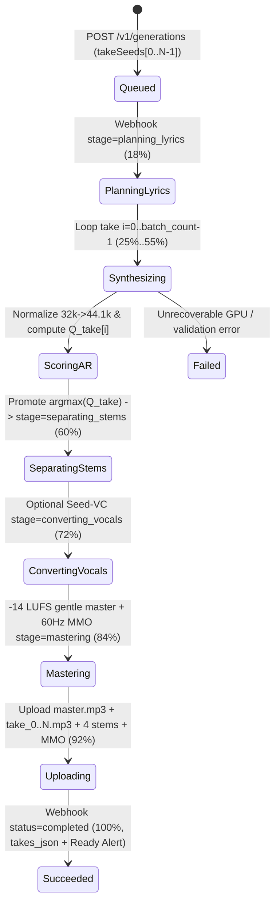
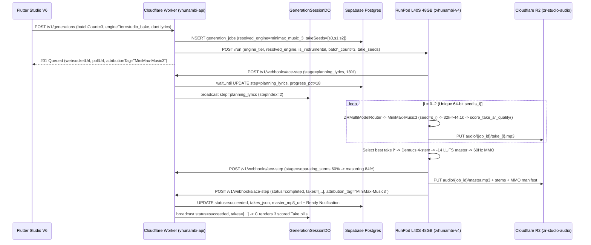

# Phase 81 Blueprint — RunPod Multi-Model Audio Engine (`MiniMax Music 3.0` + `ACE-Step 1.5 XL`) & Multi-Take A&R Baking

> **Phase ID:** `P81` (`MEM-P81-RUNPOD-MULTIMODEL-AUDIO-ENGINE`)  
> **Program:** `PROG-P80-P83-SOVEREIGN-STUDIO-ENGINE` ([Master Tracker](../PHASE_80_PLUS_STUDIO_AND_RUNPOD_MASTER_TRACKER.md))  
> **Predecessor Audit:** [`PHASE81_RUNPOD_MULTIMODEL_AUDIO_ENGINE_AUDIT.md`](../../audits/PHASE81_RUNPOD_MULTIMODEL_AUDIO_ENGINE_AUDIT.md)  
> **Predecessor Phase:** [`Phase 80 — Studio Cockpit V6 & StudioGenerationContractV6`](../phase_80_studio_cockpit_v6_and_production_contract/blueprint.md)  
> **Target Layers:** `tools/zr-studio-gpu/` (RunPod Serverless Python + Docker `:vhunambi-v4` on `L40S 48GB`) • `apps/vhunambi_api/` (Cloudflare Workers Hono TS + `GenerationSessionDO`) • `apps/vhunambi_client/` (Flutter 3.44+ Multi-Take A&R Switcher)  
> **Design & Legal Standard:** `STD-UIUX-001` (Zero raw Unicode emojis, zero stock `Icons.*`, 100% `PhosphorIcon`, `>= 44x44dp` hit bounds) • Mandatory `"MiniMax-Music3"` UI attribution • Strictly **zero `YuE2` (`CC BY-NC 4.0`)**

---

## 1. Executive Overview & Visual / Sonic North Star

Phase 80 shipped **Studio Cockpit V6** and the lossless **`StudioGenerationContractV6`** pipeline across Flutter, Cloudflare Workers, and Supabase Postgres (`public.generation_jobs` with `batch_id`, `batch_count`, `engine_tier`, `resolved_engine`, `attribution_tag`, `takes_json`, and unique 64-bit `takeSeeds`). However, the Stage 1 Forensic Audit (`AUDIT-P81-RUNPOD-MULTIMODEL-001`) proved that **9 P0/P1 downstream breaks** currently prevent commercial radio-grade audio from leaving the RunPod GPU worker:

1. **RunPod Infrastructure Bottleneck (`RUNPOD-01` – `RUNPOD-03`):**
   - Live RunPod endpoint `e7wt9pgo7djv55` (`zr-studio-prod`, v7) runs `ndugelo/zr-studio-gpu:vhunambi-v3` on a **`30 GB` ephemeral container disk**, **`networkVolumes: []`**, `timeout: 600000 ms`, and `16 GB / 24 GB` GPU pools (`AMPERE_16`, `ADA_24`, `AMPERE_24`).
   - Co-hosting `MiniMaxAI/MiniMax-Music3` (`8B Qwen3 Global + 0.6B Local + 2.4B Flow + 123M Flow-VAE`, ~22 GB in `bf16`) and `ACE-Step 1.5 XL` (`4B DiT + 4B Qwen3 Planner` across `xl-sft`, `xl-base`, `xl-turbo`, ~16 GB) overflows a 30 GB container disk and triggers CUDA OOM on 16/24 GB cards.
2. **Legacy Single-Model GPU Execution (`GPU-01` – `GPU-05`):**
   - `handler.py` silently discards `engine_tier`, `resolved_engine`, `attribution_tag`, `batch_count`, `take_seeds`, `rich_prompt`, and `voice_cast`, rendering a single unseeded WAV on legacy `ACE-Step-v1-3.5B`.
   - `model_utils.py` strips `[Voice A]`, `[Voice B]`, `[Duet]`, `[Choir]`, `[Guitar Solo]`, and `[Log Drum Drop]` (`_ALLOWED_SECTION_RE`), clamps duration at `240s` instead of `360s`, lacks `32 kHz` $\to$ `44.1 kHz` normalization for MiniMax outputs, overwrites a single `audio/{job_id}/master.mp3` key, and runs zero A&R candidate scoring.
3. **Edge Worker Sync & Active Polling Blindspots (`API-01` – `API-03`, `CLIENT-01`):**
   - `runpod_adapter.ts` omits `is_instrumental` from RunPod `input`/`song_spec`, pre-strips MiniMax duet casing, and `checkRunPodJobStatus` + `GET /v1/generations/:id` drop `takes`, `resolved_engine`, and `attribution_tag` when active polling settles a job.
   - `webhook_routes.ts` updates local SQLite/RAM without `waitUntil` Supabase persistence during intermediate stages (`planning_lyrics` $\to$ `mastering`), leaving cold `workerd` HTTP pollers blind to progress, while `GenerationSessionDO` leaves `planning_lyrics` and `converting_vocals` stuck at `stepIndex = 1`.

**Phase 81 North Star:** Stand up Vhunambi's **Multi-Model RunPod Audio Engine (`:vhunambi-v4` on `L40S 48GB` + `100 GB` `/runpod-volume`)** governed by `ZRMultiModelRouter`, deterministic 64-bit per-take seeding, mathematical **Multi-Take A&R Quality Scoring**, per-take R2 storage, and lossless Cloudflare Worker/DO stage synchronization.

---

## 2. Forensic Post-Mortem Comparison Box

```text
┌───────────────────────────────────────────────────┬───────────────────────────────────────────────────┐
│ LEGACY GPU WORKER (:vhunambi-v3 / Pre-Phase 81)   │ MULTI-MODEL ENGINE (:vhunambi-v4 / Phase 81)      │
├───────────────────────────────────────────────────┼───────────────────────────────────────────────────┤
│ [RUNPOD-01..02] 30 GB ephemeral disk, 0 network   │ [P81-INFRA] 100 GB RunPod Network Volume mounted  │
│          volumes, 16/24 GB pools, 600s timeout.   │         at `/runpod-volume/hf_cache`; `ADA_48_PRO`│
│                                                   │         (`L40S 48GB` / `RTX 6000 Ada`), `1200s`.  │
├───────────────────────────────────────────────────┼───────────────────────────────────────────────────┤
│ [GPU-01..02] Loads `ACE-Step-v1-3.5B` only;       │ [P81-ROUTER] `ZRMultiModelRouter` dispatches      │
│          ignores `resolved_engine`, `batch_count`,│         vocal Studio Bake -> `MiniMax-Music3`     │
│          `take_seeds`; risks `seed=0` duplicates  │         (`MiniMax-Music3` tag) & instrumentals /  │
│          and `sglang-omni` 400 on instrumentals.  │         ref-audio / LoRAs -> `ACE-Step 1.5 XL`.   │
├───────────────────────────────────────────────────┼───────────────────────────────────────────────────┤
│ [GPU-03] `_ALLOWED_SECTION_RE` strips `[Voice A]`,│ [P81-LYRICS] Full duet/choir/solo tag fidelity    │
│          `[Voice B]`, `[Choir]`, `[Guitar Solo]`; │         across TS & Python; `10s–360s` ceiling    │
│          hard-clamps `duration_sec <= 240s`.      │         (`<= 300s` sweet spot); Latin Bantu guard.│
├───────────────────────────────────────────────────┼───────────────────────────────────────────────────┤
│ [GPU-04] Single `audio/{job_id}/master.mp3`, no   │ [P81-AR] Renders `1..4` seeded takes, normalizes  │
│          A&R scoring, `32 kHz` vs `44.1 kHz`      │         `32 kHz -> 44.1 kHz`, scores A&R quality, │
│          sample-rate mismatch with Demucs.        │         promotes top take to master + `take_{i}`. │
├───────────────────────────────────────────────────┼───────────────────────────────────────────────────┤
│ [API-01..03] `is_instrumental` omitted; active    │ [P81-WIRE] Lossless RunPod `/run` + `/status`     │
│          poll drops `takes`; cold Worker isolates │         multi-take sync, `waitUntil` Postgres     │
│          miss stage webhooks; DO drops stages.    │         stage writes, complete DO `stepIndex` map.│
└───────────────────────────────────────────────────┴───────────────────────────────────────────────────┘
```

---

## 3. Multi-Layer Decoupled System Architecture

```text
┌─────────────────────────────────────────────────────────────────────────────────────────┐
│ LAYER 1: FLUTTER CLIENT — MULTI-TAKE A&R MONITOR (`apps/vhunambi_client/lib/features/`) │
│  • GenerationTake (takeIndex, seed, engineUsed, audioUrl, durationSec, score, attrib)   │
│  • GenerationPipelineNotifier.selectActiveTake(i) -> updates active playback + Vault URL│
│  • GenerationPipelineCard (44dp `pipeline_take_chip_$i` with A&R score & Top Pick pill) │
├──────────────────────────────────────────┬──────────────────────────────────────────────┤
│                                          ▼                                              │
│ LAYER 2: CLOUDFLARE WORKER & REALTIME DO (`apps/vhunambi_api/src/`)                     │
│  • prompt_compiler.ts & lyrics_sanitizer.ts (isInstrumental + `[Log Drum Drop]` + case) │
│  • runpod_adapter.ts (is_instrumental in input/song_spec; multi-take `/status` parser)  │
│  • webhook_routes.ts (HMAC verify + guarded `waitUntil` Postgres progress + takes_json) │
│  • generation_session_do.ts (`planning_lyrics`->2, `converting_vocals`->3, full takes)  │
├──────────────────────────────────────────┬──────────────────────────────────────────────┤
│                                          ▼                                              │
│ LAYER 3: RUNPOD SERVERLESS INFRA (`zr-studio-prod` / `e7wt9pgo7djv55` on `L40S 48GB`)   │
│  • GPU Pools: `ADA_48_PRO` (L40S 48GB, RTX 6000 Ada 48GB), `AMPERE_48`, `AMPERE_80`     │
│  • Persistent Storage: `100 GB` Network Volume `/runpod-volume/{hf_cache,lora_cache}`   │
│  • Execution Timeout: `1,200,000 ms` (20 min ceiling for 4x 300s Studio Bake)           │
├──────────────────────────────────────────┬──────────────────────────────────────────────┤
│                                          ▼                                              │
│ LAYER 4: PYTHON MULTI-MODEL ROUTER (`tools/zr-studio-gpu/model_router.py` & `utils.py`) │
│  • MiniMax3Backend (`sglang-omni` HTTP / local runner, 64-bit seed > 0, 32k->44.1k Hz)  │
│  • AceStep15XLBackend (`xl-turbo` 12-step, `xl-sft` 60-step, `xl-base` + R2 LoRAs)      │
│  • Bantu Phonetic Guard (`_install_latin_language_guard`) + Zero `YuE2` Enforcement     │
├──────────────────────────────────────────┬──────────────────────────────────────────────┤
│                                          ▼                                              │
│ LAYER 5: MULTI-TAKE A&R SCORER & R2 ARTIFACT ENGINE (`handler.py` & `mmo_extractor.py`) │
│  • `score_take_ar_quality(wav, sr)` -> composite score Q in [0, 1]                      │
│  • Uploads `audio/{job_id}/take_{i}.mp3` for all takes; promotes winner to `master.mp3` │
│  • Runs Demucs 4-stem + gentle `-14 LUFS` master + 60Hz MMO v2.0 on winning take        │
└─────────────────────────────────────────────────────────────────────────────────────────┘
```

---

## 4. Multi-Model Routing & Licensing Taxonomy

| Engine ID (`resolved_engine`) | Checkpoint Path (`/runpod-volume/hf_cache/`) | License | Active Routing Rule (`ZRMultiModelRouter`) | Native SR $\to$ Pipeline SR | Mandatory Guardrails |
| :--- | :--- | :--- | :--- | :---: | :--- |
| **`minimax_music_3`** | `MiniMaxAI/MiniMax-Music3` | Commercial $\le$ \$20M USD rev | `engine_tier == 'studio_bake'` AND `not is_instrumental` AND `not reference_audio_url` AND `not svc_clone_active` | `32 kHz` $\to$ `44.1 kHz` | Unique `seed > 0` per take; `attribution_tag = 'MiniMax-Music3'`; `<= 300s` sweet spot (`360s` max). |
| **`ace_step_xl_sft`** | `ACE-Step-v1.5-XL-SFT` | `MIT` (100% Commercial) | `is_instrumental == True` (without ref audio) OR fallback when MiniMax weights unavailable | `44.1 kHz` $\to$ `44.1 kHz` | Prevents `sglang-omni` `/v1/audio/speech` HTTP `400` on empty lyrics; `60` Euler steps. |
| **`ace_step_xl_base`** | `ACE-Step-v1.5-XL-Base` | `MIT` (100% Commercial) | `engine_tier == 'sovereign_custom'` OR `reference_audio_url != ''` (`remix`/`cover`/`reference`/`inspiration`) OR `svc_clone_active` | `44.1 kHz` $\to$ `44.1 kHz` | Hot-swaps regional `.safetensors` LoRA from `/runpod-volume/lora_cache`; `60` steps. |
| **`ace_step_xl_turbo`** | `ACE-Step-v1.5-XL-Turbo` | `MIT` (100% Commercial) | `engine_tier == 'fast_draft'` | `44.1 kHz` $\to$ `44.1 kHz` | Rapid `12`-step draft synthesis (`guidance_scale = 7.5`). |
| ~~`yue2`~~ | **FORBIDDEN** | `CC BY-NC 4.0` | **BANNED** — `ValueError` raised if ever requested | N/A | Zero `YuE2` weights, imports, or branches permitted. |

---

## 5. Multi-Take A&R Pipeline State Machine & Dual-Viewport HUD Wireframes

### 5.1 End-to-End Multi-Take Bake State Machine



### 5.2 Studio Baking Card — Multi-Take A&R Switcher Wireframes

#### Desktop / Tablet (`>= 600dp`)
```text
┌──────────────────────────────────────────────────────────────────────────────┐
│ Thohoyandou Stars   [Afro Fusion]   [Engine: MiniMax-Music3]                 │
│ ┌──────────────────────────────────────────────────────────────────────────┐ │
│ │  [✓ Plan Lyrics]  [✓ Compose Audio]  [✓ Vocals & Stems]  [✓ Master]      │ │
│ │  1 ✓ Starting up...   2 ✓ Writing lyrics...   3 ✓ Producing...  4 ✓ Ready│ │
│ └──────────────────────────────────────────────────────────────────────────┘ │
│  A&R Multi-Take Audition (44dp pills, sorted/badged by A&R Quality Score):   │
│  ┌──────────────────────┐ ┌──────────────────┐ ┌──────────────────┐          │
│  │ ★ Take 1 · 96% (Best)│ │   Take 2 · 91%   │ │   Take 3 · 88%   │          │
│  └──────────────────────┘ └──────────────────┘ └──────────────────┘          │
│  [ ▶ Play Master ]   [ Create Reel ]   [ Stems ]                             │
└──────────────────────────────────────────────────────────────────────────────┘
```

#### Mobile Portrait (`360x800dp` — Wrapping `>= 44dp` Pills, Zero Clipping)
```text
┌────────────────────────────────────────┐
│ Thohoyandou Stars                      │
│ [Afro Fusion] [Engine: MiniMax-Music3] │
│ ┌────────────────────────────────────┐ │
│ │ [✓ Plan Lyrics]  [✓ Compose Audio] │ │
│ │ [✓ Vocals & Stems]  [✓ Master]     │ │
│ └────────────────────────────────────┘ │
│ ┌────────────────────┐ ┌─────────────┐ │
│ │ ★ Take 1 · 96%     │ │ Take 2 · 91%│ │
│ └────────────────────┘ └─────────────┘ │
│ ┌─────────────┐                        │
│ │ Take 3 · 88%│                        │
│ └─────────────┘                        │
│ [ ▶ Play Master ]  [ Create Reel ]     │
└────────────────────────────────────────┘
```

---

## 6. Mathematical Formulations — A&R Quality Scoring & Resampling

### 6.1 Composite A&R Candidate Quality Score ($Q_{\text{take}} \in [0, 1]$)
Given a candidate stereo waveform $X \in \mathbb{R}^{2 \times T}$ normalized to $f_s = 44,100\text{ Hz}$ with mono mid-channel $m[n] = \frac{1}{2}(X_0[n] + X_1[n])$:

1. **Non-Silence Active Ratio ($S_{\text{active}}$):** Partition $m$ into $K$ short frames of $50\text{ ms}$. Let $E_k$ be frame RMS in dBFS:
   $$S_{\text{active}} = \text{clip}\!\left(\frac{|\{k : E_k > -48\text{ dBFS}\}|}{0.80 \cdot K},\; 0,\; 1\right)$$
2. **Dynamic Crest Factor Pocket ($S_{\text{crest}}$):** Commercial Afro-Fusion / Amapiano mixes sit healthiest around $9\text{–}16\text{ dB}$ crest factor $C_{\text{dB}} = 20\log_{10}\!\left(\frac{\max_n |m[n]|}{\text{RMS}(m) + \epsilon}\right)$:
   $$S_{\text{crest}} = \exp\!\left(-\frac{(C_{\text{dB}} - 12.5)^2}{2 \cdot 5.5^2}\right)$$
3. **Vocal / Presence Band Balance ($S_{\text{presence}}$):** Ratio of energy in $300\text{ Hz}–4,500\text{ Hz}$ vs. total broadband energy (ensuring takes with dropped vocals or muddy sub-only drones rank lower when `not is_instrumental`):
   $$S_{\text{presence}} = \text{clip}\!\left(\frac{E_{300..4500}}{0.35 \cdot E_{\text{total}} + \epsilon},\; 0,\; 1\right)$$
4. **Anti-Clipping Penalty ($P_{\text{clip}}$):** Fraction of samples exceeding $0.995$ full scale:
   $$P_{\text{clip}} = \text{clip}\!\left(50 \cdot \frac{|\{n : |X[c, n]| \ge 0.995\}|}{2T},\; 0,\; 0.5\right)$$
5. **Final Bounded Score:**
   $$Q_{\text{take}} = \text{round}\!\left(\text{clip}\!\left(0.38\,S_{\text{active}} + 0.32\,S_{\text{crest}} + 0.30\,S_{\text{presence}} - P_{\text{clip}},\; 0.05,\; 0.99\right),\; 4\right)$$

The take $i^* = \arg\max_i Q_{\text{take}}^{(i)}$ is promoted to `master_wav_path` (driving Stage 2 Demucs 4-stem separation, Stage 4 `-14.0 LUFS` gentle master, and Stage 5 MMO 60Hz telemetry), while all takes are uploaded to `audio/{job_id}/take_{i}.mp3` and returned ordered with the winning take first (`takeIndex: 0` or sorted descending by `score` with `master_mp3_url == takes[0].audioUrl`).

### 6.2 Rational Polyphase Upsampling (`32 kHz` $\to$ `44.1 kHz`)
MiniMax Music 3.0 emits $f_{\text{in}} = 32,000\text{ Hz}$ PCM-16 stereo WAV. Before Demucs (`44,100 Hz`) or mastering, `normalize_wav_to_44k1` resamples by exact rational factor $\frac{L}{M} = \frac{441}{320}$ via Kaiser-windowed polyphase FIR (`soxr.resample(..., quality="VHQ")` when available, falling back to `scipy.signal.resample_poly(x, up=441, down=320, axis=-1)`), preserving phase coherence and Nyquist headroom up to $16\text{ kHz}$ with zero pitch/duration drift.

---

## 7. Hardware VRAM, Disk & Latency Budget (`L40S 48GB`)

| Resource | Allocation | Budget / Limit | Headroom |
| :--- | :--- | :--- | :--- |
| **GPU VRAM (`L40S 48GB` / `RTX 6000 Ada`)** | MiniMax-Music3 `bf16` (~22.4 GB) OR ACE-Step 1.5 XL (~15.8 GB) + KV/Flow activations (~6 GB) + Demucs v4 (~1.8 GB) *(sequential unload/swap guard if both warm)* | `48.0 GB` | `>= 14 GB` free |
| **Network Volume (`/runpod-volume`)** | `MiniMaxAI/MiniMax-Music3` (~23 GB) + `ACE-Step 1.5 XL` `{sft,base,turbo}` (~34 GB) + `htdemucs` (~0.4 GB) + R2 LoRAs (~2 GB) | `100.0 GB` | `~40 GB` free |
| **Container Disk (`/app` + `/tmp`)** | CUDA 12.8 + PyTorch 2.10 + Python deps + temporary per-job WAV/ZIP scratch (~1.2 GB max for 4x 360s) | `40.0 GB` | `> 18 GB` free |
| **Execution Timeout** | 4 takes × ~95s synthesis + ~18s Demucs/MMO/R2 upload = ~400s typical | `1,200s` (`20m`) | `3x` safety margin |

---

## 8. End-to-End Multi-Take Sequence Diagram



---

## 9. Phase 81 Verification Gates (`G81-01` – `G81-06`)

| Gate | Verification Check | Required Pass Condition |
| :--- | :--- | :--- |
| **`G81-01`** | Python GPU Unit & Router Suite (`pytest` / `unittest`) | `100% PASS` — Verifies `ZRMultiModelRouter` routing matrix, `seed > 0` uniqueness, `YuE2` ban, `[Voice A]`/`[Voice B]`/`[Log Drum Drop]` preservation, `360s` clamp, `32 kHz -> 44.1 kHz` exact length/SR, A&R scoring order, and multi-take `handler.py` output. |
| **`G81-02`** | Python Bytecode & Syntax Gate | `python -m py_compile tools/zr-studio-gpu/*.py` exits `0` with zero syntax/import errors. |
| **`G81-03`** | Worker TypeScript & Full API Regression (`34` suites) | `cd apps/vhunambi_api && ./node_modules/.bin/tsc --noEmit && npm test` passes `100%` including new `test/phase81_runpod_multimodel_pipeline.test.ts`. |
| **`G81-04`** | Flutter Multi-Take & `STD-UIUX-001` Gate | `0` stock `Icons.*`, `0` raw Unicode emojis; `phase80_studio_cockpit_v6_test.dart` + new `phase81_multitake_ar_pipeline_test.dart` pass `100%`. |
| **`G81-05`** | RunPod Infrastructure & Worker Deployment Gate | `100 GB` Network Volume attached or configured on `zr-studio-prod` (`e7wt9pgo7djv55`), `ADA_48_PRO`/`AMPERE_48` pools + `1200000 ms` timeout set, `vhunambi-api` deployed to Cloudflare Workers. |
| **`G81-06`** | Codebase Memory Consolidation (`SLEEP`) | `memory.md` marked `"completed"`, Master Tracker updated, and `consolidate_memory.mjs` exits `0` with `0` stale broken references. |
