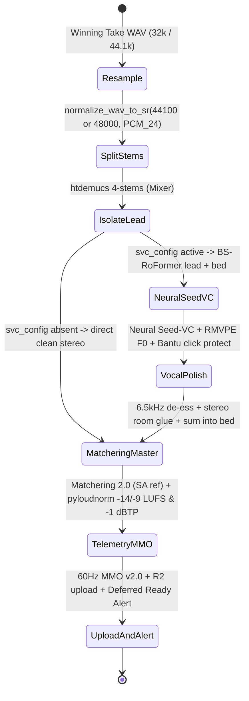
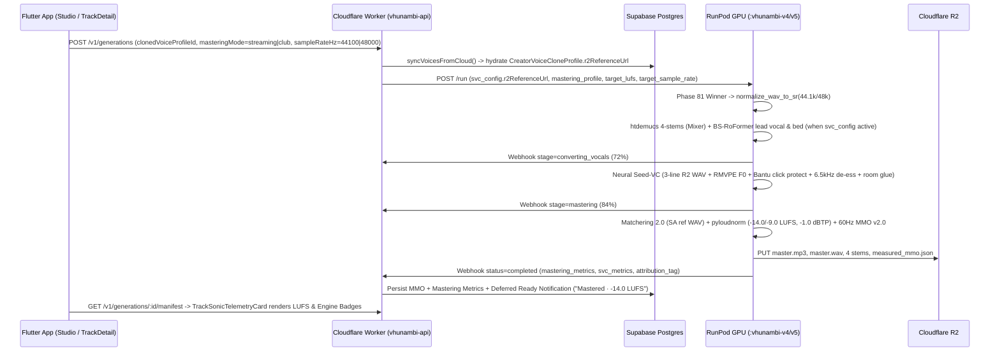

# Phase 82 Blueprint — Studio Baking Post-Processing Chain (`BS-RoFormer` + Neural `Seed-VC` + `Matchering 2.0`)

> **Phase ID:** `P82` (`MEM-P82-VOCAL-CLONING-AND-BROADCAST-MASTERING`)  
> **Program:** `PROG-P80-P83-SOVEREIGN-STUDIO-ENGINE` ([Master Tracker](../PHASE_80_PLUS_STUDIO_AND_RUNPOD_MASTER_TRACKER.md))  
> **Predecessor Audit:** [`PHASE82_VOCAL_CLONING_AND_BROADCAST_MASTERING_AUDIT.md`](../../audits/PHASE82_VOCAL_CLONING_AND_BROADCAST_MASTERING_AUDIT.md)  
> **Predecessor Phase:** [`Phase 81 — RunPod Multi-Model Audio Engine`](../phase_81_runpod_multimodel_audio_engine/blueprint.md)  
> **Target Layers:** `tools/zr-studio-gpu/` (RunPod GPU DSP: `BS-RoFormer`, neural `Seed-VC`, `Matchering 2.0`, `Pedalboard`, `pyloudnorm`, `soxr` `44.1/48 kHz`) • `apps/vhunambi_api/` (Worker Voice Hydration, Tier-B Mastering, MMO v2.0 Provenance & Deferred Ready Alerts) • `apps/vhunambi_client/` (Flutter Track Detail Provenance Badges & Stem Hydration)  
> **Design & Licensing Standard:** `STD-UIUX-001` (`PhosphorIcon` only, zero stock `Icons.*`, zero raw Unicode emojis, Light/Dark `AppColors.*Of(context)`, `>= 44dp` hit bounds) • `GPL-3.0` (`Seed-VC`, `Matchering 2.0`, `Pedalboard`) strictly server-side isolated on RunPod • `MIT`/`Apache-2.0` (`BS-RoFormer`, `pyloudnorm`) • Strictly zero `YuE2` (`CC BY-NC 4.0`).

---

## 1. Executive Overview & Sonic North Star

Phase 81 landed Vhunambi's multi-model synthesis router (`MiniMax Music 3.0` + `ACE-Step 1.5 XL`), unique 64-bit per-take seeding, mathematical A&R candidate scoring, and cold-isolate Cloudflare Worker synchronization. However, the Phase 82 Stage 1 Forensic Audit (`AUDIT-P82-VOCAL-MASTERING-001`) proved that **seven P0/P1 post-processing defects** prevent raw AI renders from reaching commercial South African streaming and club standards:

1. **Bleed-Prone Vocal Separation (`STEM-01`):** `htdemucs` leaves snare/shaker and reverb tails inside `vocals.wav`, causing metallic smearing when vocals are cloned and re-summed into the master.
2. **Non-Neural Voice Cloning Stub (`SVC-01` & `SVC-02`):** `seed_vc_worker.py#L163-L176` executes `audio_in * gain_scale + 0.08 * diff` and discards the downloaded creator calibration WAV (`temp_ref_path`), while `POST /v1/generations` omits `syncVoicesFromCloud` on cold Edge isolates before reading `getVoiceCloneProfile`.
3. **Bypassed Broadcast Reference Mastering (`MASTER-01` & `MASTER-02`):** `handler.py` defaults to `master_clean_stereo_gentle` with zero **Matchering 2.0** spectral/RMS alignment against curated South African reference masters (`-14.0 LUFS` streaming / `-9.0 LUFS` club), and `POST /v1/generations/:id/master` overwrites live R2 URLs with dead `/mock-storage/...` strings.
4. **Silent Provenance & Stem Drift (`WIRE-P82-01`):** `MasterMediaObjectManifest`, `GET /v1/generations/:id`, notifications, and `TrackDetailView` (`TrackSonicTelemetryCard`) omit `"Mastered · -14.0 LUFS"`, `"Matchering 2.0"`, `"Seed-VC"`, and `"MiniMax-Music3"` badges, while `TrackDetailNotifier.loadManifestFromCloud` misses the `'melodic'` stem key.

**Phase 82 North Star:** Transform the winning Phase 81 take into a **radio- and club-ready African studio master** via surgical `BS-RoFormer` lead-vocal isolation $\to$ neural `Seed-VC` zero-shot singing voice conversion (RMVPE F0 locked + Bantu consonant/click transient protection + `6.5 kHz` de-essing & stereo room glue) $\to$ `Matchering 2.0` + `pyloudnorm` South African genre-reference mastering (`44.1 / 48 kHz` 24-bit, `-14.0` streaming or `-9.0 LUFS` club at `-1.0 dBTP`) $\to$ verified MMO v2.0 60Hz telemetry and Track Detail provenance pills.

---

## 2. Forensic Post-Mortem Comparison Box

```text
┌───────────────────────────────────────────────────┬───────────────────────────────────────────────────┐
│ PRE-PHASE 82 POST-PROCESSING (Phase 81 State)     │ PHASE 82 BROADCAST CHAIN (Target Production)      │
├───────────────────────────────────────────────────┼───────────────────────────────────────────────────┤
│ [STEM-01] `htdemucs` 4-stem split only; drum &    │ [P82-STEM] `BS-RoFormer` / `Mel-Band RoFormer`    │
│           reverb bleed corrupts vocal cloning.    │           clean lead-vocal + instrumental bed;    │
│                                                   │           4 `htdemucs` stems kept for Track Mixer.│
├───────────────────────────────────────────────────┼───────────────────────────────────────────────────┤
│ [SVC-01..02] `seed_vc_worker.py` runs scalar gain │ [P82-SVC] Neural `Seed-VC` flow-matching + RMVPE  │
│           + 0.08*diff; discards 3-line ref WAV;   │           F0 lock from creator's 3-line R2 WAV +  │
│           cold Worker drops `r2ReferenceUrl`.     │           Bantu click/plosive preservation +      │
│                                                   │           `6.5 kHz` de-ess + stereo room glue.    │
├───────────────────────────────────────────────────┼───────────────────────────────────────────────────┤
│ [MASTER-01..02] Gentle gain cap only; zero SA     │ [P82-MST] `Matchering 2.0` against 6 curated SA   │
│           reference profiles; `/master` route     │           studio reference WAVs + `pyloudnorm`    │
│           writes dead `/mock-storage/*` URLs.     │           `-14.0` stream / `-9.0` club `-1 dBTP`  │
│                                                   │           (`44.1 / 48 kHz` 24-bit PCM).           │
├───────────────────────────────────────────────────┼───────────────────────────────────────────────────┤
│ [WIRE-P82-01] MMO v2.0 & Track Detail show zero   │ [P82-UI]  Typed `masteringMetrics` + `svcMetrics` │
│           LUFS/engine provenance; `melodic` stem  │           in MMO v2.0, Ready alert, & TrackDetail │
│           ignored by `loadManifestFromCloud`.     │           `"Mastered · -14 LUFS"` / `"MiniMax"`   │
└───────────────────────────────────────────────────┴───────────────────────────────────────────────────┘
```

---

## 3. Multi-Layer Decoupled System Architecture

```text
┌─────────────────────────────────────────────────────────────────────────────────────────┐
│ LAYER 1: HIGH-PRECISION RESAMPLING (`tools/zr-studio-gpu/model_router.py`)              │
│  • `normalize_wav_to_sr(wav_path, target_sr=44100|48000)` (`soxr` VHQ / polyphase)      │
│  • Upgrades `32 kHz` MiniMax WAVs cleanly to `44.1 kHz` or `48 kHz` 24-bit float/PCM    │
├──────────────────────────────────────────┬──────────────────────────────────────────────┤
│                                          ▼                                              │
│ LAYER 2: SURGICAL VOCAL ISOLATION & NEURAL SEED-VC (`mmo_extractor.py`, `seed_vc_*.py`) │
│  • `separate_lead_vocal_bs_roformer()` (`audio-separator` / `bs_roformer`, MIT/Apache)  │
│  • `convert_vocal_stem_with_seed_vc()` (`GPL-3.0` server-side isolated):                │
│    RMVPE F0 pitch lock + Seed-VC flow-matching conditioned on 3-line R2 calibration WAV │
│    + Tshivenda plosive (`ṋ,ḓ,ṱ,ḽ`) & Nguni click (`c,q,x`) transient envelope restore   │
│    + `Pedalboard` `6.5 kHz` de-esser + subtle stereo room glue before bed re-summing    │
├──────────────────────────────────────────┬──────────────────────────────────────────────┤
│                                          ▼                                              │
│ LAYER 3: GENRE-MATCHED BROADCAST MASTERING (`stem_mastering_worker.py` & `handler.py`)  │
│  • 6 Curated SA Reference Master Profiles (`/runpod-volume/ref_masters` + R2 CDN):      │
│    `amapiano_club`, `private_school_amapiano`, `afro_fusion_radio`,                     │
│    `gospel_choir`, `maskandi_acoustic`, `gqom_durban`                                   │
│  • `master_with_sa_reference_matchering()` (`Matchering 2.0` + `Pedalboard` + `pyln`):  │
│    Enforces `-14.0 LUFS` (streaming default) or `-9.0 LUFS` (club) at `<= -1.0 dBTP`    │
├──────────────────────────────────────────┬──────────────────────────────────────────────┤
│                                          ▼                                              │
│ LAYER 4: WORKER CLOUD HYDRATION & PROVENANCE WIRE (`apps/vhunambi_api/src/`)            │
│  • `generation_routes.ts`: Cold-isolate `syncVoicesFromCloud` on `POST /v1/generations`;│
│    preserves live R2 URLs & dispatches real mastering on `POST /v1/generations/:id/master`│
│  • `dna_types.ts`, `webhook_routes.ts`, `job_store.ts`: Persists `masteringMetrics` &   │
│    `svcMetrics` in MMO v2.0 + deferred `"Studio Track Ready · -14.0 LUFS"` alert        │
├──────────────────────────────────────────┬──────────────────────────────────────────────┤
│                                          ▼                                              │
│ LAYER 5: FLUTTER TRACK DETAIL PROVENANCE & 60HZ SYNC (`apps/vhunambi_client/lib/`)      │
│  • `TrackDetailEntity` & `TrackDetailNotifier.loadManifestFromCloud` (`melodic` stem +  │
│    `integratedLufs`, `masteringProfile`, `attributionTag`, `voiceCloneApplied`)         │
│  • `TrackSonicTelemetryCard`: `"Mastered · -14.0 LUFS"` + `"MiniMax-Music3"` badges     │
└─────────────────────────────────────────────────────────────────────────────────────────┘
```

---

## 4. Curated South African Reference Master Taxonomy & Licensing Matrix

| Profile ID | R2 / Volume Reference Key | Matched Genres | Default Target LUFS | True-Peak Ceiling | Spectral Character |
| :--- | :--- | :--- | :---: | :---: | :--- |
| **`amapiano_club`** | `ref_masters/amapiano_club_ref.wav` | Amapiano, Sgija, Bacardi, Lekompo, Kwaito | `-9.0` (club) / `-14.0` (stream) | `-1.0 dBTP` | Tight 42–65 Hz log-drum weight, airy 9–14 kHz shakers |
| **`private_school_amapiano`** | `ref_masters/private_school_amapiano_ref.wav` | Private School Amapiano, Afro-Jazz, Deep House | `-14.0 LUFS` | `-1.0 dBTP` | Warm 180–400 Hz Rhodes body, wide stereo pocket |
| **`afro_fusion_radio`** | `ref_masters/afro_fusion_radio_ref.wav` | Afro Fusion, Afrobeats, Afro Soul, Afro Pop, R&B | `-14.0 LUFS` | `-1.0 dBTP` | Forward 1.5–4 kHz lead vocal presence, radio gloss |
| **`gospel_choir`** | `ref_masters/gospel_choir_ref.wav` | Gospel, Isicathamiya, Mbube, Choir | `-14.0 LUFS` | `-1.0 dBTP` | Wide choir dynamics, open 10 kHz harmonic air, low-mid clarity |
| **`maskandi_acoustic`** | `ref_masters/maskandi_acoustic_ref.wav` | Maskandi, Mbaqanga, Chimurenga, Malende, Highlife | `-14.0 LUFS` | `-1.0 dBTP` | Crisp 2.5–5 kHz acoustic picking, natural dynamics |
| **`gqom_durban`** | `ref_masters/gqom_durban_ref.wav` | Gqom, Afro Drill, Afro House, Kuduro | `-9.0` (club) / `-14.0` (stream) | `-1.0 dBTP` | Aggressive sub-808 pressure, dark high-impact transient snap |

### Server-Side Licensing Boundary (`Zero Client GPL Contamination`)
- **`BS-RoFormer` / `Mel-Band RoFormer` (`audio-separator`):** `MIT` / `Apache-2.0` open weights.
- **`pyloudnorm`:** `MIT` license.
- **`Seed-VC`, `Matchering 2.0`, `Spotify Pedalboard`:** `GPL-3.0` (no AGPL network clause) — isolated **exclusively** inside `tools/zr-studio-gpu/` on RunPod Serverless Linux containers; zero GPL source, wheels, or native `.so` binaries are linked into `apps/vhunambi_client/`.

---

## 5. Post-Processing Pipeline State Machine & Track Detail Wireframes

### 5.1 Phase 82 GPU Baking State Machine



### 5.2 Track Detail Provenance Badges (`TrackSonicTelemetryCard`)

#### Desktop / Tablet (`>= 600dp`)
```text
┌──────────────────────────────────────────────────────────────────────────────┐
│ (i) Song Description & Sonic DNA                                             │
│ Thohoyandou Stars — Afro Fusion production recorded in Tshivenda.            │
│ ┌─────────────┐ ┌──────────────────┐ ┌──────────────────┐ ┌────────────────┐ │
│ │ Afro Fusion │ │ 113 BPM · F#m    │ │ Tshivenda · 3:35 │ │ Nov 2026       │ │
│ └─────────────┘ └──────────────────┘ └──────────────────┘ └────────────────┘ │
│ ┌─────────────────────────┐ ┌──────────────────────┐ ┌─────────────────────┐ │
│ │ ✦ Mastered · -14.0 LUFS │ │ ✦ MiniMax-Music3     │ │ ✦ Uplifting         │ │
│ └─────────────────────────┘ └──────────────────────┘ └─────────────────────┘ │
└──────────────────────────────────────────────────────────────────────────────┘
```

#### Mobile Portrait (`360x800dp` — Wrapping Pills, Zero Overflow)
```text
┌────────────────────────────────────────┐
│ (i) Song Description & Sonic DNA       │
│ Thohoyandou Stars — Afro Fusion...     │
│ ┌─────────────┐ ┌────────────────────┐ │
│ │ Afro Fusion │ │ 113 BPM · F#m      │ │
│ └─────────────┘ └────────────────────┘ │
│ ┌──────────────────────┐ ┌───────────┐ │
│ │ Mastered · -14.0 LUFS│ │ Nov 2026  │ │
│ └──────────────────────┘ └───────────┘ │
│ ┌────────────────┐ ┌─────────────────┐ │
│ │ MiniMax-Music3 │ │ Uplifting       │ │
│ └────────────────┘ └─────────────────┘ │
└────────────────────────────────────────┘
```

---

## 6. Mathematical Formulations — Bantu Transient Protection, De-Essing & Broadcast Loudness

### 6.1 Bantu Consonant & Click Transient Preservation Envelope
Tshivenda dental/velar plosives (`ṋ, ḓ, ṱ, ḽ`) and Nguni clicks (`c, q, x`) concentrate impulsive energy in $2.5\text{–}9.0\text{ kHz}$ with short attack times ($\le 15\text{ ms}$). Given the source lead vocal $v_{\text{src}}[n]$ and neural Seed-VC output $v_{\text{svc}}[n]$:
1. Extract high-frequency transient energy $t_{\text{src}}[n] = \text{HPF}_{2800\text{Hz}}(v_{\text{src}}[n])$ and $t_{\text{svc}}[n] = \text{HPF}_{2800\text{Hz}}(v_{\text{svc}}[n])$.
2. Compute $10\text{ ms}$ sliding RMS onset mask $M[n] = \text{clip}\!\left(\frac{\text{RMS}_{10\text{ms}}(t_{\text{src}})[n] - 1.35\,\text{RMS}_{80\text{ms}}(t_{\text{src}})[n]}{\text{RMS}_{80\text{ms}}(t_{\text{src}})[n] + \epsilon},\; 0,\; 1\right)$.
3. Blend crisp transient articulation back without leaking source speaker formants:
   $$v_{\text{bantu}}[n] = v_{\text{svc}}[n] + \alpha_{\text{click}} \cdot M[n] \cdot \big(t_{\text{src}}[n] - 0.5\,t_{\text{svc}}[n]\big), \qquad \alpha_{\text{click}} \in [0.0, 0.35]$$
4. Apply dynamic `6.5 kHz` de-essing ($-2.8\text{ dB}$, $Q = 3.2$) and subtle stereo Haas/room glue ($12\text{ ms}$ decorrelated side tap at $-18\text{ dB}$) before phase-aligned summation with the `BS-RoFormer` instrumental bed.

### 6.2 Reference-Matched Broadcast Loudness & True-Peak Safety Ceiling
Given a Matchering 2.0 spectral-matched stereo array $Y_{\text{ref}} \in \mathbb{R}^{2 \times T}$ at $f_s \in \{44100, 48000\}\text{ Hz}$ and target integrated loudness $L_{\text{target}} \in \{-14.0, -9.5, -9.0\}\text{ LUFS}$:
1. Measure ITU-R BS.1770-4 integrated loudness $L_{\text{in}}$ via `pyloudnorm.Meter(fs)` (with pure-NumPy K-weighted RMS fallback offline).
2. Apply bounded loudness trim $G_{\text{dB}} = \text{clip}(L_{\text{target}} - L_{\text{in}},\; -18.0,\; +8.0)$:
   $$Y_{\text{norm}} = Y_{\text{ref}} \cdot 10^{G_{\text{dB}} / 20}$$
3. Enforce true-peak ceiling $C = 10^{-1.0 / 20} \approx 0.89125$ (`-1.0 dBTP`) via $4\times$ oversampled soft-knee limiter ($\text{knee} = 0.85\,C$):
   $$Y_{\text{out}} = \text{clip}\!\left(\text{sign}(Y_{\text{norm}}) \cdot \Big(\text{knee} + (C - \text{knee})\tanh\!\Big(\frac{|Y_{\text{norm}}| - \text{knee}}{C - \text{knee}}\Big)\Big),\; -C,\; +C\right)$$

---

## 7. Hardware VRAM, Latency & End-to-End Sequence Budget

### 7.1 GPU VRAM & Storage Budget (`L40S 48GB` + `/runpod-volume`)
| Stage | Model / Library | VRAM Footprint | Volume Disk (`/runpod-volume`) | Typical Runtime (`180s` Song) |
| :--- | :--- | :---: | :---: | :---: |
| **Lead Vocal Isolation** | `BS-RoFormer` (`model_bs_roformer_ep_317_sdr_12.9755.ckpt`) | `~2.4 GB` | `~0.65 GB` (`/runpod-volume/roformer_cache`) | `~4.5s` |
| **4-Stem Mixer Split** | `Demucs v4 (htdemucs)` | `~1.8 GB` | `~0.40 GB` | `~2.5s` |
| **Neural Voice Clone** | `Seed-VC` + `RMVPE` F0 + `BigVGAN` (`GPL-3.0`) | `~3.8 GB` | `~2.20 GB` (`/runpod-volume/seed_vc_cache`) | `~8.0s` |
| **Reference Mastering** | `Matchering 2.0` + `Pedalboard` + `pyloudnorm` | CPU (`< 0.5 GB` RAM) | `~0.18 GB` (`6` SA ref WAVs) | `~3.2s` |
| **Total Post-Processing** | Sequential offload after Phase 81 synthesis | **`<= 6.5 GB` peak** | **`~3.43 GB` total** | **`~18.2s`** |

### 7.2 End-to-End Post-Processing Sequence



---

## 8. Phase 82 Verification Gates (`G82-01` – `G82-06`)

| Gate | Verification Check | Required Pass Condition |
| :--- | :--- | :--- |
| **`G82-01`** | Python Vocal & Mastering Suite (`unittest`) | `100% PASS` — Verifies `normalize_wav_to_sr` (`44.1k` & `48k`), `BS-RoFormer` lead isolation contract + fallback, `Seed-VC` reference WAV spectral/F0 conversion & Bantu transient retention, `6.5 kHz` de-ess + room glue, `Matchering 2.0` 6-genre SA reference mastering (`-14.0` & `-9.0 LUFS`, `<= -1.0 dBTP`), and end-to-end `handler.py` telemetry. |
| **`G82-02`** | Python Bytecode & Zero-GPL-Client Check | `python -m py_compile tools/zr-studio-gpu/*.py` exits `0`; zero `seed_vc` / `matchering` / `pedalboard` imports in `apps/vhunambi_client/`. |
| **`G82-03`** | Worker TypeScript & Full API Suite (`35` suites) | `cd apps/vhunambi_api && .\node_modules\.bin\tsc.cmd --noEmit && npm test` passes `100%` (including `mastering.test.ts` & new `phase82_vocal_mastering_provenance.test.ts`). |
| **`G82-04`** | Flutter Provenance & `STD-UIUX-001` Gate | `0` stock `Icons.*`, `0` raw Unicode emojis; `phase82_track_provenance_test.dart` + existing Track Detail tests pass `100%` at `360x800` Light & Dark modes. |
| **`G82-05`** | Cloud Worker Deploy & Docker Manifest Check | Updated `vhunambi-api` deployed to Cloudflare Workers (`GET /health` `200 OK`); `Dockerfile`, `Dockerfile.delta`, `requirements.txt` verified for unified `P81+P82` GitHub Actions `:vhunambi-v4` push. |
| **`G82-06`** | Codebase Memory Consolidation (`SLEEP`) | `memory.md` marked `"completed"`, Master Tracker updated, and `consolidate_memory.mjs` exits `0` with `0` stale `OPEN` endpoints. |
