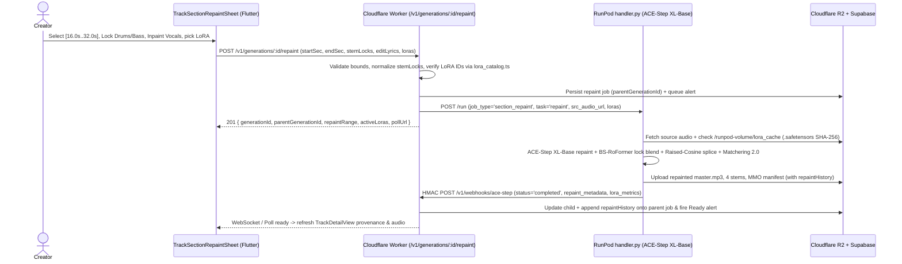
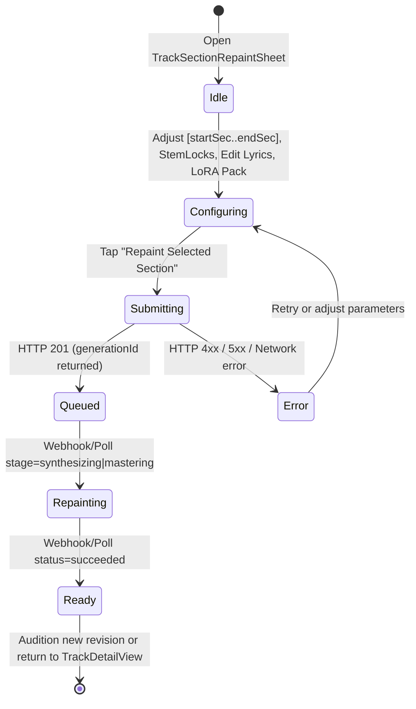

# Phase 83 Blueprint: Post-Generation Stem Repaint, Section Inpainting & Sovereign African LoRA Activation

**Phase ID:** `P83` (Capstone of `PROG-P80-P83-SOVEREIGN-STUDIO-ENGINE`)  
**Specification Version:** `1.0` (Argon-Hardened Stage 2/3)  
**Date:** `2026-11-25`  
**Audit Baseline:** [`PHASE83_POSTGEN_STEM_REPAINT_AND_LORA_STUDIO_AUDIT.md`](file:///c:/Users/Ndugelo/VHUNAMBI/monorepo/docs/audits/PHASE83_POSTGEN_STEM_REPAINT_AND_LORA_STUDIO_AUDIT.md) (`AUDIT-P83-REPAINT-LORA-083`)  
**Predecessors:** `P80` (Studio Cockpit V6 & Contract V6), `P81` (Multi-Model Router & Multi-Take A&R), `P82` (`BS-RoFormer` + Neural `Seed-VC` + `Matchering 2.0`)

---

## 1. Executive Overview & North Star

Phases 80–82 established Vhunambi's **first-pass creation engine**: Studio V6 lossless generation (`MiniMax Music 3.0` + `ACE-Step 1.5 XL`), A&R multi-take scoring, surgical `BS-RoFormer` lead isolation, neural `Seed-VC` singing voice conversion with Bantu plosive/click preservation, and 6-genre South African `Matchering 2.0` broadcast mastering (`-14.0 LUFS` streaming / `-9.0 LUFS` club).

**Phase 83 completes the creator production loop** by unlocking two high-leverage post-generation capabilities on real tracks:

1. **Surgical Post-Generation Section Repaint & Stem Inpainting (`TrackDetailView` ➔ `POST /v1/generations/:id/repaint` ➔ `ACE-Step 1.5 XL-Base`):**
   - Creators select an exact bar/time window (`[startSec, endSec]`) on an already-generated track, toggle per-stem authority (`Lock Pure 44.1k` | `Guided Inpaint` | `AI Re-Imagine`) via the relocated, upgraded `CockpitQuantumEntanglementRack` inside `TrackSectionRepaintSheet`, optionally edit section lyrics or musical directions, and regenerate only that span or stem while keeping all locked stems untouched and crossfading seamlessly across the bar boundary.
   - Creators can also audition and switch between multi-take candidates (`takes[]` from Phase 81) and inspect `repaintHistory[]` directly inside `TrackDetailView`.
2. **Truthful Sovereign African Style LoRA Pack Activation (`GET /v1/studio/loras` + Multi-LoRA Hot-Swap):**
   - Unifies three drifted LoRA tables into one canonical `LORA_PACK_CATALOG` mapped across all 42 `GENRE_PRESETS` (`Amapiano Log Drum`, `Private School Rhodes`, `Sgija / Bacardi Bounce`, `Durban Gqom`, `Maskandi Picking`, `Venda Malende / Lekompo`, `Lagos Afrobeats`, `Township Kwaito`, `Afro-Gospel Choir`, `Ancestral Afro House`).
   - Eliminates false-positive LoRA attribution (`LORA-01`): `ZRModelManager._hot_swap_lora()` ONLY reports `active_lora` / `loaded_loras` when a verified `.safetensors` file exists on disk/R2 and loads cleanly into the pipeline, with authenticated `boto3` R2 fallback + `/runpod-volume/lora_cache` preflight manifest inspection.
   - Exposes a tactile African LoRA Pack & Blend Weight Picker in both `TrackSectionRepaintSheet` and `StudioComposeTab` (`Sovereign Custom` tier), forwarding explicit `loras[]` end-to-end into `POST /v1/generations` and `POST /v1/generations/:id/repaint`.

---

## 2. Forensic Post-Mortem Comparison Box (`AUDIT-P83-REPAINT-LORA-083`)

```text
┌─────────────────────────────────────────────┬─────────────────────────────────────────────────────────┐
│ LEGACY / BROKEN STATE (PRE-PHASE 83)        │ TARGET PHASE 83 ARCHITECTURE                            │
├─────────────────────────────────────────────┼─────────────────────────────────────────────────────────┤
│ • No POST /v1/generations/:id/repaint route │ • Dedicated POST /v1/generations/:id/repaint validating │
│   anywhere in apps/vhunambi_api/src/routes/ │   [startSec, endSec], task (repaint|lego|complete),     │
│                                             │   stemLocks, editPrompt, editLyrics, and loras[]        │
├─────────────────────────────────────────────┼─────────────────────────────────────────────────────────┤
│ • handler.py checks pregen_stem_locks for   │ • Canonical normalizer maps BOTH stem roles (vocals,    │
│   f"node_{stem_name}" (node_drums) while    │   drums, bass, melodic) AND legacy 3D node IDs          │
│   Flutter sends node_beat_tempo -> 0% match │   (node_beat_tempo, node_harmony_chords, etc.)          │
├─────────────────────────────────────────────┼─────────────────────────────────────────────────────────┤
│ • CockpitQuantumEntanglementRack is         │ • Refactored with AppColors.*Of(context) + >=44dp hit   │
│   orphaned (0 callers) after P80 STU-02;    │   targets inside TrackSectionRepaintSheet launched from │
│   TrackDetailView._handleRemix drops stems, │   TrackDetailView; _handleRemix calls                   │
│   track.id, audioUrl, BPM, and key          │   applyPastTrackRemix() with full track metadata        │
├─────────────────────────────────────────────┼─────────────────────────────────────────────────────────┤
│ • _hot_swap_lora() stamps _active_lora_key  │ • Truthful LoRA provenance: loaded_loras[] only lists   │
│   even on HTTP 404 (false positive lie);    │   verified .safetensors files (SHA-256 + size > 64B +   │
│   3 drifted maps cover only 8-9/42 genres   │   pipeline load_lora OK); 1 canonical catalog -> 42/42  │
├─────────────────────────────────────────────┼─────────────────────────────────────────────────────────┤
│ • OpenVerseRemixCockpitSheet Mode A writes  │ • Clean audio envelope fallback + real Sketchpad/Repaint│
│   constant 0.45 DC dummyVocal; Mode B Open  │   handoff; TrackDetailEntity hydrates takes[] and       │
│   Sketchpad button is a SnackBar dead-end   │   repaintHistory[] badges cleanly                       │
└─────────────────────────────────────────────┴─────────────────────────────────────────────────────────┘
```

---

## 3. Multi-Layer Decoupled System Architecture

```text
┌──────────────────────────────────────────────────────────────────────────────────────────┐
│ LAYER 1 · FLUTTER CLIENT (apps/vhunambi_client/lib/)                                     │
│  [TrackDetailView] ──► [TrackSectionRepaintSheet]                                        │
│    • Bar/Time RangeSlider [startSec .. endSec] snapped to beat/bar grid (BPM-aware)      │
│    • Refactored [CockpitQuantumEntanglementRack] (Lock | Inpaint | Resynth, >= 44dp)     │
│    • Target Stem Role & Task Mode (Section Repaint | Stem Lego | Extend/Complete)        │
│    • Optional Lyric/Prompt Patch + [AfricanLoraPackPicker] (0..2 packs, weight 0.1-1.2)  │
│    • [TrackTakesSwitcher] (A/B multi-take audition) + [RepaintHistoryChip]               │
│  [StudioComposeTab] ──► [AfricanLoraPackPicker] (Sovereign Custom LoRA selection)        │
└────────────────────────────────────────────┬─────────────────────────────────────────────┘
                                             │ HTTPS JSON (Bearer JWT)
                                             ▼
┌──────────────────────────────────────────────────────────────────────────────────────────┐
│ LAYER 2 · CLOUDFLARE WORKER API (apps/vhunambi_api/src/)                                 │
│  • GET  /v1/studio/loras             -> Canonical African LoRA catalog (lora_catalog.ts) │
│  • POST /v1/generations              -> Accepts explicit loras[] overrides               │
│  • POST /v1/generations/:id/repaint  -> Validates repaint range + stemLocks + loras,     │
│      hydrates parent job from SQLite/Supabase, creates child repaint job linked via      │
│      parentGenerationId, dispatches RunPod task='repaint'|'lego'|'complete'              │
│  • POST /v1/webhooks/ace-step        -> Persists repaintMetadata, activeLoras, and       │
│      appends RepaintHistoryEntry onto parent & child MMO manifests + Ready alert         │
└────────────────────────────────────────────┬─────────────────────────────────────────────┘
                                             │ RunPod /run (job_type: 'section_repaint')
                                             ▼
┌──────────────────────────────────────────────────────────────────────────────────────────┐
│ LAYER 3 · RUNPOD SERVERLESS GPU WORKER (tools/zr-studio-gpu/)                            │
│  [handler.py] ──► [ZRMultiModelRouter] (forces ace_step_xl_base for repaint/lego/LoRA)   │
│    • Downloads source master & locked stems (R2 S3 boto3 -> HTTPS fallback)              │
│    • Normalizes stem_locks (canonical roles + legacy node_* aliases)                     │
│    • [ZRModelManager._hot_swap_loras()] loads verified .safetensors from                 │
│      /runpod-volume/lora_cache (or R2 boto3/HTTPS), verifies header & SHA-256, tracks    │
│      truthful lora_metrics { requested, loaded, verified_sha256 }                        │
│    • [ZRModelManager.repaint_audio_section()] runs ACE-Step XL-Base repaint/lego or      │
│      phase-aligned harmonic section synthesis + raised-cosine crossfade splice           │
│    • Preserves locked stems (BS-RoFormer lead/bed if vocals locked) -> Matchering 2.0 -> │
│      MMO v2.0 telemetry -> uploads updated master, stems, and repaint provenance to R2   │
└──────────────────────────────────────────────────────────────────────────────────────────┘
```

---

## 4. Mathematical Formulations

### 4.1 Bar-to-Second Quantization & Bounds Validation
Given track tempo $B \in [50, 220]\text{ BPM}$ in $4/4$ time and total duration $T \in [10, 360]\text{ s}$:

$$T_{\text{bar}} = \frac{240}{B}\text{ s}, \qquad s_{\text{start}} = \operatorname{clamp}(t_{\text{start}}, 0, T - \Delta_{\min}), \qquad s_{\text{end}} = \operatorname{clamp}(t_{\text{end}}, s_{\text{start}} + \Delta_{\min}, T)$$

where $\Delta_{\min} = 2.0\text{ s}$ is the minimum repaint span (preventing degenerate sub-beat masks) and bar-snapping rounds UI slider endpoints to the nearest $0.5 \cdot T_{\text{bar}}$ when snap-to-bar is active.

### 4.2 Click-Free Raised-Cosine Crossfade Splice (`tools/zr-studio-gpu/model_utils.py`)
When splicing a repainted segment $y_{\text{new}}[n]$ into the untouched source waveform $x_{\text{orig}}[n]$ over sample window $[N_0, N_1)$ with crossfade margin $M = \min\!\left(\lfloor 0.08 \cdot f_s \rfloor,\, \lfloor (N_1 - N_0)/4 \rfloor\right)$:

$$w(k) = \frac{1}{2}\left(1 - \cos\!\left(\frac{\pi k}{M}\right)\right), \quad k \in \{0, \dots, M-1\}$$

$$y_{\text{out}}[n] = \begin{cases} x_{\text{orig}}[n], & n < N_0 \text{ or } n \ge N_1 \\ (1 - w(n - N_0))\,x_{\text{orig}}[n] + w(n - N_0)\,y_{\text{new}}[n - N_0], & N_0 \le n < N_0 + M \\ y_{\text{new}}[n - N_0], & N_0 + M \le n < N_1 - M \\ w(N_1 - 1 - n)\,y_{\text{new}}[n - N_0] + (1 - w(N_1 - 1 - n))\,x_{\text{orig}}[n], & N_1 - M \le n < N_1 \end{cases}$$

This guarantees $C^1$ amplitude continuity ($w(0) = 0, w(M) = 1, w'(0) = w'(M) = 0$) with zero boundary clicks across both GPU neural repaints and CPU offline unit-test renders.

### 4.3 Multi-LoRA Effective Blend Weight Normalization
When a creator selects $K \in \{1, 2, 3\}$ compatible LoRA adapters with requested weights $w_i \in [0.10, 1.20]$:

$$W_{\text{sum}} = \sum_{i=1}^{K} w_i, \qquad \tilde{w}_i = \begin{cases} w_i, & W_{\text{sum}} \le 1.35 \\ 1.35 \cdot \dfrac{w_i}{W_{\text{sum}}}, & W_{\text{sum}} > 1.35 \end{cases}$$

Capping total adapter gain at $1.35$ prevents ACE-Step 1.5 XL-Base DiT attention saturation when blending two regional packs (e.g., `amapiano_private_school_v1` + `venda_malende_v1`).

---

## 5. End-to-End Sequence & State Diagrams

### 5.1 Post-Generation Section Repaint Sequence



### 5.2 Repaint Sheet FSM



---

## 6. Dual-Viewport UI Wireframes (`STD-UIUX-001`)

### 6.1 Mobile Portrait (`360 x 800`, `TrackSectionRepaintSheet`)

```text
┌────────────────────────────────────────┐
│ ── (drag pill)                         │
│ [X] Section Repaint & Stem Inpaint     │
│     Track: Ndo Mufuna Matibe (113 BPM) │
├────────────────────────────────────────┤
│ SECTION WINDOW (Bar 5 - Bar 9 · 16s)   │
│ 0:00 ━━━[========]━━━━━━━━━━━━━━ 3:18  │
│ Start: 16.0s           End: 32.0s      │
├────────────────────────────────────────┤
│ TASK MODE (VhunambiGlassTabBar)        │
│ [ Repaint ]  [ Stem Lego ]  [ Extend ] │
├────────────────────────────────────────┤
│ STEM AUTHORITY (minHeight: 44dp chips) │
│ Vocals  [Lock] [Inpaint*] [Resynth]    │
│ Drums   [Lock*] [Inpaint] [Resynth]    │
│ Bass    [Lock*] [Inpaint] [Resynth]    │
│ Melodic [Lock] [Inpaint*] [Resynth]    │
├────────────────────────────────────────┤
│ AFRICAN STYLE LoRA PACK (Optional)     │
│ [Amapiano Log Drum] [Private School*]  │
│ [Venda Malende] [Maskandi] [Gqom]      │
│ Blend Strength: ━━━━━━●━━━ 0.85        │
├────────────────────────────────────────┤
│ SECTION LYRICS / DIRECTION (Optional)  │
│ [ Optional new lyrics or drop cue... ] │
├────────────────────────────────────────┤
│ [  Repaint 16.0s - 32.0s (XL-Base)   ] │
└────────────────────────────────────────┘
```

### 6.2 Desktop / Tablet (`>= 600dp`, Two-Column Modal Sheet)
- **Left Column (55%):** Track header, interactive bar/time `RangeSlider` with beat ticks, Task Mode segmented glass bar, and the 4-stem authority matrix (`Vocals`, `Drums`, `Bass`, `Melodic` — all `>= 44dp` touch height, Light/Dark `AppColors.*Of(context)`).
- **Right Column (45%):** Sovereign African LoRA Pack selector chips + strength slider (`0.10–1.20`), optional section lyrics/prompt box, and primary `"Repaint Selected Section"` CTA button.

---

## 7. Verification Gates (`G83-01` – `G83-05`)

| Gate ID | Layer | Exact Verification Target | Pass Condition |
| :--- | :--- | :--- | :--- |
| **`G83-01`** | RunPod Python GPU | `py_compile` + `unittest discover -s tools/zr-studio-gpu -p "test_*.py" -v` | `100%` pass (`Phase 81 + Phase 82 + Phase 83` suites), zero false-positive LoRA claims, zero boundary clicks on splice, `0 MB` local `pip install`. |
| **`G83-02`** | Cloudflare Worker API | `cd apps/vhunambi_api; .\node_modules\.bin\tsc.cmd --noEmit && npm test` | `0` TS errors, `36/36` suites passing (`phase83_repaint_lora_routes.test.ts` + all 35 prior suites unchanged). |
| **`G83-03`** | Flutter Client | `flutter test --no-pub --timeout=60s` (`phase83_repaint_lora_test.dart`, `phase82_track_provenance_test.dart`, `phase54_cockpit_biome_quantum_entanglement_test.dart`, `track_detail_view_test.dart`) + `\bIcons\.` scan | `100%` pass in Light & Dark `360x800` with zero overflow, `>= 44dp` hit targets, `0` stock `Icons.*`, `0` raw emojis. |
| **`G83-04`** | Live Deploy & Night-Data Push | `wrangler deploy` + `/health` `200 OK` + `.github/workflows/push_gpu_worker.yml` `:vhunambi-v4` push readiness | Live Worker responds `200 OK` on `/health` and `/v1/studio/loras`; GPU repo commits ready for `:vhunambi-v4` GitHub Actions push. |
| **`G83-05`** | Memory Consolidation (`SLEEP`) | Promote `memory.md` to `"completed"`, update `PHASE_80_PLUS_STUDIO_AND_RUNPOD_MASTER_TRACKER.md`, run `node .agents/skills/vhunambi-memory/scripts/consolidate_memory.mjs` | Exits `0`, `0 OPEN` endpoints, `P83` indexed cleanly. |
