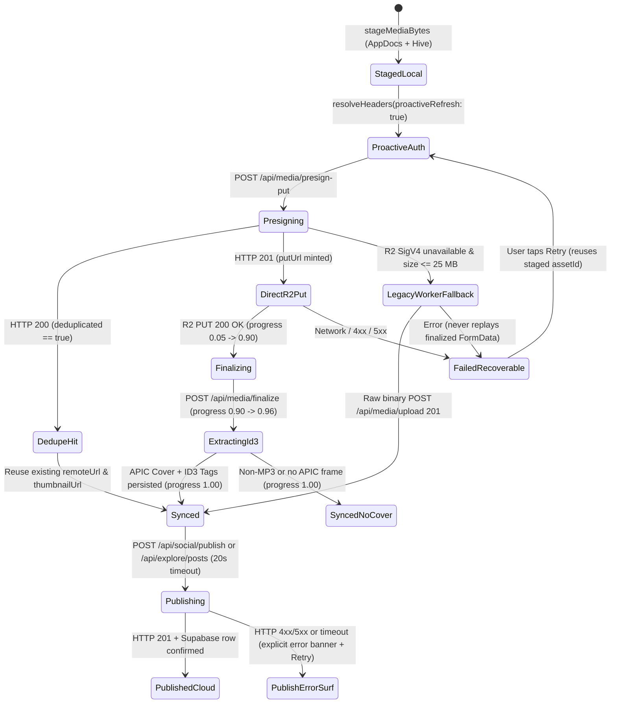
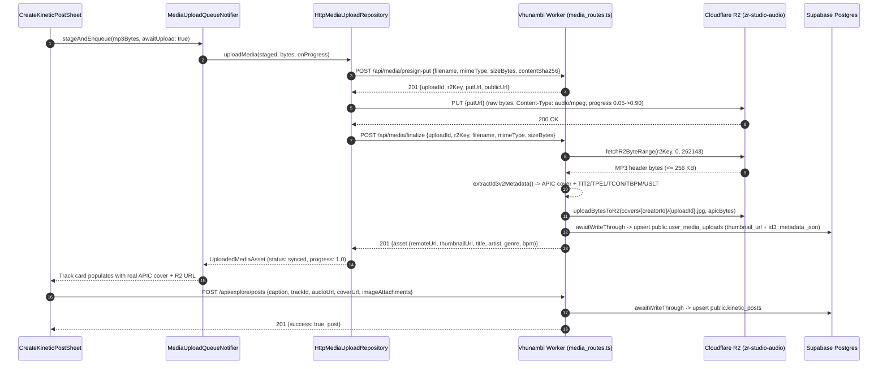
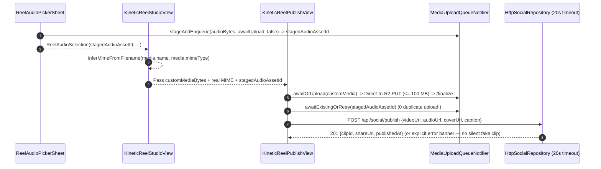

# Phase 84 — Media Pipeline Overhaul: Direct-to-R2 Presigned Uploads, Edge ID3v2 Cover/Metadata Extraction, Kinetic Reels 98% Fix, Kinetic Post Uploads & Zania Music Flywheel

> **Spec Suite ID:** `SPEC-P84-MEDIA-ID3-REELS98-KPOST`  
> **Phase Folder:** `docs/phases/phase_84_media_pipeline_id3_reels_and_kpost_overhaul/`  
> **Stage 1 Audit Provenance:**  
> - `docs/audits/CROSS_PLATFORM_ZANIA_TO_VHUNAMBI_INTEGRATION_AUDIT.md` (`AUDIT-CROSS-ZANIA-TO-VHUNAMBI-2026-11`)  
> - `docs/audits/PHASE84_ZANIA_FLYWHEEL_ID3_REELS98_AND_KPOST_AUDIT.md` (`AUDIT-P84-ZANIA-ID3-REELS98-KPOST`)  
> - `docs/audits/ZANIA_EXPLORE_ADOPTABLE_TECH_CATALOG.md` (`TECH-TRANSFER-ZANIA-TO-VHUNAMBI`)  
> **Baseline Commit:** `ef19708` (`fix/studio-cockpit-bugs-vh001-vh006`)  
> **Target Layers:** Cloudflare Workers Hono TS (`apps/vhunambi_api`), Supabase PostgreSQL (`supabase/migrations/`), Flutter/Dart (`apps/vhunambi_client`), Thin Node CLI (`tools/zania-ingest/`)

---

## §1. Executive Overview & North Star

Vhunambi's creator distribution loop is currently fractured at the exact moment a user tries to turn real audio, video, or artwork into a live cloud post or reel. Forensic inspection against production Supabase (`cbnruevwrqwjnnoscgsz`) confirmed **`0` rows** in `user_media_uploads`, **`0` rows** in `kinetic_posts`, and **`0` user-published rows** in `published_clips` (all `9` existing clips are legacy seeded `creator_makhadzi` placeholders).

Phase 84 permanently closes this gap and turns Vhunambi into the sovereign distribution home for Suno, Udio, and DAW African music creators by uniting **five tightly coupled upgrades**:

1. **Direct-to-R2 Presigned PUT + Finalize Pipeline (`EP-P84-R2-PRESIGN-DIRECT`):** Eliminates the `98%` Kinetic Reels crash (`REEL98-01..05`) by bypassing Cloudflare Worker `25 MB` RAM buffering for uploads and eliminating Dio's `Bad state: The FormData has already been finalized` crash on `401` token refresh replays.
2. **Pure Edge ID3v2.3 / ID3v2.4 Extraction (`EP-P84-EDGE-ID3-EXTRACTOR`):** Ports and extends Zania Explore's zero-dependency `Uint8Array` ID3 parser (`scripts/lib/id3v2-parser.ts`) to extract embedded `APIC` cover art (`image/jpeg`, `image/png`, `image/webp`) **plus** `TIT2` (title), `TPE1` (artist), `TALB` (album), `TCON` (genre), `TBPM` (BPM), and `USLT` (lyrics) via bounded R2 byte-range reads (`<= 256 KB` initial window, `<= 2 MB` hard cap). Extracted covers are written directly to R2 `covers/<creatorId>/<uploadId>.<ext>` so mobile clients render crisp `< 40 KB` artwork without ever downloading full MP3 headers on mobile data.
3. **Kinetic Post Real Media Upload, Cloud Persistence & Hydration Overhaul (`EP-P84-KPOST-MEDIA-UPLOAD`):** Replaces mock `_grooveSeeds`, hardcoded `'Vhunambi Sonic Groove'`, and silent bundled artwork fallbacks inside `CreateKineticPostSheet` with 1-tap direct audio & photo uploads (`My Uploads` default tab), awaited R2 URL persistence (`upsertKineticPostAsync` via `awaitWriteThrough`), and complete `imageAttachment` / `imageAttachments` / `audioUrl` / `coverUrl` cloud hydration in `SocialFeedPostsNotifier.refreshFromCloud()`.
4. **Explore Keyset Cursor & Edge FNV-1a ETag (`EP-P84-EXPLORE-CURSOR-ETAG`):** Ports Zania Explore's pure Web-API `cursor.ts` and `etag.ts` (`304 Not Modified`) into `GET /api/explore/tracks` so scaling past 200+ ingested tracks slashes mobile payload egress.
5. **Zero-Duplication Zania Music Catalog Ingestion (`EP-P84-ZANIA-CATALOG-INGEST`):** Ships an idempotent SHA-256-deduplicated Node 24 CLI (`tools/zania-ingest/ingest_zania_catalog.mjs`) that ingests the `189` Suno/DAW MP3s, sibling `.webp`/`.png` covers, and `.txt` lyrics from `C:\Users\Ndugelo\Music\ZANIA MUSIC` (or existing `zania-storage` keys) into `zr-studio-audio` + Supabase `explore_tracks` & `user_media_uploads` with zero local Docker or RAM pressure.

---

## §2. Forensic Post-Mortem Comparison Box

```text
+=======================================================================================================+
|                      VHUNAMBI MEDIA & DISTRIBUTION PIPELINE: BEFORE vs. PHASE 84                      |
+================================================+======================================================+
| BEFORE (LIVE BASELINE ef19708 — BROKEN)        | PHASE 84 (SOVEREIGN TARGET ARCHITECTURE)             |
+------------------------------------------------+------------------------------------------------------+
| [REEL98-01] sovereign_api_client.dart:195-206  | Proactive token refresh before upload + raw binary   |
| replays consumed Dio FormData on 401 ->        | OR Direct-to-R2 SigV4 PUT (no FormData stream        |
| crashes at 98% clamp (0.05..0.98).             | reuse; retry rebuilds request cleanly).              |
+------------------------------------------------+------------------------------------------------------+
| [REEL98-02] UploadsVaultView uses              | Unified MediaUploadQueueNotifier surfaces explicit   |
| awaitUpload:false (hides cloud failure behind  | cloud sync states (queued/uploading/synced/failed)   |
| local AppDocs file); Supabase has 0 rows.      | + single-tap Retry + verified remoteUrl badges.      |
+------------------------------------------------+------------------------------------------------------+
| [REEL98-03] media_routes.ts buffers entire     | POST /api/media/presign-put mints SigV4 R2 PUT URL   |
| file into Worker isolate RAM (25 MB hard cap;  | (<= 100 MB video/audio, zero Worker RAM buffering);  |
| 128 MB OOM); Reel studio hardcodes video/mp4.  | true MIME inferred from file extension + bytes.      |
+------------------------------------------------+------------------------------------------------------+
| [REEL98-04] ReelAudioPickerSheet uploads audio | ReelAudioPickerSheet hands off stagedAudioAssetId;   |
| AND passes raw bytes to ReelPublishView ->     | KineticReelPublishView awaits existing upload task   |
| uploads identical audio twice blocking publish.| with zero duplicate network transfer.                |
+------------------------------------------------+------------------------------------------------------+
| [REEL98-05] HttpSocialRepository sets 4s       | POST /api/social/publish uses 20s receiveTimeout     |
| receiveTimeout & silently returns fake         | and surfaces real failure states in production       |
| _publishClipFallback() on error/timeout.       | (test-mode fallback gated strictly to FLUTTER_TEST). |
+------------------------------------------------+------------------------------------------------------+
| [ID3-GAP] media_routes.ts:56 sets              | POST /api/media/finalize & /upload run pure edge     |
| thumbnailUrl = null on audio uploads; Suno/DAW | id3v2_parser.ts over bounded R2 range -> extracts    |
| MP3 embedded covers & tags are discarded.      | APIC cover to R2 covers/ + TIT2/TPE1/TCON/TBPM/USLT. |
+------------------------------------------------+------------------------------------------------------+
| [KPOST-01..03] CreateKineticPostSheet defaults | Defaults to My Uploads, adds 1-tap Upload Audio &    |
| to Trending + mock _grooveSeeds + unawaited    | Photo buttons, awaits real R2 URLs before POST,      |
| photo upload + refreshFromCloud drops media +  | awaits Supabase write-through (upsertKineticPostAsync|
| upsertKineticPost uses fire-and-forget write.  | ), and hydrates full image/audio/cover URLs cleanly. |
+================================================+======================================================+
```

---

## §3. Multi-Layer Decoupled System Architecture

```text
=========================================================================================================
 LAYER 1: CREATOR CAPTURE & BULK INGESTION SURFACES
=========================================================================================================
  [Flutter Client: apps/vhunambi_client]                   [Thin CLI: tools/zania-ingest/]
   |-- UploadsVaultView (Audio / Video / Image vault)       |-- Scans C:\Users\Ndugelo\Music\ZANIA MUSIC
   |-- KineticReelStudioView -> KineticReelPublishView      |-- Computes SHA-256 dedupe hash per MP3
   |-- ReelAudioPickerSheet (passes stagedAudioAssetId)     |-- Calls /api/media/presign-put -> R2 PUT
   |-- CreateKineticPostSheet (Direct Audio + Photo upload) |   -> /api/media/finalize -> /api/explore/tracks
   +-----------------------+--------------------------------+-----------------------+
                           |                                                        |
                           v (1. Presign JSON + Auth JWT)                           v (2. Direct Stream PUT)
=========================================================================================================
 LAYER 2: EDGE CONTROL PLANE (apps/vhunambi_api — Cloudflare Workers Hono TS)
=========================================================================================================
  [routes/media_routes.ts]                                 [modules/media/] (100% Pure Edge TS, Zero Node fs)
   |-- POST /api/media/presign-put  (<= 100 MB SigV4)       |-- id3v2_parser.ts (APIC + TIT2/TPE1/TALB/
   |-- POST /api/media/finalize     (ID3 + DB commit)       |                    TCON/TBPM/USLT + NFC)
   |-- POST /api/media/upload       (<= 25 MB legacy + ID3) |-- etag.ts         (FNV-1a 32-bit ETag)
   |-- GET  /api/media/uploads      (tenant-scoped list)    |-- cursor.ts       (base64url keyset cursor)
   +-----------------------+                                +-----------------------+
                           |
  [routes/explore_routes.ts]                               [modules/synthesis/r2_storage.ts]
   |-- GET  /api/explore/tracks (Cursor + ETag 304)         |-- getPresignedPutUrl() (aws4fetch SigV4)
   |-- POST /api/explore/tracks (upsertExploreTrackAsync)   |-- fetchR2ByteRange()   (Memory -> VAULT -> S3)
   |-- POST /api/explore/posts  (upsertKineticPostAsync)    |-- uploadBytesToR2()    (Covers + small files)
                           |
                           v (3. Awaited Write-Through: awaitWriteThrough)
=========================================================================================================
 LAYER 3: DURABLE CLOUD PERSISTENCE & OBJECT STORAGE
=========================================================================================================
  [Cloudflare R2: zr-studio-audio]                         [Supabase PostgreSQL: cbnruevwrqwjnnoscgsz]
   |-- media/{creatorId}/{uploadId}.{ext}                   |-- public.user_media_uploads
   |-- covers/{creatorId}/{uploadId}.{jpg|png|webp}         |    (+ id3_metadata_json, content_sha256)
   |-- (optional read-only mount: zania-storage)            |-- public.explore_tracks
                                                            |    (+ content_sha256, source_origin, lyrics_text)
                                                            |-- public.kinetic_posts (awaited write-through)
                                                            |-- public.published_clips (real user reels)
=========================================================================================================
```

---

## §4. Spatial Topology & Domain Taxonomy

### 4.1 Canonical API Endpoint Inventory (Phase 84 Surface)

| Endpoint | Method | Auth | Max Body | Purpose & Connectome ID |
| :--- | :---: | :---: | :---: | :--- |
| `/api/media/presign-put` | `POST` | `sovereignAuthMiddleware` | `16 KB` JSON | Validates MIME + `sizeBytes <= 104_857_600` (`100 MB`), checks optional `contentSha256` dedupe, mints SigV4 PUT URL (`EP-P84-R2-PRESIGN-DIRECT`). |
| `/api/media/finalize` | `POST` | `sovereignAuthMiddleware` | `32 KB` JSON | Verifies uploaded R2 object via `fetchR2ByteRange`, extracts ID3v2 `APIC` cover + text frames (`EP-P84-EDGE-ID3-EXTRACTOR`), writes cover to `covers/...`, commits `user_media_uploads` via `awaitWriteThrough`. |
| `/api/media/upload` | `POST` | `sovereignAuthMiddleware` | `25 MB` | Existing multipart/raw-byte endpoint upgraded to invoke `extractId3v2Metadata(bytes)` synchronously on `audio/*` uploads before returning `201`. |
| `/api/explore/tracks` | `GET` | `sovereignAuthMiddleware` | — | Adds optional `?cursor=<base64url>` keyset pagination + `ETag` / `If-None-Match` `304 Not Modified` (`EP-P84-EXPLORE-CURSOR-ETAG`). |
| `/api/explore/tracks` | `POST` | `sovereignAuthMiddleware` | `128 KB` JSON | Upgraded from fire-and-forget to `await vhunambiDb.upsertExploreTrackAsync(..., c)` with optional `contentSha256`, `sourceOrigin`, and `lyricsText`. |
| `/api/explore/posts` | `POST` | `sovereignAuthMiddleware` | `128 KB` JSON | Upgraded from fire-and-forget to `await vhunambiDb.upsertKineticPostAsync(..., c)` preserving `imageAttachment`, `imageAttachments`, `audioAttachment`, `audioUrl`, and `coverUrl`. |

### 4.2 Canonical `ZANIA MUSIC` Folder-to-Vhunambi Genre & Sub-Genre Mapping

| Local `READY/` Folder | MP3 Count | Canonical Vhunambi `genre` | Canonical `subGenre` | Default `moodId` |
| :--- | :---: | :--- | :--- | :--- |
| `Afro/Amapiano/*` | subset of `52` | `Amapiano` | `Private School Amapiano` | `groove` |
| `Afro/Afro beats/Venda afro` | subset of `52` | `Afrobeats` | `Venda Afro` | `soulful` |
| `Afro/Afro beats/*` | subset of `52` | `Afrobeats` | `Afro Fusion` | `uplifting` |
| `house` | `20` | `Afro House` | `Deep House` | `euphoric` |
| `Pop` | `35` | `Mzansi Pop` | `Afro Pop` | `uplifting` |
| `Rock` | `23` | `Afro Rock` | `Alternative Rock` | `energetic` |
| `Extras` | `20` | `Afro Fusion` | `Zania Curated` | `chill` |
| `Wave` | `10` | `Afro Fusion` | `Synth Wave` | `late_night` |
| `Instrumental` | `6` | `Instrumental` | `Studio Bed` | `focus` |
| `Jazz` | `5` | `Afro Jazz` | `Cape Jazz` | `chill` |
| `Phonk` | `5` | `Phonk` | `Dark Bounce` | `intense` |
| `Epic orchestration` | `4` | `Cinematic` | `Epic Orchestral` | `cinematic` |
| `Trap` | `4` | `SA Hip Hop` | `Trap` | `intense` |
| `Celestial` | `3` | `Ambient` | `Celestial` | `peaceful` |
| `Rap` | `1` | `SA Hip Hop` | `Rap` | `energetic` |

### 4.3 Canonical MIME Inference Matrix (Replaces Hardcoded `video/mp4` / `image/jpeg`)

| File Extension | Canonical MIME Type | `MediaAssetKind` | Max Direct-R2 Size |
| :--- | :--- | :---: | :---: |
| `.mp4`, `.m4v` | `video/mp4` | `video` | `100 MB` |
| `.mov` | `video/quicktime` | `video` | `100 MB` |
| `.webm` | `video/webm` | `video` | `100 MB` |
| `.jpg`, `.jpeg` | `image/jpeg` | `image` | `25 MB` |
| `.png` | `image/png` | `image` | `25 MB` |
| `.webp` | `image/webp` | `image` | `25 MB` |
| `.mp3` | `audio/mpeg` | `audio` | `50 MB` |
| `.wav` | `audio/wav` | `audio` | `100 MB` |
| `.m4a` | `audio/mp4` | `audio` | `50 MB` |
| `.aac` | `audio/aac` | `audio` | `50 MB` |
| `.ogg` | `audio/ogg` | `audio` | `50 MB` |
| `.flac` | `audio/flac` | `audio` | `100 MB` |

---

## §5. Upload, ID3 Extraction & Publish State Machine



---

## §6. Dual-Viewport UI Wireframes (`STD-UIUX-001` Compliant)

> **UI Law Check:** Zero stock `Icons.*`, zero raw Unicode emojis (`PhosphorIcon(PhosphorIconsBold.* / Regular.* / Fill.*)` only), `AppColors.*Of(context)` dual-theme adapters, `>= 44dp` touch targets.

### 6.1 Desktop / Tablet Viewport (`>= 600dp`) — `CreateKineticPostSheet` (Upgraded Composer)

```text
+======================================================================================+
| [X Close (44dp)]        Create Kinetic Post                 [Publish Post (44dp)]    |
+--------------------------------------------------------------------------------------+
|  LEFT COLUMN (Composer & Media Vault)        |  RIGHT COLUMN (Attach Sound / Track)  |
|                                              |                                       |
|  [@creator · Display Name]                   |  [ My Uploads* | Studio | Trending ]  |
|  +----------------------------------------+  |                                       |
|  | Share your music, lyrics, or vibe...   |  |  [+ Upload Audio MP3/WAV (44dp)]      |
|  |                                        |  |  Key('kpost_upload_audio_btn')        |
|  +----------------------------------------+  |                                       |
|                                              |  +---------------------------------+  |
|  Attached Visuals (0-4 real R2 uploads):     |  | [APIC Cover] Mufunwa (Radio)    |  |
|  +------------+  +------------+              |  |  Afrobeats · 116 BPM · Synced   |  |
|  | [Photo 1]  |  | [+ Upload] |              |  |  [Play 44dp]    [Selected Pill] |  |
|  | Cloud OK   |  | Photo 44dp |              |  +---------------------------------+  |
|  +------------+  +------------+              |  +---------------------------------+  |
|                                              |  | [APIC Cover] Geeste Woon        |  |
|  [Upload Photo (44dp)]  [Vision AI (44dp)]   |  |  Amapiano · 114 BPM · Synced    |  |
|  Key('kpost_upload_photo_btn')               |  |  [Play 44dp]    [Attach 44dp]   |  |
|  (Vision AI errors show honest snackbar;     |  +---------------------------------+  |
|   ZERO silent mock artwork injection!)       |                                       |
|                                              |  Snippet Window: 0:15 ----[====] 0:45 |
+======================================================================================+
```

### 6.2 Mobile Portrait Viewport (`< 600dp`) — `KineticReelPublishView` & `UploadsVaultView`

```text
+----------------------------------------+      +----------------------------------------+
| [< Back]     Publish Reel       [44dp] |      | [< Back]   My Uploads Vault   [+ Add]  |
+----------------------------------------+      +----------------------------------------+
| +------------------------------------+ |      | [ All | Audio | Video | Photos ]       |
| | [9:16 Video/Image Preview]         | |      +----------------------------------------+
| | Audio: Mufunwa (Reused Vault ID)   | |      | +------------------------------------+ |
| +------------------------------------+ |      | | [Extracted   ] Mufunwa.mp3         | |
|                                        |      | | [ID3 APIC Art] Venda Afro · 116BPM | |
| Caption: [New drop from Limpopo...   ] |      | |                [Synced · R2 Cloud] | |
| Visibility: [Public*] [Followers]      |      | +------------------------------------+ |
|                                        |      | +------------------------------------+ |
| Status Bar (Direct-to-R2 Progress):    |      | | [Video Thumb ] studio_reel_01.mp4  | |
| [===================>  ] 92% Finalizing|      | | 38.4 MB · Direct R2 · [Retry 44dp] | |
| (Never locks at 98% on FormData 401!)  |      | | Error: Timeout — tap Retry         | |
|                                        |      | +------------------------------------+ |
| [   Publish Kinetic Reel (48dp)      ] |      |                                        |
| Key('reel_publish_submit_btn')         |      | [ Retry All Failed (44dp) ]            |
+----------------------------------------+      +----------------------------------------+
```

---

## §7. Mathematical Formulations & Invariants

### 7.1 ID3v2 Synchsafe Tag Length & Bounded Range Window
Given an MP3 header byte buffer $B = [b_0, b_1, \dots, b_{n-1}]$ with signature $b_0 = \text{0x49}, b_1 = \text{0x44}, b_2 = \text{0x33}$ (`"ID3"`) and major version $v \in \{3, 4\}$:
$$S_{\text{tag}} = ((b_6 \land \text{0x7F}) \ll 21) \mid ((b_7 \land \text{0x7F}) \ll 14) \mid ((b_8 \land \text{0x7F}) \ll 7) \mid (b_9 \land \text{0x7F})$$
Total ID3v2 byte span is $L_{\text{id3}} = 10 + S_{\text{tag}}$.
The Worker range reader obeys strict memory safety bounds:
$$W_0 = 262{,}144 \text{ bytes (256 KiB)}, \qquad W_{\max} = 2{,}097{,}152 \text{ bytes (2 MiB)}$$
1. Fetch initial window $B_0 = \text{Range}(0, W_0 - 1)$.
2. If $L_{\text{id3}} > |B_0|$ and $L_{\text{id3}} \le W_{\max}$, perform exactly **one** bounded extension read $B_{\text{ext}} = \text{Range}(W_0, L_{\text{id3}} - 1)$ and concatenate $B = B_0 \Vert B_{\text{ext}}$.
3. Frame iteration terminates cleanly at $E = \min(|B|, L_{\text{id3}})$, guaranteeing zero out-of-bounds reads and zero Worker OOM even on malformed tags.

### 7.2 Deterministic Edge FNV-1a ETag Formulation
For canonical JSON payload bytes $P = [p_0, \dots, p_{m-1}]$ (`TextEncoder().encode(json)`):
$$h_0 = \text{0x811C9DC5}, \qquad h_{i+1} = \operatorname{imul}(h_i \oplus p_i, \text{0x01000193}) \ggg 0$$
$$\text{ETag}(P) = \texttt{W/"}\Vert \text{hex}_8(h_m) \Vert \texttt{-} \Vert m \Vert \texttt{"}$$
Comparing `If-None-Match` against $\text{ETag}(P)$ allows `GET /api/explore/tracks` to return HTTP `304 Not Modified` with `0` payload bytes on unchanged catalog polls.

### 7.3 Keyset Pagination Tuple Ordering
Each Explore page cursor encodes the tuple $c = (\text{sortValue}, \text{id})$ in RFC 4648 base64url without padding. For descending `trending` / `newest` order, the next page predicate is strictly:
$$(k(t) < k(c)) \lor (k(t) = k(c) \land \text{id}(t) < \text{id}(c))$$
guaranteeing $O(1)$ stability with zero skipped or duplicated tracks when new Zania Music tracks are ingested concurrently.

### 7.4 Monotonic Upload Progress Mapping
For direct-to-R2 uploads, progress $p \in [0.0, 1.0]$ maps monotonically across three distinct phases so the UI never freezes ambiguously at `98%`:
$$p(\text{phase}) = \begin{cases} 0.05 & \text{presign-put in flight} \\ 0.05 + 0.85 \cdot \frac{\text{sent}}{\max(1, \text{total})} & \text{direct R2 PUT streaming } (0.05 \to 0.90) \\ 0.94 & \text{POST /api/media/finalize + ID3 extraction} \\ 1.00 & \text{Supabase row committed + synced} \end{cases}$$

---

## §8. End-to-End Sequence Diagrams

### 8.1 Direct-to-R2 Upload + ID3v2 Cover Extraction + Kinetic Post Publish



### 8.2 Kinetic Reel Publish (Zero Duplicate Audio Upload & Zero 98% Hang)



---

## §9. Hardware, Worker RAM & Bandwidth Budget

| Resource | Hard Budget | Enforcement Mechanism |
| :--- | :---: | :--- |
| **Cloudflare Worker Isolate RAM (Presigned Path)** | `<= 4 MB` peak per request | Direct-to-R2 PUT moves `10–100 MB` media payloads completely off the Worker; `/finalize` reads only `256 KB` (hard cap `2 MB`) for ID3 parsing. |
| **Cloudflare Worker Legacy `/upload` Cap** | `<= 25 MB` | Preserved for backward compatibility and small image/audio payloads; client routes `> 4 MB` (or all presign-capable uploads) through Direct-to-R2 PUT. |
| **ID3v2 Cover Image Size on Mobile Playback** | `<= 512 KB` extracted cover | Covers extracted once on ingest into R2 `covers/...`; Flutter never sends `256 KB` range requests to MP3s when rendering feeds. |
| **Mobile Feed Bandwidth (`GET /api/explore/tracks`)** | `0 B` body on unchanged poll | Edge FNV-1a `ETag` + `If-None-Match` -> HTTP `304 Not Modified`. |
| **Laptop RAM During Zania Bulk Ingest** | `< 150 MB` RSS | `tools/zania-ingest/ingest_zania_catalog.mjs` streams one MP3 at a time (`concurrency = 2`), zero Docker, zero local FFmpeg transcoding. |

---

## §10. Verification Gates (`G-01` through `G-06`)

| Gate | Target | Pass Criterion |
| :---: | :--- | :--- |
| **`G-01`** | Edge ID3v2 Parser & ETag/Cursor Unit Suite | `apps/vhunambi_api/test/phase84_media_id3_and_presign.test.ts` proves `APIC` (JPEG/PNG/WebP + `image/jpg` alias), `TIT2`, `TPE1`, `TALB`, `TCON`, `TBPM`, `USLT`, UTF-16/UTF-8, truncated-window guard, `presign-put` + `finalize`, `ETag` `304`, cursor pagination, and `upsertKineticPostAsync` durability (`0` failures). |
| **`G-02`** | TypeScript & Full API Regression | `apps/vhunambi_api`: `.\node_modules\.bin\tsc.cmd --noEmit` (`0` errors) + `npm test` (`100%` pass). |
| **`G-03`** | Flutter Static Analysis & `STD-UIUX-001` Audit | `apps/vhunambi_client`: `flutter analyze --no-pub` (`0` issues), `0` stock `Icons.*` and `0` raw Unicode emojis in all touched Phase 84 files. |
| **`G-04`** | Flutter Client Unit & Widget Tests (`--timeout=60s`) | New `phase84_media_reels_kpost_test.dart` verifies `401` retry without `FormData` finalization crash, presign-put + finalize flow, real MIME inference, deduplicated reel audio handoff, `publishClip` error surfacing, `CreateKineticPostSheet` direct audio/photo uploads, and `refreshFromCloud()` media hydration (`100%` pass). |
| **`G-05`** | Supabase Migration & Security Advisors | `20261125000001_phase84_media_id3_and_zania_ingest.sql` applied cleanly with `0` advisor warnings and strict `((SELECT auth.jwt()) ->> 'creator_id') = creator_id` RLS policies. |
| **`G-06`** | Live Smoke & Dry-Run Ingest Verification | Worker deployed (`GET /health` `200`, `POST /api/media/presign-put` + `/finalize` verified), plus `node tools/zania-ingest/ingest_zania_catalog.mjs --dry-run` scans all `189` MP3s with `100%` genre/cover detection and `0` errors. |
