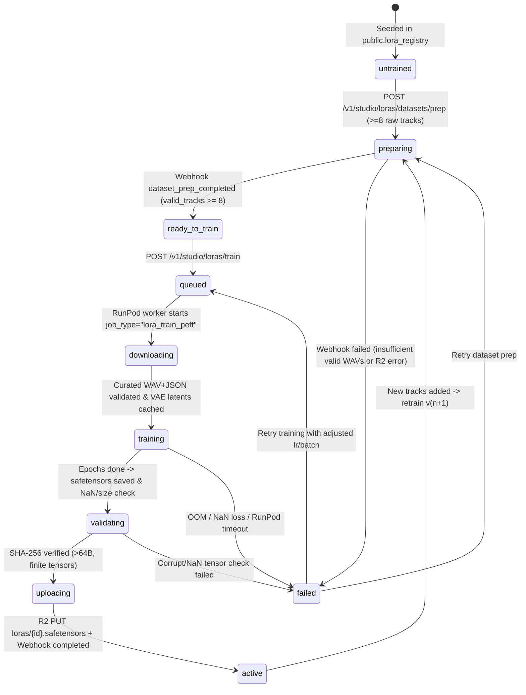
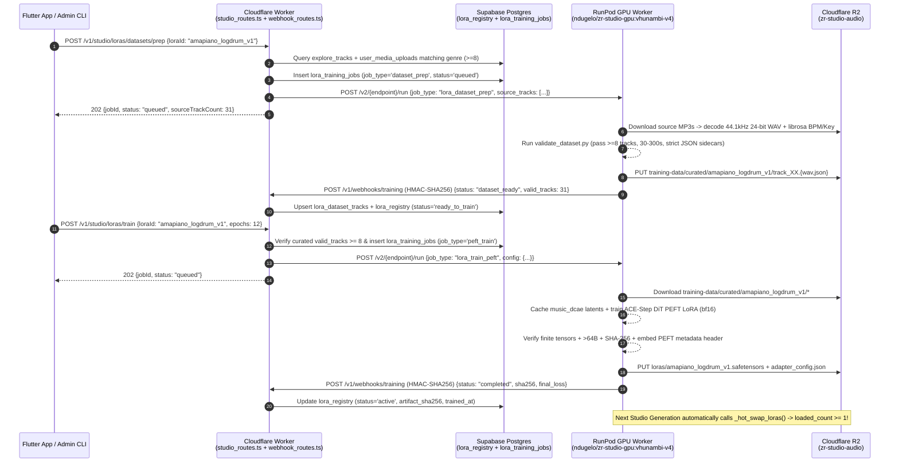

# Phase 85 Architectural Blueprint — Cloud-Only Zero-Local-RAM LoRA Factory (`ZANIA MUSIC` -> RunPod Prep & Real PEFT Trainer -> R2 `loras/*.safetensors` -> `:vhunambi-v4` Live Activation)

> **Spec Suite ID:** `SPEC-P85-CLOUD-LORA-FACTORY`  
> **Phase Folder:** `docs/phases/phase_85_cloud_lora_factory_and_dataset_pipeline/`  
> **Companion Documents:** [`requirements.md`](./requirements.md) · [`design.md`](./design.md) · [`tasks.md`](./tasks.md) · [`memory.md`](./memory.md)  
> **Predecessor Baseline:** Phase 83 (`EP-P83-SOVEREIGN-LORA-CATALOG` live on `:vhunambi-v4`) & Phase 84 (`186` unique Zania Music tracks live in R2 `zr-studio-audio` + Supabase `explore_tracks` under `creator_zania_catalog`)  
> **Source Forensic Audit:** [`CROSS_PLATFORM_ZANIA_TO_VHUNAMBI_INTEGRATION_AUDIT.md`](../../audits/CROSS_PLATFORM_ZANIA_TO_VHUNAMBI_INTEGRATION_AUDIT.md) (Pillar 3)

---

## §1. Executive Overview & Architectural North Star

### 1.1 The Real-World Problem Statement
Phase 83 delivered truthful SHA-256 verified LoRA hot-swapping inside [`tools/zr-studio-gpu/model_utils.py#L536-L598`](../../../tools/zr-studio-gpu/model_utils.py#L536-L598) (`_hot_swap_loras()`) and the 10-pack canonical African LoRA registry in [`apps/vhunambi_api/src/modules/synthesis/lora_catalog.ts#L19-L159`](../../../apps/vhunambi_api/src/modules/synthesis/lora_catalog.ts#L19-L159). Yet every live synthesis request on RunPod Serverless (`e7wt9pgo7djv55` / `ndugelo/zr-studio-gpu:vhunambi-v4`) currently reports `"loaded_count": 0` for one concrete reason: **all 10 R2 objects at `zr-studio-audio/loras/*.safetensors` return HTTP `404`**, because no real `.safetensors` LoRA adapters have been trained yet.

Training those adapters cannot rely on the developer workstation (`8 GB RAM / 1 TB HDD / Intel Core i5-11th Gen / Iris Xe iGPU`), where launching local Docker Desktop, CUDA training, or batch FFmpeg/BS-RoFormer stem extraction freezes or crashes the machine. Meanwhile, inspecting Donor [`Zania-Explore/runpod-zr-studio/training/train_lora.py#L201-L218`](file:///C:/Users/Ndugelo/Zania-Explore-v2.5/Zania-Explore/runpod-zr-studio/training/train_lora.py#L201-L218) exposed a critical trap: Donor's training script is a **mock** that sleeps 5 seconds per epoch and writes `b"MOCK_SAFETENSORS_DATA"` (`21` bytes — which Vhunambi's `verify_safetensors_artifact()` `> 64 bytes` guard would immediately reject!).

### 1.2 The Phase 85 Sovereign Solution (Zero Local RAM, Zero Local Docker)
Phase 84 just placed **186 legally owned, SHA-256 deduplicated Zania Music tracks** (`186/186` with extracted covers, `118/186` with lyrics, spanning `12` genres including `31` Amapiano, `20` Afro House, `19` Afrobeats, `30` Afro Fusion, `35` Mzansi Pop) directly into Cloudflare R2 (`zr-studio-audio/media/creator_zania_catalog/*.mp3`) and Supabase (`public.explore_tracks` + `public.user_media_uploads`).

Phase 85 transforms those cloud-hosted tracks—and every future paid Suno or community creator upload—into a **100% Cloud-Native LoRA Training Factory**:
1. **GitHub Actions Cloud Image Build (0 Local Docker):** [`.github/workflows/push_gpu_worker.yml`](../../../.github/workflows/push_gpu_worker.yml) builds `tools/zr-studio-gpu/Dockerfile.delta` on `ubuntu-latest` with `peft`, `safetensors`, and `pyyaml` layered onto `ndugelo/zr-studio-gpu:vhunambi-v4` (`ACE-Step 1.5` + `BS-RoFormer` + `librosa` + `ffmpeg` already present).
2. **RunPod Cloud Dataset Prepper (`job_type: "lora_dataset_prep"`):** Pulls tagged MP3s directly from R2 `zr-studio-audio/media/...`, decodes to lossless `44.1 kHz / 24-bit stereo WAV`, optionally runs Phase 82 `separate_lead_vocal_bs_roformer()` for the new 11th pack (`bantu_vocals_v1`), extracts real `librosa` BPM + musical key + RMS energy, merges Phase 84 ID3 `USLT` / `explore_tracks.lyrics_text`, validates every file against our ported `validate_dataset.py` gate (`>= 8` valid tracks, `30–300s`, strict JSON sidecars), and uploads curated pairs to `zr-studio-audio/training-data/curated/{lora_id}/`.
3. **Real ACE-Step 1.5 DiT `bf16` PEFT Trainer (`job_type: "lora_train_peft"` + Dedicated Pod CLI):** Replaces Donor's mock loop with genuine PyTorch `bfloat16` flow-matching LoRA training (`peft.LoraConfig`, `r=32, alpha=64` for complex/vocal packs, `r=16, alpha=32` for groove packs), caches `music_dcae` audio VAE latents so 24 GB–48 GB GPUs never OOM, exports verified `.safetensors` with embedded PEFT `__metadata__` + companion `adapter_config.json` directly to `zr-studio-audio/loras/{lora_id}.safetensors`, computes SHA-256, and fires an HMAC-SHA256 signed webhook to `POST /v1/webhooks/training`.
4. **Dual-Path Truthful Loader + Live Registry UI:** Hardens `model_utils.py:_hot_swap_loras()` to support both direct `.safetensors` loading and automatic PEFT directory reconstruction from `.safetensors` `__metadata__`, persists live pack readiness/status in Supabase (`public.lora_registry`, `public.lora_dataset_tracks`, `public.lora_training_jobs`), enriches `GET /v1/studio/loras` without breaking Phase 83's `totalCount === 10` contract, and surfaces live `Active` / `Training` / `Ready to Train` / `Needs Tracks` status inside the Flutter Studio LoRA UI.

---

## §2. Forensic Post-Mortem Comparison Box

```text
+--------------------------------------------------+--------------------------------------------------+
|        LEGACY / DONOR FAILURE MODES              |     PHASE 85 SOVEREIGN CLOUD LORA FACTORY        |
+--------------------------------------------------+--------------------------------------------------+
| 1. Donor train_lora.py:201-215 is a MOCK:        | 1. REAL PyTorch bf16 PEFT ACE-Step DiT Trainer:  |
|    time.sleep(5) + b"MOCK_SAFETENSORS_DATA"      |    Caches music_dcae latents, optimizes flow-    |
|    (21 bytes -> rejected by Vhunambi >64B check) |    matching velocity MSE loss, saves real LoRA   |
|    and posts to dead zania-explore.vercel.app.   |    tensors via safetensors.torch.save_file().    |
+--------------------------------------------------+--------------------------------------------------+
| 2. Local 8 GB RAM / HDD Laptop Crashes:          | 2. 100% Cloud Compute (0 MB Local RAM/Docker):   |
|    Docker Desktop, FFmpeg batch WAV transcoding, |    GitHub Actions builds Docker delta; RunPod    |
|    and CUDA training freeze the workstation.     |    L40S/4090 runs prep + training straight       |
|                                                  |    against Cloudflare R2 zr-studio-audio.        |
+--------------------------------------------------+--------------------------------------------------+
| 3. PEFT Loader Mismatch Trap:                    | 3. Dual-Format Artifact + Safe Adapter Loader:   |
|    model_utils.py:567 passes a bare .safetensors |    Trainer embeds PEFT adapter_config in         |
|    file path to pipe.load_lora(), which fails    |    .safetensors __metadata__ AND writes companion|
|    when upstream PEFT expects a folder with      |    loras/{id}/adapter_config.json; loader auto-  |
|    adapter_config.json + adapter_model.safetens. |    reconstructs PEFT dir if single-file fails.   |
+--------------------------------------------------+--------------------------------------------------+
| 4. Static Hardcoded LoRA Catalog (Blind UI):     | 4. Live Supabase Registry + Track Readiness API: |
|    GET /v1/studio/loras returns static array;    |    public.lora_registry + lora_dataset_tracks    |
|    Flutter cannot tell which packs are active,   |    report live status (active/training/ready/    |
|    training, or still missing 8 source tracks.   |    needs_tracks), SHA-256, and track counts.     |
+--------------------------------------------------+--------------------------------------------------+
| 5. Phase 83 Test Regression Hazard:              | 5. Backward-Compatible 10 + 1 Pack Topology:     |
|    phase83_repaint_lora_routes.test.ts:26-28     |    AFRICAN_LORA_PACKS remains 10 genre packs     |
|    asserts totalCount === 10 & packs.length===10;|    (totalCount=10); bantu_vocals_v1 exposed in   |
|    naively adding bantu_vocals_v1 breaks P83.    |    additive languagePacks[] & findLoraPackById().|
+--------------------------------------------------+--------------------------------------------------+
```

---

## §3. Multi-Layer Decoupled System Architecture

```text
+---------------------------------------------------------------------------------------------------+
| LAYER 1: CREATOR INPUT & FLUTTER STUDIO CLIENT (apps/vhunambi_client - Zero Local Heavy Compute)  |
|  - Studio LoRA Picker & TrackSectionRepaintSheet: Shows live registryStatus pills (Active/Train)  |
|  - LoraFactoryStatusSheet (Key('lora_factory_status_sheet')): Displays 11 packs' readiness ratio  |
|    (e.g. Amapiano 31/8, Afro House 20/8, Afrobeats 19/8) + 1-tap Prep Dataset / Train LoRA CTAs   |
|  - Phase 84 Upload Portal & Zania Ingest CLI continuously feed new Suno/DAW MP3s into R2          |
+-------------------------------------------------+-------------------------------------------------+
                                                  | HTTPS JSON (Bearer JWT)
                                                  v
+---------------------------------------------------------------------------------------------------+
| LAYER 2: CLOUDFLARE WORKER EDGE ORCHESTRATOR (apps/vhunambi_api - Hono TS, <= 128 MB Isolate)     |
|  - GET  /v1/studio/loras               -> 10 genre packs + languagePacks[bantu_vocals_v1] + DB    |
|  - GET  /v1/studio/loras/factory       -> Per-pack track readiness, curated datasets & active jobs|
|  - POST /v1/studio/loras/datasets/prep -> Selects R2 MP3s from explore_tracks -> RunPod prep job  |
|  - POST /v1/studio/loras/train         -> Validates >=8 curated tracks -> RunPod PEFT train job   |
|  - POST /v1/webhooks/training          -> Constant-time HMAC-SHA256 -> updates Supabase registry  |
|  - TrainingDatasetSchema (pure Zod, ported from Donor training-dataset.ts with zero D1/Next deps) |
+--------------------------+---------------------------------------------+--------------------------+
                           | PostgREST (Service Role)                    | RunPod API /v2/{id}/run
                           v                                             v
+---------------------------------------------------+  +--------------------------------------------+
| LAYER 3: SUPABASE POSTGRES (cbnruevwrqwjnnoscgsz) |  | LAYER 4: RUNPOD CLOUD GPU (L40S 48GB / 4090|
|  - public.lora_registry (11 packs, status, sha256)|  |  Image: ndugelo/zr-studio-gpu:vhunambi-v4  |
|  - public.lora_dataset_tracks (curated WAV/JSON)  |  |  Built on GitHub Actions (0 Local Docker)  |
|  - public.lora_training_jobs (epoch, loss, logs)  |  |  [Mode A] job_type="lora_dataset_prep":    |
|  - Reads public.explore_tracks (186 Zania tracks) |  |    R2 MP3 -> 44.1kHz 24b WAV -> BS-RoFormer|
+--------------------------+------------------------+  |    (optional) -> librosa BPM/Key -> Val -> |
                           |                           |    R2 training-data/curated/{lora_id}/     |
                           |                           |  [Mode B] job_type="lora_train_peft":      |
                           |                           |    Curated WAV+JSON -> ACE-Step VAE Cache  |
                           |                           |    -> PEFT DiT bf16 Flow-Matching Loop ->  |
                           |                           |    R2 loras/{lora_id}.safetensors + SHA256 |
                           |                           +---------------------+----------------------+
                           |                                                 | boto3 S3 PUT/GET
                           v                                                 v
+---------------------------------------------------------------------------------------------------+
| LAYER 5: CLOUDFLARE R2 VAULT (zr-studio-audio) & AUTO-ACTIVATION IN :vhunambi-v4 INFERENCE        |
|  - media/{creatorId}/{uploadId}.mp3                 (Phase 84 source catalog: 186 Zania MP3s live)|
|  - training-data/curated/{loraId}/track_XX.{wav,json} (Validated 44.1kHz 24-bit WAV + JSON pairs) |
|  - loras/{loraId}.safetensors + loras/{loraId}/adapter_config.json (Auto-loaded by _hot_swap_loras)|
+---------------------------------------------------------------------------------------------------+
```

---

## §4. Canonical LoRA Pack Topology & Live Zania Catalog Readiness Matrix

Based on our live Supabase query (`creator_zania_catalog` = `186` unique tracks in `public.explore_tracks` as of 2026-11-25), **4 regional packs are immediately ready to prep & train on Day 1** without recording a single extra song, while the remaining 7 packs automatically unlock as soon as their `explore_tracks` + `user_media_uploads` count reaches `MIN_TRACKS = 8`:

| # | `loraId` | Pack Type | Target R2 Artifact Key | Default Weight | PEFT Rank / Alpha | Live `explore_tracks` Sources (`creator_zania_catalog`) | Live Track Count vs `min_tracks (8)` | Day-1 Cloud Status |
| :---: | :--- | :---: | :--- | :---: | :---: | :--- | :---: | :--- |
| 1 | `amapiano_logdrum_v1` | `genre` | `loras/amapiano_logdrum_v1.safetensors` | `0.85` | `32 / 64` | `genre = 'Amapiano'` | **31 / 8** | **READY NOW (Exceeds 15 rec.)** |
| 2 | `amapiano_private_school_v1` | `genre` | `loras/amapiano_private_school_v1.safetensors` | `0.85` | `32 / 64` | `genre IN ('Amapiano', 'Afro Jazz')` | **36 / 8** | **READY NOW (Exceeds 15 rec.)** |
| 3 | `afrobeats_lagos_v1` | `genre` | `loras/afrobeats_lagos_v1.safetensors` | `0.80` | `16 / 32` | `genre IN ('Afrobeats', 'Afro Fusion')` | **49 / 8** | **READY NOW (Exceeds 15 rec.)** |
| 4 | `afrohouse_ancestral_v1` | `genre` | `loras/afrohouse_ancestral_v1.safetensors` | `0.85` | `16 / 32` | `genre = 'Afro House'` | **20 / 8** | **READY NOW (Exceeds 15 rec.)** |
| 5 | `bantu_vocals_v1` | `language` | `loras/bantu_vocals_v1.safetensors` | `0.88` | `32 / 64` | `lyrics_text <> ''` + BS-RoFormer vocal isolation (Tshivenḓa/Bantu subset + multilingual vocal tracks) | **118 vocal / 8** *(4+ Venda)* | **READY (BS-RoFormer Vocal Prep)** |
| 6 | `sgija_bacardi_v1` | `genre` | `loras/sgija_bacardi_v1.safetensors` | `0.86` | `16 / 32` | `genre IN ('Sgija', 'Bacardi')` or `sub_genre ILIKE '%sgija%'` | **0 / 8** | Awaiting Suno/Creator Uploads |
| 7 | `gqom_durban_v1` | `genre` | `loras/gqom_durban_v1.safetensors` | `0.88` | `16 / 32` | `genre = 'Gqom'` | **0 / 8** | Awaiting Suno/Creator Uploads |
| 8 | `maskandi_picking_v1` | `genre` | `loras/maskandi_picking_v1.safetensors` | `0.82` | `32 / 64` | `genre IN ('Maskandi', 'Mbaqanga')` | **0 / 8** | Awaiting Suno/Creator Uploads |
| 9 | `venda_malende_v1` | `genre` | `loras/venda_malende_v1.safetensors` | `0.85` | `32 / 64` | `sub_genre ILIKE '%venda%'` or `genre IN ('Malende', 'Lekompo')` | **4 / 8** | Needs +4 Venda Suno Tracks |
| 10 | `kwaito_township_v1` | `genre` | `loras/kwaito_township_v1.safetensors` | `0.82` | `16 / 32` | `genre = 'Kwaito'` (+ optional `SA Hip Hop`: 5) | **0–5 / 8** | Awaiting Suno/Creator Uploads |
| 11 | `afro_gospel_choir_v1` | `genre` | `loras/afro_gospel_choir_v1.safetensors` | `0.84` | `32 / 64` | `genre IN ('Gospel', 'Isicathamiya', 'Mbube')` | **0 / 8** | Awaiting Suno/Creator Uploads |

> **Backward Compatibility Invariant (`PHASE83-GUARD`):** `AFRICAN_LORA_PACKS` exports packs `#1–#4, #6–#11` (`length === 10`), keeping `GET /v1/studio/loras` default `totalCount === 10` and `packs.length === 10` 100% compatible with [`phase83_repaint_lora_routes.test.ts#L26-L28`](../../../apps/vhunambi_api/test/phase83_repaint_lora_routes.test.ts#L26-L28). Pack `#5` (`bantu_vocals_v1`) is exported in `LANGUAGE_LORA_PACKS` and returned in `languagePacks[]` on `GET /v1/studio/loras` (and included in `findLoraPackById()` and `GENRE_LORA_REGISTRY`).

---

## §5. LoRA Pack Lifecycle State Machine



---

## §6. Dual-Viewport Flutter LoRA Factory & Status Wireframes

All Flutter UI strictly complies with `STD-UIUX-001` (zero stock `Icons.*`, zero raw Unicode emojis, `PhosphorIcon`, `AppColors.*Of(context)` Light/Dark tokens, `>= 44x44dp` touch targets).

### 6.1 Desktop / Tablet Viewport (`>= 600dp`) — `LoraFactoryStatusSheet`
```text
+------------------------------------------------------------------------------------+
| [Sparkle] Sovereign African LoRA Factory                [186 Cloud Tracks]  [X]    |
| Zero-Local-RAM Cloud Training on RunPod L40S -> R2 loras/*.safetensors             |
+------------------------------------------------------------------------------------+
| Filter: [ All (11) ] [ Active ] [ Ready to Train (5) ] [ Training ] [ Needs Data ] |
+---------------------------------------+--------------------------------------------+
| AMAPIANO LOG DRUM  [READY 31/8]       | PRIVATE SCHOOL RHODES  [READY 36/8]        |
| Gauteng / SA  |  Rank 32 / Alpha 64   | Joburg / SA  |  Rank 32 / Alpha 64         |
| [======== 31/15 Rec. ========] 100%   | [======== 36/15 Rec. ========] 100%        |
| [ Prep Cloud Dataset ] [ Train LoRA ] | [ Prep Cloud Dataset ] [ Train LoRA ]      |
+---------------------------------------+--------------------------------------------+
| LAGOS AFROBEATS    [READY 49/8]       | BANTU VOCALS (LANG)  [READY 118/8]         |
| West & Pan-Africa | Rank 16 / Alpha 32| 11 SA Languages | BS-RoFormer Vocal Split  |
| [======== 49/15 Rec. ========] 100%   | [======== 118/15 Rec. =======] 100%        |
| [ Prep Cloud Dataset ] [ Train LoRA ] | [ Prep Vocal Dataset ] [ Train LoRA ]      |
+---------------------------------------+--------------------------------------------+
| VENDA MALENDE      [NEEDS +4]         | DURBAN GQOM SUB      [NEEDS +8]            |
| Limpopo / Venda | 4/8 tracks in R2    | KZN / Durban | 0/8 tracks in R2            |
| [====---- 4/8 Min -----------]  50%   | [----------------------------]   0%        |
| [ Upload More Tracks ] (disabled train)| [ Upload More Tracks ] (disabled train)   |
+---------------------------------------+--------------------------------------------+
```

### 6.2 Mobile Portrait Viewport (`< 600dp`) — Compact Pack Card + Studio Picker Pill
```text
+------------------------------------+
| [Sparkle] LoRA Factory         [X] |
| 186 R2 Tracks | 5 Ready | 0 Active |
+------------------------------------+
| [All] [Ready] [Active] [Needs Data]|
+------------------------------------+
| AMAPIANO LOG DRUM                  |
| Gauteng / SA  •  r=32, a=64        |
| Status: [READY TO TRAIN]  31/8 trk |
| [=========== 100% ===============] |
| [ Prep Dataset (44dp)            ] |
| [ Train on RunPod GPU (44dp)     ] |
+------------------------------------+
| AFRO HOUSE ANCESTRAL               |
| Southern & East Africa • r=16      |
| Status: [TRAINING E4/12]  loss 0.41|
| [====-------- 33% ---------------] |
+------------------------------------+
```

---

## §7. Mathematical Foundations of ACE-Step 1.5 PEFT LoRA Training

1. **Low-Rank Adaptation Matrix Decomposition:**
   For each targeted DiT attention linear projection $W_0 \in \mathbb{R}^{d_{\text{out}} \times d_{\text{in}}}$ (`linear_q/k/v`, `to_q/k/v/out.0`, or `q_proj/k_proj/v_proj/o_proj`), PEFT freezes $W_0$ and learns low-rank factors $A \in \mathbb{R}^{r \times d_{\text{in}}}$ (Kaiming-uniform init) and $B \in \mathbb{R}^{d_{\text{out}} \times r}$ (zero init):
   $$h = W_0 x + \frac{\alpha}{r} B A x, \quad \Delta W = \frac{\alpha}{r} B A$$
   With default scaling $\frac{\alpha}{r} = 2.0$ (`r=32, \alpha=64` for rhythmically/phonetically dense packs like Amapiano, Maskandi, Venda Malende, Gospel, Bantu Vocals; `r=16, \alpha=32` for cleaner groove packs).
2. **Rectified Flow-Matching Velocity Objective (ACE-Step 1.5 DiT):**
   Given clean VAE audio latent $x_1 = \mathcal{E}_{\text{DCAE}}(y) \in \mathbb{R}^{C \times F \times T}$ (where $y$ is a 44.1 kHz stereo audio crop of length $L_{\text{crop}} \le 60\text{s}$), Gaussian noise $x_0 \sim \mathcal{N}(0, I)$, and logit-normal sampled timestep $t = \sigma(u), \; u \sim \mathcal{N}(0, 1)$, the interpolated latent and target velocity are:
   $$x_t = (1 - t) x_0 + t x_1, \qquad v^* = x_1 - x_0$$
   Conditioned on caption/prompt embedding $c_{\text{text}}$ and tokenized lyrics $c_{\text{lyr}}$ (with `VoiceBpeTokenizer` Latin phonetic guard active so Bantu diacritics never route to Mandarin), the per-sample weighted flow-matching loss with track weight $w_i \in [0.1, 3.0]$ is:
   $$\mathcal{L}_{\text{FM}}(\theta_{\text{LoRA}}) = \mathbb{E}_{t, x_0, (x_1, c, w_i)} \left[ w_i \cdot \left\| v_{\theta_0 + \Delta\theta}(x_t, t, c_{\text{text}}, c_{\text{lyr}}) - (x_1 - x_0) \right\|_2^2 \right]$$
3. **Gradient Accumulation & Cosine LR Decay:**
   Effective batch size $B_{\text{eff}} = B_{\text{micro}} \cdot G_{\text{accum}}$ (`1 * 4 = 4` on 24 GB RTX 4090, `2 * 2 = 4` on 48 GB L40S), with linear warmup over $S_{\text{warm}}$ steps and cosine annealing to $\eta_{\min} = 0.05 \eta_0$, gradient clipping $\|\nabla \theta\|_2 \le 1.0$, and mandatory non-finite guard (`torch.isfinite(loss)`).

---

## §8. End-to-End Cloud Sequence Diagram (Zero Local RAM)



---

## §9. Hardware, VRAM, Timeout & Cost Budget

| Execution Surface | Hardware / Tier | Peak Memory | Expected Duration | Cost / Safety Guardrail |
| :--- | :--- | :---: | :---: | :--- |
| **Developer Laptop** | 8 GB RAM / 1 TB HDD / Iris Xe | **0 MB Docker / < 50 MB API call** | Instant (`< 1s` HTTP trigger) | Zero local Docker, FFmpeg, or PyTorch execution required. |
| **GitHub Actions CI** | `ubuntu-latest` cloud runner | Cloud runner | `~4–8 min` delta push | Triggered automatically on `tools/zr-studio-gpu/**` or `tools/zr-studio-training/**` push. |
| **RunPod Dataset Prep** | L40S 48 GB / RTX 4090 (Serverless) | `<= 6 GB RAM` (`<= 12 GB VRAM` if BS-RoFormer) | `~1–3 min` for 30 tracks | Streams tracks sequentially (`gc.collect()` per track); skips already-curated SHA-256 pairs. |
| **RunPod PEFT Training** | L40S 48 GB (`bf16`) / RTX 4090 24 GB | `~18–26 GB VRAM` (cached VAE latents + grad checkpointing) | `~8–18 min` for 30 tracks x 12 epochs | Serverless handles `<= 25 min` fast packs; standalone CLI (`train_lora.py --mode pod`) supports multi-hour RunPod Pods with checkpoint resume to R2! |
| **Cloudflare Worker** | V8 Edge Isolate | `<= 16 MB` per request | `< 150 ms` | Never downloads audio or `.safetensors` bytes; orchestrates metadata & signed webhooks only. |

---

## §10. Verification Gates (`G-01` through `G-06`)

| Gate | Scope | Exact Verification Criteria |
| :---: | :--- | :--- |
| **`G-01`** | **Supabase Schema & RLS** | `supabase/migrations/20261125000002_phase85_cloud_lora_factory.sql` applies cleanly (`IF NOT EXISTS`), seeds all 11 canonical `lora_registry` rows, enables RLS with zero Supabase advisor warnings. |
| **`G-02`** | **Cloud Prepper, Validator & Real PEFT Trainer (Python)** | `python -m unittest discover -s tools/zr-studio-gpu -p "test_phase8*.py"` AND `python -m unittest discover -s tools/zr-studio-training/tests -p "test_*.py"` pass 100%, verifying `validate_dataset.py`, `dataset_prep_worker.py`, real PyTorch/PEFT `.safetensors` serialization (with finite weights, `> 64 bytes`, SHA-256, embedded PEFT config), and dual-path `_hot_swap_loras()`. |
| **`G-03`** | **Worker API, Webhook HMAC & Backward Compatibility (TS)** | `tsc --noEmit` + `npm test` (all 37 existing suites including `phase83_repaint_lora_routes.test.ts` asserting `totalCount === 10` + new `phase85_lora_factory.test.ts`) pass with exit code `0`. |
| **`G-04`** | **Flutter Studio LoRA Status & Factory Sheet (Dart)** | `dart analyze` returns `0` issues; targeted + regression `flutter test` (`phase85_lora_factory_ui_test.dart`, `phase83_repaint_lora_ui_test.dart`, `--timeout=60s`) pass 100%; `STD-UIUX-001` grep confirms `0` stock `Icons.*` and `0` raw Unicode emojis. |
| **`G-05`** | **Zero-Local-Docker CI Packaging** | `tools/zr-studio-gpu/Dockerfile.delta` and `.github/workflows/push_gpu_worker.yml` cleanly include `peft`, `safetensors`, `pyyaml`, and `tools/zr-studio-training` modules (`python -m py_compile` clean). |
| **`G-06`** | **Cloud Deploy & Memory Consolidation** | Supabase migration applied, Cloudflare Worker deployed & `/v1/studio/loras/factory` verified live, `tasks.md` checked `[x]`, `memory.md` marked `"status": "completed"`, and `consolidate_memory.mjs` exits `0`. |
