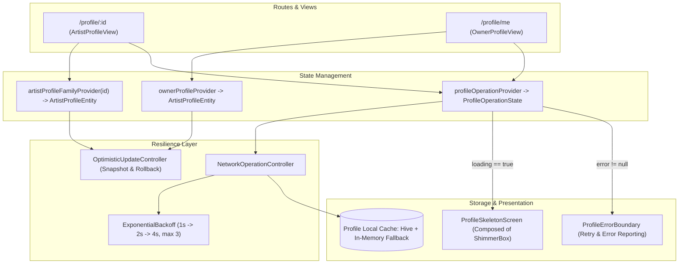
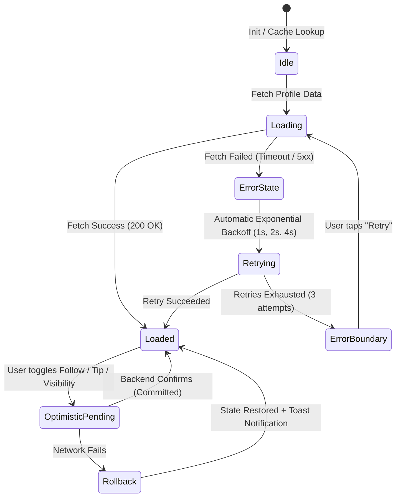

# System Modernization 8 · Blueprint — Profile UX Enhancement & Resilient Accessibility

> **System:** M8 (Modernization Sprint) / Phase 06.1  
> **Codename:** `profile-ux-enhancement`  
> **Status:** 🟡 SPECIFICATION  
> **Target App:** `apps/vhunambi_client`  
> **Flutter / Dart:** 3.44+ / 3.x+  
> **State Management:** Riverpod 2.x (`artistProfileFamilyProvider`, `ownerProfileProvider`, `profileOperationProvider`)  
> **Persistence:** Local Hive Cache (`AppConstants.preferencesBoxKey` / profile cache) with headless in-memory fallback  
> **Accessibility Standard:** WCAG 2.1 AA / Apple HIG (44×44px hit bounds, focus indicators, screen reader semantics)  
> **Companion Documents:**  
> — `docs/audits/PROFILE_FEATURE_AUDIT.md` (Audit Scorecard & Gap Analysis)  
> — `docs/phases/profile-ux-enhancement/requirements.md`  
> — `docs/phases/profile-ux-enhancement/design.md`  
> — `docs/phases/profile-ux-enhancement/tasks.md`  

---

## 1. Executive Summary & Cultural Context

System M8 elevates VHUNAMBI's User Profile subsystem into a resilient, inclusive, and professional-grade creator interface. The profile feature is the cultural and commercial home for African artists, beatmakers, and producers across the continent. It serves a dual-route architecture:
1. **Public Artist Profile (`/profile/:id`)**: The public showcase presenting discography, kinetic reels, top supporters, beat licensing catalog, and direct micro-tipping in creator credits.
2. **Owner Creator Studio (`/profile/me`)**: The private studio cockpit providing discography release management, track public/private visibility toggles, tip history ledgers, referral links, and AI-synthesized avatar personalization.

### Non-Negotiable Architectural Invariants:
1. **Preserve `ArtistProfileEntity` Provider Return Type (Zero Breaking Changes)**:
   - `artistProfileFamilyProvider(artistId)` and `ownerProfileProvider` **MUST continue to emit `ArtistProfileEntity`**.
   - Do NOT replace the state with a breaking `ProfileState` wrapper or rename `ArtistProfileNotifier`.
   - All 10+ existing profile widgets (`ProfileBannerHeader`, `ProfileStatsGrid`, `TopSupportersLeaderboard`, `ReleasesManagerCard`, `TipHistoryLedger`, etc.) and all existing tests in `profile_notifier_test.dart` rely on reading `ArtistProfileEntity` directly.
   - Network status, operation loading states, and error contexts are managed via a companion provider (`profileOperationProvider`) or non-breaking entity extensions, keeping existing contracts 100% intact.
2. **Reuse Existing Shimmer Engine (`ShimmerBox`)**:
   - Vhunambi already possesses a token-disciplined, headless-safe shimmer engine in `lib/shared/widgets/shimmer_skeleton.dart` (`ShimmerBox`, `TrackTileSkeleton`).
   - **NEVER hardcode `#141418`** or build redundant animation controllers with arbitrary hex codes.
   - Profile loading placeholders (`ProfileHeaderSkeleton`, `ProfileStatsSkeleton`, `ProfileReleaseSkeleton`) MUST compose `ShimmerBox`.
3. **Ergonomic 44×44px Touch Targets (WCAG 2.1 AA / Apple HIG)**:
   - Every interactive control (Follow button, Tip amount buttons, Tab bar items, Track visibility switches, New Release dialog triggers, Edit pills) MUST satisfy the 44×44px minimum touch bounding box (`minHeight: 44, minWidth: 44` or `kMinInteractiveDimension`).
4. **Token Discipline (Zero Raw Hex Values)**:
   - All colors and surfaces strictly map to `AppColors` tokens: `surfaceCanvas`, `surfaceElevated`, `surfaceSecondary`, `surfaceModal`, `brandPrimary` (`#F97316`), `accentGold`, `accentElectric`, `accentSuccess`, and `error` (`#EF4444`).
5. **Headless Test Safety & Graceful Degradation**:
   - All caching layers use an untyped Hive box with an automatic in-memory fallback.
   - Timers for retries and animations must be cancellable and safe in widget tests without causing timer leaks.

---

## 2. System Context & Data Flow



---

## 3. Viewport Geometry & Wireframes

### 3.1 Mobile Viewport (< 768px) — Single Column Slivers
```
┌────────────────────────────────────────────────────────┐
│ [← Back]          Artist Profile              [Share ➦] │ ◄── VhunambiTopBarMetrics (56px + safeArea)
├────────────────────────────────────────────────────────┤
│ ┌────────────────────────────────────────────────────┐ │
│ │  Ambient Bronze-Amber Gradient Banner (220px)      │ │
│ │                                                    │ │
│ │    ┌──────┐   Fifi Cooper 👑 [Follow]              │ │ ◄── Avatar (84px monogram)
│ │    │  FC  │   @fifi_cooper • Motswako Queen        │ │ ◄── Follow Button (minHeight: 44px)
│ │    └──────┘   [ Tip Artist ⚡ ]                    │ │ ◄── Tip Button (minHeight: 44px)
│ └────────────────────────────────────────────────────┘ │
│ ┌────────────────────────────────────────────────────┐ │
│ │  [ 12 ]       [ 45.2K ]     [ 1.8K ]      [ 🔥 4 ] │ │ ◄── ProfileStatsGrid (min 44px tiles)
│ │  Tracks       Plays         Followers     Streak   │ │
│ └────────────────────────────────────────────────────┘ │
│ ┌────────────────────────────────────────────────────┐ │
│ │   [ Music (12) ]    [ Clips & Reels (8) ]  [ Beats ]│ │ ◄── Tri-Modal TabBar (minHeight: 48px)
│ ├────────────────────────────────────────────────────┤ │
│ │  Today's Releases                                  │ │
│ │  ┌──────────────────────────────────────────────┐  │ │
│ │  │ ▶  Ngangiwe (feat. Focalistic)        3:42   │  │ │ ◄── Track Row (minHeight: 52px)
│ │  │    Amapiano • 112 BPM • Private/Public [◉]   │  │ │ ◄── Visibility Switch (44x44px target)
│ │  └──────────────────────────────────────────────┘  │ │
│ │  Top Supporters Leaderboard                        │ │
│ │  1. 🥇 @lerato_m  •  500 credits                   │ │
│ │  2. 🥈 @thabo_k   •  350 credits                   │ │
│ └────────────────────────────────────────────────────┘ │
│ (Scroll Inset padding: VhunambiBottomDockMetrics)      │
└────────────────────────────────────────────────────────┘
```

### 3.2 Desktop Viewport (> 1024px) — Split-Column Cockpit
- **Hero & Identity Banner**: 260px height banner with genre-derived gradients and subtle parallax.
- **Left Column (320px)**: Sticky artist bio, monogram avatar, verified badges, follower count, tip action card, and top supporters leaderboard.
- **Right Column (Expanded)**: Tri-modal tabs (`Clips & Reels`, `Music Discography`, `Beats & Licensing`), releases manager card, and tip history ledger.
- **Keyboard Navigation**: Full `FocusTraversalGroup` support with visible 2px `AppColors.brandPrimary` focus rings on all active elements.

---

## 4. Component Hierarchy Tree

```
ArtistProfileView / OwnerProfileView (ConsumerStatefulWidget)
├── Scaffold (backgroundColor: AppColors.surfaceCanvas)
│   └── SafeArea / NestedScrollView
│       ├── SliverAppBar (expandedHeight: 220px/260px, pinned: true)
│       │   ├── FlexibleSpaceBar: ProfileBannerHeader
│       │   │   ├── AmbientGenreGradient
│       │   │   ├── ArtistMonogramAvatar (with edit badge on OwnerView)
│       │   │   └── TopBarMetrics back/share action rail
│       │   └── Bottom: TriModalTabBar (Clips | Music | Beats)
│       └── SliverBody: AnimatedSwitcher (Smooth cross-fade)
│           ├── CASE: Loading -> ProfileSkeletonScreen
│           │   ├── ShimmerBox (Banner placeholder)
│           │   ├── ShimmerBox (Avatar circle)
│           │   ├── ShimmerBox (Stats strip)
│           │   └── TrackTileSkeleton × 4
│           ├── CASE: Error -> ProfileErrorBoundary
│           │   ├── ErrorIcon & Descriptive Message
│           │   ├── ActionButton: "Retry Operation" (minHeight: 44px)
│           │   └── Offline banner indicator (if cached data available)
│           └── CASE: Content -> TabBarView
│               ├── Tab 0: MusicDiscographyShelf
│               │   ├── ReleasesManagerCard (OwnerView only)
│               │   └── TrackTile / TrackGridCard
│               ├── Tab 1: CreatorReelsGrid (Phase 18 Integration)
│               └── Tab 2: BeatsMarketplaceShelf / TipHistoryLedger
```

---

## 5. State Machine & Lifecycle Models

### 5.1 Profile Operation Lifecycle



### 5.2 Transition Trigger Table

| Current State | Trigger Event | Next State | Action / Side Effect |
|:---|:---|:---|:---|
| `idle` | Navigation to `/profile/:id` | `loading` | Read cache immediately, dispatch network fetch |
| `loading` | Network returns profile data | `loaded` | Emit `ArtistProfileEntity`, write cache snapshot |
| `loading` | Network throws `SocketException` / 5xx | `retrying` | Schedule backoff retry (1s, 2s, 4s; max 3) |
| `retrying` | Retry count reaches 3 and fails | `errorBoundary` | Show `ProfileErrorBoundary` with manual retry CTA |
| `loaded` | User taps Follow button | `optimisticPending` | Immediately toggle `isFollowing`, bump followerCount |
| `optimisticPending` | API confirms mutation | `loaded` | Commit state update, retain counter |
| `optimisticPending` | API rejects mutation (4xx/5xx) | `rollback` | Revert followerCount & toggle state, show error toast |
| `errorBoundary` | User taps "Retry" button | `loading` | Reset retry count, re-dispatch request |

---

## 6. Design Token Bindings Table

| UI Element | Property | Token Binding | Value / Description |
|:---|:---|:---|:---|
| **Canvas** | Background | `AppColors.surfaceCanvas` | `#0A0A0C` (Pitch Black) |
| **Containers & Cards** | Background | `AppColors.surfaceElevated` | `#141418` (Elevated Card Surface) |
| **Chip / Inset Surfaces**| Background | `AppColors.surfaceSecondary` | `#1B1B22` (Secondary Inset) |
| **Modals & Dialogs** | Background | `AppColors.surfaceModal` | `#16161C` (Modal Canvas) |
| **Primary Brand CTA** | Color | `AppColors.brandPrimary` | `#F97316` (Vibrant Brand Orange) |
| **Follow Button (Active)**| Text & Border| `AppColors.brandPrimary` | Followed state highlight |
| **Error Feedback** | Color | `AppColors.error` | `#EF4444` (Accessible Error Red) |
| **Success / Verified** | Color | `AppColors.accentSuccess` | `#10B981` (Emerald Green) |
| **Gold / Top Supporter**| Badge Color | `AppColors.accentGold` | `#F59E0B` (1st Place Medal) |
| **Electric Accent** | Badge Color | `AppColors.accentElectric`| `#8B5CF6` (Music Clips / Reels) |
| **Skeleton Placeholders**| Shimmer Color| `ShimmerBox` | Uses `surfaceSecondary` + opacity fade |
| **Focus Rings** | Border | `AppColors.brandPrimary` | 2px solid border on focused elements |
| **Card Radii** | Radius | `AppRadius.cardBorder` | 12px rounded borders |
| **Pill / Button Radii** | Radius | `AppRadius.pillBorder` | 999px fully rounded caps |
| **Touch Boundaries** | Dimensions | `minHeight: 44, minWidth: 44` | Minimum interactive hit target |

---

## 7. Dock & Navigation Safe-Area Geometry

To ensure seamless integration with Vhunambi's persistent player and header system:
- **Top Safe Area**: Profile headers integrate with `VhunambiTopBarMetrics`:
  ```dart
  final topPadding = MediaQuery.paddingOf(context).top;
  final effectiveAppBarHeight = kToolbarHeight + topPadding;
  ```
- **Bottom Safe Area**: Profile scroll views apply bottom padding matching `VhunambiBottomDockMetrics`:
  ```dart
  // Accommodates 60px mobile mini-player / 72px desktop DAW dock + bottom navigation
  final dockInset = VhunambiBottomDockMetrics.effectiveScrollPadding(context);
  EdgeInsets.only(bottom: dockInset + AppSpacing.md);
  ```

---

## 8. Verification & Gatekeeper Checklist

1. `dart analyze apps/vhunambi_client` -> **0 issues (No warnings, no deprecations)**.
2. `flutter test test/features/profile/...` -> **100% passing (All existing tests in `profile_notifier_test.dart` and `profile_view_test.dart` pass without changes)**.
3. Monorepo regression test: `flutter test` -> **813+ passing tests**.
