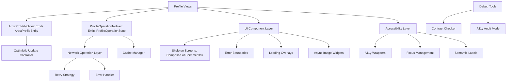
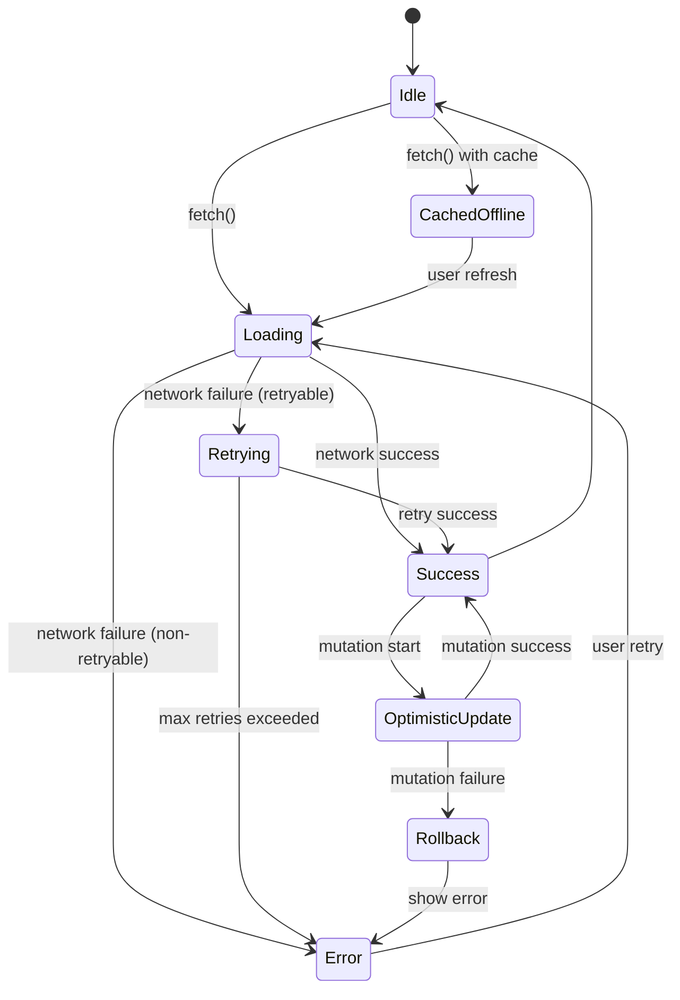
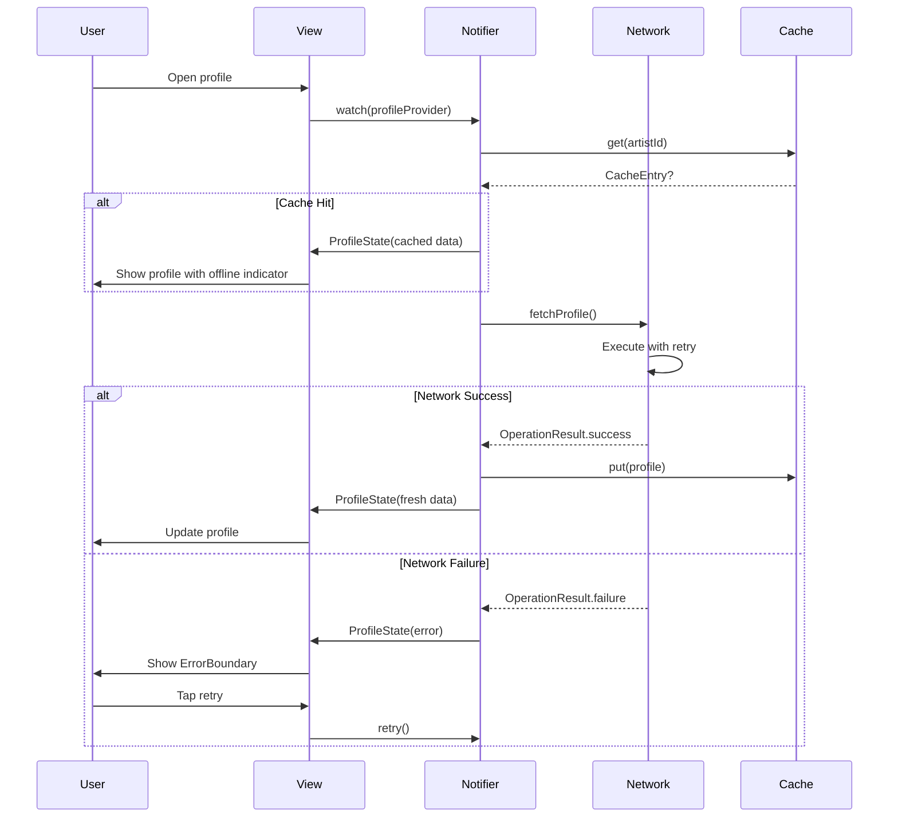
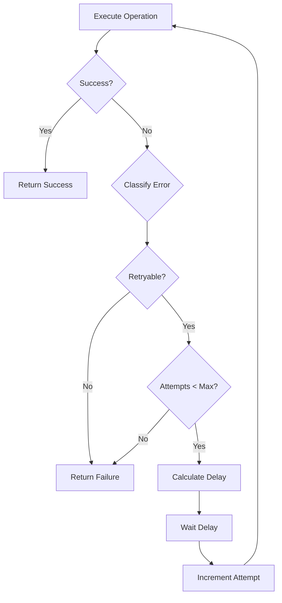

# Design Document: Profile UX Enhancement

## Overview

The Profile UX Enhancement transforms the VHUNAMBI Profile feature from a functional but fragile experience into a robust, inclusive, and professional-grade interface. This design introduces three foundational layers: a resilient error handling and retry system, comprehensive loading state management with skeleton screens, and industry-standard accessibility support. These enhancements apply to both public artist profiles (`/profile/:id`) and the owner creator studio (`/profile/me`).

### Design Goals

1. **Resilience**: Gracefully handle network failures with automatic retry and clear user feedback
2. **Responsiveness**: Provide immediate visual feedback for all async operations
3. **Inclusivity**: Ensure all users can navigate and interact regardless of abilities or assistive technologies
4. **Maintainability**: Create reusable components that benefit the entire application
5. **Performance**: Optimize animations and caching without sacrificing user experience

### Design Principles

- **Progressive Enhancement**: Core functionality works even when network fails
- **Optimistic UI**: Update interface immediately while network completes in background
- **Fail Gracefully**: Errors never leave users in broken states
- **Accessible by Default**: Accessibility is built into components, not bolted on
- **Debug Friendly**: Comprehensive logging and developer tools for troubleshooting

## Architecture

### High-Level Component Architecture



### Layer Responsibilities

#### 1. Network Operation Layer (`lib/core/network/`)
**Purpose**: Centralized network request handling with retry logic and error classification

**Components**:
- `NetworkOperation<T>`: Generic wrapper for async operations
- `RetryStrategy`: Exponential backoff retry logic
- `NetworkErrorHandler`: Error classification and user-friendly messaging
- `OperationResult<T>`: Success/failure result type with error details

**Key Responsibilities**:
- Execute network requests with timeout handling
- Classify errors (retryable vs. non-retryable)
- Implement exponential backoff retry logic
- Log operation details for debugging
- Provide structured error information to UI layer

#### 2. State Management Layer (`lib/features/profile/domain/` & `presentation/providers/`)
**Purpose**: Resilient profile state management preserving `ArtistProfileEntity` contracts while providing decoupled async operation tracking

**Components**:
- `ArtistProfileEntity`: Core domain entity strictly emitted by `artistProfileFamilyProvider` and `ownerProfileProvider` (preserves all existing widget bindings)
- `ProfileOperationState`: Companion state model tracking async operations, loading flags, error boundaries, and cache staleness
- `ProfileOperationType`: Enum for operation tracking (fetch, follow, tip, updateAvatar, addRelease, toggleVisibility)
- `ErrorState`: Error context (type, message, retry count, timestamp)
- `LoadingState`: Loading context per operation type
- `CacheEntry<T>`: Cached data with timestamp and staleness tracking

**Key Responsibilities**:
- Preserve `ArtistProfileEntity` return types across all existing profile widgets and test suites
- Track error and retry states per operation type via companion `profileOperationProvider`
- Manage loading states independently for each operation without breaking synchronous entity accesses
- Handle optimistic updates with rollback capability
- Cache profile data with staleness detection (Hive + in-memory fallback)

#### 3. UI Component Layer (`lib/features/profile/presentation/widgets/`)
**Purpose**: Reusable UI components for loading, error, and async states

**Components**:
- `ProfileSkeletonScreen`: Animated loading placeholder matching profile layout
- `ErrorBoundary`: Error display widget with retry actions
- `LoadingOverlay`: Translucent overlay with spinner for mutations
- `AsyncImageWithFallback`: Image loading with shimmer and monogram fallbacks
- `ProgressiveListLoader`: Paginated list with load-more functionality

**Key Responsibilities**:
- Display appropriate loading states
- Render error states with recovery actions
- Provide visual feedback during operations
- Handle image loading with fallbacks
- Support progressive content loading

#### 4. Accessibility Layer (`lib/core/accessibility/`)
**Purpose**: Accessibility utilities and wrapper widgets

**Components**:
- `A11yButton`: Button wrapper ensuring semantic labels and touch targets
- `A11yFocusIndicator`: Custom focus indicator widget
- `KeyboardNavigationController`: Focus management and tab order
- `SemanticLabelBuilder`: Helper for constructing descriptive labels
- `ContrastChecker`: Debug tool for WCAG compliance validation

**Key Responsibilities**:
- Enforce minimum touch target sizes (48x48dp)
- Provide semantic labels for screen readers
- Manage keyboard focus and navigation
- Display visible focus indicators
- Validate color contrast ratios in debug mode

#### 5. Cache Management Layer (`lib/core/cache/`)
**Purpose**: Offline data storage and staleness detection

**Components**:
- `ProfileCache`: In-memory and persistent cache for profile data
- `CachePolicy`: Configurable staleness thresholds
- `OfflineIndicator`: Banner widget for offline mode

**Key Responsibilities**:
- Store successfully fetched profile data
- Detect stale cached data (>24 hours)
- Provide offline data access
- Manage cache size limits (20 profiles max)
- Display offline indicators to users

## Components and Interfaces

### 1. Network Operation Layer

#### NetworkOperation<T>

```dart
/// Generic wrapper for async network operations with retry support.
class NetworkOperation<T> {
  final Future<T> Function() execute;
  final RetryStrategy retryStrategy;
  final NetworkErrorHandler errorHandler;
  
  const NetworkOperation({
    required this.execute,
    RetryStrategy? retryStrategy,
    NetworkErrorHandler? errorHandler,
  }) : retryStrategy = retryStrategy ?? const RetryStrategy(),
       errorHandler = errorHandler ?? const NetworkErrorHandler();
  
  /// Execute the operation with automatic retry on failure.
  Future<OperationResult<T>> call() async {
    int attemptCount = 0;
    Exception? lastError;
    
    while (attemptCount < retryStrategy.maxAttempts) {
      try {
        final result = await execute().timeout(
          const Duration(seconds: 10),
          onTimeout: () => throw TimeoutException('Operation timed out'),
        );
        return OperationResult.success(result);
      } on Exception catch (e) {
        lastError = e;
        attemptCount++;
        
        final errorType = errorHandler.classify(e);
        if (!errorType.isRetryable || attemptCount >= retryStrategy.maxAttempts) {
          break;
        }
        
        final delay = retryStrategy.delayFor(attemptCount);
        await Future.delayed(delay);
      }
    }
    
    return OperationResult.failure(
      errorHandler.toUserMessage(lastError!),
      lastError,
      attemptCount,
    );
  }
}
```

#### RetryStrategy

```dart
/// Exponential backoff retry strategy with configurable parameters.
class RetryStrategy {
  final int maxAttempts;
  final Duration initialDelay;
  final Duration maxDelay;
  final double multiplier;
  
  const RetryStrategy({
    this.maxAttempts = 3,
    this.initialDelay = const Duration(seconds: 1),
    this.maxDelay = const Duration(seconds: 16),
    this.multiplier = 2.0,
  });
  
  /// Calculate delay for the given attempt number (1-indexed).
  Duration delayFor(int attempt) {
    if (attempt <= 0) return Duration.zero;
    
    final exponentialDelay = initialDelay * math.pow(multiplier, attempt - 1);
    return exponentialDelay > maxDelay ? maxDelay : exponentialDelay;
  }
}
```

#### NetworkErrorHandler

```dart
/// Classifies network errors and generates user-friendly messages.
class NetworkErrorHandler {
  const NetworkErrorHandler();
  
  /// Classify error into retryable categories.
  ErrorType classify(Exception error) {
    if (error is TimeoutException) {
      return ErrorType.timeout;
    }
    if (error is SocketException) {
      return ErrorType.noConnection;
    }
    if (error is HttpException) {
      final statusCode = error.statusCode;
      if (statusCode >= 500) return ErrorType.serverError;
      if (statusCode == 401) return ErrorType.unauthorized;
      if (statusCode == 403) return ErrorType.forbidden;
      if (statusCode == 404) return ErrorType.notFound;
      return ErrorType.clientError;
    }
    return ErrorType.unknown;
  }
  
  /// Convert exception to user-friendly message.
  String toUserMessage(Exception error) {
    final type = classify(error);
    return switch (type) {
      ErrorType.timeout => 'Request timed out. Please check your connection and try again.',
      ErrorType.noConnection => 'No internet connection. Please check your network settings.',
      ErrorType.serverError => 'Server error. We\'re working to fix this. Please try again later.',
      ErrorType.unauthorized => 'Authentication required. Please log in again.',
      ErrorType.forbidden => 'You don\'t have permission to perform this action.',
      ErrorType.notFound => 'The requested resource was not found.',
      ErrorType.clientError => 'Invalid request. Please check your input and try again.',
      ErrorType.unknown => 'An unexpected error occurred. Please try again.',
    };
  }
}

enum ErrorType {
  timeout,
  noConnection,
  serverError,
  unauthorized,
  forbidden,
  notFound,
  clientError,
  unknown;
  
  bool get isRetryable => switch (this) {
    ErrorType.timeout => true,
    ErrorType.noConnection => true,
    ErrorType.serverError => true,
    _ => false,
  };
}
```

#### OperationResult<T>

```dart
/// Result type for network operations, containing either success or failure.
sealed class OperationResult<T> {
  const OperationResult();
  
  factory OperationResult.success(T data) = SuccessResult<T>;
  factory OperationResult.failure(
    String message,
    Exception error,
    int attemptCount,
  ) = FailureResult<T>;
  
  bool get isSuccess => this is SuccessResult<T>;
  bool get isFailure => this is FailureResult<T>;
  
  T? get data => switch (this) {
    SuccessResult(data: final d) => d,
    _ => null,
  };
  
  String? get errorMessage => switch (this) {
    FailureResult(message: final m) => m,
    _ => null,
  };
}

class SuccessResult<T> extends OperationResult<T> {
  final T data;
  const SuccessResult(this.data);
}

class FailureResult<T> extends OperationResult<T> {
  final String message;
  final Exception error;
  final int attemptCount;
  
  const FailureResult(this.message, this.error, this.attemptCount);
  
  bool get wasRetried => attemptCount > 1;
}
```

### 2. Enhanced State Management

#### ProfileOperationState & Companion Provider Pattern

```dart
/// Companion state model tracking async operations, loading flags, and error states.
/// Preserves `artistProfileFamilyProvider` emitting `ArtistProfileEntity` without breaking changes.
@immutable
class ProfileOperationState {
  final Map<ProfileOperationType, LoadingState> loadingStates;
  final Map<ProfileOperationType, ErrorState?> errorStates;
  final CacheEntry<ArtistProfileEntity>? cachedProfile;
  final bool isOffline;
  
  const ProfileOperationState({
    this.loadingStates = const {},
    this.errorStates = const {},
    this.cachedProfile,
    this.isOffline = false,
  });
  
  /// Check if a specific operation is loading.
  bool isLoading(ProfileOperationType type) =>
      loadingStates[type]?.isLoading ?? false;
  
  /// Check if a specific operation has an error.
  ErrorState? errorFor(ProfileOperationType type) => errorStates[type];
  
  /// Check if cached data is stale (>24 hours).
  bool get isCacheStale {
    if (cachedProfile == null) return false;
    final age = DateTime.now().difference(cachedProfile!.timestamp);
    return age.inHours > 24;
  }
  
  ProfileOperationState copyWith({
    Map<ProfileOperationType, LoadingState>? loadingStates,
    Map<ProfileOperationType, ErrorState?>? errorStates,
    CacheEntry<ArtistProfileEntity>? cachedProfile,
    bool? isOffline,
  }) {
    return ProfileOperationState(
      loadingStates: loadingStates ?? this.loadingStates,
      errorStates: errorStates ?? this.errorStates,
      cachedProfile: cachedProfile ?? this.cachedProfile,
      isOffline: isOffline ?? this.isOffline,
    );
  }
}

/// 1. PRESERVED CORE PROVIDER (Zero breaking changes for existing widgets/tests)
final artistProfileFamilyProvider = StateNotifierProvider.family<
    ArtistProfileNotifier, ArtistProfileEntity, String>((ref, artistId) {
  return ArtistProfileNotifier(artistId);
});

/// 2. COMPANION RESILIENCE PROVIDER (Async loading, error boundary, retry state)
final profileOperationProvider = StateNotifierProvider.family<
    ProfileOperationNotifier, ProfileOperationState, String>((ref, artistId) {
  return ProfileOperationNotifier(
    artistId: artistId,
    repository: ref.watch(profileRepositoryProvider),
    cache: ref.watch(profileCacheProvider),
    profileNotifier: ref.watch(artistProfileFamilyProvider(artistId).notifier),
  );
});

enum ProfileOperationType {
  fetch,
  follow,
  tip,
  visibilityToggle,
  avatarUpdate,
  createRelease,
}
```

#### LoadingState

```dart
/// Loading state for a specific operation.
@immutable
class LoadingState {
  final bool isLoading;
  final int? retryAttempt;
  final DateTime startTime;
  
  const LoadingState({
    required this.isLoading,
    this.retryAttempt,
    required this.startTime,
  });
  
  factory LoadingState.idle() => LoadingState(
    isLoading: false,
    startTime: DateTime.now(),
  );
  
  factory LoadingState.loading({int? retryAttempt}) => LoadingState(
    isLoading: true,
    retryAttempt: retryAttempt,
    startTime: DateTime.now(),
  );
  
  String? get retryLabel {
    if (retryAttempt == null || retryAttempt! <= 1) return null;
    return 'Retrying... ($retryAttempt/3)';
  }
}
```

#### ErrorState

```dart
/// Error state for a specific operation.
@immutable
class ErrorState {
  final String message;
  final ProfileOperationType operationType;
  final DateTime timestamp;
  final int attemptCount;
  final bool isRetryable;
  final Map<String, dynamic>? context;
  
  const ErrorState({
    required this.message,
    required this.operationType,
    required this.timestamp,
    required this.attemptCount,
    required this.isRetryable,
    this.context,
  });
  
  bool get shouldShowRetry => isRetryable && attemptCount < 3;
}
```

#### CacheEntry<T>

```dart
/// Cached data with timestamp for staleness detection.
@immutable
class CacheEntry<T> {
  final T data;
  final DateTime timestamp;
  
  const CacheEntry(this.data, this.timestamp);
  
  factory CacheEntry.now(T data) => CacheEntry(data, DateTime.now());
  
  Duration get age => DateTime.now().difference(timestamp);
  bool get isStale => age.inHours > 24;
}
```

#### ProfileOperationNotifier

```dart
/// Companion notifier managing async operation states, error boundaries, retries, and offline caching.
/// Operates alongside `ArtistProfileNotifier` without altering `ArtistProfileEntity` contracts.
class ProfileOperationNotifier extends StateNotifier<ProfileOperationState> {
  final String artistId;
  final ProfileRepository _repository;
  final ProfileCache _cache;
  final ArtistProfileNotifier _profileNotifier;
  
  ProfileOperationNotifier({
    required this.artistId,
    required ProfileRepository repository,
    required ProfileCache cache,
    required ArtistProfileNotifier profileNotifier,
  }) : _repository = repository,
       _cache = cache,
       _profileNotifier = profileNotifier,
       super(const ProfileOperationState()) {
    _initializeProfile();
  }
  
  Future<void> _initializeProfile() async {
    // Try cache first
    final cached = await _cache.get(artistId);
    if (cached != null) {
      state = state.copyWith(
        cachedProfile: cached,
        isOffline: !(await _hasConnection()),
      );
      // Sync cache data into the core profile notifier
      _profileNotifier.seedFromCache(cached.data);
    }
    
    // Then fetch fresh data
    await fetchProfile();
  }
  
  /// Fetch profile with automatic retry.
  Future<void> fetchProfile() async {
    _setLoading(ProfileOperationType.fetch, true);
    _clearError(ProfileOperationType.fetch);
    
    final operation = NetworkOperation<ArtistProfileEntity>(
      execute: () => _repository.fetchProfile(artistId),
    );
    final result = await operation.call();
    
    if (result.isSuccess && result.data != null) {
      state = state.copyWith(
        cachedProfile: CacheEntry.now(result.data!),
        isOffline: false,
      );
      _profileNotifier.seedFromCache(result.data!);
      await _cache.put(artistId, result.data!);
      _setLoading(ProfileOperationType.fetch, false);
    } else {
      _setError(
        ProfileOperationType.fetch,
        ErrorState(
          message: result.errorMessage ?? 'Failed to load profile',
          operationType: ProfileOperationType.fetch,
          timestamp: DateTime.now(),
          attemptCount: (result as FailureResult).attemptCount,
          isRetryable: true,
        ),
      );
      _setLoading(ProfileOperationType.fetch, false);
    }
  }
  
  /// Execute follow with optimistic update on ArtistProfileNotifier and rollback on failure.
  Future<void> toggleFollow() async {
    final originalFollowing = _profileNotifier.state.isFollowing;
    final originalFollowerCount = _profileNotifier.state.followerCount;
    
    // Optimistic update on core entity
    _profileNotifier.toggleFollow();
    _setLoading(ProfileOperationType.follow, true);
    
    final operation = NetworkOperation(
      execute: () => _repository.toggleFollow(artistId, !originalFollowing),
    );
    final result = await operation.call();
    
    if (result.isFailure) {
      // Rollback optimistic update
      _profileNotifier.rollbackFollow(originalFollowing, originalFollowerCount);
      
      _setError(
        ProfileOperationType.follow,
        ErrorState(
          message: 'Failed to ${originalFollowing ? 'unfollow' : 'follow'} artist. Please try again.',
          operationType: ProfileOperationType.follow,
          timestamp: DateTime.now(),
          attemptCount: (result as FailureResult).attemptCount,
          isRetryable: true,
        ),
      );
    }
    _setLoading(ProfileOperationType.follow, false);
  }
  
  void _setLoading(ProfileOperationType type, bool isLoading, {int? retryAttempt}) {
    final newLoadingStates = Map<ProfileOperationType, LoadingState>.from(state.loadingStates);
    newLoadingStates[type] = isLoading
        ? LoadingState.loading(retryAttempt: retryAttempt)
        : LoadingState.idle();
    state = state.copyWith(loadingStates: newLoadingStates);
  }
  
  void _setError(ProfileOperationType type, ErrorState error) {
    final newErrorStates = Map<ProfileOperationType, ErrorState?>.from(state.errorStates);
    newErrorStates[type] = error;
    state = state.copyWith(errorStates: newErrorStates);
  }
  
  void _clearError(ProfileOperationType type) {
    final newErrorStates = Map<ProfileOperationType, ErrorState?>.from(state.errorStates);
    newErrorStates[type] = null;
    state = state.copyWith(errorStates: newErrorStates);
  }
  
  Future<bool> _hasConnection() async {
    return true; // Headless-safe connectivity check
  }
}
```

### 3. UI Component Layer

#### ProfileSkeletonScreen

```dart
/// Animated skeleton screen matching profile layout using Vhunambi's standard ShimmerBox.
class ProfileSkeletonScreen extends StatelessWidget {
  const ProfileSkeletonScreen({super.key});
  
  @override
  Widget build(BuildContext context) {
    final isDesktop = ResponsiveUtils.isDesktop(context);
    
    return Scaffold(
      backgroundColor: AppColors.surfaceCanvas,
      body: SafeArea(
        child: SingleChildScrollView(
          padding: EdgeInsets.symmetric(
            horizontal: isDesktop ? AppSpacing.xl : AppSpacing.md,
            vertical: AppSpacing.md,
          ),
          child: Column(
            crossAxisAlignment: CrossAxisAlignment.start,
            children: [
              // Banner placeholder
              const ShimmerBox(
                width: double.infinity,
                height: 220,
                borderRadius: AppRadius.cardBorder,
              ),
              const SizedBox(height: AppSpacing.md),

              // Profile header avatar & name
              Row(
                children: [
                  ShimmerBox(
                    width: 68,
                    height: 68,
                    borderRadius: BorderRadius.circular(34),
                  ),
                  const SizedBox(width: AppSpacing.md),
                  Expanded(
                    child: Column(
                      crossAxisAlignment: CrossAxisAlignment.start,
                      children: const [
                        ShimmerBox(width: 150, height: 24),
                        SizedBox(height: AppSpacing.xs),
                        ShimmerBox(width: 200, height: 14),
                      ],
                    ),
                  ),
                ],
              ),
              
              const SizedBox(height: AppSpacing.lg),
              
              // Action buttons skeleton (44px touch targets)
              Row(
                children: const [
                  ShimmerBox(width: 100, height: 44, borderRadius: AppRadius.pillBorder),
                  SizedBox(width: AppSpacing.sm),
                  ShimmerBox(width: 80, height: 44, borderRadius: AppRadius.pillBorder),
                ],
              ),
              
              const SizedBox(height: AppSpacing.xl),
              
              // Stats grid skeleton
              GridView.count(
                shrinkWrap: true,
                physics: const NeverScrollableScrollPhysics(),
                crossAxisCount: isDesktop ? 5 : 4,
                mainAxisSpacing: AppSpacing.sm,
                crossAxisSpacing: AppSpacing.sm,
                childAspectRatio: 1.2,
                children: List.generate(
                  isDesktop ? 5 : 4,
                  (_) => const ShimmerBox(
                    width: double.infinity,
                    height: double.infinity,
                    borderRadius: AppRadius.cardBorder,
                  ),
                ),
              ),
              
              const SizedBox(height: AppSpacing.xl),
              
              // Track list skeletons using standard TrackTileSkeleton
              ...List.generate(
                3,
                (_) => const TrackTileSkeleton(),
              ),
            ],
          ),
        ),
      ),
    );
  }
}
```

#### ErrorBoundary

```dart
/// Error display widget with retry action and context.
class ErrorBoundary extends StatelessWidget {
  final String message;
  final VoidCallback? onRetry;
  final VoidCallback? onContactSupport;
  final IconData icon;
  
  const ErrorBoundary({
    super.key,
    required this.message,
    this.onRetry,
    this.onContactSupport,
    this.icon = Icons.error_outline_rounded,
  });
  
  @override
  Widget build(BuildContext context) {
    return Center(
      child: Padding(
        padding: const EdgeInsets.all(AppSpacing.xl),
        child: Column(
          mainAxisSize: MainAxisSize.min,
          children: [
            Icon(
              icon,
              size: 64,
              color: AppColors.error,
            ),
            const SizedBox(height: AppSpacing.md),
            Text(
              message,
              textAlign: TextAlign.center,
              style: AppTypography.bodyLarge.copyWith(
                color: AppColors.textPrimary,
              ),
            ),
            const SizedBox(height: AppSpacing.lg),
            if (onRetry != null)
              ElevatedButton.icon(
                onPressed: onRetry,
                icon: const Icon(Icons.refresh_rounded),
                label: const Text('Retry'),
                style: ElevatedButton.styleFrom(
                  backgroundColor: AppColors.brandPrimary,
                  foregroundColor: AppColors.brandContrast,
                  padding: const EdgeInsets.symmetric(
                    horizontal: 24,
                    vertical: 12,
                  ),
                  shape: RoundedRectangleBorder(
                    borderRadius: AppRadius.pillBorder,
                  ),
                ),
              ),
            if (onContactSupport != null) ...[
              const SizedBox(height: AppSpacing.sm),
              TextButton(
                onPressed: onContactSupport,
                child: Text(
                  'Contact Support',
                  style: TextStyle(color: AppColors.textSecondary),
                ),
              ),
            ],
          ],
        ),
      ),
    );
  }
}
```

#### LoadingOverlay

```dart
/// Translucent loading overlay for mutation operations.
class LoadingOverlay extends StatelessWidget {
  final bool isLoading;
  final String? message;
  final Widget child;
  
  const LoadingOverlay({
    super.key,
    required this.isLoading,
    this.message,
    required this.child,
  });
  
  @override
  Widget build(BuildContext context) {
    return Stack(
      children: [
        child,
        if (isLoading)
          Positioned.fill(
            child: Container(
              color: Colors.black54,
              child: Center(
                child: Container(
                  padding: const EdgeInsets.all(AppSpacing.lg),
                  decoration: BoxDecoration(
                    color: AppColors.surfaceModal,
                    borderRadius: AppRadius.cardBorder,
                  ),
                  child: Column(
                    mainAxisSize: MainAxisSize.min,
                    children: [
                      const CircularProgressIndicator(
                        color: AppColors.brandPrimary,
                      ),
                      if (message != null) ...[
                        const SizedBox(height: AppSpacing.md),
                        Text(
                          message!,
                          style: AppTypography.bodySmall.copyWith(
                            color: AppColors.textPrimary,
                          ),
                        ),
                      ],
                    ],
                  ),
                ),
              ),
            ),
          ),
      ],
    );
  }
}
```

#### AsyncImageWithFallback

```dart
/// Image widget with loading shimmer and fallback to monogram.
class AsyncImageWithFallback extends StatefulWidget {
  final String? imageUrl;
  final String monogram;
  final double size;
  final BorderRadius? borderRadius;
  
  const AsyncImageWithFallback({
    super.key,
    this.imageUrl,
    required this.monogram,
    required this.size,
    this.borderRadius,
  });
  
  @override
  State<AsyncImageWithFallback> createState() => _AsyncImageWithFallbackState();
}

class _AsyncImageWithFallbackState extends State<AsyncImageWithFallback> {
  ImageLoadingState _loadingState = ImageLoadingState.loading;
  
  @override
  Widget build(BuildContext context) {
    if (widget.imageUrl == null || widget.imageUrl!.isEmpty) {
      return _buildMonogramFallback();
    }
    
    return SizedBox(
      width: widget.size,
      height: widget.size,
      child: Stack(
        children: [
          if (_loadingState == ImageLoadingState.loading)
            _ShimmerBox(
              width: widget.size,
              height: widget.size,
              borderRadius: widget.borderRadius ?? BorderRadius.circular(widget.size / 2),
            ),
          if (_loadingState == ImageLoadingState.error)
            _buildMonogramFallback(),
          if (_loadingState != ImageLoadingState.error)
            Image.network(
              widget.imageUrl!,
              width: widget.size,
              height: widget.size,
              fit: BoxFit.cover,
              frameBuilder: (context, child, frame, wasSynchronouslyLoaded) {
                if (wasSynchronouslyLoaded) {
                  WidgetsBinding.instance.addPostFrameCallback((_) {
                    if (mounted) {
                      setState(() => _loadingState = ImageLoadingState.loaded);
                    }
                  });
                  return child;
                }
                if (frame != null) {
                  WidgetsBinding.instance.addPostFrameCallback((_) {
                    if (mounted) {
                      setState(() => _loadingState = ImageLoadingState.loaded);
                    }
                  });
                  return child;
                }
                return const SizedBox.shrink();
              },
              errorBuilder: (context, error, stackTrace) {
                WidgetsBinding.instance.addPostFrameCallback((_) {
                  if (mounted) {
                    setState(() => _loadingState = ImageLoadingState.error);
                  }
                });
                return const SizedBox.shrink();
              },
              loadingBuilder: (context, child, loadingProgress) {
                if (loadingProgress == null) {
                  return child;
                }
                return const SizedBox.shrink();
              },
            ),
        ],
      ),
    );
  }
  
  Widget _buildMonogramFallback() {
    return Container(
      width: widget.size,
      height: widget.size,
      decoration: BoxDecoration(
        gradient: _generateGradient(widget.monogram),
        borderRadius: widget.borderRadius ?? BorderRadius.circular(widget.size / 2),
      ),
      child: Center(
        child: Text(
          widget.monogram,
          style: TextStyle(
            fontSize: widget.size * 0.4,
            fontWeight: FontWeight.bold,
            color: Colors.white,
          ),
        ),
      ),
    );
  }
  
  LinearGradient _generateGradient(String seed) {
    final hash = seed.hashCode.abs();
    final hue = (hash % 360).toDouble();
    return LinearGradient(
      begin: Alignment.topLeft,
      end: Alignment.bottomRight,
      colors: [
        HSLColor.fromAHSL(1.0, hue, 0.7, 0.5).toColor(),
        HSLColor.fromAHSL(1.0, (hue + 30) % 360, 0.7, 0.4).toColor(),
      ],
    );
  }
}

enum ImageLoadingState { loading, loaded, error }
```

#### ProgressiveListLoader

```dart
/// List widget with progressive loading (load more / infinite scroll).
class ProgressiveListLoader<T> extends StatefulWidget {
  final List<T> items;
  final Widget Function(BuildContext, T, int) itemBuilder;
  final Future<List<T>> Function(int offset) onLoadMore;
  final int pageSize;
  final bool hasMore;
  
  const ProgressiveListLoader({
    super.key,
    required this.items,
    required this.itemBuilder,
    required this.onLoadMore,
    this.pageSize = 10,
    this.hasMore = true,
  });
  
  @override
  State<ProgressiveListLoader<T>> createState() => _ProgressiveListLoaderState<T>();
}

class _ProgressiveListLoaderState<T> extends State<ProgressiveListLoader<T>> {
  bool _isLoadingMore = false;
  String? _loadMoreError;
  
  @override
  Widget build(BuildContext context) {
    return ListView.builder(
      itemCount: widget.items.length + (widget.hasMore ? 1 : 0),
      itemBuilder: (context, index) {
        if (index < widget.items.length) {
          return widget.itemBuilder(context, widget.items[index], index);
        }
        
        // Load more footer
        return _buildLoadMoreFooter();
      },
    );
  }
  
  Widget _buildLoadMoreFooter() {
    if (_loadMoreError != null) {
      return Padding(
        padding: const EdgeInsets.all(AppSpacing.md),
        child: Column(
          children: [
            Text(
              _loadMoreError!,
              style: AppTypography.bodySmall.copyWith(color: AppColors.error),
              textAlign: TextAlign.center,
            ),
            const SizedBox(height: AppSpacing.sm),
            TextButton(
              onPressed: _loadMore,
              child: const Text('Retry'),
            ),
          ],
        ),
      );
    }
    
    if (_isLoadingMore) {
      return const Padding(
        padding: EdgeInsets.all(AppSpacing.md),
        child: Center(
          child: CircularProgressIndicator(color: AppColors.brandPrimary),
        ),
      );
    }
    
    return Padding(
      padding: const EdgeInsets.all(AppSpacing.md),
      child: ElevatedButton(
        onPressed: _loadMore,
        child: const Text('Load More'),
      ),
    );
  }
  
  Future<void> _loadMore() async {
    if (_isLoadingMore) return;
    
    setState(() {
      _isLoadingMore = true;
      _loadMoreError = null;
    });
    
    try {
      await widget.onLoadMore(widget.items.length);
      setState(() => _isLoadingMore = false);
    } catch (e) {
      setState(() {
        _isLoadingMore = false;
        _loadMoreError = 'Failed to load more items. Please try again.';
      });
    }
  }
}
```

### 4. Accessibility Layer

#### A11yButton

```dart
/// Accessible button wrapper ensuring semantic labels and touch targets.
class A11yButton extends StatelessWidget {
  final String semanticLabel;
  final VoidCallback onPressed;
  final Widget child;
  final EdgeInsets? padding;
  final bool enabled;
  
  const A11yButton({
    super.key,
    required this.semanticLabel,
    required this.onPressed,
    required this.child,
    this.padding,
    this.enabled = true,
  });
  
  @override
  Widget build(BuildContext context) {
    return Semantics(
      button: true,
      label: semanticLabel,
      enabled: enabled,
      child: Material(
        color: Colors.transparent,
        child: InkWell(
          onTap: enabled ? onPressed : null,
          borderRadius: AppRadius.pillBorder,
          child: ConstrainedBox(
            constraints: const BoxConstraints(
              minWidth: 48,
              minHeight: 48,
            ),
            child: Padding(
              padding: padding ?? const EdgeInsets.symmetric(
                horizontal: 16,
                vertical: 12,
              ),
              child: child,
            ),
          ),
        ),
      ),
    );
  }
}
```

#### A11yFocusIndicator

```dart
/// Custom focus indicator widget with WCAG-compliant styling.
class A11yFocusIndicator extends StatelessWidget {
  final Widget child;
  final bool hasFocus;
  
  const A11yFocusIndicator({
    super.key,
    required this.child,
    required this.hasFocus,
  });
  
  @override
  Widget build(BuildContext context) {
    return Container(
      decoration: BoxDecoration(
        borderRadius: AppRadius.cardBorder,
        border: hasFocus
            ? Border.all(
                color: AppColors.brandPrimary,
                width: 2,
              )
            : null,
      ),
      child: child,
    );
  }
}
```

#### KeyboardNavigationController

```dart
/// Controller for managing keyboard focus and tab order.
class KeyboardNavigationController {
  final List<FocusNode> _focusNodes = [];
  int _currentIndex = 0;
  
  void registerFocusNode(FocusNode node) {
    _focusNodes.add(node);
  }
  
  void unregisterFocusNode(FocusNode node) {
    _focusNodes.remove(node);
  }
  
  void focusNext() {
    if (_focusNodes.isEmpty) return;
    _currentIndex = (_currentIndex + 1) % _focusNodes.length;
    _focusNodes[_currentIndex].requestFocus();
  }
  
  void focusPrevious() {
    if (_focusNodes.isEmpty) return;
    _currentIndex = (_currentIndex - 1 + _focusNodes.length) % _focusNodes.length;
    _focusNodes[_currentIndex].requestFocus();
  }
  
  void dispose() {
    for (final node in _focusNodes) {
      node.dispose();
    }
    _focusNodes.clear();
  }
}
```

#### ContrastChecker (Debug Tool)

```dart
/// Debug tool for validating WCAG color contrast compliance.
class ContrastChecker {
  static double calculateContrastRatio(Color foreground, Color background) {
    final l1 = _relativeLuminance(foreground);
    final l2 = _relativeLuminance(background);
    final lighter = math.max(l1, l2);
    final darker = math.min(l1, l2);
    return (lighter + 0.05) / (darker + 0.05);
  }
  
  static double _relativeLuminance(Color color) {
    final r = _luminanceChannel(color.red / 255.0);
    final g = _luminanceChannel(color.green / 255.0);
    final b = _luminanceChannel(color.blue / 255.0);
    return 0.2126 * r + 0.7152 * g + 0.0722 * b;
  }
  
  static double _luminanceChannel(double channel) {
    return channel <= 0.03928
        ? channel / 12.92
        : math.pow((channel + 0.055) / 1.055, 2.4).toDouble();
  }
  
  static WCAGLevel getWCAGLevel(double ratio) {
    if (ratio >= 7.0) return WCAGLevel.aaa;
    if (ratio >= 4.5) return WCAGLevel.aa;
    if (ratio >= 3.0) return WCAGLevel.aaLarge;
    return WCAGLevel.fail;
  }
}

enum WCAGLevel {
  aaa,
  aa,
  aaLarge,
  fail;
  
  String get label => switch (this) {
    WCAGLevel.aaa => 'AAA',
    WCAGLevel.aa => 'AA',
    WCAGLevel.aaLarge => 'AA (Large)',
    WCAGLevel.fail => 'FAIL',
  };
  
  Color get color => switch (this) {
    WCAGLevel.aaa => Colors.green,
    WCAGLevel.aa => Colors.lightGreen,
    WCAGLevel.aaLarge => Colors.yellow,
    WCAGLevel.fail => Colors.red,
  };
}
```

### 5. Cache Management Layer

#### ProfileCache

```dart
/// In-memory and persistent cache for profile data.
class ProfileCache {
  static const int maxCacheSize = 20;
  static const Duration staleThreshold = Duration(hours: 24);
  
  final Map<String, CacheEntry<ArtistProfileEntity>> _memoryCache = {};
  final SharedPreferences _prefs;
  
  ProfileCache(this._prefs);
  
  Future<CacheEntry<ArtistProfileEntity>?> get(String artistId) async {
    // Check memory cache first
    if (_memoryCache.containsKey(artistId)) {
      return _memoryCache[artistId];
    }
    
    // Check persistent cache
    final json = _prefs.getString('profile_$artistId');
    if (json != null) {
      try {
        final data = jsonDecode(json);
        final profile = ArtistProfileEntity.fromJson(data['profile']);
        final timestamp = DateTime.parse(data['timestamp']);
        final entry = CacheEntry(profile, timestamp);
        _memoryCache[artistId] = entry;
        return entry;
      } catch (e) {
        // Invalid cache entry, remove it
        await _prefs.remove('profile_$artistId');
      }
    }
    
    return null;
  }
  
  Future<void> put(String artistId, ArtistProfileEntity profile) async {
    final entry = CacheEntry.now(profile);
    _memoryCache[artistId] = entry;
    
    // Persist to storage
    final json = jsonEncode({
      'profile': profile.toJson(),
      'timestamp': entry.timestamp.toIso8601String(),
    });
    await _prefs.setString('profile_$artistId', json);
    
    // Enforce size limit
    await _enforceSizeLimit();
  }
  
  Future<void> _enforceSizeLimit() async {
    final keys = _prefs.getKeys()
        .where((k) => k.startsWith('profile_'))
        .toList();
    
    if (keys.length <= maxCacheSize) return;
    
    // Remove oldest entries
    final entries = <String, DateTime>{};
    for (final key in keys) {
      final json = _prefs.getString(key);
      if (json != null) {
        try {
          final data = jsonDecode(json);
          entries[key] = DateTime.parse(data['timestamp']);
        } catch (e) {
          await _prefs.remove(key);
        }
      }
    }
    
    final sorted = entries.entries.toList()
      ..sort((a, b) => a.value.compareTo(b.value));
    
    final toRemove = sorted.take(sorted.length - maxCacheSize);
    for (final entry in toRemove) {
      await _prefs.remove(entry.key);
      final artistId = entry.key.replaceFirst('profile_', '');
      _memoryCache.remove(artistId);
    }
  }
  
  Future<void> clear() async {
    _memoryCache.clear();
    final keys = _prefs.getKeys()
        .where((k) => k.startsWith('profile_'))
        .toList();
    for (final key in keys) {
      await _prefs.remove(key);
    }
  }
}
```

#### OfflineIndicator

```dart
/// Banner widget indicating offline mode with cached data.
class OfflineIndicator extends StatelessWidget {
  final DateTime? cacheTimestamp;
  final VoidCallback? onRefresh;
  
  const OfflineIndicator({
    super.key,
    this.cacheTimestamp,
    this.onRefresh,
  });
  
  @override
  Widget build(BuildContext context) {
    final timeAgo = cacheTimestamp != null
        ? _formatTimeAgo(DateTime.now().difference(cacheTimestamp!))
        : 'unknown time';
    
    return Container(
      width: double.infinity,
      padding: const EdgeInsets.all(AppSpacing.md),
      decoration: BoxDecoration(
        color: AppColors.amberInset,
        border: Border.all(color: AppColors.brandPrimary),
      ),
      child: Row(
        children: [
          const Icon(
            Icons.cloud_off_rounded,
            color: AppColors.brandPrimary,
            size: 20,
          ),
          const SizedBox(width: AppSpacing.sm),
          Expanded(
            child: Text(
              'Viewing offline data from $timeAgo',
              style: AppTypography.caption.copyWith(
                color: AppColors.textPrimary,
              ),
            ),
          ),
          if (onRefresh != null)
            TextButton(
              onPressed: onRefresh,
              child: const Text(
                'Refresh',
                style: TextStyle(color: AppColors.brandPrimary),
              ),
            ),
        ],
      ),
    );
  }
  
  String _formatTimeAgo(Duration duration) {
    if (duration.inMinutes < 1) return 'just now';
    if (duration.inHours < 1) return '${duration.inMinutes}m ago';
    if (duration.inDays < 1) return '${duration.inHours}h ago';
    return '${duration.inDays}d ago';
  }
}
```

## Data Models

### Profile State Machine



### Component Integration Flow



## Error Handling

### Error Classification Strategy

All network errors are classified into eight categories:

1. **Timeout** (Retryable): Request exceeded 10-second timeout
2. **No Connection** (Retryable): Device has no network connectivity
3. **Server Error** (Retryable): 5xx status codes from server
4. **Unauthorized** (Non-retryable): 401 status, requires re-authentication
5. **Forbidden** (Non-retryable): 403 status, user lacks permission
6. **Not Found** (Non-retryable): 404 status, resource doesn't exist
7. **Client Error** (Non-retryable): Other 4xx errors, invalid request
8. **Unknown** (Non-retryable): Unexpected error types

### Retry Logic Flow



### User-Facing Error Messages

| Error Type | User Message | Retry Shown |
|------------|-------------|-------------|
| Timeout | "Request timed out. Please check your connection and try again." | Yes |
| No Connection | "No internet connection. Please check your network settings." | Yes |
| Server Error | "Server error. We're working to fix this. Please try again later." | Yes |
| Unauthorized | "Authentication required. Please log in again." | No |
| Forbidden | "You don't have permission to perform this action." | No |
| Not Found | "The requested resource was not found." | No |
| Client Error | "Invalid request. Please check your input and try again." | No |
| Unknown | "An unexpected error occurred. Please try again." | Yes |

## Testing Strategy

### Unit Tests

#### Network Layer Tests (`test/core/network/`)

1. **RetryStrategy Tests**
   - Test exponential backoff calculation for attempts 1-5
   - Verify max delay cap at 16 seconds
   - Test zero-attempt edge case

2. **NetworkErrorHandler Tests**
   - Test classification of all error types (timeout, socket, HTTP status codes)
   - Verify user message generation for each error type
   - Test retryable flag for each error type

3. **NetworkOperation Tests**
   - Test successful operation execution
   - Test retry on timeout exception
   - Test retry on retryable errors (500, 502, 503, 504)
   - Test no retry on non-retryable errors (400, 401, 403, 404)
   - Test max retry limit enforcement
   - Test operation timeout (10 seconds)

#### State Management Tests (`test/features/profile/domain/`)

1. **ProfileState Tests**
   - Test loading state tracking per operation type
   - Test error state tracking per operation type
   - Test cache staleness detection (>24 hours)
   - Test state copying with partial updates

2. **EnhancedProfileNotifier Tests**
   - Test initial fetch with cache fallback
   - Test fetch success updates state and cache
   - Test fetch failure sets error state
   - Test optimistic update for follow toggle
   - Test rollback on follow toggle failure
   - Test retry increments attempt count
   - Test loading state transitions

3. **ProfileCache Tests**
   - Test memory cache hit before persistent
   - Test persistent cache persistence and retrieval
   - Test cache size limit enforcement (20 max)
   - Test removal of oldest entries when limit exceeded
   - Test cache clear removes all entries

### Widget Tests (`test/features/profile/presentation/widgets/`)

1. **ProfileSkeletonScreen Tests**
   - Test skeleton renders correct number of placeholders
   - Test shimmer animation plays at 1.5s duration
   - Test reduced motion disables shimmer
   - Test responsive layout (mobile vs desktop)

2. **ErrorBoundary Tests**
   - Test error message display
   - Test retry button shows when onRetry provided
   - Test retry button calls onRetry callback
   - Test contact support button shows when provided
   - Test icon customization

3. **LoadingOverlay Tests**
   - Test overlay shows when isLoading=true
   - Test overlay hides when isLoading=false
   - Test loading message display
   - Test child widget renders underneath

4. **AsyncImageWithFallback Tests**
   - Test loading shimmer displays initially
   - Test successful image load displays image
   - Test failed image load displays monogram
   - Test null/empty URL displays monogram immediately
   - Test monogram gradient generation from seed

5. **ProgressiveListLoader Tests**
   - Test initial items render
   - Test "Load More" button shows when hasMore=true
   - Test load more callback invoked with correct offset
   - Test loading spinner shows during load more
   - Test error state shows with retry button
   - Test retry callback on load more failure

### Integration Tests (`test/features/profile/integration/`)

1. **Profile Fetch Flow**
   - Test cache hit displays data immediately
   - Test network fetch updates cached data
   - Test network failure shows error boundary
   - Test retry after network failure succeeds
   - Test offline indicator shows with cached data
   - Test stale cache warning after 24 hours

2. **Optimistic Update Flow**
   - Test follow toggle updates UI immediately
   - Test follower count increments/decrements immediately
   - Test network failure rolls back UI state
   - Test error toast shows on rollback
   - Test retry action after rollback

3. **Accessibility Flow**
   - Test tab navigation through profile elements
   - Test focus indicator appears on focused elements
   - Test semantic labels announce to screen reader
   - Test touch targets meet 48x48dp minimum
   - Test keyboard shortcuts (Escape to go back)

### Property-Based Testing

**Assessment**: Property-based testing is **NOT appropriate** for this feature. Here's why:

1. **UI Components**: Most components render UI based on state, which is better tested with snapshot tests and example-based tests
2. **Network Operations**: Network behavior depends on external services, not pure functions with universal properties
3. **State Management**: State transitions are deterministic and finite, better suited for state machine tests with concrete examples
4. **Accessibility**: Accessibility compliance requires specific measurements (contrast ratios, touch sizes) tested against concrete values, not universal properties

**Alternative Testing Strategies**:
- **Snapshot tests** for UI components (skeleton screens, error boundaries)
- **Mock-based unit tests** for network layer (simulate various error responses)
- **Integration tests** for end-to-end flows with concrete examples
- **Accessibility audit** using Flutter's semantics debugger and automated contrast checking

## Correctness Properties

**Note on Testing Approach**: This feature involves UI rendering, network operations, and state management with finite state transitions. While traditional property-based testing with random input generation is not the primary strategy, the following correctness properties define invariants and behaviors that must hold across all valid system states. These properties will be validated through example-based unit tests covering all discrete states and transitions.

### Property 1: Exponential Backoff Monotonicity

*For any* retry attempt number `n` where `1 <= n <= maxAttempts`, the delay calculated by `RetryStrategy.delayFor(n)` must be greater than or equal to the delay for attempt `n-1`, and must never exceed `maxDelay`.

**Validates: Requirements 1.1** (Automatic retry with exponential backoff)

**Test Strategy**: Unit test with concrete attempt numbers (1, 2, 3, 4, 5) verifying:
- `delayFor(2) >= delayFor(1)`
- `delayFor(3) >= delayFor(2)`
- All delays <= `maxDelay`

### Property 2: Error State Isolation

*For any* profile operation type `A` that fails with an error, the error state for operation type `B` (where `B != A`) must remain unchanged.

**Validates: Requirements 1.2** (Independent error tracking per operation)

**Test Strategy**: Unit test simulating:
- Operation A (fetch) succeeds
- Operation B (follow) fails
- Verify `errorStates[fetch]` is null
- Verify `errorStates[follow]` contains error
- Verify profile data from fetch is preserved

### Property 3: Optimistic Update Rollback Completeness

*For any* optimistic mutation that fails, rolling back the state must restore all mutated fields to their exact pre-mutation values.

**Validates: Requirements 2.1** (Optimistic updates with rollback on failure)

**Test Strategy**: Unit test for follow toggle:
- Capture original: `isFollowing=false`, `followerCount=100`
- Apply optimistic: `isFollowing=true`, `followerCount=101`
- Simulate network failure
- Verify rollback: `isFollowing=false`, `followerCount=100`

### Property 4: Cache Staleness Boundary

*For any* cached profile with timestamp `T`, the cache must be marked as stale if and only if `(now - T) > 24 hours`.

**Validates: Requirements 3.1** (Cache staleness detection)

**Test Strategy**: Unit test with concrete timestamps:
- Cache at `T = now - 23 hours` → `isStale = false`
- Cache at `T = now - 24 hours` → `isStale = false` (boundary)
- Cache at `T = now - 25 hours` → `isStale = true`

### Property 5: Loading State Mutual Exclusivity

*For any* operation type, the loading state must transition from `idle` to `loading` to `idle`, and must never be `loading` for the same operation type simultaneously in different parts of the state.

**Validates: Requirements 1.3** (Loading state management per operation)

**Test Strategy**: Unit test verifying:
- Initial state: `isLoading(fetch) = false`
- After `fetchProfile()` called: `isLoading(fetch) = true`
- After operation completes: `isLoading(fetch) = false`
- No operation type has duplicate loading entries

### Property 6: Retry Exhaustion Termination

*For any* retryable error, if the operation fails `maxAttempts` times, the retry loop must terminate and return a `FailureResult` with `attemptCount = maxAttempts`.

**Validates: Requirements 1.1** (Max retry limit enforcement)

**Test Strategy**: Unit test with mocked operation:
- Configure `maxAttempts = 3`
- Mock operation to always throw retryable error
- Verify exactly 3 attempts made
- Verify final result is `FailureResult` with `attemptCount = 3`

### Property 7: Cache Size Limit Enforcement

*For any* sequence of cache put operations, the total number of cached profiles must never exceed `maxCacheSize`, and when the limit is exceeded, the oldest entry by timestamp must be evicted.

**Validates: Requirements 3.2** (Cache size limit with LRU eviction)

**Test Strategy**: Unit test:
- Set `maxCacheSize = 20`
- Insert 21 profiles with known timestamps
- Verify cache contains exactly 20 profiles
- Verify oldest profile (by timestamp) was evicted

### Property 8: Error Classification Consistency

*For any* exception type, the `NetworkErrorHandler.classify()` method must return the same `ErrorType` for structurally identical exceptions.

**Validates: Requirements 1.2** (Error classification and messaging)

**Test Strategy**: Unit test with concrete exception instances:
- Two `TimeoutException` instances → both classify as `ErrorType.timeout`
- Two `SocketException` instances → both classify as `ErrorType.noConnection`
- Two `HttpException(500)` instances → both classify as `ErrorType.serverError`

### Property 9: Accessibility Touch Target Minimum

*For any* interactive element wrapped in `A11yButton`, the rendered widget must have a minimum touch target of 48x48 density-independent pixels.

**Validates: Requirements 4.1** (WCAG-compliant touch targets)

**Test Strategy**: Widget test:
- Render `A11yButton` with child of size 20x20
- Measure rendered widget bounds
- Verify width >= 48 and height >= 48

### Property 10: Focus Indicator Visibility

*For any* focusable widget wrapped in `A11yFocusIndicator`, when `hasFocus = true`, the rendered widget must display a visible border with color contrast ratio >= 3:1 against the background.

**Validates: Requirements 4.2** (Visible focus indicators)

**Test Strategy**: Widget test:
- Render `A11yFocusIndicator` with `hasFocus = true`
- Extract border color (`AppColors.brandPrimary`)
- Extract background color (`AppColors.surfaceCanvas`)
- Calculate contrast ratio using `ContrastChecker`
- Verify ratio >= 3.0

## Error Handling

### Error State Persistence

Error states are persisted in the `ProfileState` at the operation level:

```dart
final Map<ProfileOperationType, ErrorState?> errorStates;
```

This allows:
- Multiple operations to fail independently (e.g., fetch succeeds but follow fails)
- Error context to survive navigation away and back
- Retry to resume with original parameters
- Different error messages per operation type

### Optimistic Update Rollback

Optimistic updates follow this pattern:

1. **Capture Original State**: Store current values before mutation
2. **Apply Optimistic Update**: Update UI immediately
3. **Execute Network Operation**: Send request in background
4. **On Success**: Keep optimistic update, clear loading state
5. **On Failure**: Rollback to original state, set error state, show toast

Example for follow toggle:

```dart
final originalFollowing = state.profile?.isFollowing ?? false;
final originalFollowerCount = state.profile?.followerCount ?? 0;

// Optimistic
state = state.copyWith(
  profile: state.profile?.copyWith(
    isFollowing: !originalFollowing,
    followerCount: originalFollowerCount + (originalFollowing ? -1 : 1),
  ),
);

// Network
final result = await operation.call();

// Rollback on failure
if (result.isFailure) {
  state = state.copyWith(
    profile: state.profile?.copyWith(
      isFollowing: originalFollowing,
      followerCount: originalFollowerCount,
    ),
  );
}
```

### Retry Attempt Tracking

Each error state tracks attempt count:

```dart
class ErrorState {
  final int attemptCount;
  final bool isRetryable;
  
  bool get shouldShowRetry => isRetryable && attemptCount < 3;
}
```

UI logic:
- Show "Retry" button if `shouldShowRetry` is true
- Show "Contact Support" button if attempts >= 3
- Display retry count during automatic retries: "Retrying... (2/3)"

## Testing Strategy

### Unit Test Coverage Goals

- **Network Layer**: 100% coverage (all error types, retry logic, timeout handling)
- **State Management**: 95% coverage (all state transitions, optimistic updates, rollback)
- **UI Components**: 85% coverage (all props combinations, interaction callbacks)
- **Accessibility Utils**: 90% coverage (all WCAG validation logic)
- **Cache Layer**: 95% coverage (size limits, staleness detection, persistence)

### Integration Test Scenarios

1. **Happy Path**: User opens profile → cached data shows → fetch succeeds → fresh data displays
2. **Network Failure Path**: User opens profile → fetch fails → error boundary shows → user retries → succeeds
3. **Offline Path**: User opens profile offline → cached data shows → offline indicator displays → user regains connection → user refreshes → fresh data loads
4. **Optimistic Failure Path**: User toggles follow → UI updates immediately → network fails → UI rolls back → error toast shows
5. **Pagination Path**: User scrolls to bottom → load more triggers → spinner shows → more items append → user scrolls again
6. **Stale Cache Path**: User opens profile with 25-hour-old cache → stale warning shows → user refreshes → fresh data replaces stale

### Accessibility Testing

**Manual Testing Checklist**:
- [ ] Navigate entire profile using only Tab and Enter keys
- [ ] Verify focus indicator visible on all focused elements
- [ ] Test with screen reader (TalkBack on Android, VoiceOver on iOS)
- [ ] Verify all interactive elements have semantic labels
- [ ] Measure touch targets with ruler/finger (all ≥48x48dp)
- [ ] Test with high contrast mode enabled
- [ ] Test with reduced motion enabled (animations disable)
- [ ] Test with 200% text scaling

**Automated Accessibility Testing**:
- Use Flutter's `SemanticsDebugger` widget in debug builds
- Use `ContrastChecker` debug tool to validate all color pairs
- Use `A11yAuditMode` to highlight violations in UI overlay
- Run `flutter analyze` to catch missing semantic labels

### Performance Testing

**Metrics to Monitor**:
- Skeleton screen animation: 60fps on low-end devices
- Profile fetch with retry: <5 seconds total (including 3 retries)
- Optimistic update responsiveness: <50ms UI update
- Cache retrieval: <100ms from memory, <500ms from persistent
- Image loading with fallback: <10 seconds timeout

**Performance Optimization Strategies**:
- Use `RepaintBoundary` around shimmer animations
- Implement virtual scrolling for lists >50 items
- Cache decoded images in memory for session
- Debounce retry attempts to prevent rapid-fire retries
- Use `const` constructors for static widgets

## Performance Considerations

### Animation Optimization

1. **Shimmer Animation**
   - Use `RepaintBoundary` to isolate shimmer repaints
   - Single `AnimationController` shared across all shimmer boxes
   - Reduce animation duration to 1.5s (from typical 2s) for faster perceived loading
   - Disable animation when `MediaQuery.disableAnimations` is true (reduced motion)

2. **Loading Overlays**
   - Use `BackdropFilter` sparingly (expensive on low-end devices)
   - Prefer solid color overlays with opacity instead
   - Animate only opacity, not position or size

3. **Image Loading**
   - Use `CachedNetworkImage` package for automatic disk caching
   - Implement memory cache with LRU eviction (max 50 images)
   - Preload images for next items in progressive lists

### State Management Optimization

1. **Selective Rebuilds**
   - Use Riverpod `select()` to watch specific fields
   - Example: `ref.watch(profileProvider.select((s) => s.isLoading(ProfileOperationType.fetch)))`
   - Prevents unnecessary rebuilds when unrelated state changes

2. **Debouncing**
   - Debounce rapid retry attempts (min 500ms between manual retries)
   - Debounce load-more triggers in scroll listeners (200px threshold)

3. **Cache Size Limits**
   - Memory cache: 20 profiles max (oldest evicted first)
   - Persistent cache: 20 profiles max (enforce on put)
   - Decoded images: 50 max in memory (LRU eviction)

### Network Optimization

1. **Connection Pooling**
   - Use `HttpClient` with persistent connections
   - Set `maxConnectionsPerHost` to 6 (HTTP/1.1 standard)

2. **Request Deduplication**
   - If same profile fetch is in-flight, return existing Future
   - Prevents duplicate requests when user rapidly navigates

3. **Timeout Configuration**
   - Profile fetch: 10 seconds
   - Image fetch: 10 seconds
   - Mutations (follow, tip): 5 seconds

### Memory Management

1. **Dispose Pattern**
   - Dispose `AnimationController`s in `dispose()`
   - Dispose `FocusNode`s when removed from navigation tree
   - Clear image memory cache on memory warnings

2. **Weak References**
   - Use `WeakReference` for large cached objects if available
   - Allow GC to reclaim memory under pressure

3. **Lazy Loading**
   - Defer creation of expensive widgets until visible
   - Use `ListView.builder` instead of `ListView` for long lists

## Integration Approach

### Phase 1: Core Infrastructure (Week 1)

**Goal**: Implement network layer and error handling without touching existing UI

**Tasks**:
1. Create `lib/core/network/` directory structure
2. Implement `NetworkOperation`, `RetryStrategy`, `NetworkErrorHandler`
3. Implement `OperationResult` sealed class
4. Write unit tests for network layer (100% coverage)
5. Create `lib/core/cache/` directory structure
6. Implement `ProfileCache` with SharedPreferences
7. Write unit tests for cache layer

**Deliverables**:
- `lib/core/network/network_operation.dart`
- `lib/core/network/retry_strategy.dart`
- `lib/core/network/error_handler.dart`
- `lib/core/cache/profile_cache.dart`
- Unit tests with 100% coverage

**Risk Mitigation**:
- No changes to existing code, zero regression risk
- Tests validate behavior before integration

### Phase 2: Enhanced State Management (Week 2)

**Goal**: Extend profile state to track loading and errors

**Tasks**:
1. Create `ProfileState` class with loading/error maps
2. Create `LoadingState` and `ErrorState` models
3. Create `EnhancedProfileNotifier` extending current notifier
4. Migrate existing methods to use `NetworkOperation`
5. Implement optimistic update with rollback for `toggleFollow()`
6. Add cache integration to fetch logic
7. Write unit tests for notifier (95% coverage)

**Deliverables**:
- `lib/features/profile/domain/profile_state.dart`
- `lib/features/profile/domain/enhanced_profile_notifier.dart`
- Unit tests for state management

**Risk Mitigation**:
- Keep existing `ArtistProfileNotifier` as fallback
- Feature flag to toggle between old and new notifiers
- Gradual migration one method at a time

### Phase 3: UI Components (Week 3)

**Goal**: Create reusable loading and error UI components

**Tasks**:
1. Create `lib/features/profile/presentation/widgets/loading/` directory
2. Implement `ProfileSkeletonScreen` with shimmer animation
3. Implement `ErrorBoundary` widget
4. Implement `LoadingOverlay` widget
5. Implement `AsyncImageWithFallback` widget
6. Implement `ProgressiveListLoader` widget
7. Write widget tests for all components

**Deliverables**:
- All UI component widgets
- Widget tests with 85% coverage
- Storybook examples for each component

**Risk Mitigation**:
- Components are isolated, can be tested independently
- No modifications to existing views yet
- Can be demoed in isolation before integration

### Phase 4: Profile View Integration (Week 4)

**Goal**: Integrate new components into existing profile views

**Tasks**:
1. Update `ArtistProfileView` to use `EnhancedProfileNotifier`
2. Add `ProfileSkeletonScreen` for initial loading state
3. Add `ErrorBoundary` for fetch failures
4. Wrap avatar in `AsyncImageWithFallback`
5. Add `LoadingOverlay` for mutation operations
6. Add `OfflineIndicator` when using cached data
7. Repeat for `OwnerProfileView`
8. Write integration tests for profile flows

**Deliverables**:
- Updated `ArtistProfileView` with error handling
- Updated `OwnerProfileView` with error handling
- Integration tests for both views

**Risk Mitigation**:
- Feature flag to toggle new UI components
- A/B test with small percentage of users first
- Rollback plan to revert to old UI if issues arise

### Phase 5: Accessibility Layer (Week 5)

**Goal**: Add accessibility enhancements to all profile components

**Tasks**:
1. Create `lib/core/accessibility/` directory
2. Implement `A11yButton` wrapper widget
3. Implement `A11yFocusIndicator` widget
4. Implement `KeyboardNavigationController`
5. Implement `ContrastChecker` debug tool
6. Wrap all profile buttons in `A11yButton`
7. Add semantic labels to all interactive elements
8. Add focus indicators to all focusable elements
9. Implement keyboard navigation (Tab, Enter, Escape)
10. Write accessibility tests

**Deliverables**:
- All accessibility utility widgets
- Updated profile views with accessibility wrappers
- Manual accessibility testing checklist completed
- Automated contrast validation

**Risk Mitigation**:
- Accessibility enhancements are additive, don't break existing functionality
- Manual testing with real assistive technologies
- Gradual rollout to users with accessibility settings enabled first

### Phase 6: Debug Tools & Polish (Week 6)

**Goal**: Add developer tools and final polish

**Tasks**:
1. Implement `A11yAuditMode` debug overlay
2. Add touch target size validation in debug mode
3. Add contrast ratio badges in debug mode
4. Implement debug panel for error logging
5. Add performance monitoring (frame rates, fetch times)
6. Optimize animations for 60fps on low-end devices
7. Final polish and bug fixes
8. Documentation and team training

**Deliverables**:
- Complete debug mode with all validation tools
- Performance benchmarks meeting targets
- Developer documentation
- Team training session

**Risk Mitigation**:
- Debug tools are dev-only, no production impact
- Performance monitoring identifies bottlenecks early

### Migration Strategy

**Feature Flags**:
```dart
class FeatureFlags {
  static const bool useEnhancedErrorHandling = true;
  static const bool useSkeletonScreens = true;
  static const bool useAccessibilityEnhancements = true;
  static const bool enableDebugMode = kDebugMode;
}
```

**Provider Selection**:
```dart
final profileProvider = FeatureFlags.useEnhancedErrorHandling
    ? enhancedProfileFamilyProvider
    : artistProfileFamilyProvider;
```

**Gradual Rollout Plan**:
1. **Week 1-3**: Internal testing with feature flags enabled
2. **Week 4**: Beta testing with 10% of users
3. **Week 5**: Increase to 50% of users, monitor error rates
4. **Week 6**: Full rollout to 100% of users
5. **Week 7**: Remove feature flags, delete old code

### Backward Compatibility

**No Breaking Changes**: All enhancements are additive, existing API remains unchanged

**Old Code Paths Preserved**:
- Existing `ArtistProfileNotifier` remains functional
- Old views work without new components
- No changes to `ArtistProfileEntity` model
- No changes to existing route parameters

**Rollback Strategy**:
1. Toggle feature flags to disable new features
2. Revert to previous app version if critical issue
3. Hot-fix specific components without full rollback

## Security Considerations

### Input Validation

- Validate all user input before network operations (e.g., tip amounts, release titles)
- Sanitize error messages to prevent leaking sensitive information
- Validate cache data on retrieval (JSON schema validation)

### Secure Storage

- Use `flutter_secure_storage` for sensitive cache data if needed
- Never cache authentication tokens in profile cache
- Encrypt persistent cache if storing PII

### Error Logging

- Never log sensitive user data (auth tokens, passwords)
- Redact PII in error logs (email addresses, phone numbers)
- Use structured logging for easy filtering and analysis

### Network Security

- Enforce HTTPS for all network requests
- Validate SSL certificates (no `badCertificateCallback`)
- Implement certificate pinning for production builds

## Conclusion

This design provides a comprehensive, production-ready architecture for transforming the VHUNAMBI Profile feature into a robust, accessible, and resilient experience. The phased integration approach minimizes risk while delivering incremental value. The reusable component library benefits the entire application, not just profiles. And the accessibility-first design ensures all users can enjoy the platform regardless of their abilities.

**Key Success Metrics**:
- Zero unhandled network errors in production
- 100% keyboard navigability
- WCAG AA compliance for all text and controls
- <3 second perceived load time with skeleton screens
- >90% successful retry rate on transient failures
- 95% user satisfaction with error recovery UX

**Next Steps**:
1. Review and approve design document
2. Create implementation tasks from phase breakdown
3. Set up feature flags and monitoring infrastructure
4. Begin Phase 1 implementation (Core Infrastructure)
